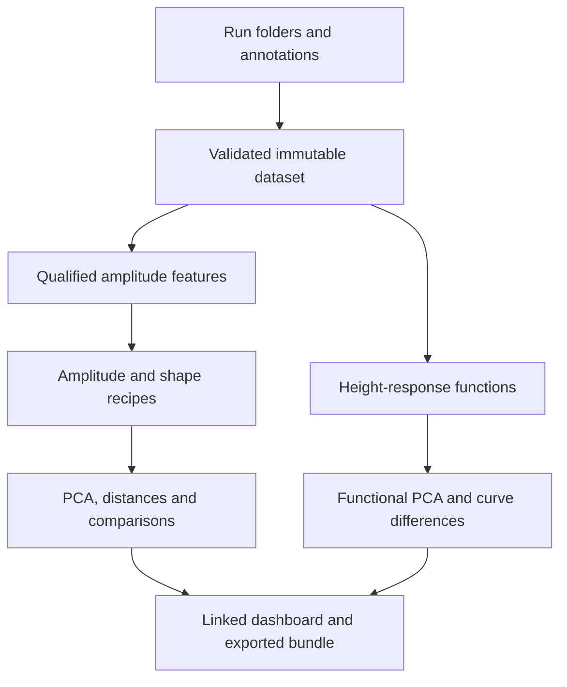

# LIO food-profile processing and visualization — implementation plan

**Document:** LIO-SW-PROFILES-001, revision 1  
**Date:** 2026-11-20  
**Status:** engineering plan prepared at the owner's request; implementation and physical qualification remain to be completed.  
**Repository baseline reviewed:** `main` at `dc7235ac46776ad1f390ed666a3d2716656401d5`.

## 1. Outcome and scope

Deliver an offline-capable food-profile workspace inside the existing dashboard. It must let the owner inspect and compare scanned foods through:

1. Signed raw and processed height-response data, with findings and provenance.
2. Fixed-height amplitude fingerprints and explicit reference-relative correction.
3. Separate amplitude and normalized-shape processing recipes.
4. Food × feature heatmaps, PCA scores/loadings, original-space distances and linked source curves.
5. Whole-height difference maps, curve summaries and discretized multivariate functional PCA.
6. Optional UMAP/t-SNE sensitivity views, grouped evaluation, designed-effects analysis, gallery browsing and compatible historical trends.
7. Versioned, portable datasets/models/reports reproducible through the CLI and the dashboard.

Implement this full scope in the milestones below. The delivery target is working numerical capabilities and user workflows, not mock controls or an implementation that stops after basic heatmaps. Scientific gates control labeling and promotion to defaults; absence of real food data must not become an excuse for leaving software methods as placeholders.

The literature establishes candidates and failure modes, not the best empirical LIO recipe. Keep that distinction in the product.

### Reading order

- `.agents/README.md`, `.agents/preferences.md`, `.agents/project-state.md`, `.agents/baselines.md`.
- `.agents/scan-data-viz-handoff.md` for context; current code wins where it differs.
- [Research review](research/LIO_FOOD_SCAN_LITERATURE_REVIEW.md) and [50-record evidence matrix](research/LIO_FOOD_SCAN_EVIDENCE.csv).
- `docs/DIAGNOSTIC_SWEEP.md`, `docs/FOOD_LIBRARY.md`.
- Code paths in §2 and the handoff in [FOOD_PROFILE_AGENT_HANDOFF.md](FOOD_PROFILE_AGENT_HANDOFF.md).

### Explicit non-goals

Do not implement chemical composition claims, ingredient unmixing, allergen/safety assurance, missing-wavelength reconstruction, blind-channel imputation, automatic peak registration, or a new cloud service. CP/PARAFAC/Tucker and learned nuisance projection remain documented research extensions, not required defaults: the literature recommends testing their assumptions before adopting them. Do not build every method mentioned in the bibliography.

Do not replace the acquisition engine, firmware, hardware interlocks, existing diagnostic physics, suite baseline system or food database. Do not migrate raw cubes to a database/Parquet merely for this feature.

## 2. Existing implementation: reuse and limits

| Existing path/API | Use / required boundary |
|---|---|
| `lio.scan.store.ScanStore` | Read multi-member gzip and manifest-indexed NPZs. Raw source of truth. |
| `lio.scan.analysis.data.Cube.open(folder)` | Reuse metadata and typed accessors. `curve()` medians duplicates and despikes; its net values are processed, not raw. |
| `lio.scan.analysis.optics` and saved `analysis.json` | Consume existing O/C/h_opt/modulation/FWHM/SNR and findings. Do not duplicate or silently rerun diagnostic analysis. |
| `lio.scan.analysis.trend` | Adapter for compact baseline snapshots and compatible diagnostic/control outputs; enforce additional compatibility/history rules before calling it. |
| `lio.scan.report` | Retain reproducible static reports; reuse visual conventions and saved summaries. |
| `lio.dashboard.server/session/scan_job` | Extend the existing local server and Scan history. Keep explorer state independent of acquisition. |
| `lio/foods/scans.py` and food-library scan records | Different single-height repeated-SWEEP schema. Link item identifiers if available; never reinterpret these records as height sweeps. |
| `lio.cli` | Add a thin, offline `profiles` command group, lazily importing the new package. |
| `software/host/pyproject.toml`, CI | Preserve Python 3.10/3.12 support, strict typing and existing checks. Add tested optional analytical dependencies and browser smoke coverage. |

Current `GET /api/scan` returns live job + saved summaries. `POST /api/load` loads `results.json` into the twin; it is not a saved cube loader. The live grid stores only `[height, net, is_P3]` and cannot reconstruct repetitions or scientific selection. Load saved rows afresh.

Current `/results/` does not serve gzip/NPZ. Read these in Python and return strict JSON. The dashboard has no general packaged-JS route; its CSP allows inline scripts but omits local external scripts. Add a narrowly scoped asset route with correct JS/CSS MIME types. Add `'self'` to both script-src and style-src while retaining existing inline allowances until those scripts/styles are deliberately migrated. Preserve Host/token checks.

Existing offline launch:

```bash
lio dashboard --results-dir /path/to/test_results --no-phone --no-tunnel
```

This existing launch still opens/creates the food-library DB in cmd_dashboard(). M1 must add a `--no-food-library` mode that passes `foods=None` through the existing optional server interface, skips intake/DB/phone/tunnel initialization and handles shutdown/printing without a library object. The new mode keeps food-profile analysis enabled. Test the actual CLI launch without any food DB. Saved exploration must not require serial connection, stage homing, a food record or a simulated hardware session.

## 3. Architecture and dependency decisions

### Package boundary

Create `software/host/src/lio/food_profiles/`. Keep numerical/domain logic independent of dashboard sessions, serial devices and HTTP. Proposed modules are responsibilities, not a demand for empty files; merge small helpers when clearer.

| Proposed module | Responsibility |
|---|---|
| `schema.py` | Versioned manifests, feature identities, validity/reason types, capabilities |
| `runs.py` | Read-only raw run/baseline adapters, step-kind join, channel-map resolution |
| `metadata.py` | Food/product/material/lot/preparation hierarchy and annotation validation |
| `features.py` | Fixed-height, O-envelope and curve-summary extraction with source links |
| `preprocessing.py` | Reference selection/correction, vector normalization, SNV, MSC, scaling/weights |
| `ordination.py` | Fitted PCA/projection, detector-specific and joint models |
| `distances.py` | Stated amplitude/shape/functional metrics and clustering |
| `functional.py` | Physical-height grids/quadrature, functional PCA and reconstruction |
| `validation.py` | Grouped splits, training-only pipeline fit, evaluation and limitations |
| `effects.py` | Identifiable designed-effects/ASCA analysis |
| `trends.py` | Compatible, chronological baseline/control views |
| `artifacts.py` | Hashing, caches, schema validation, safe model bundles and reports |
| `cli.py` | CLI adapters over the same service functions |
| `embeddings.py` | Lazy optional UMAP/t-SNE exploratory snapshots |

Dashboard adapters: `dashboard/scan_explorer.py`, `dashboard/profile_jobs.py`. Frontend: scoped files under `dashboard/static/profiles/` plus a pinned local Plotly bundle and license. Update package-data patterns for nested assets.

### Dependencies

- Base Explore/Compare/metadata/CSV loading must work with existing dependencies. Use `ScanStore.rows()`/stdlib gzip/CSV and NumPy; do not add pandas just for cube loading.
- Add a `profiles` optional extra for maintained SciPy/scikit-learn numerical tools. Use library PCA/SVD, distances, clustering and appropriate split primitives rather than writing novel statistical algorithms.
- Add an `embeddings` extra for UMAP. t-SNE uses the tested scikit-learn dependency.
- Resolve and record versions compatible with both supported Python versions. Add a reproducible constraints/environment file after testing; do not copy unverified latest-version pins into the project.
- Lazy imports and capability checks: absent optional packages disable only the affected operation, with an install instruction. Existing dashboard and scan CLI must still start.
- Persist numeric parameters, not pickled estimators. Viewing existing bundles and mathematical PCA projection should not require loading scikit-learn estimator objects.
- No frontend framework/server migration. Avoid a Node build chain in production; a small dev-only browser-test setup is acceptable.

### Processing flow



## 4. Data contracts

All formats below are **new proposed contracts**, not claims about fields currently present. Version them from 1, validate explicitly, and document migration behavior. Use stable deterministic IDs and explicit missing values. Never infer unknown physical history.

### 4.1 Read-only RunData

Required inputs: `scan.json` + `cube.csv.gz`. Optional: `analysis.json`, streams, compact baselines, profile annotations.

Retain all raw columns:
`run_id, step, phase, height_hs, height_mm, direction, rep, hole, state, detector, dark_counts, lit_counts, net_counts, net_mv, t_s, duty_wait_ms, settle_ms, n`.

Join `kind` from `scan.json.plan.steps[step]`; it is not a CSV column. Raw row identity must distinguish every reading, even duplicate values/heights. Use a source-file identity plus row index, not a value-derived ID that collapses duplicates.

Default optical selection:
`state=lit, phase=P2, direction=down, rep=0, kind=measure`.
P3/up primary is a distinct selection. Continuous-motion kind=continuous cycles/skips holes and has channel-specific height support; retain it for labeled inspection or a separate explicit compatible recipe, never default stationary-food modeling. Unknown step kinds do not silently qualify; resolve metadata or use a recorded operator override. Repeats, extra/fine points, P1/P4, coupling states and streams remain separate layers. Filter state before interpreting `rep`: CE-only uses it for rail identity.

Cross-check saved analysis run_id/sample_id/mode/status against scan metadata and available source hashes. Mismatched or stale analysis disables C/O/FWHM-dependent products while raw exploration remains usable. Legacy missing hash provenance is explicitly unverified, not proof of staleness.

Primary heatmap cells with duplicate visits use an explicitly named reducer/count and retain links to individual readings. Default scientific features must not silently pool passes/repeats.

### 4.2 Channel map and provenance

Stable feature identity starts with detector + hole, e.g. `opt101:h01`, plus feature kind/height/recipe when appropriate. Wavelength alone cannot identify white/pink or overlap-detector channels.

Current map: OPT101 signal 1–11; InGaAs signal 8,9,12–14 and weak 15; remaining pairs blind, including h16 on both. The configuration is authoritative over stale documentation tables.

Old folders contain a config hash, not a full map. Resolve an exact known config/map if possible. Otherwise show numbered raw channels and `channel_map_unverified`; do not silently borrow today's map as verified historical truth. Permit an explicitly documented operator-supplied map override in the analysis workspace.

For **future** acquisitions, add a backwards-compatible metadata snapshot: channel labels, nominal wavelength, broadband flag, detector expectations, relevant unit/gain/lead settings and map/config identity. Add analyser source/config/version provenance when analysis is explicitly generated. Do not rewrite old acquisition records on explorer load.

### 4.3 Dataset manifest and independent units

A dataset is an immutable snapshot of selected run identities/hashes plus explicit annotations and references. Build new versions when inputs/annotations change.

| Identity | Meaning |
|---|---|
| `run_id` | One acquisition |
| Existing `sample_id` | Preserve its existing instrument/food-library meaning |
| `food_label`, `product_id` | Intended comparison class/product, if known |
| `parent_material_id`, `lot_id` | Physical source and batch/package hierarchy |
| `preparation_id` | Independent cup loading/preparation |
| `repeat_type` | Same-cup, reload, repack or independent preparation, explicitly supplied |
| Acquisition day/time/order | Recorded timing; timezone retained, analysis-day policy explicit |
| Geometry/preparation fields | Cup/nest, fill depth or mass, packing, surface plane/datum, lid, temperature if known |
| Reference links | Explicit physical reference IDs and protocol |

Unknown remains null. Do not manufacture preparation IDs from date/sample_id or guess identical products from similar labels. Unannotated old runs remain explorable but cannot support grouped claims requiring missing metadata.

Rows/points represent runs. The default PCA fitting unit is **one aggregate per known preparation**, with equal preparation weight and declared reducer; individual runs are projected/displayed with their parent links. For exploratory data lacking preparation IDs, allow explicit run-level fitting labeled `independence_unknown`, with no validated generalization claim. Lot-level claims require lot-level grouping/weighting as specified by the evaluation target.

Store source manifest/cube/analysis/map/annotation hashes and exact selected references. Hash streams only when consumed. Discovery and data identity are separate: the source folder may move while the content-defined dataset remains identifiable.

### 4.4 FeatureBatch and recipe

A feature batch contains:

- Ordered row IDs plus run/preparation/material/lot IDs.
- Ordered feature IDs and units, detector/block identities and derivation.
- Numeric `X`, per-cell availability and exclusion reasons.
- Source-row/curve links and interpolation/reducer provenance.
- Metadata completeness, coverage, quality warnings and compatibility results.

Reasons distinguish at least: blind, weak/excluded, missing, saturated, nonfinite, unsupported height/gap, unverified map, incompatible reference/settings/geometry, weak denominator and insufficient analysis. JSON uses `null`, never NaN/Infinity; a null is not zero.

A recipe freezes selection, representation, height policy, channel eligibility, coupling policy, reference protocol, preprocessing, scaling/block weights, aggregation unit, interpolation/gap policy and model configuration. Use a small validated schema, not arbitrary Python expressions or an open-ended plugin execution engine.

### 4.5 Fitted pipeline and model bundle

Explicit `fit(training_batch, recipe)` and `transform(new_batch, fitted_pipeline)` APIs. The fitted state owns training-selected columns, map/feature schema, physical domain/grid, MSC reference, means/scales, block weights, PCA basis and training IDs.

Freeze the ordered fit stages: per-run extraction/reference correction → mean of qualified technical-run vectors within each preparation → rowwise vector/SNV/MSC → fitted variable/block scaling → PCA. Record aggregation membership and required coverage. MSC training reference is learned from the declared fitting units. Transforming individual runs uses the same rowwise/fitted transforms without a new group fit. A preparation score is not assumed equal to the average of run scores after nonlinear normalization. Other stage orders require a distinct explicit recipe.

Transform **never** recomputes channel intersection, means, scales, reference protocol, height selection or basis. Missing required future features produce an unprojectable row with reasons; raw inspection remains available. V1 has no silent imputation.

Bundle layout, stored outside raw acquisition folders:

```text
profile_sets/<dataset_id>/dataset.json
profile_sets/<dataset_id>/annotations.json
profile_analyses/<analysis_id>/
  manifest.json
  feature_schema.json
  features.csv.gz
  validity.json
  preprocessing.npz
  model.npz
  scores.csv
  references.json
  diagnostics.json
  report.html
```

Paths are proposed defaults under the configured results workspace and must be gitignored. Models use JSON + numeric NPZ with `allow_pickle=False`. Reject object arrays, malformed dimensions, duplicate/incompatible features and unsupported schema versions. Never load pickle/joblib supplied in a model/run directory. Persist content hashes, recipe/implementation/package versions, seeds, fitted IDs and warnings. Write through temporary directories and finalize atomically.

## 5. Numerical behavior

### 5.1 Amplitude and physical referencing

Implement three distinguishable representations:

- Raw dark-subtracted nets.
- Existing-analysis coupling-corrected nets, where C is available and applicable.
- Matched-height reference-relative response.

Do not subtract dark from `net_counts` a second time. Do not substitute select-only values for the existing C estimate.

Reference-relative candidate:
`q_j(h) = (net_sample,j(h) - C_sample,j) / (net_white,j(h) - C_white,j)`.
Require an explicit coupling policy; if reliable C is unavailable, disable that corrected recipe or provide a separately named uncorrected-net ratio recipe. Never silently fall back between the two.

Reference eligibility checks include channel map, acquisition settings, gain/timing, surface/datum/geometry compatibility, completeness and denominator quality. Thresholds are recipe/config parameters justified by control data; expose them and avoid presenting the diagnostic 100-count ratio floor as validated food QC.

Default predictive selection is a compatible reference at/before the observation. Optional retrospective bracketing is explicit and labeled. Freeze selected reference IDs in derived artifacts. A held-out day's independently acquired physical control is allowed when deployment uses that control; fitting correction/scaling from held-out food spectra is not.

Initial implementation uses explicit or prior compatible references; bracketing may select a declared before/after protocol, but must not invent an unvalidated drift interpolation. If interpolation is implemented, specify/test its arithmetic and label it experimental. Adding future references must not change an existing prior-only bundle.

Require the corrected white denominator to be finite and greater than a positive recipe minimum; a large negative denominator is invalid. Preserve signed sample numerators, valid negative ratios and ratios above one. Weak/zero/negative denominator yields unavailable, not epsilon clipping. Empty cup is not 100% white; black cup is not perfect zero. Use relative units until radiometric claims are validated.

### 5.2 Height and O envelope

Fixed-height features default to exact common measured heights. Optional interpolation is linear, inside support only, with a declared maximum-gap rule. Use physical height, not index spacing; preserve half-steps and recorded millimeters. Matching stage coordinates alone cannot establish matching food-surface distance.

O-envelope features consume existing saved per-channel O/h_opt; they are labeled per-channel maxima at possibly different geometry. Never call them a fixed-height spectrum.

If analysis is missing, raw features remain available; O/C/FWHM-dependent products are unavailable unless an **explicit** diagnostic analysis action is requested. Opening a view must not call `analyse()`.

### 5.3 Shape, scaling and blocks

Implement vector normalization, SNV and restrained MSC as real selectable transforms, with an amplitude branch retained.

- Operate on a consistent, qualified feature set; no blind normalization.
- Near-zero vector norm/profile variance/MSC slope yields unavailable with reason.
- MSC's learned reference comes from training data/control protocol only.
- Offer mean-centering and declared variable/block scaling; persist all fitted values.
- Raw detector gains differ. Do not apply one unqualified global SNV or autoscale weak noise into equal importance.
- Start with separate detector maps, then a documented joint model.
- Do not learn scales/weights from test-food data. Equal block variance is not proof of equal detector quality.

No wavelength derivative or high-order EMSC default. Height-axis smoothing, if used, records method/parameters and is compared with raw points.

### 5.4 PCA, distances and clustering

Fit maintained library PCA/SVD on the declared training/aggregation units. Persist exact preprocessing and arrays so projection/reconstruction can be performed safely without deserializing estimators.

Rank follows finite data and independent fitting units. Do not fabricate PC3 or an ellipse for insufficient rank. Repeated eigenvalues/sign flips require subspace-aware tests.

Return scores, explained variance, loadings/contributions by detector/feature, reconstruction residuals and source links. The same coordinates can be recolored by metadata; refit is explicit and creates a new version. Projecting compatible new runs must not move previous points.

Distances: amplitude Euclidean, explicitly scaled Euclidean, correlation, cosine/angle, and physical-height functional distance. Declare what amplitude information each removes. Correlation on a flat vector is unavailable. Do not estimate unrestricted high-dimensional Mahalanobis covariance from inadequate independent data.

Cluster ordering is optional. Use average/complete linkage with a compatible chosen distance; use Ward only with the required Euclidean geometry. Keep physical channel order available. Pairwise distances are not independent replicate observations.

### 5.5 Full-height functional analysis

Implement **discretized multivariate functional PCA**, not a claim to reproduce every feature of Happ–Greven's general method.

1. Freeze a training-supported common physical-height domain/grid and per-channel validity.
2. Interpolate within measured support under the gap policy; no automatic peak warping.
3. Center by fitted mean functions.
4. Multiply each centered value by `sqrt(w_height * w_channel_or_block)`, where w_height is its positive trapezoidal quadrature weight and the second factor is the explicit combined channel/block weight.
5. Fit PCA/SVD on the weighted curve representation.
6. Persist grid, weights, means and components; undo weighting when returning physical eigenfunctions/reconstruction. Return scores and channel × height contributions with the metric convention.

Down/up/repeats remain separate selections. Fine-grid samples must not increase importance just because there are more points. Boundary h_opt and incomplete FWHM retain their warnings. Display mean ± component perturbations and selected-food curve differences with raw markers.

### 5.6 Optional neighborhood embeddings

Implement UMAP and t-SNE via maintained dependencies with stored feature representation, metric, parameters, seed and library versions. Add bounded parameter/seed sensitivity runs and original-space neighborhood/distance checks. Do not optimize parameters against a “prettiest clusters” criterion.

Persist coordinates as **exploratory snapshots**. Safe frozen out-of-sample projection is required for PCA/functional PCA; it is not promised for a saved UMAP/t-SNE artifact. Return `projection_not_supported` rather than unpickle an estimator, silently refit, or place new points by an undocumented nearest-neighbor trick.

### 5.7 Grouped evaluation and designed effects

Evaluation declares target: new preparation, new parent material/lot, new day, or jointly disjoint groups. Do not silently substitute a random row split if group metadata is insufficient.

Split independent groups **before** data-dependent channel QC, height selection, learned normalization reference/scaling, feature selection and model fitting. Metadata/hardware rules fixed independently of food labels may be applied globally; training-learned rules may not.

Implement:
- Grouped holdouts/cross-validation with explicit assignments and exclusion reasons.
- Within/between-food summaries at the correct independent unit.
- An optional simple nearest-centroid classifier as a transparent discrimination benchmark, reporting grouped held-out predictions/confusion/balanced metrics. No fitted supervised score plot as proof.
- Nested selection when comparing/tuning recipes using labels; a single prespecified recipe may use grouped outer evaluation without an inner search.
- No mixing fold-specific PCA coordinates into a seemingly common fitted map.
- No universal “validated” badge. Save target, support, group counts, predictions and limitations.

ASCA: implement descriptive food/day effect decomposition and component plots for a supported crossed, replicated design on preparation-level features. Check design rank and residual degrees of freedom. A balanced two-factor implementation is a defensible initial supported design; reject unsupported/unbalanced/nested designs with a precise limitation instead of silently applying the wrong ANOVA. Never treat within-run height rows as independent ASCA samples. Any inferential permutation needs an implemented explicit exchangeability/block policy; otherwise report significance not computed.

### 5.8 Gallery and trends

Gallery indexes dataset/run manifests and optional existing food-library links; no mandatory second database. Show thumbnail, sample/product/preparation/lot identity, quality/coverage and processing version. Page/lazy-load large collections.

Trends use compatible same-sample/reference histories, chronological **prior** observations and no self-inclusion. Compact legacy snapshots omit timestamps/timezones: join original scan.json or require explicit time/order annotations. A timestamp-looking run_id alone does not establish timezone-aware as-of eligibility. Reuse existing diagnostic/control analysis through an adapter where scientifically compatible; require at least five eligible prior baselines per metric for existing controls. Display provisional limits. Show numeric history/mean/sd/current/EWMA; if reconstructing a full EWMA trajectory, match the existing algorithm and persist calculation provenance.

Different-food comparisons are descriptive. Do not apply `trend.compare()`'s hardware-fault localization/verdict to food A versus food B. Current software does not enforce all compatibility rules; the adapter must.

## 6. Product workflow and API

### Screens

**Explore:** saved run metadata/coverage → signed detector heatmaps → linked height fingerprint/channel curve → findings/electrical drawer. Raw/processed identity always visible. Repeats have a separate inspector. Dark, hum and selected NPZ trace are available lazily. Use saved burst-wise harmonic summaries; no misleading uniform FFT of stitched streams.

**Compare:** explicit A/reference and B/current; same-sample health vs different-food intent; common height/pass/representation; A/B scales locked within each detector; signed B−A, raw source curves and preparation spread. Compact baseline adapters expose O + smoothed-curve comparisons only. Unsupported raw, C/reference correction and stream operations are disabled with reasons.

**Food Map:** gallery/dataset selection → metadata completeness/recipe → food × feature heatmap, PCA/loadings and distance matrix coordinated by one selection. Food/day/lot/preparation/order/fill recoloring; linked technical repeats; known independent-unit counts. Full-height/effects/embedding/trend panels are progressively available according to data/dependencies.

Do not put mathematical implementation details in the normal operator flow. Show the decisions that matter: representation, units, height/pass, references, eligibility, fit unit, provenance and limitations. Put detailed parameters in an inspectable panel. No automatic confidence ellipses or claim of ingredient identity.

### Proposed endpoints

These are new APIs; retain existing acquisition APIs unchanged.

| Endpoint | Behavior |
|---|---|
| `GET /api/scan/explorer/runs` | Paginated saved-run summaries/capabilities |
| `GET /api/scan/explorer/run?run_id=...` | Raw/processed presentation payload and stream index; no eager NPZ load |
| `GET /api/scan/explorer/stream?run_id=...&stream_id=...` | One manifest-selected stream, timestamp gaps/rate and bounded display data |
| `GET /api/scan/explorer/baselines?sample_id=...` | Compact baseline provenance/capabilities |
| `GET /api/scan/profiles/datasets` | List persisted datasets after restart |
| `GET /api/scan/profiles/datasets/<id>` | Read dataset version/annotations/capabilities |
| `GET /api/scan/profiles/analyses` | Discover saved analysis/model bundles, with dataset/method filters |
| `GET /api/scan/profiles/analyses/<id>` | Bundle manifest, capabilities and artifact IDs for reopening |
| `POST /api/scan/profiles/datasets` | Create/version a dataset from validated selected IDs |
| `POST /api/scan/profiles/datasets/<id>/annotations` | Create an annotated dataset version |
| `POST /api/scan/profiles/jobs` | Build/fit/project/evaluate/effects/trend/report operation; returns 202 + job ID |
| `GET /api/scan/profiles/jobs/<id>` | Queued/running/complete/error/cancelled + stage/artifact IDs |
| `POST /api/scan/profiles/jobs/<id>/cancel` | Cancel analytics only |
| `GET /api/scan/profiles/artifacts/<id>` | Registered safe artifact/JSON/download |

Use run/stream/dataset/artifact IDs scoped under configured roots. Do not accept arbitrary browser filesystem paths, follow escaping symlinks, or expose a general file server. Render annotation/finding text safely. Use strict finite JSON and reason masks.

### Jobs, caches and acquisition

- One bounded analytical worker; execute heavy numerical work outside HTTP request handlers and device/session locks. Use an isolated disposable process for uninterruptible library fits, with numerical thread counts bounded; keep short parsing/client selections separate.
- Saved browsing remains available during acquisition. Queue new heavy fits until hardware is idle by default. Give acquisition priority if it starts later. Add a small shared analytical-job notification hook for suite start, scan start and relevant manual hardware operations. Cancel/requeue cooperatively where possible; terminate only the isolated analytical worker if an uninterruptible fit exceeds the cancellation grace. Mark interrupted jobs and remove temporary outputs. Never terminate the dashboard/device process or wait for a long numerical fit before acquisition/interlocks can proceed.
- Never pass serial/session/device objects into numerical jobs. Never change acquisition selection, twin, heartbeat or `_dev_lock` to browse a run.
- Cancellation must clean temporary artifacts; only complete bundles become visible. Stale responses cannot overwrite a newer selection.
- Use size/mtime for discovery cache invalidation, content hashes for reproducible derived artifacts. Keys include source/analysis/annotations/map/reference/recipe/implementation versions.
- Default fit inputs are completed, stable snapshots. Running/aborted runs remain inspectable with status. Detect file changes during reads; retry/return updating rather than accept a torn gzip snapshot.
- Do not hash/load NPZs to show a heatmap. Decimation is display-only, preserves gaps and never becomes model input.
- Do not add a new fit on every hover/slider event.

### Portable report/source contract

Default exports are self-contained for their displayed numerical views: include selected source rows/curves and row links, feature/model parameters, provenance manifests and local Plotly/CSS/JS assets. They must reopen without dashboard APIs, absolute host paths, tokens or network access. Open the exported report directly from the filesystem in browser smoke tests, not only through the dashboard: local-file ES-module imports or fetches of neighboring JSON may fail. Prefer embedded numerical payloads/classic local scripts or a fully self-contained HTML viewer. Large NPZ streams are opt-in; omitted streams are visibly unavailable. A smaller model-only export is allowed if it explicitly disables missing source views. Never make an apparently portable report that secretly fetches localhost. Safely embed/escape JSON and annotation text; validate paths if packaging/extracting an archive.

### CLI parity

Proposed commands, finalized consistently during M0:

```text
lio profiles init --results-dir ROOT --out DATASET
lio profiles annotate DATASET --run-id RUN --preparation-id PREP ...
lio profiles build DATASET --recipe RECIPE --out BUNDLE
lio profiles fit DATASET --recipe RECIPE --method pca|functional-pca|umap|tsne --out BUNDLE
lio profiles project MODEL --dataset DATASET --out BUNDLE
lio profiles compare DATASET --a A --b B --out BUNDLE
lio profiles validate DATASET --recipe RECIPE --target new-preparation|new-lot|new-day
lio profiles effects DATASET --design food_label,day --out BUNDLE
lio profiles trends DATASET --as-of TIMESTAMP --out BUNDLE
lio profiles report BUNDLE --out DIRECTORY
lio profiles verify BUNDLE
```

Every command is offline and uses the same functions as the UI. CLI paths are local operator inputs; browser APIs use scoped IDs. A missing optional dependency must identify the extra to install, not fail unrelated commands.

## 7. Milestones and acceptance

When the owner invokes the implementation handoff, proceed through the requested milestones without routine phase-by-phase approval. Commit coherent completed slices on `main`, with passing relevant checks. Scientific/hardware measurements remain explicitly pending until actually performed.

| Milestone | Deliverables | Exit evidence |
|---|---|---|
| **M0 — contracts and fixtures** | Package skeleton with useful contracts, recipes, metadata hierarchy, persisted schema examples; generated tiny synthetic run folders and capability policy | Fixtures exercise multi-member gzip, blinds, irregular heights, repeats, missing analysis, compact baselines; metadata/model schema tests pass |
| **M1 — saved Explore** | Read-only loader, run discovery, local assets/CSP/packaging, raw/processed linked heatmap/curves, findings/electrical drawer/stream selection; base CLI inspection/export and --no-food-library launch | Works without USB/food DB/results.json/analysis/NPZ; correct counts and missingness; no artifact mutation; installed-wheel offline browser smoke |
| **M2 — Compare and features** | Dataset/annotations, exact/interpolated height policy, amplitude/O/curve summaries, reference protocols, vector/SNV/MSC, A/B and feature heatmaps, exports | Display/export parity; genuine implementations of each transform; invalid references have reasons; no per-food fault verdict |
| **M3 — frozen PCA and distances** | Detector-specific/fused PCA, loadings/residuals, safe bundles, project command, distance matrix/clustering, run→source linkage | Round-trip and future projection preserve old coordinates; training state cannot change from held-out data; fitting-unit/repeat weighting correct |
| **M4 — whole-height analysis** | Physical-height difference maps, integrated distances, discretized functional PCA, eigenfunctions/reconstruction/projection | Known synthetic curve modes recovered; quadrature/refinement invariance; unsupported domains/gaps rejected; no automatic peak alignment |
| **M5 — gallery and evaluation** | Food/preparation/lot gallery; grouped splits/nested selection/nearest-centroid benchmark; evaluation artifacts and collection-protocol UI/docs | Explicit target/group support; leakage and imbalance tests; no fake independence or merged fold coordinates |
| **M6 — experimental analyses and trends** | Working optional UMAP/t-SNE sensitivity panels; supported ASCA design; chronological baseline/EWMA panels | Dependency absence handled; genuine algorithms exercised; confounded/unsupported designs refused; no self/future-history leakage |
| **M7 — integration and handoff** | Portable reports, recipes/examples, help/docs, offline installed-package tests, performance evidence, updated operator/agent docs | All automated acceptance checks pass; runnable synthetic demonstration; physical LIO validation separately listed with missing artifacts |

Each milestone ends with executable examples. Do not mark a method done because its button exists or a stub returns unavailable; unavailable is correct only when actual dependency/data prerequisites are absent and the implemented valid-input path is tested.

### Performance budgets

Record measurements on a stated development machine and a representative modest cube/dataset. Initial goals: a few-thousand-row saved run opens within a couple of seconds locally, ordinary linked selections respond in approximately 100 ms, and a small PCA dataset fits interactively. These are engineering targets to measure/tune, not claims about current performance or brittle CI wall-clock assertions. Lazy streams, cached immutable features, one numerical worker and no automatic hover-fit should suffice before adding infrastructure.

## 8. Test strategy

Add focused unit/property tests under `software/host/tests/unit/`, domain integration tests under `tests/system/` where appropriate, and a small browser smoke suite. Synthetic fixtures must be visibly labeled synthetic. They verify implementation, not food-discrimination performance.

| Test family | Required invariant |
|---|---|
| Raw fidelity | Exact CSV values/identities survive load; concatenated gzip reads; duplicates and row counts retained |
| Slice correctness | P1/P4, P3 repeats, coupling rows, extra and continuous points never leak into default stationary P2 primary features |
| Map/missingness | Blind ≠ missing ≠ excluded ≠ zero; broadband features never collapse by wavelength; unresolved map disables verified spectral interpretation |
| Read-only behavior | Hashes of scan/cube/analysis/streams unchanged after view, build, fit, project and export |
| References | Dark/C applied exactly once; zero/weak/negative denominators unavailable; chronology/compatibility enforced; future references do not change frozen prior-only features |
| Transform math | SNV positive-affine invariance where variance valid; vector-norm invariance; degenerate/negative-slope MSC handled explicitly; amplitude branch retains known amplitude differences |
| Fit/transform | Extreme held-out data cannot change training masks/reference/scales/basis; missing future features do not trigger refit/intersection |
| Weighting | Extra technical runs from one preparation do not silently change equal-preparation fit weights |
| PCA/bundles | Export/import projection within tolerance; existing scores stable under new transforms; rank/sign/degenerate subspaces handled correctly |
| Distances | Symmetric/zero diagonal where defined; shape invariances correct; flat correlation unavailable; displayed/exported matrix agrees |
| Functional analysis | Synthetic mode span and reconstruction recovered; irregular-grid/refinement weighting correct; no endpoint extrapolation |
| Grouped evaluation | No prohibited prep/parent/lot/day overlap; unknown groups refuse unsupported target; nested selection fits only training groups |
| Effects/embeddings | ASCA separates known crossed effects and rejects confounding; UMAP/t-SNE preserve IDs/finite outputs and record parameters; no “pretty clusters” test |
| Trends | Four eligible prior baselines cannot enable a five-baseline chart; five can; no self/future inclusion; existing EWMA calculation preserved |
| Safe persistence/API | Object NPZ/pickle, malformed dimensions/schema/IDs, traversal and symlink escapes rejected; strict finite JSON |
| Concurrency/cache | Saved browsing during simulated acquisition preserves progress/heartbeat; starting acquisition during a deliberately long fit preempts only the analytical worker; stale selection/jobs cannot overwrite UI; changed source/recipe invalidates cache |
| Packaging/offline | Built wheel includes nested JS/CSS/local Plotly/license; fresh install works with network disabled and optional numerical extras absent/present |

For browser smoke coverage use a dev-only maintained harness such as Playwright, with a repeatable local/CI setup. Exercise Explore→Compare→Food Map, keyboard/non-color status labels, missing-data reasons, no CDN requests, console errors and active-scan browsing. Keep dependencies/install scope separate from the Python runtime. Add a CI job rather than weakening existing checks.

Existing relevant commands, run from the indicated directories:

```bash
# repository root
ruff check .
ruff format --check .

# software/host, with the appropriate extras installed
mypy
pytest -m "unit or sim" --lio-sim --results-dir=/tmp/lio-profile-tests
```

Maintain the existing CI coverage gate and Python matrix. Add numerical-extra tests, base-install-without-extras coverage and an installed-wheel/assets smoke check. Use existing simulator/test fixtures where practical; do not run hardware/motion tests without bench authorization.

## 9. Scientific qualification and operator pilot

Software completion and physical validation are separate deliverables.

Proposed feasibility pilot: four powder foods, including a difficult pair, two independent refills/preparations per food on each of two days, interleaved order: 16 food scans plus controls. This is not a power calculation. Add stable white/PTFE, empty/black-cup diagnostic references as appropriate, a same-cup repeat and repack controls; later add independent lots/packages.

Compare minimally corrected amplitude, reference-relative amplitude, normalized shape and height-derived representations. Promote a default only with repeatability/source-feature evidence, declared held-out grouping and a documented intended task. Control references acquired under the deployment protocol may accompany a held-out day; test-food spectra may not fit correction/model parameters.

Report:
- Known independent preparations/lots/days and excluded/unknown observations.
- Within-food variability versus difficult between-food pairs.
- Whether food patterns instead follow day/order/fill/reference drift.
- Channel/height contribution and sensitivity to representation/weights.
- What was measured, what was simulated, and what remains untested.

If no real cubes are available, finish software/synthetic demonstrations and list the physical qualification as pending. Never fabricate food measurements, accuracy, calibration or successful hardware tests.

## 10. Delivery and repository rules

- Work only on `main`; no new branches, side-branch PRs, force pushes or git-config changes.
- Preserve unrelated work. Inspect current status and changes before every commit/push; never reset/clean away owner work.
- Use small coherent commits and retain passing current checks. Re-read current code if it has changed since this plan.
- No unsolicited acquisition, motion, firmware flash, dashboard restart during a live scan or alteration of diagnostic thresholds. The job-preemption hook coordinates analytics only; it is not a replacement for existing hardware safety controls.
- Raw runs, datasets/models, generated reports and real food data stay out of git by default; small explicitly synthetic fixtures/scripts and static test assets may be tracked.
- Keep scientific reference links and the evidence matrix accessible in docs. Do not require private ChatGPT links to implement the plan.
- Update `docs/README.md`, usage docs and relevant `.agents/` context after implementation, keeping plan milestones accurate.
- Final implementation report must list completed milestones/commits, checks actually run, example commands, dependency/known limits and separate physical-validation tasks.

## 11. Definition of done

The owner can launch the existing dashboard offline, open a single old/new scan, compare two runs or a capability-limited scan baseline, annotate/group food preparations, build actual amplitude/shape/curve recipes, inspect coordinated PCA/loadings/distances, project new compatible runs without refitting, inspect full-height functional components, run optional neighborhood/effects/chronological analyses with honest prerequisites, and export/reopen a versioned safe bundle.

The implementation passes the domain, integration, packaging and acquisition-regression checks. Every displayed result links to its source and processing recipe. Unsupported inputs have actionable reasons. No scientific claim rests only on colored clusters, technical repetition counts or fabricated hardware validation.


## 12. Official implementation references

Use documentation appropriate to the dependency versions actually tested; the current stable docs may require a newer Python than this repository.

- [scikit-learn PCA](https://scikit-learn.org/stable/modules/generated/sklearn.decomposition.PCA.html): fit/transform, SVD choices and returned numerical state.
- [Preprocessing and leakage pitfalls](https://scikit-learn.org/stable/common_pitfalls.html): fit transforms on training data and apply them consistently.
- [GroupKFold](https://scikit-learn.org/stable/modules/generated/sklearn.model_selection.GroupKFold.html): group separation; multi-axis day/lot exclusions need an explicit splitter beyond an assumed single group column.
- [Model persistence](https://scikit-learn.org/stable/model_persistence.html): executable pickle risks and environment compatibility; the LIO bundle intentionally stores explicit numeric transforms.
- [Plotly events](https://plotly.com/javascript/plotlyjs-events/) and [local installation](https://plotly.com/javascript/getting-started/): coordinated views without CDN dependence.
- [Playwright Python](https://playwright.dev/python/docs/intro): browser test harness compatible with the existing pytest workflow.
