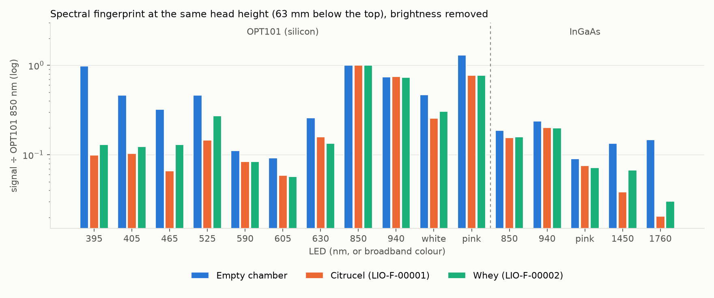
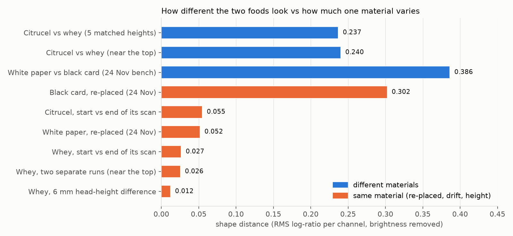

# Is there enough variance between samples to build a food dataset? (25 Nov 2026)

**Data:** empty-chamber quick scan `20261125-130035_scan_quick`, Citrucel fine scan
`20261125-141952_scan_fine` (LIO-F-00001), whey fine scan `20261125-172501_scan_fine`
(LIO-F-00002), a second whey run cancelled at 81/89 steps `20261125-160648_scan_fine`, and the
24 Nov stationary bench (white paper / black card, two placements each). Offline, read-only.
Script and numbers: `test_results/derived/variance_2026-11-25/` (`variance_analysis.py`,
`variance_results.json`, `shape_results.json`, `variance_plots.py`).

## 1. Bottom line

**Yes, for foods that differ the way Citrucel and whey do, with room to spare, provided the
dataset is collected with repeat placements and a reference each session.** After removing
overall brightness, the two foods' spectral fingerprints differ by about **0.24** (roughly 25 %
per channel). Re-running whey, scanning drift over an hour and re-placing white paper all move
the fingerprint by only **0.01–0.05**, five to twenty times less. The difference is the same at
every head height compared (0.22–0.26), and it sits in physically sensible places: blue/green
(Citrucel is orange) and the 1450 / 1760 nm SWIR channels. Two cautions limit what this proves:
there is only **one placement of each food**, so food-to-food variation within a type (lot,
packing, moisture, day) is not yet measured; and a **dark sample re-placed gave 0.30**, as much
as the whole Citrucel–whey difference, so dark foods are at real risk.

## 2. What was compared, and how

Signals rise steeply as the head nears the sample, and the three scans reached different depths
(bottom marks changed during the day: empty −286,884, Citrucel −259,552, whey −331,073
half-steps). Every comparison is therefore made **at matched head heights**, interpolated from
each scan's mean at each height, down to −259,552 (63 mm), the deepest height all three reached.

The fingerprint uses the 16 usable channels: OPT101 h1–h11 and InGaAs h8, h9, h11, h12, h15.
Left out: h13/h14 (4–7 counts, too weak), and h16 (its start/end readings jumped 0 ↔ 640, the
known intermittent joint). **Shape distance** = RMS over channels of the log ratio between two
fingerprints after removing their common factor, so it ignores overall brightness (how much
powder, how close its surface is) and measures colour/spectral shape only. 0.05 ≈ 5 % per channel.

## 3. Results

Fingerprint at 63 mm (each channel ÷ OPT101 850 nm):

| Channel | Empty | Citrucel | Whey | Whey ÷ Citrucel |
|---|---|---|---|---|
| 395 nm | 0.98 | 0.100 | 0.131 | 1.31 |
| 405 nm | 0.46 | 0.103 | 0.124 | 1.20 |
| **465 nm (blue)** | 0.32 | **0.067** | **0.131** | **1.96** |
| **525 nm (green)** | 0.46 | **0.146** | **0.273** | **1.88** |
| 590 / 605 nm | 0.11 / 0.09 | 0.084 / 0.059 | 0.084 / 0.057 | 1.00 / 0.97 |
| 630 nm (red) | 0.26 | 0.159 | 0.134 | 0.84 |
| 850 / 940 nm | 1 / 0.74 | 1 / 0.75 | 1 / 0.73 | 1 / 0.98 |
| white / pink LED | 0.47 / 1.30 | 0.256 / 0.777 | 0.307 / 0.775 | 1.20 / 1.00 |
| InGaAs 850 / 940 / pink | 0.19 / 0.24 / 0.09 | 0.155 / 0.202 / 0.076 | 0.158 / 0.200 / 0.072 | 1.02 / 0.99 / 0.95 |
| **InGaAs 1450 nm** | 0.135 | **0.038** | **0.067** | **1.75** |
| **InGaAs 1760 nm** | 0.148 | **0.021** | **0.030** | **1.47** |

| Comparison | Shape distance | What it represents |
|---|---|---|
| **Citrucel vs whey**, 5 matched heights (22–63 mm) | **0.223–0.259** (mean 0.237) | difference between the two foods |
| Citrucel vs whey, near the top (6–11 mm) | 0.227–0.250 | same, where the second whey run overlaps |
| White paper vs black card (24 Nov) | 0.386 | a large material difference, for scale |
| **Whey, two separate runs** (near the top) | **0.022–0.031** | run-to-run repeatability (likely same placement) |
| Whey, start vs end of its scan (≈ 1 h) | 0.027 | drift |
| Citrucel, start vs end of its scan | 0.055 | drift (its h5 590 nm channel was unsteady) |
| **White paper, re-placed** (24 Nov) | **0.052** | placement of a light material |
| **Black card, re-placed** (24 Nov) | **0.302** | placement of a dark material |
| Whey, 6 mm higher vs lower | 0.012 | head-height error (cf. the ≈ 2.7 mm step loss seen today) |
| Citrucel, 16 mm higher vs lower | 0.073 | larger height change |

Raw precision is not the limit: repeated visits to the same height within a scan agree to
mostly under 3 counts (worst: Citrucel 590 nm, 7 counts) on signals of 45–1,500 counts.
Brightness alone changes mostly 1.3–1.8 % per mm of head height near the bottom. That is a reason to compare shapes, not raw counts, since today's
motor step loss shifts heights by millimetres.

## 4. What this means for a full dataset

| Question | Answer from these data |
|---|---|
| Can the two foods be told apart? | Yes: 0.24 between vs ≤ 0.05 within (light materials), at every height. |
| Is the difference physical, not an artefact? | Plausibly. It is concentrated where the materials should differ: orange Citrucel absorbs blue/green; whey returns relatively more 1450/1760 nm. The NIR channels (850/940 nm, both detectors) are identical in shape, as expected for two dry powders. Not proof of chemistry. |
| How many independent "directions" of difference? | Few so far: violet–green (h1–h4, white LED), red (h7), and SWIR (h12, h15). The NIR channels move together. Roughly 3–5 useful dimensions: enough to separate food classes; thin for predicting nutrient content. |
| Smallest difference likely resolvable | About **0.10–0.15** for light-coloured foods (≈ 3× the 0.03–0.05 within-material scatter), with ≥ 3 placements per food. Similar-coloured foods with similar moisture may fall below this. |
| Dark foods? | At risk: a re-placed black card moved by 0.30. Low signal plus placement sensitivity. Needs more placements and a fixed sample geometry. |
| Is an empty-chamber scan a valid background to subtract? | **No.** The sample *covers* the reflective plate (empty reads more than Citrucel at 395 nm). Normalise to a **white reference** measured the same session instead. |

## 5. Limits of this assessment

- **One placement per food.** The second whey run was almost certainly the same placement, and
  its height coordinates were broken by the wrong bottom marks then, so it is compared near the
  top only. Within-food variation from re-filling, packing, lot, moisture and day is unmeasured.
  The 24 Nov paper/card placements are the only re-placement data, on flat sheets, not powders.
- **Different rig states between scans:** Citrucel at 500 half-steps/s with old bottom marks,
  whey at 300 with new ones; the top was re-set several times. Shape comparison absorbs most of
  this (a 6 mm height change moves the shape by 0.01), but it is not controlled.
- No white/black reference was scanned on 25 Nov, so nothing is calibrated; all of this is
  relative, valid within one rig state.
- Weak or faulty channels: h13/h14 excluded (too weak), h16 excluded (intermittent), h5 noisy
  on the Citrucel run. The left motor loses steps when lifting.

## 6. What to collect so the dataset is usable

1. **Per session:** a white reference scan (and the black card) at the start and end. Normalise
   every food to the session's white.
2. **Per food:** at least **3 independent placements** (empty, refill, re-level), ideally on 2
   days, in randomised order. Record fill mass and fill height.
3. **Fixed presentation:** same tray, same fill level, surface levelled. This is the main lever
   on within-food variation, especially for dark foods.
4. **Shorter scans:** the shape barely changes over the last 10–20 mm, so a few heights near the
   bottom, or a stationary protocol at one fixed low height, is enough. That allows more
   placements per hour than a ~1 h fine scan.
5. **Fix before scaling up:** the left motor's step loss, the h16 joint, h13/h14 aim.
6. **Analysis:** brightness-normalised log-ratio fingerprints, white-reference normalisation, and
   validation grouped by placement and day (never by reading). Start with 8–10 foods spanning
   colour, fat, protein, fibre and moisture to see how many of the 3–5 dimensions carry
   composition rather than colour.

**No calibrated reflectance, nutrient prediction, chemistry or 1850 nm claim is made.**
