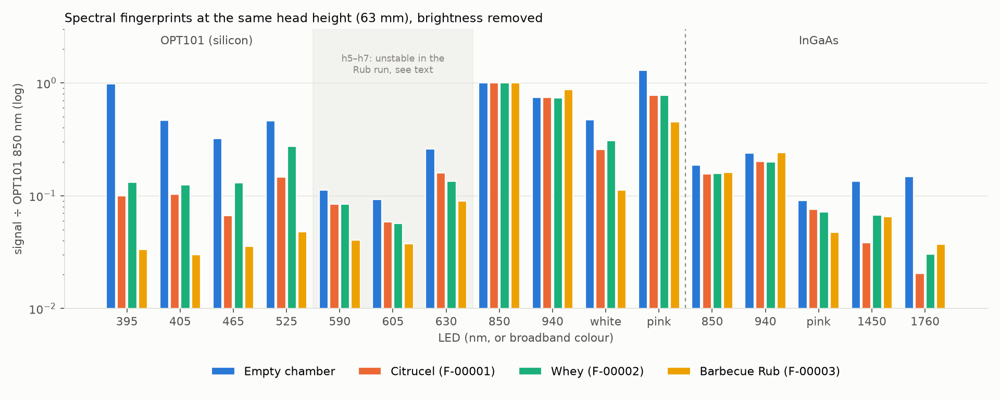
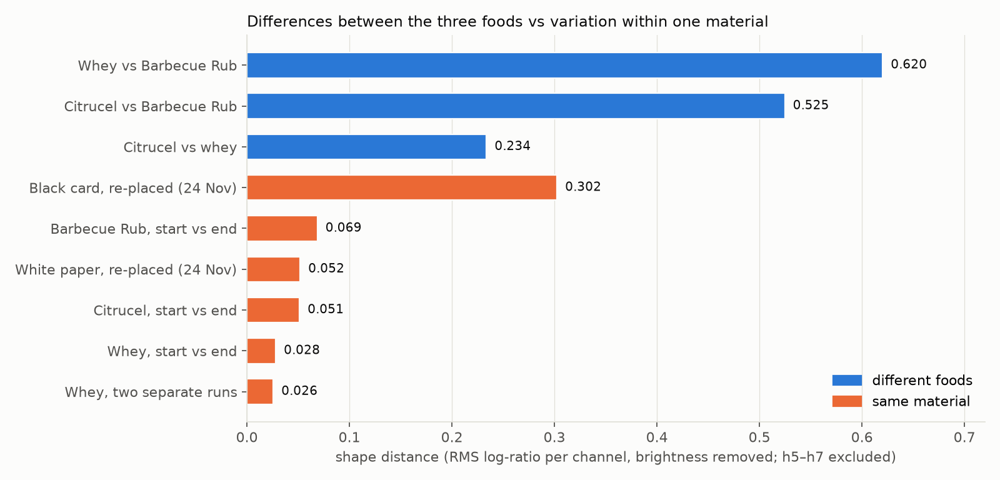
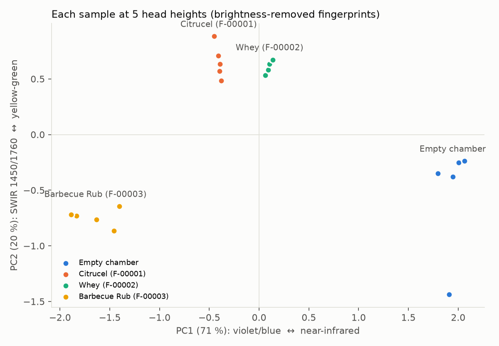

# Sample variance with three foods: Citrucel, whey, Barbecue Rub (26 Nov 2026)

Updates [the 25 Nov assessment](LIO_V3_SAMPLE_VARIANCE_ASSESSMENT_2026-11-25.md) with a third
food. **Data:** empty chamber `20261125-130035_scan_quick`; Citrucel orange (LIO-F-00001)
`20261125-141952_scan_fine`; Strawberry Banana whey protein (LIO-F-00002)
`20261125-172501_scan_fine` (+ second run `20261125-160648_scan_fine`, near the top only); The
Barbecue Rub (LIO-F-00003) `20261126-004824_scan_fine` (fine, resumed at step 0, complete);
24 Nov bench re-placements. Offline, read-only. Same method as 25 Nov: brightness-removed
fingerprints compared **at matched head heights** down to 63 mm. Code and numbers:
`test_results/derived/variance_2026-11-26/` (`variance3.py`, `results3.json`, `plots3.py`).
LIO-F-00004, scanning while this was written, is not included.

## 1. Bottom line

**All three foods are clearly distinguishable, and the margin is comfortable.** The closest pair
(Citrucel vs whey, 0.23) is 3–9× the variation seen within one material (0.03–0.07). The
Barbecue Rub, a dark spice blend, sits far from both (0.52 and 0.62). Each food's readings at five
different heights cluster tightly and well apart in a principal-component view. The third food
also **eases the dark-sample worry** from the 25 Nov report: a real dark food drifted only 0.07
over its hour-long scan, not the 0.30 the re-placed black card suggested. But it exposed a
hardware problem: **LEDs h5–h7 (590–630 nm) were unstable during the Rub run** (h6 16→65, h7
78→33 between start and end), and h7 was erratic on 25 Nov too. Those three channels are
excluded below and need fixing. The main gap is unchanged: **one placement per food**, so
variation within a food (re-fill, packing, lot, day) is still unmeasured.

## 2. Results

Fingerprint at 63 mm (each channel ÷ OPT101 850 nm):

| Channel | Empty | Citrucel | Whey | Barbecue Rub |
|---|---|---|---|---|
| 395 / 405 nm | 0.98 / 0.46 | 0.100 / 0.103 | 0.131 / 0.124 | **0.033 / 0.030** |
| 465 nm (blue) | 0.32 | 0.067 | 0.131 | **0.036** |
| 525 nm (green) | 0.46 | 0.146 | 0.273 | **0.048** |
| 630 nm (red) † | 0.26 | 0.159 | 0.134 | 0.090 |
| 850 / 940 nm | 1 / 0.74 | 1 / 0.75 | 1 / 0.73 | 1 / **0.87** |
| white / pink LED | 0.47 / 1.30 | 0.256 / 0.777 | 0.307 / 0.775 | **0.112 / 0.451** |
| InGaAs 850 / 940 | 0.19 / 0.24 | 0.155 / 0.202 | 0.158 / 0.200 | 0.162 / 0.242 |
| **InGaAs 1450 nm** | 0.135 | 0.038 | 0.067 | 0.066 |
| **InGaAs 1760 nm** | 0.148 | 0.021 | 0.030 | **0.037** |

† h5–h7 unstable in the Rub run; shown for completeness, excluded from distances.

The Rub absorbs strongly across the whole visible range (3–4× darker than Citrucel or whey
relative to 850 nm) yet is the brightest of the three at 1760 nm and matches whey at 1450 nm, so
the SWIR channels carry information that colour alone does not.

| Comparison (h5–h7 excluded) | Shape distance |
|---|---|
| Whey vs Barbecue Rub | **0.620** |
| Citrucel vs Barbecue Rub | **0.525** |
| Citrucel vs whey | **0.234** (0.237 with all channels, as on 25 Nov) |
| Black card re-placed (24 Nov, flat card) | 0.302 |
| Barbecue Rub, start vs end of its scan | 0.069 (0.430 with h5–h7) |
| White paper re-placed (24 Nov) | 0.052 |
| Citrucel, start vs end | 0.051 |
| Whey, start vs end | 0.028 |
| Whey, two separate runs | 0.026 |

Principal components of the brightness-removed fingerprints (4 samples × 5 heights): PC1
(71 %) is violet/blue against near-infrared, essentially darkness/colour; PC2 (20 %) is
SWIR 1450/1760 nm against yellow-green. Every sample forms its own tight cluster. Citrucel
spreads more with height than whey (a 6 mm height change moves Citrucel's shape by 0.059, whey's
by 0.012), so **matching the measurement height matters** more for some foods than others. With
only four samples PCA cannot show more than three independent directions, so "two components
explain 91 %" is a consequence of the small set, not a limit of the instrument.

## 3. What changed since 25 Nov

| | 25 Nov (2 foods) | 26 Nov (3 foods) |
|---|---|---|
| Smallest difference between foods | 0.24 | 0.23 (same pair) |
| Largest within-material variation, light foods | 0.05 | 0.05 |
| Dark food drift over a scan | unknown (black card re-placement 0.30) | **0.07** (Rub, h5–h7 excluded) |
| Independent information seen | blue/green + SWIR | colour/darkness axis + a separate SWIR axis |
| New hardware issue | h7 erratic | **h5–h7** unstable (h6/h7 swapped levels during the Rub run) |

## 4. Limits

- **One placement per food.** The second whey run was almost certainly the same placement. The
  within-food spread a real dataset must beat (re-fill, packing, lot, moisture, day) is unknown.
- Different rig states between scans (motor speed 500 vs 300 half-steps/s; bottom marks changed;
  the Rub run resumed after a config-only change); shape comparisons absorb most of this.
- No white reference on 25 or 26 Nov: all comparisons are relative, not calibrated.
- Channels excluded: h13/h14 (too weak), h16 (intermittent), h5–h7 (unstable in the Rub run).

## 5. Next steps

1. **Fix h5–h7** (check the 590/605/630 nm LED leads and their connections; the h6/h7 swap of
   levels points at wiring or a shared joint) and re-run the all-16 check.
2. **Replicate placements:** re-fill and re-scan each of the existing foods at least twice
   (ideally on another day). That is the one number needed to judge how fine the separation can be.
3. **White reference per session** (start and end), and a fixed fill height.
4. Keep adding foods that differ in composition but look alike (e.g. two white powders) to test
   whether the SWIR axis separates them.

**No calibrated reflectance, nutrient prediction, chemistry or 1850 nm claim is made.**
