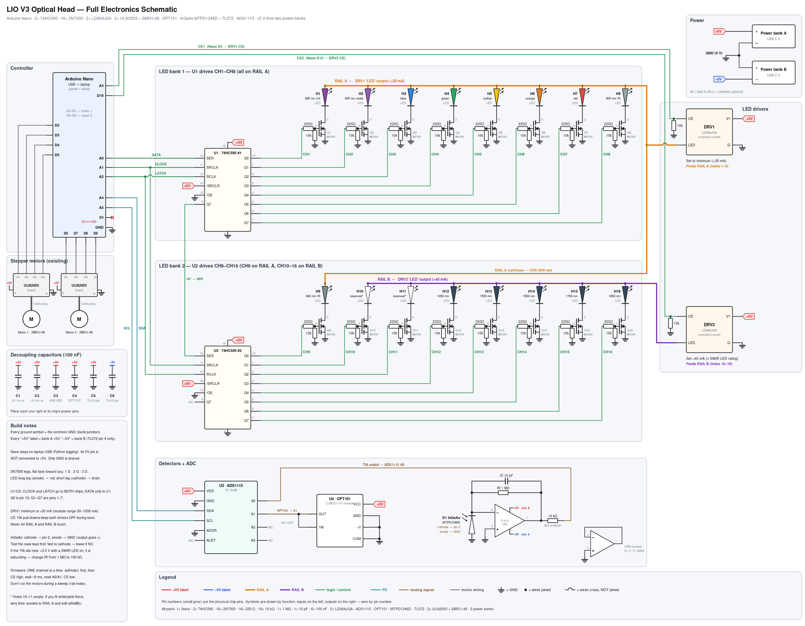

# LIO V3 — Electronics

The electronics for the LIO V3 optical head:

- 16 individually switched LEDs (395–1850 nm), lit one at a time
- two detectors: an OPT101 (silicon) and an InGaAs photodiode with a TL072 transimpedance amplifier
- a 16-bit ADS1115 ADC
- an Arduino Nano controller
- the existing stepper drive for the chamber



**Status:** development breadboard prototype (LIO-ELEC-001 Rev A, Nov 2026). It is not hardware-qualified. See §1.2 of the technical document for the open items.

## Contents

| Path | What it is |
|---|---|
| `LIO_full_schematic.svg` | Full schematic (vector, zoomable) |
| `LIO_full_schematic.html` | Schematic plus written description, pin map, channel map, net list, parts list (open in a browser) |
| `docs/LIO-ELEC-001_Electronics_Technical_Description.pdf` / `.docx` | Full technical document: design, calculations, assembly, bring-up, troubleshooting, safety |
| `WIRING_CHECKLIST.md` | Tick-list for checking every breadboard connection |
| `../docs/` | Project log, design decisions, inventory, channel map, LED sourcing, open items |
| `data/bom.csv` | Bill of materials |
| `data/netlist.csv` | Every connection, by net |
| `data/channel_map.csv` | Hole → LED → shift-register output/pin → rail → driver → detector |
| `data/nano_pinmap.csv` | Arduino Nano pin assignments |
| `source/gen_full.py` | Generates the schematic SVG/HTML (`python3 gen_full.py`, with `page_template.html` alongside) |
| `source/build_doc.js` | Generates the technical document (`node build_doc.js`, needs the npm `docx` package; images and listings are in `source/docbuild/`) |
| `../software/firmware/lio_firmware/lio_firmware.ino` | Test and sweep firmware (5 test modes) |
| `../software/logger/lio_logger.py` | Python serial logger: CSV + plot |
| `../CAD/V3/LIO_V3_dual_detector_plate_v01.scad` | Dual-detector plate (OPT101 + InGaAs) for the optical deck |

## Architecture in one paragraph

The Nano shifts a 16-bit pattern into two daisy-chained 74HC595s:

- **A0** = DATA, **A1** = CLOCK, **A2** = LATCH.

Each register output drives one 2N7000 low-side switch (220 Ω gate resistor, 10 kΩ pull-down), one switch per LED. Two LD06AJSA constant-current modules feed the LED anodes:

- **DRV1** → RAIL A, holes 1–9, ≈30 mA, enabled by **A3**.
- **DRV2** → RAIL B, holes 10–16, ≈45 mA, enabled by **D10**.

Both detectors feed an ADS1115 read over I²C. The bus runs in software on **D11 (SDA) and D12 (SCL)**, with 4.7 kΩ pull-ups to +5 V, because this Nano's hardware I²C pins (A4/A5) are damaged:

- **ADS A0** = InGaAs amplifier output, through a 10 kΩ protection resistor.
- **ADS A1** = OPT101 output.

Power is two separate 5 V USB banks in series, giving ±5 V for the TL072. The Nano runs from laptop USB with only GND shared.

## Quick start

1. Build and check the circuit in stages (technical document §12).
2. Firmware v2 needs no extra Arduino libraries (the legacy `TEST_MODE` sketch needed **Adafruit ADS1X15**).
3. Flash `lio_firmware.ino` and step `TEST_MODE` through 1 → 5:
   - 1 = I²C scan
   - 2 = live detector readings
   - 3 = walk through all channels
   - 4 = single LED, for setting driver current
   - 5 = sweep
4. Run the logger:
   ```bash
   pip install -r software/logger/requirements.txt
   python software/logger/lio_logger.py /dev/tty.usbserial-XXXX   # or COM3 on Windows
   ```
   It writes `lio_sweep.csv` (dark-subtracted volts) and `lio_sweep.png`.

## Must-know warnings

- **InGaAs orientation:** cathode → TL072 pin 2, anode → GND. The reverse drives the output negative, which can damage the ADS1115.
- **InGaAs case lead:** test it with a meter before grounding it. If it's tied to the cathode, leave it unconnected.
- **Firmware order:** only one channel on at a time. Select the MOSFET first, then raise CE.
- **DRV1 minimum current:** ≈30 mA, which is above the 20 mA rating of the 5 mm LEDs. That's fine at sweep duty cycles, but don't leave a RAIL A LED on continuously.
- **Power banks:** they must be separate units. Two ports on one bank share a ground. If bank B auto-sleeps, the −5 V rail disappears.
- **Optical safety:** 395/405 nm (near-UV) and all IR/SWIR emitters can harm the eyes, and the IR ones are invisible. Run sweeps with the chamber closed.

## Detector coverage

| Holes | λ | Read by |
|---|---|---|
| 1–7 | 395–630 nm | OPT101 |
| 8–9 | 850, 940 nm | both (cross-calibration) |
| 10–11 | reserved | — |
| 12–14 | 1450–1650 nm | InGaAs |
| 15 | 1760 nm | InGaAs (weak, at cutoff) |
| 16 | 1850 nm | none yet (needs extended InGaAs) |
