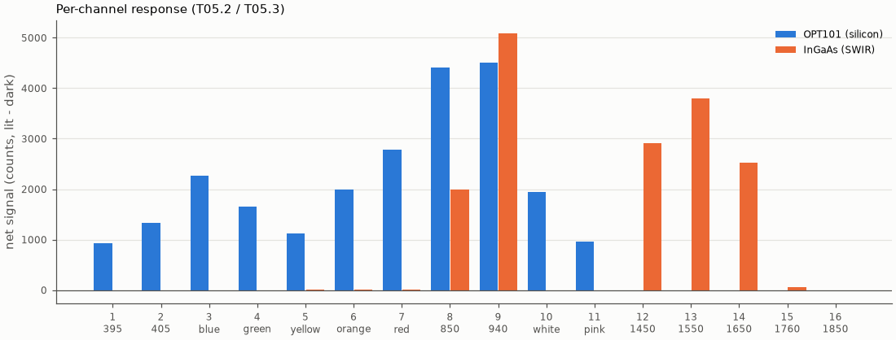
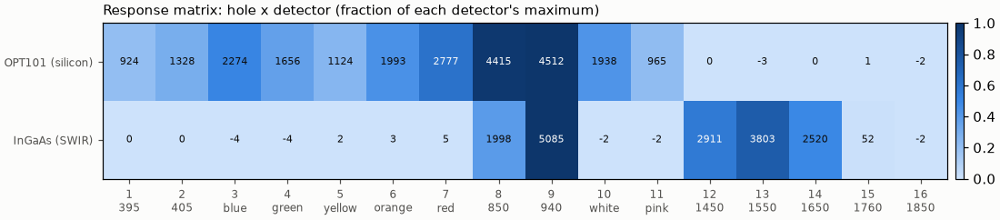
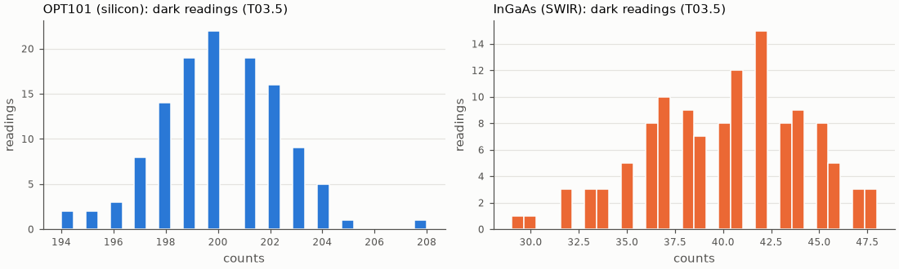
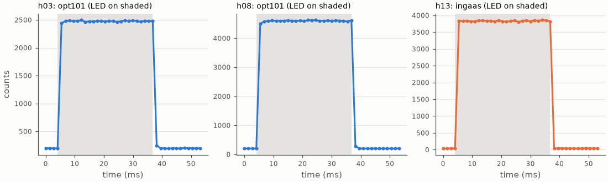
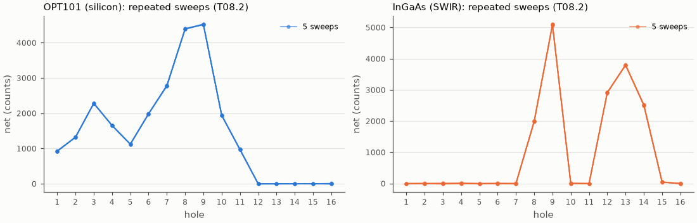

# LIO test report: 20261110-230409_sim

**Verdict: FUNCTIONAL**: no failures or warnings

- Target: `sim`
- Started 2026-11-10T23:04:09-05:00, finished 2026-11-10T23:04:42-05:00
- Sample: `none-empty-chamber`, operator: unknown
- Firmware 2.3.1 (proto 1, build 2026-11-03)
- Config `/Users/coleloughbc/Documents/VSCode-Local/LIO/software/config/lio_hw.yaml` sha256 e1d087fa7bb2 (thresholds provisional)
- Host: macOS-27.0.1-x86_64-i386-64bit, Python 3.12.11, lio 0.2.0, git 943774d465 (dirty)
- Counts: PASS 42, SKIP 3
- LED duty budget: 153.2 s of cool-down waits, 0 over-budget on-time(s)

## Summary

| Test | Name | Status | Note |
|---|---|---|---|
| T01.1 | Python and dependency versions | ✓ PASS |  |
| T01.2 | Serial port discovery | ✓ PASS |  |
| T01.3 | Configuration loads and is self-consistent | ✓ PASS |  |
| T02.1 | Port open and boot banner | ✓ PASS |  |
| T02.2 | PING round-trip latency | ✓ PASS |  |
| T02.3 | INFO fields, versions and safety limits | ✓ PASS |  |
| T02.4 | Robustness to bad input | ✓ PASS |  |
| T02.5 | Sequence numbers and interleaved events | ✓ PASS |  |
| T02.6 | RESET restores the boot state | ✓ PASS |  |
| T03.1 | I2C scan finds the ADS1115 | ✓ PASS |  |
| T03.2 | Dark ADC noise, all inputs | ✓ PASS |  |
| T03.3 | Gain sweep on dark inputs | ✓ PASS |  |
| T03.4 | ADC data rate | ✓ PASS |  |
| T03.5 | Long-term dark stability | ✓ PASS |  |
| T04.1 | Shift-register patterns with CE low | ✓ PASS |  |
| T04.2 | Shift-register loopback (optional jumper) | - SKIP | loopback jumper not fitted (this build has no loop-back input (pins.LOOP), plan §6.3); the shift registers are verified optically by T05.3 |
| T04.3 | Optical address verification | - SKIP | covered by T05.3 (each hole must light only its own expected response) |
| T04.4 | Walk test (operator) | ✓ PASS |  |
| T05.1 | Rail gating by CE1 / CE2 | ✓ PASS |  |
| T05.2 | Per-channel response | ✓ PASS |  |
| T05.3 | Channel address and isolation | ✓ PASS |  |
| T05.4 | Off-state return after each MEAS | ✓ PASS |  |
| T05.5 | Repeatability (interleaved MEAS) | ✓ PASS | not judged (net < 1000 counts or detector unusable): 1/opt101, 11/opt101, 15/ingaas |
| T05.6 | Driver current with a meter (operator) | ✓ PASS |  |
| T06.1 | OPT101 | ✓ PASS |  |
| T06.2 | InGaAs TIA | ✓ PASS |  |
| T06.3 | Cross-calibration on the shared holes | ✓ PASS |  |
| T06.4 | Ambient light sensitivity (operator) | ✓ PASS |  |
| T07.1 | Step response and settling time | ✓ PASS |  |
| T07.2 | Recommended settle time | ✓ PASS |  |
| T07.3 | MEAS timing | ✓ PASS |  |
| T08.1 | SWEEP completes with a valid schema | ✓ PASS |  |
| T08.2 | Repeated sweeps | ✓ PASS |  |
| T08.3 | Sweep agrees with MEAS | ✓ PASS |  |
| T08.4 | CSV output format | ✓ PASS |  |
| T09.1 | Motion arming | ✓ PASS |  |
| T09.2 | Each motor moves both ways | ✓ PASS |  |
| T09.3 | MOTOR STOP latency | ✓ PASS |  |
| T09.4 | Detector noise while a motor moves | ✓ PASS |  |
| T10.1 | Power-up dark state | ✓ PASS |  |
| T10.2 | On-time watchdog | ✓ PASS |  |
| T10.3 | Comms-loss failsafe | ✓ PASS |  |
| T10.4 | Single-channel invariant | ✓ PASS |  |
| T10.5 | Motion disarmed after comms loss | ✓ PASS |  |
| T11.1 | Comparison with the baseline | - SKIP | no baseline given (--baseline <file>); save one with --save-baseline |

### Per-channel response

### Response matrix

### Dark noise

### Step responses

### Repeated sweeps

## T01

### T01.1 Python and dependency versions: PASS

| Check | Status | Result | Criterion |
|---|---|---|---|
| Python version | ✓ PASS | 3.12.11 | >= 3.10 |
| pyserial installed | ✓ PASS | 3.5 | importable |
| pyyaml installed | ✓ PASS | 6.0.3 | importable |
| numpy installed | ✓ PASS | 2.5.4 | importable |
| matplotlib installed | ✓ PASS | 3.11.2 | importable |
| jinja2 installed | ✓ PASS | 3.1.6 | importable |

### T01.2 Serial port discovery: PASS

| Check | Status | Result | Criterion |
|---|---|---|---|
| Port discovery | ✓ PASS | simulator target; 3 serial port(s) on this host recorded only |  |

### T01.3 Configuration loads and is self-consistent: PASS

| Check | Status | Result | Criterion |
|---|---|---|---|
| Config validates | ✓ PASS | lio_hw.yaml sha256 e1d087fa7bb2 |  |
| 16 holes | ✓ PASS | 16 entries |  |
| Rails split A = 1-9, B = 10-16 | ✓ PASS | A=[1, 2, 3, 4, 5, 6, 7, 8, 9] B=[10, 11, 12, 13, 14, 15, 16] |  |

## T02

### T02.1 Port open and boot banner: PASS

| Check | Status | Result | Criterion |
|---|---|---|---|
| Boot banner within the timeout | ✓ PASS | 1.61 s | <= 3 s |
| Banner identifies LIO firmware | ✓ PASS | # BOOT name=lio fw=2.3.1 proto=1 build=2026-11-03 adc_ok=1 hw_wdt=0 | name=lio, fw and proto present |

### T02.2 PING round-trip latency: PASS

| Check | Status | Result | Criterion |
|---|---|---|---|
| Every PING answered | ✓ PASS | 100/100 answered | all |
| p99 round trip | ✓ PASS | median 4.31 ms, p99 4.49 ms, max 4.49 ms | p99 < 50 ms |

### T02.3 INFO fields, versions and safety limits: PASS

| Check | Status | Result | Criterion |
|---|---|---|---|
| INFO fields present | ✓ PASS | 21 fields | all protocol-1 INFO fields |
| Firmware compatible with this host package | ✓ PASS | fw 2.3.1 proto 1 | >= 2.0.0, proto 1 |
| settle_ms matches lio_hw.yaml | ✓ PASS | 8 | 8 |
| wdt_a_ms matches lio_hw.yaml | ✓ PASS | 2000 | 2000 |
| wdt_b_ms matches lio_hw.yaml | ✓ PASS | 5000 | 5000 |
| wdt_a_cap_ms matches lio_hw.yaml | ✓ PASS | 5000 | 5000 |
| wdt_b_cap_ms matches lio_hw.yaml | ✓ PASS | 10000 | 10000 |
| comms_ms matches lio_hw.yaml | ✓ PASS | 10000 | 10000 |
| arm_ms matches lio_hw.yaml | ✓ PASS | 60000 | 60000 |
| step_max matches lio_hw.yaml | ✓ PASS | 2048 | 2048 |
| jog_max matches lio_hw.yaml | ✓ PASS | 2048 | 2048 |
| jog_v_max matches lio_hw.yaml | ✓ PASS | 1000 | 1000 |
| jog_acc_max matches lio_hw.yaml | ✓ PASS | 1000 | 1000 |
| wake_ms_max matches lio_hw.yaml | ✓ PASS | 3000 | 3000 |
| ADC address matches lio_hw.yaml | ✓ PASS | 0x48 | 0x48 |
| ADC gain matches lio_hw.yaml | ✓ PASS | 1 | 1 |
| ADC rate matches lio_hw.yaml | ✓ PASS | 128 | 128 |

### T02.4 Robustness to bad input: PASS

| Check | Status | Result | Criterion |
|---|---|---|---|
| Unknown command | ✓ PASS | @140 ERR FROBNICATE code=1 msg=unknown command | ERR code=1 |
| Bad argument | ✓ PASS | @141 ERR MEAS code=2 msg=usage: MEAS <1-16> [settle_ms] [n] | ERR code=2 |
| Missing argument | ✓ PASS | @142 ERR CH code=2 msg=usage: CH <1-16> ON [ms] | ERR code=2 |
| Line over 64 characters | ✓ PASS | ERR ? code=6 msg=line too long | ERR code=6 |
| Garbage bytes, then PING | ✓ PASS | PING OK | PING still answered |

### T02.5 Sequence numbers and interleaved events: PASS

| Check | Status | Result | Criterion |
|---|---|---|---|
| @1 echoed | ✓ PASS | @1 OK PING uptime_ms=2166 | @1 OK PING |
| @4242 echoed | ✓ PASS | @4242 OK PING uptime_ms=2170 | @4242 OK PING |
| @99999 echoed | ✓ PASS | @99999 OK PING uptime_ms=2175 | @99999 OK PING |
| No @seq, none echoed | ✓ PASS | OK PING uptime_ms=2179 | OK PING |
| Response found after interleaved events | ✓ PASS | 20 '# S' events then OK | 20 events |
| Asynchronous '# OFF' does not desynchronise | ✓ PASS | 10/10 PINGs matched; 1 timer event(s) seen | all PINGs answered in order, one '# OFF' |

### T02.6 RESET restores the boot state: PASS

| Check | Status | Result | Criterion |
|---|---|---|---|
| Banner after RESET | ✓ PASS | 0.06 s | <= 3 s |
| STATUS shows the safe state | ✓ PASS | ch=0 ce1=0 ce2=0 mask=0x0000 armed=0 | ch=0 ce1=0 ce2=0 mask=0 armed=0, motors idle |
| Settings back to defaults | ✓ PASS | wdt_a_ms=2000 (was set to 200) | 2000 |

## T03

### T03.1 I2C scan finds the ADS1115: PASS

| Check | Status | Result | Criterion |
|---|---|---|---|
| ADS1115 at 0x48 | ✓ PASS | found ['0x48'] | 0x48 acknowledges |
| I2C lines (SDA, SCL) | ✓ PASS | lines idle high with pull-ups, not bridged; 0x48 answers at 400 kHz | both idle high, rise on external pull-ups, not joined |
| No unexpected I2C devices | ✓ PASS | none | only the ADS1115 |

### T03.2 Dark ADC noise, all inputs: PASS

| Check | Status | Result | Criterion |
|---|---|---|---|
| ADS A0 (ingaas) dark noise | ✓ PASS | mean 39.9, sigma 3.85 counts (n=64) | sigma <= 20 counts |
| ADS A1 (opt101) dark noise | ✓ PASS | mean 200.3, sigma 2.83 counts (n=64) | sigma <= 20 counts |
| ADS A2 (unconnected) | ✓ PASS | recorded only: mean 1681.8, sigma 66.48 | floating input |
| ADS A3 (unconnected) | ✓ PASS | recorded only: mean 2153.4, sigma 75.30 | floating input |

### T03.3 Gain sweep on dark inputs: PASS

| Check | Status | Result | Criterion |
|---|---|---|---|
| GAIN 2/3 accepted | ✓ PASS | lsb 0.1875 mV | 0.1875 mV |
| GAIN 1 accepted | ✓ PASS | lsb 0.125 mV | 0.125 mV |
| GAIN 2 accepted | ✓ PASS | lsb 0.0625 mV | 0.0625 mV |
| GAIN 4 accepted | ✓ PASS | lsb 0.03125 mV | 0.03125 mV |
| GAIN 8 accepted | ✓ PASS | lsb 0.015625 mV | 0.015625 mV |
| GAIN 16 accepted | ✓ PASS | lsb 0.0078125 mV | 0.0078125 mV |
| ingaas at GAIN 2/3 agrees with GAIN 1 | ✓ PASS | 4.98 mV vs 5.13 mV | within 6.35 mV |
| ingaas at GAIN 1 agrees with GAIN 1 | ✓ PASS | 5.13 mV vs 5.13 mV | within 6.35 mV |
| ingaas at GAIN 2 agrees with GAIN 1 | ✓ PASS | 5.12 mV vs 5.13 mV | within 6.35 mV |
| ingaas at GAIN 4 agrees with GAIN 1 | ✓ PASS | 4.69 mV vs 5.13 mV | within 6.35 mV |
| ingaas at GAIN 8 agrees with GAIN 1 | ✓ PASS | 4.95 mV vs 5.13 mV | within 6.69 mV |
| ingaas at GAIN 16 agrees with GAIN 1 | ✓ PASS | 5.11 mV vs 5.13 mV | within 6.75 mV |
| GAIN 2/3 accepted | ✓ PASS | lsb 0.1875 mV | 0.1875 mV |
| GAIN 1 accepted | ✓ PASS | lsb 0.125 mV | 0.125 mV |
| GAIN 2 accepted | ✓ PASS | lsb 0.0625 mV | 0.0625 mV |
| GAIN 4 accepted | ✓ PASS | lsb 0.03125 mV | 0.03125 mV |
| GAIN 8 accepted | ✓ PASS | lsb 0.015625 mV | 0.015625 mV |
| GAIN 16 accepted | ✓ PASS | lsb 0.0078125 mV | 0.0078125 mV |
| opt101 at GAIN 2/3 agrees with GAIN 1 | ✓ PASS | 24.98 mV vs 25.06 mV | within 6.06 mV |
| opt101 at GAIN 1 agrees with GAIN 1 | ✓ PASS | 25.06 mV vs 25.06 mV | within 6.06 mV |
| opt101 at GAIN 2 agrees with GAIN 1 | ✓ PASS | 25.13 mV vs 25.06 mV | within 6.06 mV |
| opt101 at GAIN 4 agrees with GAIN 1 | ✓ PASS | 25.10 mV vs 25.06 mV | within 6.06 mV |
| opt101 at GAIN 8 agrees with GAIN 1 | ✓ PASS | 25.11 mV vs 25.06 mV | within 6.06 mV |
| opt101 at GAIN 16 agrees with GAIN 1 | ✓ PASS | 25.09 mV vs 25.06 mV | within 6.06 mV |

### T03.4 ADC data rate: PASS

| Check | Status | Result | Criterion |
|---|---|---|---|
| 8 SPS conversion interval | ✓ PASS | 125.200 ms (nominal 125.000 ms, overhead +0.200 ms) | 106.250-145.250 ms |
| 16 SPS conversion interval | ✓ PASS | 62.700 ms (nominal 62.500 ms, overhead +0.200 ms) | 53.125-73.375 ms |
| 32 SPS conversion interval | ✓ PASS | 31.450 ms (nominal 31.250 ms, overhead +0.200 ms) | 26.562-37.438 ms |
| 64 SPS conversion interval | ✓ PASS | 15.825 ms (nominal 15.625 ms, overhead +0.200 ms) | 13.281-19.469 ms |
| 128 SPS conversion interval | ✓ PASS | 8.012 ms (nominal 7.812 ms, overhead +0.200 ms) | 6.641-10.484 ms |
| 250 SPS conversion interval | ✓ PASS | 4.200 ms (nominal 4.000 ms, overhead +0.200 ms) | 3.400-6.100 ms |
| 475 SPS conversion interval | ✓ PASS | 2.305 ms (nominal 2.105 ms, overhead +0.200 ms) | 1.789-3.921 ms |
| 860 SPS conversion interval | ✓ PASS | 1.363 ms (nominal 1.163 ms, overhead +0.200 ms) | 0.988-2.837 ms |

### T03.5 Long-term dark stability: PASS

| Check | Status | Result | Criterion |
|---|---|---|---|
| ingaas drift over 60 s | ✓ PASS | -0.1 counts/min (0.000 % FS/min), sigma 4.14 | <= 2 % FS/min |
| opt101 drift over 60 s | ✓ PASS | +0.9 counts/min (0.003 % FS/min), sigma 2.33 | <= 2 % FS/min |

## T04

### T04.1 Shift-register patterns with CE low: PASS

| Check | Status | Result | Criterion |
|---|---|---|---|
| SR RAW 0x0000 | ✓ PASS | echoed, CE low, detectors dark | mask echoed in reply and STATUS; CE1 = CE2 = 0; detectors at dark |
| SR RAW 0xFFFF | ✓ PASS | echoed, CE low, detectors dark | mask echoed in reply and STATUS; CE1 = CE2 = 0; detectors at dark |
| SR RAW 0x0001 | ✓ PASS | echoed, CE low, detectors dark | mask echoed in reply and STATUS; CE1 = CE2 = 0; detectors at dark |
| SR RAW 0x0002 | ✓ PASS | echoed, CE low, detectors dark | mask echoed in reply and STATUS; CE1 = CE2 = 0; detectors at dark |
| SR RAW 0x0004 | ✓ PASS | echoed, CE low, detectors dark | mask echoed in reply and STATUS; CE1 = CE2 = 0; detectors at dark |
| SR RAW 0x0008 | ✓ PASS | echoed, CE low, detectors dark | mask echoed in reply and STATUS; CE1 = CE2 = 0; detectors at dark |
| SR RAW 0x0010 | ✓ PASS | echoed, CE low, detectors dark | mask echoed in reply and STATUS; CE1 = CE2 = 0; detectors at dark |
| SR RAW 0x0020 | ✓ PASS | echoed, CE low, detectors dark | mask echoed in reply and STATUS; CE1 = CE2 = 0; detectors at dark |
| SR RAW 0x0040 | ✓ PASS | echoed, CE low, detectors dark | mask echoed in reply and STATUS; CE1 = CE2 = 0; detectors at dark |
| SR RAW 0x0080 | ✓ PASS | echoed, CE low, detectors dark | mask echoed in reply and STATUS; CE1 = CE2 = 0; detectors at dark |
| SR RAW 0x0100 | ✓ PASS | echoed, CE low, detectors dark | mask echoed in reply and STATUS; CE1 = CE2 = 0; detectors at dark |
| SR RAW 0x0200 | ✓ PASS | echoed, CE low, detectors dark | mask echoed in reply and STATUS; CE1 = CE2 = 0; detectors at dark |
| SR RAW 0x0400 | ✓ PASS | echoed, CE low, detectors dark | mask echoed in reply and STATUS; CE1 = CE2 = 0; detectors at dark |
| SR RAW 0x0800 | ✓ PASS | echoed, CE low, detectors dark | mask echoed in reply and STATUS; CE1 = CE2 = 0; detectors at dark |
| SR RAW 0x1000 | ✓ PASS | echoed, CE low, detectors dark | mask echoed in reply and STATUS; CE1 = CE2 = 0; detectors at dark |
| SR RAW 0x2000 | ✓ PASS | echoed, CE low, detectors dark | mask echoed in reply and STATUS; CE1 = CE2 = 0; detectors at dark |
| SR RAW 0x4000 | ✓ PASS | echoed, CE low, detectors dark | mask echoed in reply and STATUS; CE1 = CE2 = 0; detectors at dark |
| SR RAW 0x8000 | ✓ PASS | echoed, CE low, detectors dark | mask echoed in reply and STATUS; CE1 = CE2 = 0; detectors at dark |
| SR RAW 0xFFFE | ✓ PASS | echoed, CE low, detectors dark | mask echoed in reply and STATUS; CE1 = CE2 = 0; detectors at dark |
| SR RAW 0xFFFD | ✓ PASS | echoed, CE low, detectors dark | mask echoed in reply and STATUS; CE1 = CE2 = 0; detectors at dark |
| SR RAW 0xFFFB | ✓ PASS | echoed, CE low, detectors dark | mask echoed in reply and STATUS; CE1 = CE2 = 0; detectors at dark |
| SR RAW 0xFFF7 | ✓ PASS | echoed, CE low, detectors dark | mask echoed in reply and STATUS; CE1 = CE2 = 0; detectors at dark |
| SR RAW 0xFFEF | ✓ PASS | echoed, CE low, detectors dark | mask echoed in reply and STATUS; CE1 = CE2 = 0; detectors at dark |
| SR RAW 0xFFDF | ✓ PASS | echoed, CE low, detectors dark | mask echoed in reply and STATUS; CE1 = CE2 = 0; detectors at dark |
| SR RAW 0xFFBF | ✓ PASS | echoed, CE low, detectors dark | mask echoed in reply and STATUS; CE1 = CE2 = 0; detectors at dark |
| SR RAW 0xFF7F | ✓ PASS | echoed, CE low, detectors dark | mask echoed in reply and STATUS; CE1 = CE2 = 0; detectors at dark |
| SR RAW 0xFEFF | ✓ PASS | echoed, CE low, detectors dark | mask echoed in reply and STATUS; CE1 = CE2 = 0; detectors at dark |
| SR RAW 0xFDFF | ✓ PASS | echoed, CE low, detectors dark | mask echoed in reply and STATUS; CE1 = CE2 = 0; detectors at dark |
| SR RAW 0xFBFF | ✓ PASS | echoed, CE low, detectors dark | mask echoed in reply and STATUS; CE1 = CE2 = 0; detectors at dark |
| SR RAW 0xF7FF | ✓ PASS | echoed, CE low, detectors dark | mask echoed in reply and STATUS; CE1 = CE2 = 0; detectors at dark |
| SR RAW 0xEFFF | ✓ PASS | echoed, CE low, detectors dark | mask echoed in reply and STATUS; CE1 = CE2 = 0; detectors at dark |
| SR RAW 0xDFFF | ✓ PASS | echoed, CE low, detectors dark | mask echoed in reply and STATUS; CE1 = CE2 = 0; detectors at dark |
| SR RAW 0xBFFF | ✓ PASS | echoed, CE low, detectors dark | mask echoed in reply and STATUS; CE1 = CE2 = 0; detectors at dark |
| SR RAW 0x7FFF | ✓ PASS | echoed, CE low, detectors dark | mask echoed in reply and STATUS; CE1 = CE2 = 0; detectors at dark |

### T04.2 Shift-register loopback (optional jumper): SKIP

loopback jumper not fitted (this build has no loop-back input (pins.LOOP), plan §6.3); the shift registers are verified optically by T05.3

### T04.3 Optical address verification: SKIP

covered by T05.3 (each hole must light only its own expected response)

### T04.4 Walk test (operator): PASS

| Check | Status | Result | Criterion |
|---|---|---|---|
| Holes 1-11 seen by eye in order | ✓ PASS | confirmed | operator confirms the order |
| Holes 8-9 seen through the camera in order | ✓ PASS | confirmed | operator confirms the order |
| Holes 12-16 | - SKIP | n/a: SWIR emitters cannot be seen; covered optically by T05.2/T05.3 |  |

## T05

### T05.1 Rail gating by CE1 / CE2: PASS

| Check | Status | Result | Criterion |
|---|---|---|---|
| Hole 8 selected, CE1 low | ✓ PASS | opt101 202 (dark 200) | dark |
| Hole 8 selected, CE1 high | ✓ PASS | opt101 4597 | light above the detection threshold |
| Hole 8 with CE2 (wrong rail) | ✓ PASS | ERR code=3 needs exactly one selected hole on this rail | refused (code 3) |
| Hole 12 selected, CE2 low | ✓ PASS | ingaas 38 (dark 40) | dark |
| Hole 12 selected, CE2 high | ✓ PASS | ingaas 2952 | light above the detection threshold |
| Hole 12 with CE1 (wrong rail) | ✓ PASS | ERR code=3 needs exactly one selected hole on this rail | refused (code 3) |

### T05.2 Per-channel response: PASS

| Check | Status | Result | Criterion |
|---|---|---|---|
| Hole 1 (395) on ingaas | ✓ PASS | net +0 (none); no signal, as expected | expect none: signal >= 50 |
| Hole 1 (395) on opt101 | ✓ PASS | net +924 (signal); signal as expected | expect signal: signal >= 50 |
| Hole 2 (405) on ingaas | ✓ PASS | net +0 (none); no signal, as expected | expect none: signal >= 50 |
| Hole 2 (405) on opt101 | ✓ PASS | net +1328 (signal); signal as expected | expect signal: signal >= 50 |
| Hole 3 (blue) on ingaas | ✓ PASS | net -4 (none); no signal, as expected | expect none: signal >= 50 |
| Hole 3 (blue) on opt101 | ✓ PASS | net +2274 (signal); signal as expected | expect signal: signal >= 50 |
| Hole 4 (green) on ingaas | ✓ PASS | net -4 (none); no signal, as expected | expect none: signal >= 50 |
| Hole 4 (green) on opt101 | ✓ PASS | net +1656 (signal); signal as expected | expect signal: signal >= 50 |
| Hole 5 (yellow) on ingaas | ✓ PASS | net +2 (none); no signal, as expected | expect none: signal >= 50 |
| Hole 5 (yellow) on opt101 | ✓ PASS | net +1124 (signal); signal as expected | expect signal: signal >= 50 |
| Hole 6 (orange) on ingaas | ✓ PASS | net +3 (none); no signal, as expected | expect none: signal >= 50 |
| Hole 6 (orange) on opt101 | ✓ PASS | net +1993 (signal); signal as expected | expect signal: signal >= 50 |
| Hole 7 (red) on ingaas | ✓ PASS | net +5 (none); no signal, as expected | expect none: signal >= 50 |
| Hole 7 (red) on opt101 | ✓ PASS | net +2777 (signal); signal as expected | expect signal: signal >= 50 |
| Hole 8 (850) on ingaas | ✓ PASS | net +1998 (signal); signal as expected | expect signal: signal >= 50 |
| Hole 8 (850) on opt101 | ✓ PASS | net +4415 (signal); signal as expected | expect signal: signal >= 50 |
| Hole 9 (940) on ingaas | ✓ PASS | net +5085 (signal); signal as expected | expect signal: signal >= 50 |
| Hole 9 (940) on opt101 | ✓ PASS | net +4512 (signal); signal as expected | expect signal: signal >= 50 |
| Hole 10 (white) on ingaas | ✓ PASS | net -2 (none); no signal, as expected | expect none: signal >= 50 |
| Hole 10 (white) on opt101 | ✓ PASS | net +1938 (signal); signal as expected | expect signal: signal >= 50 |
| Hole 11 (pink) on ingaas | ✓ PASS | net -2 (none); no signal, as expected | expect none: signal >= 50 |
| Hole 11 (pink) on opt101 | ✓ PASS | net +965 (signal); signal as expected | expect signal: signal >= 50 |
| Hole 12 (1450) on ingaas | ✓ PASS | net +2911 (signal); signal as expected | expect signal: signal >= 50 |
| Hole 12 (1450) on opt101 | ✓ PASS | net +0 (none); no signal, as expected | expect none: signal >= 50 |
| Hole 13 (1550) on ingaas | ✓ PASS | net +3803 (signal); signal as expected | expect signal: signal >= 50 |
| Hole 13 (1550) on opt101 | ✓ PASS | net -3 (none); no signal, as expected | expect none: signal >= 50 |
| Hole 14 (1650) on ingaas | ✓ PASS | net +2520 (signal); signal as expected | expect signal: signal >= 50 |
| Hole 14 (1650) on opt101 | ✓ PASS | net +0 (none); no signal, as expected | expect none: signal >= 50 |
| Hole 15 (1760) on ingaas | ✓ PASS | net +52 (signal); signal (weak expected) | expect weak: signal >= 50 |
| Hole 15 (1760) on opt101 | ✓ PASS | net +1 (none); no signal, as expected | expect none: signal >= 50 |
| Hole 16 (1850) on ingaas | ✓ PASS | net -2 (none); no signal, as expected | expect none: signal >= 50 |
| Hole 16 (1850) on opt101 | ✓ PASS | net -2 (none); no signal, as expected | expect none: signal >= 50 |

### T05.3 Channel address and isolation: PASS

| Check | Status | Result | Criterion |
|---|---|---|---|
| Hole 1 (395) detector pattern | ✓ PASS | seen by ['opt101'] as expected | expected ['opt101'] |
| Hole 2 (405) detector pattern | ✓ PASS | seen by ['opt101'] as expected | expected ['opt101'] |
| Hole 3 (blue) detector pattern | ✓ PASS | seen by ['opt101'] as expected | expected ['opt101'] |
| Hole 4 (green) detector pattern | ✓ PASS | seen by ['opt101'] as expected | expected ['opt101'] |
| Hole 5 (yellow) detector pattern | ✓ PASS | seen by ['opt101'] as expected | expected ['opt101'] |
| Hole 6 (orange) detector pattern | ✓ PASS | seen by ['opt101'] as expected | expected ['opt101'] |
| Hole 7 (red) detector pattern | ✓ PASS | seen by ['opt101'] as expected | expected ['opt101'] |
| Hole 8 (850) detector pattern | ✓ PASS | seen by ['ingaas', 'opt101'] as expected | expected ['ingaas', 'opt101'] |
| Hole 9 (940) detector pattern | ✓ PASS | seen by ['ingaas', 'opt101'] as expected | expected ['ingaas', 'opt101'] |
| Hole 10 (white) detector pattern | ✓ PASS | seen by ['opt101'] as expected | expected ['opt101'] |
| Hole 11 (pink) detector pattern | ✓ PASS | seen by ['opt101'] as expected | expected ['opt101'] |
| Hole 12 (1450) detector pattern | ✓ PASS | seen by ['ingaas'] as expected | expected ['ingaas'] |
| Hole 13 (1550) detector pattern | ✓ PASS | seen by ['ingaas'] as expected | expected ['ingaas'] |
| Hole 14 (1650) detector pattern | ✓ PASS | seen by ['ingaas'] as expected | expected ['ingaas'] |
| Hole 15 (1760) detector pattern | ✓ PASS | seen by ['ingaas'] as expected | expected ['ingaas'] |
| Hole 16 (1850) detector pattern | ✓ PASS | seen by nothing as expected | expected none |
| Signatures unique | ✓ PASS | no two channels look the same | cosine < 0.98 or amplitude differs by more than 1 % |

### T05.4 Off-state return after each MEAS: PASS

| Check | Status | Result | Criterion |
|---|---|---|---|
| Hole 1 ingaas back to dark | ✓ PASS | 42.2 after OFF vs dark 44 | within 5 sigma (13.6 counts) |
| Hole 1 opt101 back to dark | ✓ PASS | 202.8 after OFF vs dark 199 | within 5 sigma (10.0 counts) |
| Hole 2 ingaas back to dark | ✓ PASS | 37.5 after OFF vs dark 41 | within 5 sigma (13.6 counts) |
| Hole 2 opt101 back to dark | ✓ PASS | 200.5 after OFF vs dark 198 | within 5 sigma (10.0 counts) |
| Hole 3 ingaas back to dark | ✓ PASS | 43.2 after OFF vs dark 42 | within 5 sigma (13.6 counts) |
| Hole 3 opt101 back to dark | ✓ PASS | 198.8 after OFF vs dark 202 | within 5 sigma (10.0 counts) |
| Hole 4 ingaas back to dark | ✓ PASS | 40.0 after OFF vs dark 39 | within 5 sigma (13.6 counts) |
| Hole 4 opt101 back to dark | ✓ PASS | 199.0 after OFF vs dark 202 | within 5 sigma (10.0 counts) |
| Hole 5 ingaas back to dark | ✓ PASS | 36.2 after OFF vs dark 38 | within 5 sigma (13.6 counts) |
| Hole 5 opt101 back to dark | ✓ PASS | 200.0 after OFF vs dark 200 | within 5 sigma (10.0 counts) |
| Hole 6 ingaas back to dark | ✓ PASS | 39.2 after OFF vs dark 38 | within 5 sigma (13.6 counts) |
| Hole 6 opt101 back to dark | ✓ PASS | 198.5 after OFF vs dark 201 | within 5 sigma (10.0 counts) |
| Hole 7 ingaas back to dark | ✓ PASS | 39.5 after OFF vs dark 37 | within 5 sigma (13.6 counts) |
| Hole 7 opt101 back to dark | ✓ PASS | 198.8 after OFF vs dark 200 | within 5 sigma (10.0 counts) |
| Hole 8 ingaas back to dark | ✓ PASS | 36.5 after OFF vs dark 40 | within 5 sigma (13.6 counts) |
| Hole 8 opt101 back to dark | ✓ PASS | 200.8 after OFF vs dark 201 | within 5 sigma (10.0 counts) |
| Hole 9 ingaas back to dark | ✓ PASS | 42.0 after OFF vs dark 39 | within 5 sigma (13.6 counts) |
| Hole 9 opt101 back to dark | ✓ PASS | 198.8 after OFF vs dark 202 | within 5 sigma (10.0 counts) |
| Hole 10 ingaas back to dark | ✓ PASS | 41.0 after OFF vs dark 41 | within 5 sigma (13.6 counts) |
| Hole 10 opt101 back to dark | ✓ PASS | 199.5 after OFF vs dark 202 | within 5 sigma (10.0 counts) |
| Hole 11 ingaas back to dark | ✓ PASS | 41.8 after OFF vs dark 41 | within 5 sigma (13.6 counts) |
| Hole 11 opt101 back to dark | ✓ PASS | 200.0 after OFF vs dark 202 | within 5 sigma (10.0 counts) |
| Hole 12 ingaas back to dark | ✓ PASS | 43.8 after OFF vs dark 40 | within 5 sigma (13.6 counts) |
| Hole 12 opt101 back to dark | ✓ PASS | 201.5 after OFF vs dark 199 | within 5 sigma (10.0 counts) |
| Hole 13 ingaas back to dark | ✓ PASS | 36.8 after OFF vs dark 38 | within 5 sigma (13.6 counts) |
| Hole 13 opt101 back to dark | ✓ PASS | 199.0 after OFF vs dark 201 | within 5 sigma (10.0 counts) |
| Hole 14 ingaas back to dark | ✓ PASS | 40.2 after OFF vs dark 40 | within 5 sigma (13.6 counts) |
| Hole 14 opt101 back to dark | ✓ PASS | 198.5 after OFF vs dark 199 | within 5 sigma (10.0 counts) |
| Hole 15 ingaas back to dark | ✓ PASS | 36.0 after OFF vs dark 39 | within 5 sigma (13.6 counts) |
| Hole 15 opt101 back to dark | ✓ PASS | 199.5 after OFF vs dark 199 | within 5 sigma (10.0 counts) |
| Hole 16 ingaas back to dark | ✓ PASS | 39.5 after OFF vs dark 41 | within 5 sigma (13.6 counts) |
| Hole 16 opt101 back to dark | ✓ PASS | 200.2 after OFF vs dark 202 | within 5 sigma (10.0 counts) |

### T05.5 Repeatability (interleaved MEAS): PASS

not judged (net < 1000 counts or detector unusable): 1/opt101, 11/opt101, 15/ingaas

| Check | Status | Result | Criterion |
|---|---|---|---|
| Hole 2 opt101 CV over 10 | ✓ PASS | mean 1324, CV 0.20 % | CV <= 2 % |
| Hole 3 opt101 CV over 10 | ✓ PASS | mean 2280, CV 0.19 % | CV <= 2 % |
| Hole 4 opt101 CV over 10 | ✓ PASS | mean 1656, CV 0.26 % | CV <= 2 % |
| Hole 5 opt101 CV over 10 | ✓ PASS | mean 1126, CV 0.33 % | CV <= 2 % |
| Hole 6 opt101 CV over 10 | ✓ PASS | mean 1986, CV 0.11 % | CV <= 2 % |
| Hole 7 opt101 CV over 10 | ✓ PASS | mean 2776, CV 0.09 % | CV <= 2 % |
| Hole 8 opt101 CV over 10 | ✓ PASS | mean 4401, CV 0.16 % | CV <= 2 % |
| Hole 8 ingaas CV over 10 | ✓ PASS | mean 2000, CV 0.20 % | CV <= 2 % |
| Hole 9 opt101 CV over 10 | ✓ PASS | mean 4511, CV 0.13 % | CV <= 2 % |
| Hole 9 ingaas CV over 10 | ✓ PASS | mean 5085, CV 0.25 % | CV <= 2 % |
| Hole 10 opt101 CV over 10 | ✓ PASS | mean 1943, CV 0.21 % | CV <= 2 % |
| Hole 12 ingaas CV over 10 | ✓ PASS | mean 2911, CV 0.19 % | CV <= 2 % |
| Hole 13 ingaas CV over 10 | ✓ PASS | mean 3800, CV 0.11 % | CV <= 2 % |
| Hole 14 ingaas CV over 10 | ✓ PASS | mean 2523, CV 0.17 % | CV <= 2 % |

### T05.6 Driver current with a meter (operator): PASS

| Check | Status | Result | Criterion |
|---|---|---|---|
| RAIL A driver current (hole 8) | ✓ PASS | 30 mA vs nominal 30 mA (0 % off) | within 15 % (WARN to 30 %) |
| RAIL B driver current (hole 12) | ✓ PASS | 45 mA vs nominal 45 mA (0 % off) | within 15 % (WARN to 30 %) |

## T06

### T06.1 OPT101: PASS

| Check | Status | Result | Criterion |
|---|---|---|---|
| opt101 dark offset | ✓ PASS | 200.3 counts | 0 to 800 counts |
| Responds to hole 1 (395) | ✓ PASS | net +924 | no zeros where light is expected |
| Responds to hole 2 (405) | ✓ PASS | net +1328 | no zeros where light is expected |
| Responds to hole 3 (blue) | ✓ PASS | net +2274 | no zeros where light is expected |
| Responds to hole 4 (green) | ✓ PASS | net +1656 | no zeros where light is expected |
| Responds to hole 5 (yellow) | ✓ PASS | net +1124 | no zeros where light is expected |
| Responds to hole 6 (orange) | ✓ PASS | net +1993 | no zeros where light is expected |
| Responds to hole 7 (red) | ✓ PASS | net +2777 | no zeros where light is expected |
| Responds to hole 10 (white) | ✓ PASS | net +1938 | no zeros where light is expected |
| Responds to hole 11 (pink) | ✓ PASS | net +965 | no zeros where light is expected |
| Not saturated | ✓ PASS | peak 4714 | < 29000 counts |

### T06.2 InGaAs TIA: PASS

| Check | Status | Result | Criterion |
|---|---|---|---|
| Dark signal steady | ✓ PASS | dark mean 40, sigma 3.9 | sigma <= 100 and mean >= -1500 |
| ingaas dark offset | ✓ PASS | 39.9 counts | -100 to 2000 counts |
| Polarity gate (hole 8) | ✓ PASS | net +1999 | net >= -5 sigma |
| Hole 9 InGaAs polarity | ✓ PASS | net +5085 | net not negative |
| Hole 12 InGaAs polarity | ✓ PASS | net +2911 | net not negative |
| Hole 13 InGaAs polarity | ✓ PASS | net +3803 | net not negative |
| Hole 14 InGaAs polarity | ✓ PASS | net +2520 | net not negative |
| InGaAs not saturated | ✓ PASS | no hole saturates | < 27000 counts |

### T06.3 Cross-calibration on the shared holes: PASS

| Check | Status | Result | Criterion |
|---|---|---|---|
| Hole 8 seen by both detectors | ✓ PASS | InGaAs/OPT101 = 0.453 | both above the detection threshold |
| Hole 9 seen by both detectors | ✓ PASS | InGaAs/OPT101 = 1.127 | both above the detection threshold |

### T06.4 Ambient light sensitivity (operator): PASS

| Check | Status | Result | Criterion |
|---|---|---|---|
| ingaas change with the lid open | ✓ PASS | recorded: +301 counts (39 -> 340) | recorded only (quantifies light-tightness) |
| ingaas back to dark after closing | ✓ PASS | 40 vs dark 40 | dark +- k sigma |
| opt101 change with the lid open | ✓ PASS | recorded: +1500 counts (200 -> 1700) | recorded only (quantifies light-tightness) |
| opt101 back to dark after closing | ✓ PASS | 200 vs dark 200 | dark +- k sigma |

## T07

### T07.1 Step response and settling time: PASS

| Check | Status | Result | Criterion |
|---|---|---|---|
| Hole 3 (opt101) step response | ✓ PASS | settled within a few samples: t99 <= 2.04 ms (upper bound, limited by the sample interval) | time to 99 % recorded |
| Hole 8 (opt101) step response | ✓ PASS | settled within a few samples: t99 <= 2.04 ms (upper bound, limited by the sample interval) | time to 99 % recorded |
| Hole 13 (ingaas) step response | ✓ PASS | settled within one sample: t99 <= 0.68 ms (upper bound, limited by the sample interval) | time to 99 % recorded |

### T07.2 Recommended settle time: PASS

| Check | Status | Result | Criterion |
|---|---|---|---|
| Configured settle_ms is long enough | ✓ PASS | recommended 4 ms (max 2.04 ms x 1.5), configured 8 ms | recommended <= 8 ms |

### T07.3 MEAS timing: PASS

| Check | Status | Result | Criterion |
|---|---|---|---|
| MEAS 3 8 1 on-time | ✓ PASS | t_on_ms 24 | 21.3-32.0 ms and <= watchdog 2000 ms |
| MEAS 3 20 4 on-time | ✓ PASS | t_on_ms 84 | 73.1-106.9 ms and <= watchdog 2000 ms |

## T08

### T08.1 SWEEP completes with a valid schema: PASS

| Check | Status | Result | Criterion |
|---|---|---|---|
| 16 records, holes 1-16 in order | ✓ PASS | 16 records: [1, 2, 3, 4, 5, 6, 7, 8, 9, 10, 11, 12, 13, 14, 15, 16] | holes 1..16 |
| Sweep records parse | ✓ PASS | all '# M' fields present and integer |  |
| Sweep duration | ✓ PASS | 769 ms (host 781 ms) | <= 2.5 s |

### T08.2 Repeated sweeps: PASS

| Check | Status | Result | Criterion |
|---|---|---|---|
| Hole 2 opt101 sweep-to-sweep CV | ✓ PASS | mean 1321, CV 0.49 % | CV <= 2 % |
| Hole 3 opt101 sweep-to-sweep CV | ✓ PASS | mean 2281, CV 0.24 % | CV <= 2 % |
| Hole 4 opt101 sweep-to-sweep CV | ✓ PASS | mean 1654, CV 0.13 % | CV <= 2 % |
| Hole 5 opt101 sweep-to-sweep CV | ✓ PASS | mean 1123, CV 0.32 % | CV <= 2 % |
| Hole 6 opt101 sweep-to-sweep CV | ✓ PASS | mean 1984, CV 0.16 % | CV <= 2 % |
| Hole 7 opt101 sweep-to-sweep CV | ✓ PASS | mean 2780, CV 0.32 % | CV <= 2 % |
| Hole 8 opt101 sweep-to-sweep CV | ✓ PASS | mean 4392, CV 0.17 % | CV <= 2 % |
| Hole 8 ingaas sweep-to-sweep CV | ✓ PASS | mean 1995, CV 0.36 % | CV <= 2 % |
| Hole 9 opt101 sweep-to-sweep CV | ✓ PASS | mean 4518, CV 0.19 % | CV <= 2 % |
| Hole 9 ingaas sweep-to-sweep CV | ✓ PASS | mean 5091, CV 0.27 % | CV <= 2 % |
| Hole 10 opt101 sweep-to-sweep CV | ✓ PASS | mean 1942, CV 0.30 % | CV <= 2 % |
| Hole 12 ingaas sweep-to-sweep CV | ✓ PASS | mean 2913, CV 0.21 % | CV <= 2 % |
| Hole 13 ingaas sweep-to-sweep CV | ✓ PASS | mean 3797, CV 0.22 % | CV <= 2 % |
| Hole 14 ingaas sweep-to-sweep CV | ✓ PASS | mean 2513, CV 0.45 % | CV <= 2 % |
| ingaas dark stable between sweeps | ✓ PASS | per-sweep dark means span 2.44 counts | <= 4.81 counts |
| opt101 dark stable between sweeps | ✓ PASS | per-sweep dark means span 0.50 counts | <= 3.54 counts |

### T08.3 Sweep agrees with MEAS: PASS

| Check | Status | Result | Criterion |
|---|---|---|---|
| Hole 1 opt101 sweep vs MEAS | ✓ PASS | sweep 926 vs MEAS 924 (0.2 %) | within 92 counts (max of 10 %, 5 sigma) |
| Hole 2 opt101 sweep vs MEAS | ✓ PASS | sweep 1321 vs MEAS 1328 (0.5 %) | within 133 counts (max of 10 %, 5 sigma) |
| Hole 3 opt101 sweep vs MEAS | ✓ PASS | sweep 2281 vs MEAS 2274 (0.3 %) | within 227 counts (max of 10 %, 5 sigma) |
| Hole 4 opt101 sweep vs MEAS | ✓ PASS | sweep 1654 vs MEAS 1656 (0.1 %) | within 166 counts (max of 10 %, 5 sigma) |
| Hole 5 opt101 sweep vs MEAS | ✓ PASS | sweep 1123 vs MEAS 1124 (0.1 %) | within 112 counts (max of 10 %, 5 sigma) |
| Hole 6 opt101 sweep vs MEAS | ✓ PASS | sweep 1984 vs MEAS 1993 (0.5 %) | within 199 counts (max of 10 %, 5 sigma) |
| Hole 7 opt101 sweep vs MEAS | ✓ PASS | sweep 2780 vs MEAS 2777 (0.1 %) | within 278 counts (max of 10 %, 5 sigma) |
| Hole 8 opt101 sweep vs MEAS | ✓ PASS | sweep 4392 vs MEAS 4415 (0.5 %) | within 442 counts (max of 10 %, 5 sigma) |
| Hole 8 ingaas sweep vs MEAS | ✓ PASS | sweep 1995 vs MEAS 1998 (0.2 %) | within 200 counts (max of 10 %, 5 sigma) |
| Hole 9 opt101 sweep vs MEAS | ✓ PASS | sweep 4518 vs MEAS 4512 (0.1 %) | within 451 counts (max of 10 %, 5 sigma) |
| Hole 9 ingaas sweep vs MEAS | ✓ PASS | sweep 5091 vs MEAS 5085 (0.1 %) | within 508 counts (max of 10 %, 5 sigma) |
| Hole 10 opt101 sweep vs MEAS | ✓ PASS | sweep 1942 vs MEAS 1938 (0.2 %) | within 194 counts (max of 10 %, 5 sigma) |
| Hole 11 opt101 sweep vs MEAS | ✓ PASS | sweep 973 vs MEAS 965 (0.8 %) | within 96 counts (max of 10 %, 5 sigma) |
| Hole 12 ingaas sweep vs MEAS | ✓ PASS | sweep 2913 vs MEAS 2911 (0.1 %) | within 291 counts (max of 10 %, 5 sigma) |
| Hole 13 ingaas sweep vs MEAS | ✓ PASS | sweep 3797 vs MEAS 3803 (0.2 %) | within 380 counts (max of 10 %, 5 sigma) |
| Hole 14 ingaas sweep vs MEAS | ✓ PASS | sweep 2513 vs MEAS 2520 (0.3 %) | within 252 counts (max of 10 %, 5 sigma) |
| Hole 15 ingaas sweep vs MEAS | ✓ PASS | sweep 46 vs MEAS 52 (11.5 %) | within 18 counts (max of 10 %, 5 sigma) |

### T08.4 CSV output format: PASS

| Check | Status | Result | Criterion |
|---|---|---|---|
| Header | ✓ PASS | hole,label,dark_ingaas,dark_opt101,ingaas,opt101,net_ingaas_V,net_opt101_V | hole,label,dark_ingaas,dark_opt101,ingaas,opt101,net_ingaas_V,net_opt101_V |
| One CRLF-terminated row per hole | ✓ PASS | 16 rows | 16 rows, CRLF |
| Rows byte-identical to the original logger's format | ✓ PASS | all rows identical | same columns, rounding, labels |

## T09

### T09.1 Motion arming: PASS

| Check | Status | Result | Criterion |
|---|---|---|---|
| MOTOR STEP without ARM is refused | ✓ PASS | @1007 ERR MOTOR code=3 msg=not armed | ERR code=3 (not armed) |
| ARM with the wrong token is refused | ✓ PASS | @1009 ERR MOTOR code=3 msg=wrong token | ERR code=3 |
| ARM with the INFO token | ✓ PASS | armed=1 armed_ms=59995 | armed=1, armed_ms <= 60000 |
| Arming expires after 60 s | ✓ PASS | armed=0 failsafe_trips=0 | armed=0 without a failsafe |
| MOTOR STEP after expiry is refused | ✓ PASS | @1045 ERR MOTOR code=3 msg=not armed | ERR code=3 (not armed) |

### T09.2 Each motor moves both ways: PASS

| Check | Status | Result | Criterion |
|---|---|---|---|
| Motor 1 +64 half-steps completes | ✓ PASS | # MOTOR m=1 steps=64 pos=64 done | '# MOTOR m=1 steps=64 ... done' |
| Operator saw motor 1 (LEFT) move up | ✓ PASS | confirmed | +steps = up (legacy U direction) |
| Motor 1 -64 half-steps completes | ✓ PASS | # MOTOR m=1 steps=64 pos=0 done | '# MOTOR m=1 steps=64 ... done' |
| Operator saw motor 1 (LEFT) move back down | ✓ PASS | confirmed | returned |
| Motor 1 idle, coils released, back at start | ✓ PASS | motor1=idle pos1=0 | idle, pos1=0 |
| Motor 2 +64 half-steps completes | ✓ PASS | # MOTOR m=2 steps=64 pos=64 done | '# MOTOR m=2 steps=64 ... done' |
| Operator saw motor 2 (RIGHT) move up | ✓ PASS | confirmed | +steps = up (legacy U direction) |
| Motor 2 -64 half-steps completes | ✓ PASS | # MOTOR m=2 steps=64 pos=0 done | '# MOTOR m=2 steps=64 ... done' |
| Operator saw motor 2 (RIGHT) move back down | ✓ PASS | confirmed | returned |
| Motor 2 idle, coils released, back at start | ✓ PASS | motor2=idle pos2=0 | idle, pos2=0 |

### T09.3 MOTOR STOP latency: PASS

| Check | Status | Result | Criterion |
|---|---|---|---|
| MOTOR STOP answered | ✓ PASS | 5.3 ms | < 50 ms |
| Motor stopped and stays stopped | ✓ PASS | moved 96 of 2048 half-steps; motor1=idle | idle, position frozen, move cut short |
| Motor 1 returned to the start | ✓ PASS | # MOTOR m=1 steps=96 pos=0 done | pos1=0 |

### T09.4 Detector noise while a motor moves: PASS

| Check | Status | Result | Criterion |
|---|---|---|---|
| Streams taken while the motor was moving | ✓ PASS | motor still running after both streams | motor1=run |
| ingaas noise during motion | ✓ PASS | sigma 4.64 moving vs 3.29 at rest (x1.41) | ratio <= 3 |
| opt101 noise during motion | ✓ PASS | sigma 2.07 moving vs 2.82 at rest (x0.74) | ratio <= 3 |

## T10

### T10.1 Power-up dark state: PASS

| Check | Status | Result | Criterion |
|---|---|---|---|
| STATUS safe after RESET | ✓ PASS | ch=0 ce1=0 ce2=0 mask=0x0000 armed=0 | ch=0 ce1=0 ce2=0 mask=0 armed=0, motors idle |
| Detectors dark after RESET | ✓ PASS | ingaas 42, opt101 201 | dark +- k sigma |
| STATUS safe after a port reopen | ✓ PASS | ch=0 ce1=0 ce2=0 mask=0x0000 armed=0 | ch=0 ce1=0 ce2=0 mask=0 armed=0, motors idle |
| Detectors dark after a port reopen | ✓ PASS | ingaas 40, opt101 201 | dark +- k sigma |

### T10.2 On-time watchdog: PASS

| Check | Status | Result | Criterion |
|---|---|---|---|
| CH 3 ON 60000 clamped to RAIL A limit | ✓ PASS | until_ms=2000 clamped=1 | until_ms=2000 clamped=1 |
| Hole 3 lit before the watchdog | ✓ PASS | light seen | light seen |
| Light gone after the watchdog limit | ✓ PASS | dark after 319 ms | <= 352 ms: limit 300 + tolerance 50 + detector settling 2.0 ms |
| '# WDT' received | ✓ PASS | # WDT ch=3 on_ms=300 off | '# WDT' with on_ms <= 350 |
| CH 13 ON 60000 clamped to RAIL B limit | ✓ PASS | until_ms=5000 clamped=1 | until_ms=5000 clamped=1 |
| Hole 13 lit before the watchdog | ✓ PASS | light seen | light seen |
| Light gone after the watchdog limit | ✓ PASS | dark after 304 ms | <= 351 ms: limit 300 + tolerance 50 + detector settling 0.7 ms |
| '# WDT' received | ✓ PASS | # WDT ch=13 on_ms=300 off | '# WDT' with on_ms <= 350 |

### T10.3 Comms-loss failsafe: PASS

| Check | Status | Result | Criterion |
|---|---|---|---|
| '# FAILSAFE' after the comms timeout | ✓ PASS | # FAILSAFE reason=comms idle_ms=10000 | idle_ms 10000-10050 |
| Everything off after the failsafe | ✓ PASS | ch=0 ce1=0 ce2=0 mask=0x0000 armed=0 | ch=0 ce1=0 ce2=0 mask=0 armed=0, motors idle |
| Failsafe counted | ✓ PASS | failsafe_trips=1 | >= 1 |

### T10.4 Single-channel invariant: PASS

| Check | Status | Result | Criterion |
|---|---|---|---|
| SR RAW 0x0000 then CE 1 1 | ✓ PASS | ERR code=3 needs exactly one selected hole on this rail; ce1=0 ce2=0 | refused (code 3), CE stays low |
| SR RAW 0x0005 then CE 1 1 | ✓ PASS | ERR code=3 needs exactly one selected hole on this rail; ce1=0 ce2=0 | refused (code 3), CE stays low |
| SR RAW 0x0101 then CE 1 1 | ✓ PASS | ERR code=3 needs exactly one selected hole on this rail; ce1=0 ce2=0 | refused (code 3), CE stays low |
| SR RAW 0x3000 then CE 2 1 | ✓ PASS | ERR code=3 needs exactly one selected hole on this rail; ce1=0 ce2=0 | refused (code 3), CE stays low |
| SR RAW 0x1004 then CE 1 1 | ✓ PASS | ERR code=3 needs exactly one selected hole on this rail; ce1=0 ce2=0 | refused (code 3), CE stays low |
| SR RAW 0x1004 then CE 2 1 | ✓ PASS | ERR code=3 needs exactly one selected hole on this rail; ce1=0 ce2=0 | refused (code 3), CE stays low |

### T10.5 Motion disarmed after comms loss: PASS

| Check | Status | Result | Criterion |
|---|---|---|---|
| Armed before the silence | ✓ PASS | armed=1 | armed=1 |
| Disarmed after the failsafe | ✓ PASS | armed=0 armed_ms=0 | armed=0 |

## T11

### T11.1 Comparison with the baseline: SKIP

no baseline given (--baseline <file>); save one with --save-baseline
