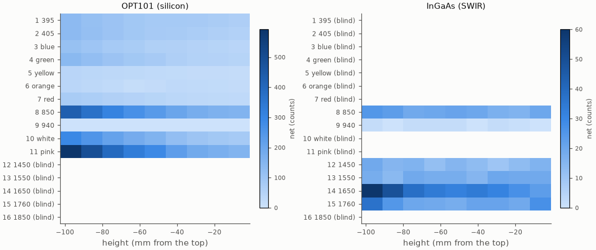
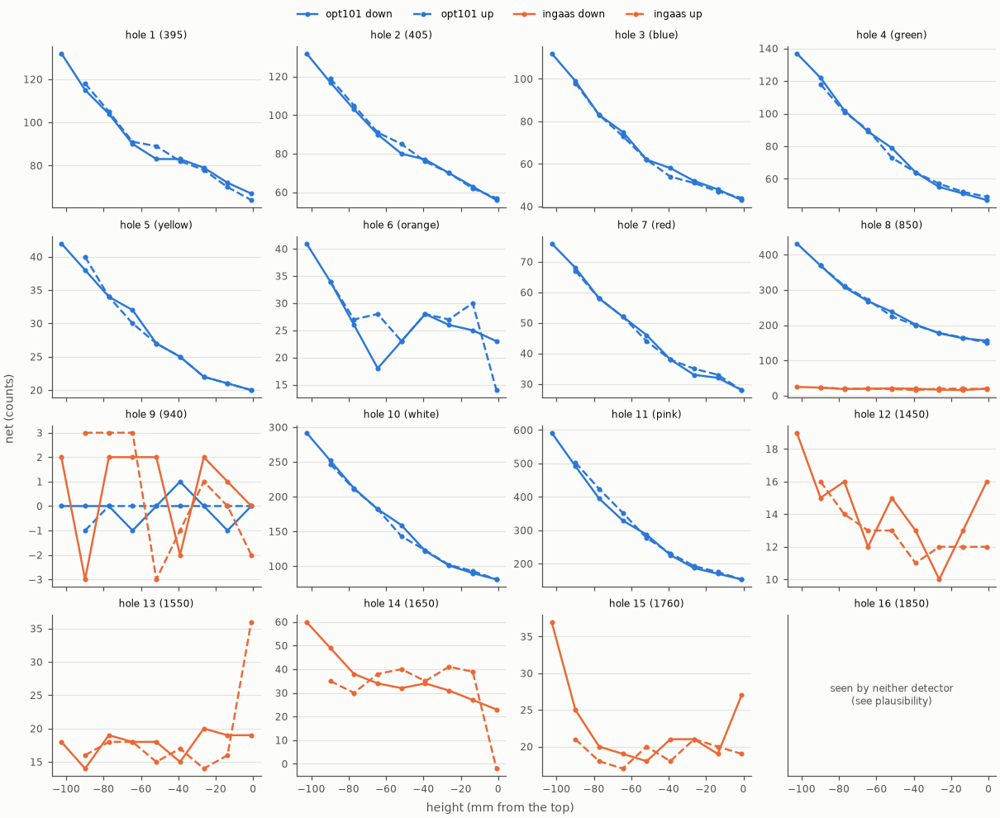
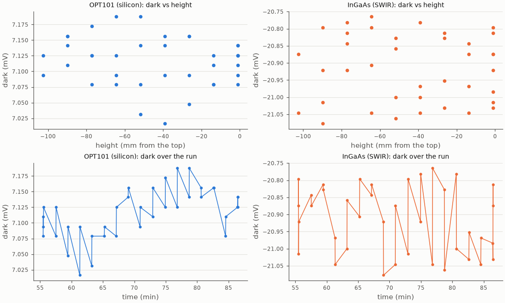
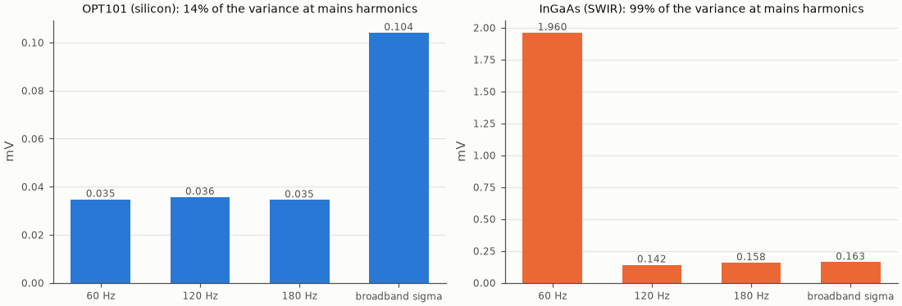

# LIO diagnostic sweep 20261116-202110_scan_quick

Mode **quick**, sample **empty**, status **COMPLETE**

## Verdict: NOT FUNCTIONAL

- failures not tied to a channel: T13.T06

## Subsystem health

| Subsystem | Parts | Health | Reason |
|---|---|---|---|
| Link / firmware | Nano R4, USB, firmware | ✓ OK | 1 checks pass |
| ADC / I²C | ADS1115, software I²C D11/D12 | ✓ OK | 1 checks pass |
| Shift registers | U1, U2 | ✓ OK | 1 checks pass |
| LED drivers / rails | DRV1 (RAIL A), DRV2 (RAIL B) | ✓ OK | 4 checks pass |
| LED / MOSFET channels | LED1-16, Q1-16 | ✕ ACT | optics/opt101/h09/response: O -12 counts at h -160066, C +12.7, modulation 0.11 |
| OPT101 | OPT101 (A1) | ✓ OK | 9 checks pass |
| InGaAs TIA | D1, U5, Rf, Cf (A0) | ✕ ACT | optics/ingaas/throughput: median O over 5 expected holes; spread (CV) 93% across holes |
| Motors / lead screws | M1, M2, ULN2003, couplers, M6 rods | ✓ OK | 3 checks pass |
| Stage tracking | lio.stage, soft limits | ✓ OK | 1 checks pass |
| Safety | interlocks, duty budget | ✓ OK | 2 checks pass |
| Power / earthing | supplies, GND, earth bond | ! WATCH | elec/ingaas/hum: 60/120/180 Hz: 1.960 / 0.142 / 0.158 mV; 99% of the variance at mains harmonics; broadband sigma 0.163 mV |
| Optical path / ambient | window, shroud, lid, sample | ! WATCH | optics/optimum: -420017 half-steps (-102.54 mm); weakest normalised response there 0.79; at an end of the travel: the true peak may lie beyond |
| Run | the scan itself | ✓ OK | 1 checks pass |

## Findings to act on

### ✕ FAIL `optics/opt101/h09/response`: hole 9 (940) on opt101

O -12 counts at h -160066, C +12.7, modulation 0.11

- **Why:** This hole gives no (or little) height-dependent light on a detector that should see it: the LED is dead or reversed, its MOSFET is open, it is wired to the wrong rail, or it is an LED that this detector cannot see (swapped or wrong part).
- **Parts:** LED9, Q9, rail wiring
- **Next check:** Phone-camera check of the hole while it is lit (lio ch 9 on); meter the Q gate and drain; compare with the rail map.

### ✕ FAIL `optics/opt101/h16/plausibility`: hole 16 (1850) seen by opt101?

opt101 cannot see 1850 nm; residual +741 counts over C +19.0; height-dependent (optical)

- **Why:** A detector responds, with a height-dependent (optical) signal, to a hole whose wavelength it cannot see: the LED in this hole is not the one in the channel map (swapped with another hole, or the wrong part).
- **Parts:** LED16
- **Next check:** Camera check of that hole (visible or not); compare the LED marking with docs/OPTICAL_CHANNEL_MAP.md; look for the hole it was swapped with (a response missing elsewhere).

### ✕ FAIL `optics/ingaas/h09/response`: hole 9 (940) on ingaas

O -3 counts at h -264047, C +6.0, modulation 1.09

- **Why:** This hole gives no (or little) height-dependent light on a detector that should see it: the LED is dead or reversed, its MOSFET is open, it is wired to the wrong rail, or it is an LED that this detector cannot see (swapped or wrong part).
- **Parts:** LED9, Q9, rail wiring
- **Next check:** Phone-camera check of the hole while it is lit (lio ch 9 on); meter the Q gate and drain; compare with the rail map.

### ✕ FAIL `optics/ingaas/throughput`: ingaas: optical throughput (window, alignment)

median O over 5 expected holes; spread (CV) 93% across holes

- **Why:** Every hole on this detector is weaker than expected while the shape vs height is normal: less light reaches the detector (a dirty or blocked window, misalignment, or a weaker sample).
- **Parts:** detector window, alignment, sample
- **Next check:** Inspect and clean the deck window over the detector; re-run with the white tile.

### ! WARN `optics/optimum`: optimum height (all holes)

-420017 half-steps (-102.54 mm); weakest normalised response there 0.79; at an end of the travel: the true peak may lie beyond

- **Why:** The best height is at an end of the travel: the true optimum may lie beyond it.
- **Parts:** geometry
- **Next check:** Check the sample position.

### ✕ FAIL `elec/ingaas/dark_offset`: ingaas: dark offset / leakage

-167.3 counts (-20.91 mV); equivalent input current +20.9 nA (Rf 1 MΩ)

- **Why:** The InGaAs dark output is outside its range: a current flows into the TIA input (a negative output means current into pin 2: leakage, or the photodiode connected the wrong way or not at all).
- **Parts:** U5 pin-2 node, D1, Rf, board cleanliness
- **Next check:** Meter the pin-2 node to ground; clean flux off the board; check D1's orientation.

### ! WARN `elec/ingaas/hum`: ingaas: mains hum (coils off)

60/120/180 Hz: 1.960 / 0.142 / 0.158 mV; 99% of the variance at mains harmonics; broadband sigma 0.163 mV

- **Why:** Mains hum on the detector output: a missing earth bond or leakage from a charger.
- **Parts:** earth bond, chargers, GND
- **Next check:** Check the earth bond (circuit GND to mains earth); unplug the laptop charger and repeat.

### ✕ FAIL `optics/wrong_rail/h09`: hole 9 dark with only RAIL B enabled

+81 counts on opt101 with the hole selected and RAIL B enabled; it lights: wired to the other rail

- **Why:** The LED lights when only the other rail's driver is enabled: it is wired to the wrong rail (its return or anode on the other driver).
- **Parts:** rail wiring, LED9, DRV1/DRV2
- **Next check:** Trace the LED's wiring to its driver against docs/OPTICAL_CHANNEL_MAP.md; meter the rail current with the hole lit (T05.6).

## Response vs height, per hole (down pass; blind holes blank)

## Response curves: down pass (solid) and up pass (dashed)

## Dark level vs height (light leak) and over time (drift)

## Dark noise: mains harmonics and broadband

## System

| Status | Metric | Value | Result | Criterion |
|---|---|---|---|---|
| ✓ PASS | `system/link` | 0 unexpected boots | firmware 2.5.0, no unexpected # BOOT |  |
| ✓ PASS | `system/adc` | 764 readings | 764 readings, no dropout |  |
| ✓ PASS | `system/addressing` | 0 pairs | 15 responding holes, all distinct |  |
| ✓ PASS | `system/rail/A` | 8 holes | 8/9 holes respond |  |
| ✓ PASS | `system/rail/B` | 6 holes | 6/7 holes respond |  |
| ✓ PASS | `system/interlocks` | 0 failed | light_while_moving: PASS; single_channel: PASS |  |
| ✓ PASS | `system/duty` | 129 ms/min | max 129 ms of 1000 ms; 0 cool-down waits, 0 s in all |  |
| ✓ PASS | `system/stage` |  | position [-4096, -4096], limits respected |  |
| ✓ PASS | `system/run` |  | COMPLETE |  |

## Optics

| Status | Metric | Value | Result | Criterion |
|---|---|---|---|---|
| ✓ PASS | `optics/opt101/h01/response` | 118.3 counts | O 118 counts at h -420017, C +12.7, modulation 0.54 | O >= 15 (WARN below), >= 6 (FAIL below) |
| ✓ PASS | `optics/opt101/h02/response` | 119.2 counts | O 119 counts at h -420017, C +12.7, modulation 0.64 | O >= 15 (WARN below), >= 6 (FAIL below) |
| ✓ PASS | `optics/opt101/h03/response` | 99.8 counts | O 100 counts at h -420017, C +12.7, modulation 0.69 | O >= 15 (WARN below), >= 6 (FAIL below) |
| ✓ PASS | `optics/opt101/h04/response` | 125.2 counts | O 125 counts at h -420017, C +12.7, modulation 0.73 | O >= 15 (WARN below), >= 6 (FAIL below) |
| ✓ PASS | `optics/opt101/h05/response` | 29.3 counts | O 29 counts at h -420017, C +12.7, modulation 0.75 | O >= 15 (WARN below), >= 6 (FAIL below) |
| ✓ PASS | `optics/opt101/h06/response` | 28.5 counts | O 28 counts at h -420017, C +12.7, modulation 0.73 | O >= 15 (WARN below), >= 6 (FAIL below) |
| ✓ PASS | `optics/opt101/h07/response` | 63.7 counts | O 64 counts at h -420017, C +12.7, modulation 0.75 | O >= 15 (WARN below), >= 6 (FAIL below) |
| ✓ PASS | `optics/opt101/h08/response` | 419 counts | O 419 counts at h -420017, C +12.7, modulation 0.66 | O >= 15 (WARN below), >= 6 (FAIL below) |
| ✕ FAIL | `optics/opt101/h09/response` | -12 counts | O -12 counts at h -160066, C +12.7, modulation 0.11 | O >= 15 (WARN below), >= 6 (FAIL below) |
| ✓ PASS | `optics/opt101/h10/response` | 273 counts | O 273 counts at h -420017, C +19.0, modulation 0.77 | O >= 15 (WARN below), >= 6 (FAIL below) |
| ✓ PASS | `optics/opt101/h11/response` | 572.5 counts | O 572 counts at h -420017, C +19.0, modulation 0.77 | O >= 15 (WARN below), >= 6 (FAIL below) |
| ✓ PASS | `optics/opt101/h12/plausibility` | -3.1 counts | opt101 cannot see 1450 nm; residual -3 counts over C +19.0 | < 30 counts (WARN), < 80 (FAIL) |
| ✓ PASS | `optics/opt101/h13/plausibility` | -0.5 counts | opt101 cannot see 1550 nm; residual -0 counts over C +19.0 | < 30 counts (WARN), < 80 (FAIL) |
| ✓ PASS | `optics/opt101/h14/plausibility` | 12 counts | opt101 cannot see 1650 nm; residual +12 counts over C +19.0 | < 30 counts (WARN), < 80 (FAIL) |
| ✓ PASS | `optics/opt101/h15/plausibility` | 4 counts | opt101 cannot see 1760 nm; residual +4 counts over C +19.0 | < 30 counts (WARN), < 80 (FAIL) |
| ✕ FAIL | `optics/opt101/h16/plausibility` | 740.7 counts | opt101 cannot see 1850 nm; residual +741 counts over C +19.0; height-dependent (optical) | < 30 counts (WARN), < 80 (FAIL) |
| ✓ PASS | `optics/opt101/electrical_only` | 0.09 fraction | 1/11 expected holes show no optical response; coupling present | FAIL when >= 75% of expected holes have O < 6 while |C| >= 8 |
| ✓ PASS | `optics/opt101/throughput` | 118.3 counts | median O over 11 expected holes; spread (CV) 104% across holes | median O >= 60 (WARN below), >= 20 (FAIL below) for empty |
| ✓ PASS | `optics/ingaas/h01/plausibility` | 0.2 counts | ingaas cannot see 395 nm; residual +0 counts over C +6.0 | < 30 counts (WARN), < 80 (FAIL) |
| ✓ PASS | `optics/ingaas/h02/plausibility` | 1.5 counts | ingaas cannot see 405 nm; residual +2 counts over C +6.0 | < 30 counts (WARN), < 80 (FAIL) |
| ✓ PASS | `optics/ingaas/h03/plausibility` | -0 counts | ingaas cannot see 465 nm; residual -0 counts over C +6.0 | < 30 counts (WARN), < 80 (FAIL) |
| ✓ PASS | `optics/ingaas/h04/plausibility` | -3.9 counts | ingaas cannot see 525 nm; residual -4 counts over C +6.0 | < 30 counts (WARN), < 80 (FAIL) |
| ✓ PASS | `optics/ingaas/h05/plausibility` | 7 counts | ingaas cannot see 590 nm; residual +7 counts over C +6.0 | < 30 counts (WARN), < 80 (FAIL) |
| ✓ PASS | `optics/ingaas/h06/plausibility` | 9.4 counts | ingaas cannot see 605 nm; residual +9 counts over C +6.0 | < 30 counts (WARN), < 80 (FAIL) |
| ✓ PASS | `optics/ingaas/h07/plausibility` | 5.9 counts | ingaas cannot see 630 nm; residual +6 counts over C +6.0 | < 30 counts (WARN), < 80 (FAIL) |
| ✓ PASS | `optics/ingaas/h08/response` | 19.3 counts | O 19 counts at h -420017, C +6.0, modulation 0.46 | O >= 15 (WARN below), >= 6 (FAIL below) |
| ✕ FAIL | `optics/ingaas/h09/response` | -3.2 counts | O -3 counts at h -264047, C +6.0, modulation 1.09 | O >= 15 (WARN below), >= 6 (FAIL below) |
| ✓ PASS | `optics/ingaas/h10/plausibility` | 0.1 counts | ingaas cannot see 450 nm; residual +0 counts over C +3.0 | < 30 counts (WARN), < 80 (FAIL) |
| ✓ PASS | `optics/ingaas/h11/plausibility` | 5.2 counts | ingaas cannot see 450 nm; residual +5 counts over C +3.0 | < 30 counts (WARN), < 80 (FAIL) |
| ✓ PASS | `optics/ingaas/h12/response` | 15.2 counts | O 15 counts at h -420017, C +3.0, modulation 0.46 | O >= 15 (WARN below), >= 6 (FAIL below) |
| ✓ PASS | `optics/ingaas/h13/response` | 17.1 counts | O 17 counts at h -56086, C +3.0, modulation 0.22 | O >= 15 (WARN below), >= 6 (FAIL below) |
| ✓ PASS | `optics/ingaas/h14/response` | 57 counts | O 57 counts at h -420017, C +3.0, modulation 0.65 | O >= 15 (WARN below), >= 6 (FAIL below) |
| ✓ PASS | `optics/ingaas/h16/plausibility` | 20.3 counts | ingaas cannot see 1850 nm; residual +20 counts over C +3.0 | < 30 counts (WARN), < 80 (FAIL) |
| ✓ PASS | `optics/ingaas/electrical_only` | 0.2 fraction | 1/5 expected holes show no optical response; coupling small | FAIL when >= 75% of expected holes have O < 6 while |C| >= 8 |
| ✕ FAIL | `optics/ingaas/throughput` | 17.1 counts | median O over 5 expected holes; spread (CV) 93% across holes | median O >= 60 (WARN below), >= 20 (FAIL below) for empty |
| ! WARN | `optics/optimum` | -420017 half-steps | -420017 half-steps (-102.54 mm); weakest normalised response there 0.79; at an end of the travel: the true peak may lie beyond |  |
| ✓ PASS | `optics/opt101/snr` | 30.7 dB | weakest hole 6: 30.7 dB (noise sigma 0.104 mV) | >= 20 dB |
| ✓ PASS | `optics/opt101/headroom` | 97.2 % | highest lit reading 821 of 29600 counts | >= 10% |
| ✓ PASS | `optics/ingaas/snr` | 21.3 dB | weakest hole 12: 21.3 dB (noise sigma 0.163 mV) | >= 20 dB |
| ✓ PASS | `optics/ingaas/headroom` | 99.9 % | highest lit reading 35 of 28000 counts | >= 10% |
| - SKIP | `optics/stray` |  | needs a black_cup run (with a white_ptfe reference) |  |
| - SKIP | `optics/effectiveness` |  | needs a reference (baseline) of the same sample |  |
| ✓ PASS | `optics/wrong_rail/h01` | 0 counts | +0 counts on opt101 with the hole selected and RAIL B enabled | < 30 counts (WARN), < 80 (FAIL) |
| ✓ PASS | `optics/wrong_rail/h02` | 0 counts | +0 counts on opt101 with the hole selected and RAIL B enabled | < 30 counts (WARN), < 80 (FAIL) |
| ✓ PASS | `optics/wrong_rail/h03` | 0 counts | +0 counts on opt101 with the hole selected and RAIL B enabled | < 30 counts (WARN), < 80 (FAIL) |
| ✓ PASS | `optics/wrong_rail/h04` | 0 counts | +0 counts on opt101 with the hole selected and RAIL B enabled | < 30 counts (WARN), < 80 (FAIL) |
| ✓ PASS | `optics/wrong_rail/h05` | 0 counts | +0 counts on opt101 with the hole selected and RAIL B enabled | < 30 counts (WARN), < 80 (FAIL) |
| ✓ PASS | `optics/wrong_rail/h06` | 0 counts | +0 counts on opt101 with the hole selected and RAIL B enabled | < 30 counts (WARN), < 80 (FAIL) |
| ✓ PASS | `optics/wrong_rail/h07` | 0 counts | +0 counts on opt101 with the hole selected and RAIL B enabled | < 30 counts (WARN), < 80 (FAIL) |
| ✓ PASS | `optics/wrong_rail/h08` | 1 counts | +1 counts on opt101 with the hole selected and RAIL B enabled | < 30 counts (WARN), < 80 (FAIL) |
| ✕ FAIL | `optics/wrong_rail/h09` | 81 counts | +81 counts on opt101 with the hole selected and RAIL B enabled; it lights: wired to the other rail | < 30 counts (WARN), < 80 (FAIL) |
| ✓ PASS | `optics/wrong_rail/h10` | 0 counts | +0 counts on opt101 with the hole selected and RAIL A enabled | < 30 counts (WARN), < 80 (FAIL) |
| ✓ PASS | `optics/wrong_rail/h11` | 0 counts | +0 counts on opt101 with the hole selected and RAIL A enabled | < 30 counts (WARN), < 80 (FAIL) |
| ✓ PASS | `optics/wrong_rail/h12` | 2 counts | +2 counts on ingaas with the hole selected and RAIL A enabled | < 30 counts (WARN), < 80 (FAIL) |
| ✓ PASS | `optics/wrong_rail/h13` | -1 counts | -1 counts on ingaas with the hole selected and RAIL A enabled | < 30 counts (WARN), < 80 (FAIL) |
| ✓ PASS | `optics/wrong_rail/h14` | 1 counts | +1 counts on ingaas with the hole selected and RAIL A enabled | < 30 counts (WARN), < 80 (FAIL) |
| ✓ PASS | `optics/wrong_rail/h15` | 1 counts | +1 counts on ingaas with the hole selected and RAIL A enabled | < 30 counts (WARN), < 80 (FAIL) |

## Electrical

| Status | Metric | Value | Result | Criterion |
|---|---|---|---|---|
| ✓ PASS | `elec/opt101/coupling` | 19 counts | rail A: +12.7 counts (+1.58 mV) inferred, rail B: +19.0 counts (+2.38 mV) from 5 blind holes | corrected in software below 20 counts (FAIL at or above) |
| ✓ PASS | `elec/opt101/ground_shift` | 0.0528 mV/mA | +0.422 counts/mA | corrected in software below 0.08 mV/mA (FAIL at or above) |
| ✓ PASS | `elec/ingaas/coupling` | 6 counts | rail A: +6.0 counts (+0.75 mV) from 7 blind holes, rail B: +3.0 counts (+0.38 mV) from 3 blind holes | corrected in software below 20 counts (FAIL at or above) |
| ✓ PASS | `elec/ingaas/ground_shift` | 0.0135 mV/mA | +0.108 counts/mA | corrected in software below 0.08 mV/mA (FAIL at or above) |
| ✓ PASS | `elec/opt101/dark_offset` | 7.125 mV | +57.0 counts (+7.12 mV) | 0 to 800 counts (thresholds.dark) |
| ✕ FAIL | `elec/ingaas/dark_offset` | -20.914 mV | -167.3 counts (-20.91 mV); equivalent input current +20.9 nA (Rf 1 MΩ) | -100 to 2000 counts (thresholds.dark) |
| ✓ PASS | `elec/opt101/drift` | 0.125 mV/h | +0.12 ± 0.03 mV/h; P4 - P1 +0.04 mV | |slope| < 3 mV/h (WARN), < 8 (FAIL) |
| ✓ PASS | `elec/ingaas/drift` | -0.118 mV/h | -0.12 ± 0.09 mV/h (+0.1 nA/h); P4 - P1 -0.01 mV | |slope| < 3 mV/h (WARN), < 8 (FAIL) |
| ✓ PASS | `elec/opt101/hum` | 0.0348 mV | 60/120/180 Hz: 0.035 / 0.036 / 0.035 mV; 14% of the variance at mains harmonics; broadband sigma 0.104 mV | 60 Hz amplitude < 0.3 mV (WARN; not when the readings reject it), < 1 (FAIL); mains fraction < 0.5 |
| ! WARN | `elec/ingaas/hum` | 1.9604 mV | 60/120/180 Hz: 1.960 / 0.142 / 0.158 mV; 99% of the variance at mains harmonics; broadband sigma 0.163 mV | 60 Hz amplitude < 1 mV (WARN; not when the readings reject it), < 3 (FAIL); mains fraction < 0.5 |
| ✓ PASS | `elec/opt101/coil_emi` | 8.07 x | sigma 1.009 mV moving vs 0.104 mV off (measured while moving, S0 D2); judged only when measuring while moving (continuous mode): every other reading is taken with the motors stopped | ratio < 3 (WARN), < 6 (FAIL) |
| ✓ PASS | `elec/ingaas/coil_emi` | 2.54 x | sigma 0.414 mV moving vs 0.163 mV off (measured while moving, S0 D2); judged only when measuring while moving (continuous mode): every other reading is taken with the motors stopped | ratio < 3 (WARN), < 6 (FAIL) |
| ✓ PASS | `elec/opt101/select_only` | 0.5 counts | largest on hole 1: +0.5 counts | < 8 counts (WARN), < 20 (FAIL) |
| ✓ PASS | `elec/ingaas/select_only` | 0.9 counts | largest on hole 10: +0.9 counts | < 8 counts (WARN), < 20 (FAIL) |
| ✓ PASS | `elec/opt101/ce_only` | 0 counts | CE1: +0.0, CE2: +0.0 | < 8 counts (WARN), < 20 (FAIL) |
| ✓ PASS | `elec/ingaas/ce_only` | 3 counts | CE1: -3.0, CE2: +2.0 | < 8 counts (WARN), < 20 (FAIL) |
| - SKIP | `elec/rails` |  | A2/A3 not wired for rail and ground monitoring |  |

## Mechanics

| Status | Metric | Value | Result | Criterion |
|---|---|---|---|---|
| - SKIP | `mech/home_sensors` |  | no home sensors fitted |  |
| ✓ PASS | `mech/travel` | 420017 half-steps | tracked range 420017 / 420017 half-steps (left / right) (thresholds.motion.travel.range_steps not set: not compared) |  |
| ✓ PASS | `mech/lockstep` | 0 moves | 20 moves; 0 ended with the two sides at different positions (without home sensors only the commanded steps are seen: a side losing steps shows as mech/step_loss) |  |
| ✓ PASS | `mech/settle` | 605 ms | median 605 ms, max 608 ms (mechanical wait 300 ms) | max - median < 500 ms (WARN), < 1500 (FAIL) |
| - SKIP | `mech/backlash` | 5459 half-steps | +5459 ± 3934 half-steps (+1.333 mm) from 97 readings on 14 channels | < 600 (WARN), < 1500 (FAIL); not flagged within 3 sigma; not judged when the resolution is worse than 300 |
| - SKIP | `mech/step_loss` | -41332 half-steps per travel | the stage falls behind by -41332 ± 8005 half-steps over a full upward travel (one side losing steps: about twice that on that side, and a tilt) | < 400 (WARN), < 1000 (FAIL); not flagged within 3 sigma |
| - SKIP | `mech/repeatability` |  | no repeated reference visits in this mode (full, fine, repeatability have them) |  |

## Ambient

| Status | Metric | Value | Result | Criterion |
|---|---|---|---|---|
| ✓ PASS | `ambient/opt101/leak` | 0.2 counts | dark at the bottom +0.2 counts (+0.02 mV) vs the top; 0.16% of the median signal | rise < 8 counts (WARN), < 25 (FAIL) |
| ✓ PASS | `ambient/ingaas/leak` | 0.8 counts | dark at the bottom +0.8 counts (+0.09 mV) vs the top; 4.12% of the median signal | rise < 8 counts (WARN), < 25 (FAIL) |
| ✓ PASS | `ambient/opt101/flicker` | 0.0357 mV | 120 Hz amplitude in the dark streams 0.036 mV | < 0.4 mV (WARN), < 1.2 (FAIL) |
| ✓ PASS | `ambient/ingaas/flicker` | 0.1419 mV | 120 Hz amplitude in the dark streams 0.142 mV | < 0.4 mV (WARN), < 1.2 (FAIL) |
| - SKIP | `ambient/lid` |  | optional operator step (lid ajar at two heights) |  |

## Not measured (capability)

- rail_monitor: A2/A3 not wired for rail and ground monitoring
- home_sensors: no home sensors fitted
