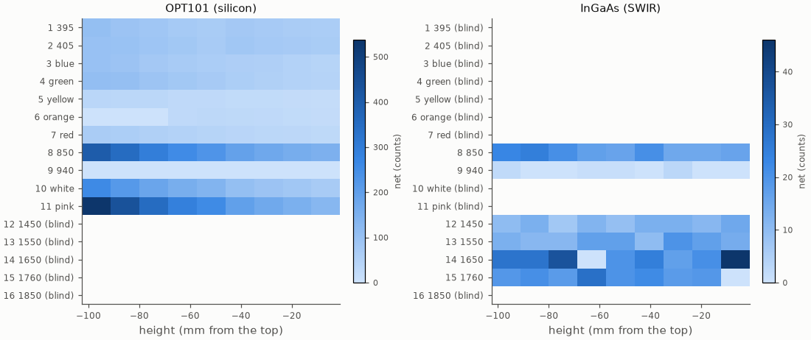
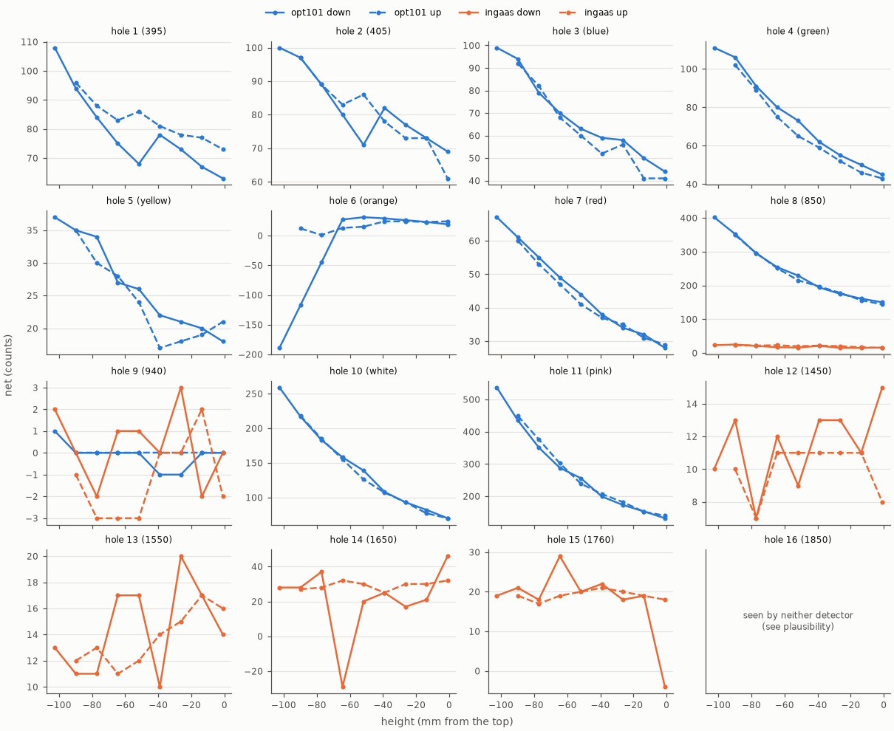
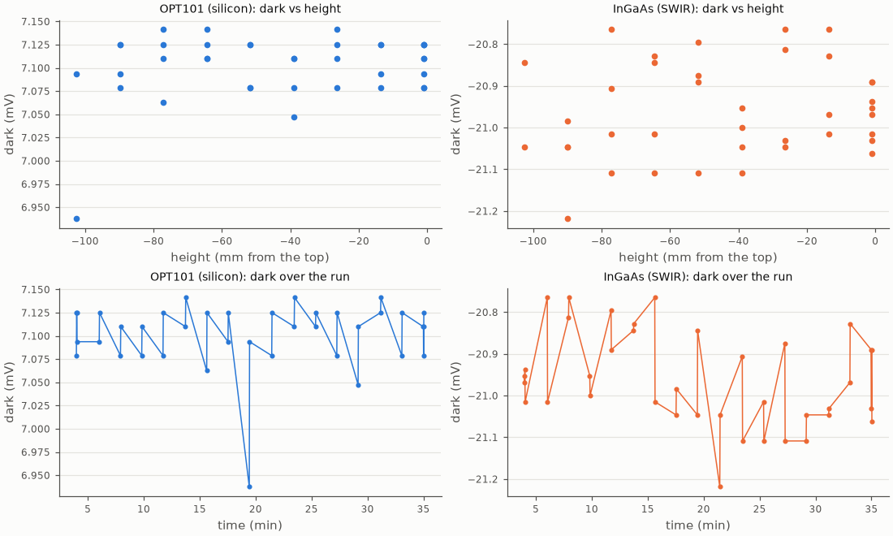
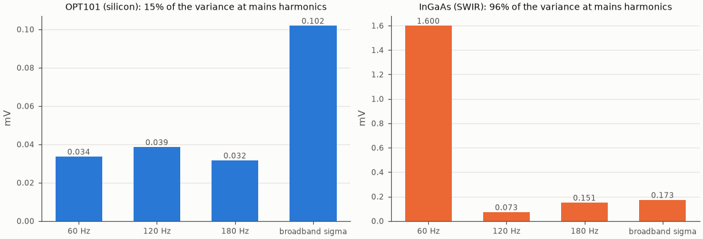

# LIO diagnostic sweep 20261116-220635_scan_quick

Mode **quick**, sample **black_cup**, status **COMPLETE**

## Verdict: NOT FUNCTIONAL

- failures not tied to a channel: T13.T06, T13.T13

## Subsystem health

| Subsystem | Parts | Health | Reason |
|---|---|---|---|
| Link / firmware | Nano R4, USB, firmware | ✓ OK | 1 checks pass |
| ADC / I²C | ADS1115, software I²C D11/D12 | ✓ OK | 1 checks pass |
| Shift registers | U1, U2 | ✓ OK | 1 checks pass |
| LED drivers / rails | DRV1 (RAIL A), DRV2 (RAIL B) | ✓ OK | 4 checks pass |
| LED / MOSFET channels | LED1-16, Q1-16 | ✕ ACT | optics/opt101/h16/plausibility: opt101 cannot see 1850 nm; residual +595 counts over C +19.0; height-dependent (optical) |
| OPT101 | OPT101 (A1) | ✓ OK | 8 checks pass |
| InGaAs TIA | D1, U5, Rf, Cf (A0) | ✕ ACT | elec/ingaas/dark_offset: -167.8 counts (-20.98 mV); equivalent input current +21.0 nA (Rf 1 MΩ) |
| Motors / lead screws | M1, M2, ULN2003, couplers, M6 rods | ✓ OK | 3 checks pass |
| Stage tracking | lio.stage, soft limits | ✓ OK | 1 checks pass |
| Safety | interlocks, duty budget | ✓ OK | 2 checks pass |
| Power / earthing | supplies, GND, earth bond | ! WATCH | elec/ingaas/hum: 60/120/180 Hz: 1.600 / 0.073 / 0.151 mV; 96% of the variance at mains harmonics; broadband sigma 0.173 mV |
| Optical path / ambient | window, shroud, lid, sample | ✕ ACT | optics/stray: median over 14 channels against empty (20261116-202110_scan_quick); the black cup keeps 83.9% of the response at the optimum |
| Run | the scan itself | ✓ OK | 1 checks pass |

## Findings to act on

### ✕ FAIL `optics/opt101/h16/plausibility`: hole 16 (1850) seen by opt101?

opt101 cannot see 1850 nm; residual +595 counts over C +19.0; height-dependent (optical)

- **Why:** A detector responds, with a height-dependent (optical) signal, to a hole whose wavelength it cannot see: the LED in this hole is not the one in the channel map (swapped with another hole, or the wrong part).
- **Parts:** LED16
- **Next check:** Camera check of that hole (visible or not); compare the LED marking with docs/OPTICAL_CHANNEL_MAP.md; look for the hole it was swapped with (a response missing elsewhere).

### ✕ FAIL `optics/stray`: stray light (height-invariant optical)

median over 14 channels against empty (20261116-202110_scan_quick); the black cup keeps 83.9% of the response at the optimum

- **Why:** Light reaches the detectors without going via the sample (height-invariant): reflections inside the chamber or light leaking between holes.
- **Parts:** chamber walls, hole baffles
- **Next check:** Repeat with the black cup; inspect for shiny surfaces and gaps between holes.

### ✕ FAIL `elec/ingaas/dark_offset`: ingaas: dark offset / leakage

-167.8 counts (-20.98 mV); equivalent input current +21.0 nA (Rf 1 MΩ)

- **Why:** The InGaAs dark output is outside its range: a current flows into the TIA input (a negative output means current into pin 2: leakage, or the photodiode connected the wrong way or not at all).
- **Parts:** U5 pin-2 node, D1, Rf, board cleanliness
- **Next check:** Meter the pin-2 node to ground; clean flux off the board; check D1's orientation.

### ! WARN `elec/ingaas/hum`: ingaas: mains hum (coils off)

60/120/180 Hz: 1.600 / 0.073 / 0.151 mV; 96% of the variance at mains harmonics; broadband sigma 0.173 mV

- **Why:** Mains hum on the detector output: a missing earth bond or leakage from a charger.
- **Parts:** earth bond, chargers, GND
- **Next check:** Check the earth bond (circuit GND to mains earth); unplug the laptop charger and repeat.

### ! WARN `optics/wrong_rail/h09`: hole 9 dark with only RAIL B enabled

+71 counts on opt101 with the hole selected and RAIL B enabled; it lights: wired to the other rail

- **Why:** The LED lights when only the other rail's driver is enabled: it is wired to the wrong rail (its return or anode on the other driver).
- **Parts:** rail wiring, LED9, DRV1/DRV2
- **Next check:** Trace the LED's wiring to its driver against docs/OPTICAL_CHANNEL_MAP.md; meter the rail current with the hole lit (T05.6).

## Response vs height, per hole (down pass; blind holes blank)

## Response curves: down pass (solid) and up pass (dashed)

## Dark level vs height (light leak) and over time (drift)

## Dark noise: mains harmonics and broadband

## System

| Status | Metric | Value | Result | Criterion |
|---|---|---|---|---|
| ✓ PASS | `system/link` | 0 unexpected boots | firmware 2.5.0, no unexpected # BOOT |  |
| ✓ PASS | `system/adc` | 764 readings | 764 readings, no dropout |  |
| ✓ PASS | `system/addressing` | 0 pairs | 15 responding holes, all distinct |  |
| ✓ PASS | `system/rail/A` | 8 holes | 8/9 holes respond |  |
| ✓ PASS | `system/rail/B` | 6 holes | 6/7 holes respond |  |
| ✓ PASS | `system/interlocks` | 0 failed | light_while_moving: PASS; single_channel: PASS |  |
| ✓ PASS | `system/duty` | 129 ms/min | max 129 ms of 1000 ms; 0 cool-down waits, 0 s in all |  |
| ✓ PASS | `system/stage` |  | position [-4096, -4096], limits respected |  |
| ✓ PASS | `system/run` |  | COMPLETE |  |

## Optics

| Status | Metric | Value | Result | Criterion |
|---|---|---|---|---|
| - SKIP | `optics/opt101/h01/response` | 94.7 counts | sample 'black_cup' is not judged against absolute levels | O >= 15 (WARN below), >= 6 (FAIL below) |
| - SKIP | `optics/opt101/h02/response` | 88.2 counts | sample 'black_cup' is not judged against absolute levels | O >= 15 (WARN below), >= 6 (FAIL below) |
| - SKIP | `optics/opt101/h03/response` | 88 counts | sample 'black_cup' is not judged against absolute levels | O >= 15 (WARN below), >= 6 (FAIL below) |
| - SKIP | `optics/opt101/h04/response` | 100 counts | sample 'black_cup' is not judged against absolute levels | O >= 15 (WARN below), >= 6 (FAIL below) |
| - SKIP | `optics/opt101/h05/response` | 24.2 counts | sample 'black_cup' is not judged against absolute levels | O >= 15 (WARN below), >= 6 (FAIL below) |
| - SKIP | `optics/opt101/h06/response` | 23.2 counts | sample 'black_cup' is not judged against absolute levels | O >= 15 (WARN below), >= 6 (FAIL below) |
| - SKIP | `optics/opt101/h07/response` | 54.3 counts | sample 'black_cup' is not judged against absolute levels | O >= 15 (WARN below), >= 6 (FAIL below) |
| - SKIP | `optics/opt101/h08/response` | 390.5 counts | sample 'black_cup' is not judged against absolute levels | O >= 15 (WARN below), >= 6 (FAIL below) |
| - SKIP | `optics/opt101/h09/response` | -11.8 counts | sample 'black_cup' is not judged against absolute levels | O >= 15 (WARN below), >= 6 (FAIL below) |
| - SKIP | `optics/opt101/h10/response` | 238.7 counts | sample 'black_cup' is not judged against absolute levels | O >= 15 (WARN below), >= 6 (FAIL below) |
| - SKIP | `optics/opt101/h11/response` | 515 counts | sample 'black_cup' is not judged against absolute levels | O >= 15 (WARN below), >= 6 (FAIL below) |
| ✓ PASS | `optics/opt101/h12/plausibility` | -2.2 counts | opt101 cannot see 1450 nm; residual -2 counts over C +19.0 | < 30 counts (WARN), < 80 (FAIL) |
| ✓ PASS | `optics/opt101/h13/plausibility` | -0.1 counts | opt101 cannot see 1550 nm; residual -0 counts over C +19.0 | < 30 counts (WARN), < 80 (FAIL) |
| ✓ PASS | `optics/opt101/h14/plausibility` | 24.8 counts | opt101 cannot see 1650 nm; residual +25 counts over C +19.0 | < 30 counts (WARN), < 80 (FAIL) |
| ✓ PASS | `optics/opt101/h15/plausibility` | 1.2 counts | opt101 cannot see 1760 nm; residual +1 counts over C +19.0 | < 30 counts (WARN), < 80 (FAIL) |
| ✕ FAIL | `optics/opt101/h16/plausibility` | 595 counts | opt101 cannot see 1850 nm; residual +595 counts over C +19.0; height-dependent (optical) | < 30 counts (WARN), < 80 (FAIL) |
| ✓ PASS | `optics/opt101/electrical_only` | 0.09 fraction | 1/11 expected holes show no optical response; coupling present | FAIL when >= 75% of expected holes have O < 6 while |C| >= 8 |
| - SKIP | `optics/opt101/throughput` | 88.2 counts | median O over 11 expected holes; spread (CV) 109% across holes | sample 'black_cup': judged against its baseline only |
| ✓ PASS | `optics/ingaas/h01/plausibility` | 2.5 counts | ingaas cannot see 395 nm; residual +2 counts over C +4.0 | < 30 counts (WARN), < 80 (FAIL) |
| ✓ PASS | `optics/ingaas/h02/plausibility` | 0.5 counts | ingaas cannot see 405 nm; residual +0 counts over C +4.0 | < 30 counts (WARN), < 80 (FAIL) |
| ✓ PASS | `optics/ingaas/h03/plausibility` | 4.1 counts | ingaas cannot see 465 nm; residual +4 counts over C +4.0 | < 30 counts (WARN), < 80 (FAIL) |
| ✓ PASS | `optics/ingaas/h04/plausibility` | -1.2 counts | ingaas cannot see 525 nm; residual -1 counts over C +4.0 | < 30 counts (WARN), < 80 (FAIL) |
| ✓ PASS | `optics/ingaas/h05/plausibility` | 8.3 counts | ingaas cannot see 590 nm; residual +8 counts over C +4.0 | < 30 counts (WARN), < 80 (FAIL) |
| ✓ PASS | `optics/ingaas/h06/plausibility` | 17.2 counts | ingaas cannot see 605 nm; residual +17 counts over C +4.0 | < 30 counts (WARN), < 80 (FAIL) |
| ✓ PASS | `optics/ingaas/h07/plausibility` | 7.8 counts | ingaas cannot see 630 nm; residual +8 counts over C +4.0 | < 30 counts (WARN), < 80 (FAIL) |
| - SKIP | `optics/ingaas/h08/response` | 20.1 counts | sample 'black_cup' is not judged against absolute levels | O >= 15 (WARN below), >= 6 (FAIL below) |
| - SKIP | `optics/ingaas/h09/response` | -2 counts | sample 'black_cup' is not judged against absolute levels | O >= 15 (WARN below), >= 6 (FAIL below) |
| ✓ PASS | `optics/ingaas/h10/plausibility` | 0.7 counts | ingaas cannot see 450 nm; residual +1 counts over C +4.0 | < 30 counts (WARN), < 80 (FAIL) |
| ✓ PASS | `optics/ingaas/h11/plausibility` | 2.5 counts | ingaas cannot see 450 nm; residual +2 counts over C +4.0 | < 30 counts (WARN), < 80 (FAIL) |
| - SKIP | `optics/ingaas/h12/response` | 10 counts | sample 'black_cup' is not judged against absolute levels | O >= 15 (WARN below), >= 6 (FAIL below) |
| - SKIP | `optics/ingaas/h13/response` | 15 counts | sample 'black_cup' is not judged against absolute levels | O >= 15 (WARN below), >= 6 (FAIL below) |
| - SKIP | `optics/ingaas/h14/response` | 38.5 counts | sample 'black_cup' is not judged against absolute levels | O >= 15 (WARN below), >= 6 (FAIL below) |
| ✓ PASS | `optics/ingaas/h16/plausibility` | 14.8 counts | ingaas cannot see 1850 nm; residual +15 counts over C +4.0 | < 30 counts (WARN), < 80 (FAIL) |
| ✓ PASS | `optics/ingaas/electrical_only` | 0.2 fraction | 1/5 expected holes show no optical response; coupling small | FAIL when >= 75% of expected holes have O < 6 while |C| >= 8 |
| - SKIP | `optics/ingaas/throughput` | 15 counts | median O over 5 expected holes; spread (CV) 82% across holes | sample 'black_cup': judged against its baseline only |
| ✓ PASS | `optics/optimum` | -160066 half-steps | -160066 half-steps (-39.08 mm); weakest normalised response there 0.36 |  |
| ✓ PASS | `optics/opt101/snr` | 29.1 dB | weakest hole 6: 29.1 dB (noise sigma 0.102 mV) | >= 20 dB |
| ✓ PASS | `optics/opt101/headroom` | 97.7 % | highest lit reading 672 of 29600 counts | >= 10% |
| ✓ PASS | `optics/ingaas/snr` | 17.2 dB | weakest hole 12: 17.2 dB (noise sigma 0.173 mV) | >= 20 dB |
| ✓ PASS | `optics/ingaas/headroom` | 99.9 % | highest lit reading 18 of 28000 counts | >= 10% |
| ✕ FAIL | `optics/stray` | 7.38 % of empty | median over 14 channels against empty (20261116-202110_scan_quick); the black cup keeps 83.9% of the response at the optimum | < 0.6% (WARN), < 1% (FAIL) |
| - SKIP | `optics/effectiveness` |  | needs a reference (baseline) of the same sample |  |
| ✓ PASS | `optics/wrong_rail/h01` | 0 counts | +0 counts on opt101 with the hole selected and RAIL B enabled | < 30 counts (WARN), < 80 (FAIL) |
| ✓ PASS | `optics/wrong_rail/h02` | 0 counts | +0 counts on opt101 with the hole selected and RAIL B enabled | < 30 counts (WARN), < 80 (FAIL) |
| ✓ PASS | `optics/wrong_rail/h03` | 1 counts | +1 counts on opt101 with the hole selected and RAIL B enabled | < 30 counts (WARN), < 80 (FAIL) |
| ✓ PASS | `optics/wrong_rail/h04` | 0 counts | +0 counts on opt101 with the hole selected and RAIL B enabled | < 30 counts (WARN), < 80 (FAIL) |
| ✓ PASS | `optics/wrong_rail/h05` | 0 counts | +0 counts on opt101 with the hole selected and RAIL B enabled | < 30 counts (WARN), < 80 (FAIL) |
| ✓ PASS | `optics/wrong_rail/h06` | -1 counts | -1 counts on opt101 with the hole selected and RAIL B enabled | < 30 counts (WARN), < 80 (FAIL) |
| ✓ PASS | `optics/wrong_rail/h07` | 0 counts | +0 counts on opt101 with the hole selected and RAIL B enabled | < 30 counts (WARN), < 80 (FAIL) |
| ✓ PASS | `optics/wrong_rail/h08` | 1 counts | +1 counts on ingaas with the hole selected and RAIL B enabled | < 30 counts (WARN), < 80 (FAIL) |
| ! WARN | `optics/wrong_rail/h09` | 71 counts | +71 counts on opt101 with the hole selected and RAIL B enabled; it lights: wired to the other rail | < 30 counts (WARN), < 80 (FAIL) |
| ✓ PASS | `optics/wrong_rail/h10` | 0 counts | +0 counts on opt101 with the hole selected and RAIL A enabled | < 30 counts (WARN), < 80 (FAIL) |
| ✓ PASS | `optics/wrong_rail/h11` | 0 counts | +0 counts on opt101 with the hole selected and RAIL A enabled | < 30 counts (WARN), < 80 (FAIL) |
| ✓ PASS | `optics/wrong_rail/h12` | -2 counts | -2 counts on ingaas with the hole selected and RAIL A enabled | < 30 counts (WARN), < 80 (FAIL) |
| ✓ PASS | `optics/wrong_rail/h13` | 2 counts | +2 counts on ingaas with the hole selected and RAIL A enabled | < 30 counts (WARN), < 80 (FAIL) |
| ✓ PASS | `optics/wrong_rail/h14` | 0 counts | +0 counts on ingaas with the hole selected and RAIL A enabled | < 30 counts (WARN), < 80 (FAIL) |
| ✓ PASS | `optics/wrong_rail/h15` | 0 counts | +0 counts on ingaas with the hole selected and RAIL A enabled | < 30 counts (WARN), < 80 (FAIL) |

## Electrical

| Status | Metric | Value | Result | Criterion |
|---|---|---|---|---|
| ✓ PASS | `elec/opt101/coupling` | 19 counts | rail A: +12.7 counts (+1.58 mV) inferred, rail B: +19.0 counts (+2.38 mV) from 5 blind holes | corrected in software below 20 counts (FAIL at or above) |
| ✓ PASS | `elec/opt101/ground_shift` | 0.0528 mV/mA | +0.422 counts/mA | corrected in software below 0.08 mV/mA (FAIL at or above) |
| ✓ PASS | `elec/ingaas/coupling` | 4 counts | rail A: +4.0 counts (+0.50 mV) from 7 blind holes, rail B: +4.0 counts (+0.50 mV) from 3 blind holes | corrected in software below 20 counts (FAIL at or above) |
| ✓ PASS | `elec/ingaas/ground_shift` | 0.0128 mV/mA | +0.103 counts/mA | corrected in software below 0.08 mV/mA (FAIL at or above) |
| ✓ PASS | `elec/opt101/dark_offset` | 7.11 mV | +56.9 counts (+7.11 mV) | 0 to 800 counts (thresholds.dark) |
| ✕ FAIL | `elec/ingaas/dark_offset` | -20.976 mV | -167.8 counts (-20.98 mV); equivalent input current +21.0 nA (Rf 1 MΩ) | -100 to 2000 counts (thresholds.dark) |
| ✓ PASS | `elec/opt101/drift` | 0.008 mV/h | +0.01 ± 0.03 mV/h; P4 - P1 +0.00 mV | |slope| < 3 mV/h (WARN), < 8 (FAIL) |
| ✓ PASS | `elec/ingaas/drift` | -0.213 mV/h | -0.21 ± 0.10 mV/h (+0.2 nA/h); P4 - P1 -0.02 mV | |slope| < 3 mV/h (WARN), < 8 (FAIL) |
| ✓ PASS | `elec/opt101/hum` | 0.0337 mV | 60/120/180 Hz: 0.034 / 0.039 / 0.032 mV; 15% of the variance at mains harmonics; broadband sigma 0.102 mV | 60 Hz amplitude < 0.3 mV (WARN; not when the readings reject it), < 1 (FAIL); mains fraction < 0.5 |
| ! WARN | `elec/ingaas/hum` | 1.5997 mV | 60/120/180 Hz: 1.600 / 0.073 / 0.151 mV; 96% of the variance at mains harmonics; broadband sigma 0.173 mV | 60 Hz amplitude < 1 mV (WARN; not when the readings reject it), < 3 (FAIL); mains fraction < 0.5 |
| ✓ PASS | `elec/opt101/coil_emi` | 8.4 x | sigma 1.051 mV moving vs 0.102 mV off (measured while moving, S0 D2); judged only when measuring while moving (continuous mode): every other reading is taken with the motors stopped | ratio < 3 (WARN), < 6 (FAIL) |
| ✓ PASS | `elec/ingaas/coil_emi` | 2.17 x | sigma 0.374 mV moving vs 0.173 mV off (measured while moving, S0 D2); judged only when measuring while moving (continuous mode): every other reading is taken with the motors stopped | ratio < 3 (WARN), < 6 (FAIL) |
| ✓ PASS | `elec/opt101/select_only` | 0.6 counts | largest on hole 8: +0.6 counts | < 8 counts (WARN), < 20 (FAIL) |
| ✓ PASS | `elec/ingaas/select_only` | 0.6 counts | largest on hole 12: +0.6 counts | < 8 counts (WARN), < 20 (FAIL) |
| ✓ PASS | `elec/opt101/ce_only` | 0 counts | CE1: +0.0, CE2: +0.0 | < 8 counts (WARN), < 20 (FAIL) |
| ✓ PASS | `elec/ingaas/ce_only` | 1 counts | CE1: +1.0, CE2: -1.0 | < 8 counts (WARN), < 20 (FAIL) |
| - SKIP | `elec/rails` |  | A2/A3 not wired for rail and ground monitoring |  |

## Mechanics

| Status | Metric | Value | Result | Criterion |
|---|---|---|---|---|
| - SKIP | `mech/home_sensors` |  | no home sensors fitted |  |
| ✓ PASS | `mech/travel` | 420017 half-steps | tracked range 420017 / 420017 half-steps (left / right) (thresholds.motion.travel.range_steps not set: not compared) |  |
| ✓ PASS | `mech/lockstep` | 0 moves | 20 moves; 0 ended with the two sides at different positions (without home sensors only the commanded steps are seen: a side losing steps shows as mech/step_loss) |  |
| ✓ PASS | `mech/settle` | 605 ms | median 605 ms, max 612 ms (mechanical wait 300 ms) | max - median < 500 ms (WARN), < 1500 (FAIL) |
| - SKIP | `mech/backlash` | -80065 half-steps | -80065 ± 3639 half-steps (-19.547 mm) from 93 readings on 12 channels | < 600 (WARN), < 1500 (FAIL); not flagged within 3 sigma; not judged when the resolution is worse than 300 |
| - SKIP | `mech/step_loss` | -70186 half-steps per travel | the stage falls behind by -70186 ± 9315 half-steps over a full upward travel (one side losing steps: about twice that on that side, and a tilt) | < 400 (WARN), < 1000 (FAIL); not flagged within 3 sigma |
| - SKIP | `mech/repeatability` |  | no repeated reference visits in this mode (full, fine, repeatability have them) |  |

## Ambient

| Status | Metric | Value | Result | Criterion |
|---|---|---|---|---|
| ✓ PASS | `ambient/opt101/leak` | 0.1 counts | dark at the bottom +0.1 counts (+0.01 mV) vs the top; 0.07% of the median signal | rise < 8 counts (WARN), < 25 (FAIL) |
| ✓ PASS | `ambient/ingaas/leak` | -0.2 counts | dark at the bottom -0.2 counts (-0.02 mV) vs the top | rise < 8 counts (WARN), < 25 (FAIL) |
| ✓ PASS | `ambient/opt101/flicker` | 0.0386 mV | 120 Hz amplitude in the dark streams 0.039 mV | < 0.4 mV (WARN), < 1.2 (FAIL) |
| ✓ PASS | `ambient/ingaas/flicker` | 0.0732 mV | 120 Hz amplitude in the dark streams 0.073 mV | < 0.4 mV (WARN), < 1.2 (FAIL) |
| - SKIP | `ambient/lid` |  | optional operator step (lid ajar at two heights) |  |

## Not measured (capability)

- rail_monitor: A2/A3 not wired for rail and ground monitoring
- home_sensors: no home sensors fitted
