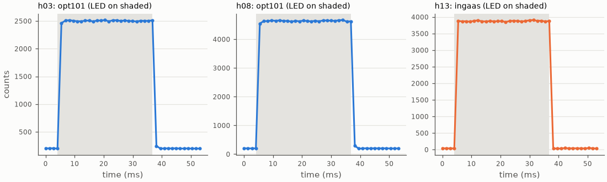

# LIO test report: 20261117-000346_sim

**Verdict: FUNCTIONAL**: no failures or warnings

- Target: `sim`
- Started 2026-11-17T00:03:46-05:00, finished 2026-11-17T00:04:01-05:00
- Sample: `none-empty-chamber`, operator: unknown
- Firmware 2.5.1 (proto 1, build 2026-11-16)
- Config `/Users/coleloughbc/Documents/VSCode-Local/LIO/software/config/lio_hw.yaml` sha256 a6884745c280 (thresholds provisional)
- Host: macOS-27.0.1-x86_64-i386-64bit, Python 3.12.4, lio 0.2.0, git 8b1b33f855 (dirty)
- Counts: PASS 3
- LED duty budget: 0.0 s of cool-down waits, 0 over-budget on-time(s)

## Summary

| Test | Name | Status | Note |
|---|---|---|---|
| T07.1 | Step response and settling time | ✓ PASS |  |
| T07.2 | Recommended settle time | ✓ PASS |  |
| T07.3 | MEAS timing | ✓ PASS |  |

### Step responses

## T07

### T07.1 Step response and settling time: PASS

| Check | Status | Result | Criterion |
|---|---|---|---|
| Hole 3 (opt101) step response | ✓ PASS | settled within a few samples: t99 <= 2.04 ms (upper bound, limited by the sample interval) | time to 99 % recorded |
| Hole 8 (opt101) step response | ✓ PASS | settled within a few samples: t99 <= 2.04 ms (upper bound, limited by the sample interval) | time to 99 % recorded |
| Hole 13 (ingaas) step response | ✓ PASS | settled within one sample: t99 <= 0.68 ms (upper bound, limited by the sample interval) | time to 99 % recorded |

### T07.2 Recommended settle time: PASS

| Check | Status | Result | Criterion |
|---|---|---|---|
| Configured settle_ms is long enough | ✓ PASS | recommended 4 ms (max 2.04 ms x 1.5), configured 8 ms | recommended <= 8 ms |

### T07.3 MEAS timing: PASS

| Check | Status | Result | Criterion |
|---|---|---|---|
| MEAS 3 8 1 on-time | ✓ PASS | t_on_ms 24 | 21.3-32.0 ms and <= watchdog 2000 ms |
| MEAS 3 20 4 on-time | ✓ PASS | t_on_ms 84 | 73.1-106.9 ms and <= watchdog 2000 ms |
