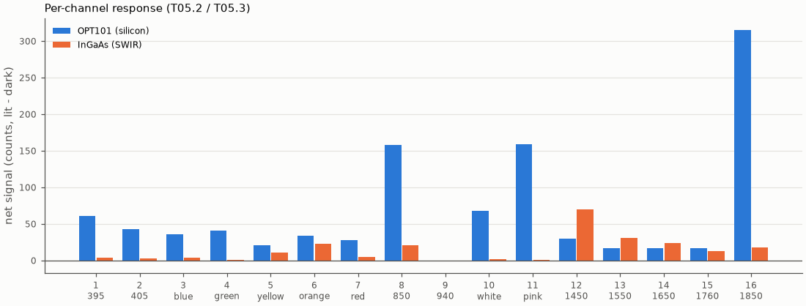
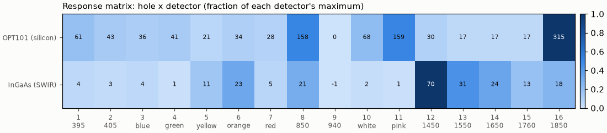
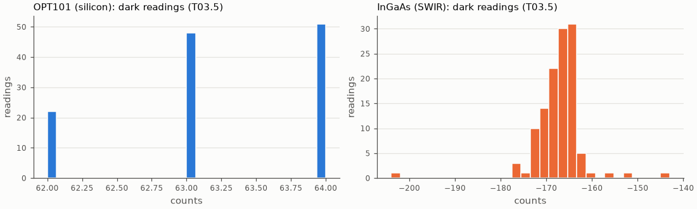
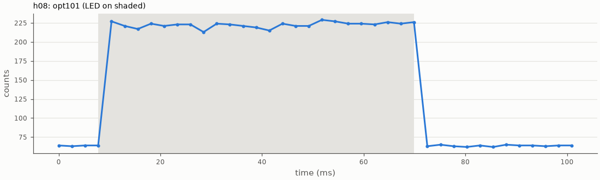
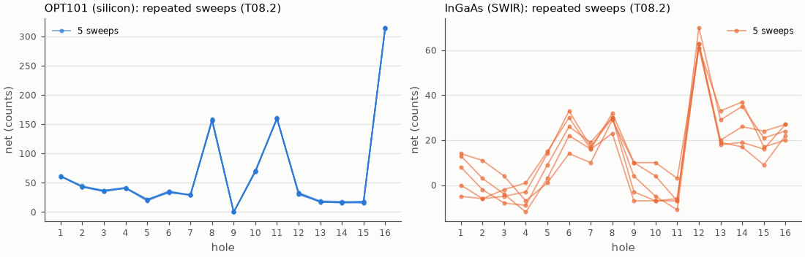

# LIO test report: 20261117-141207_host

**Verdict: NOT FUNCTIONAL**: failure in a critical module: T10.1; failures not tied to a channel: T09.2, T09.3, T09.4, T13.1; 4 failing channels (more than 2): 3, 8, 9, 13

- Target: `/dev/cu.usbmodem1101`
- Started 2026-11-17T14:12:07-05:00, finished 2026-11-17T16:03:52-05:00
- Sample: `none-empty-chamber`, operator: unknown
- Firmware 2.5.1 (proto 1, build 2026-11-16)
- Config `/Users/coleloughbc/Documents/VSCode-Local/LIO/software/config/lio_hw.yaml` sha256 795e6bf0787d (thresholds provisional)
- Host: macOS-27.0.1-x86_64-i386-64bit, Python 3.12.4, lio 0.2.0, git 33dbb29085 (dirty)
- Counts: PASS 31, WARN 2, FAIL 5, SKIP 3, ERROR 4
- LED duty budget: 24.9 s of cool-down waits, 0 over-budget on-time(s)

## Summary

| Test | Name | Status | Note |
|---|---|---|---|
| T01.1 | Python and dependency versions | ✓ PASS |  |
| T01.2 | Serial port discovery | ✓ PASS |  |
| T01.3 | Configuration loads and is self-consistent | ✓ PASS |  |
| T02.1 | Port open and boot banner | ✓ PASS |  |
| T02.2 | PING round-trip latency | ✓ PASS |  |
| T02.3 | INFO fields, versions and safety limits | ✓ PASS |  |
| T02.4 | Robustness to bad input | ✓ PASS |  |
| T02.5 | Sequence numbers and interleaved events | ✓ PASS |  |
| T02.6 | RESET restores the boot state | ✓ PASS |  |
| T03.1 | I2C scan finds the ADS1115 | ✓ PASS |  |
| T03.2 | Dark ADC noise, all inputs | ✓ PASS |  |
| T03.3 | Gain sweep on dark inputs | ✓ PASS |  |
| T03.4 | ADC data rate | ✓ PASS |  |
| T03.5 | Long-term dark stability | ✓ PASS |  |
| T04.1 | Shift-register patterns with CE low | ✓ PASS |  |
| T04.2 | Shift-register loopback (optional jumper) | - SKIP | loopback jumper not fitted (this build has no loop-back input (pins.LOOP), plan §6.3); the shift registers are verified optically by T05.3 |
| T04.3 | Optical address verification | - SKIP | covered by T05.3 (each hole must light only its own expected response) |
| T05.1 | Rail gating by CE1 / CE2 | ✓ PASS |  |
| T05.2 | Per-channel response | ✕ FAIL |  |
| T05.3 | Channel address and isolation | ✕ FAIL |  |
| T05.4 | Off-state return after each MEAS | ✓ PASS |  |
| T05.5 | Repeatability (interleaved MEAS) | ✓ PASS | not judged (net < 1000 counts or detector unusable): 1/opt101, 2/opt101, 3/opt101, 4/opt101, 5/opt101, 6/opt101, 7/opt101, 8/opt101, 8/ingaas, 9/opt101, 9/ingaas, 10/opt101, 11/opt101, 12/ingaas, 13/ingaas, 14/ingaas, 15/ingaas |
| T06.1 | OPT101 | ✓ PASS |  |
| T06.2 | InGaAs TIA | ✓ PASS |  |
| T06.3 | Cross-calibration on the shared holes | ✕ FAIL |  |
| T07.1 | Step response and settling time | ✕ FAIL |  |
| T07.2 | Recommended settle time | ✓ PASS |  |
| T07.3 | MEAS timing | ✓ PASS |  |
| T08.1 | SWEEP completes with a valid schema | ✓ PASS |  |
| T08.2 | Repeated sweeps | ✓ PASS |  |
| T08.3 | Sweep agrees with MEAS | ✓ PASS |  |
| T08.4 | CSV output format | ✓ PASS |  |
| T09.1 | Motion arming | ✓ PASS |  |
| T09.2 | Each motor moves both ways | ✕ ERROR | StageError: motor 1: +64 would end at -4032, above the top limit (0 - margin 4096); at most +0 |
| T09.3 | MOTOR STOP latency | ✕ ERROR | StageError: motor 1: +2048 would end at -2048, above the top limit (0 - margin 4096); at most +0 |
| T09.4 | Detector noise while a motor moves | ✕ ERROR | StageError: motor 1: +256 would end at -3840, above the top limit (0 - margin 4096); at most +0 |
| T09.6 | Full travel, both motors in lockstep | ! WARN |  |
| T09.7 | Detectors while the chamber moves | ! WARN |  |
| T10.1 | Power-up dark state | ✕ FAIL |  |
| T10.2 | On-time watchdog | ✓ PASS |  |
| T10.3 | Comms-loss failsafe | ✓ PASS |  |
| T10.4 | Single-channel invariant | ✓ PASS |  |
| T10.5 | Motion disarmed after comms loss | ✓ PASS |  |
| T11.1 | Comparison with the baseline | - SKIP | no baseline given (--baseline <file>); save one with --save-baseline |
| T13.1 | Diagnostic height sweep | ✕ ERROR | OSError: [Errno 28] No space left on device: '/Users/coleloughbc/Documents/VSCode-Local/LIO/test_results/stage_position.tmp' |

### Per-channel response

### Response matrix

### Dark noise

### Step responses

### Repeated sweeps

## T01

### T01.1 Python and dependency versions: PASS

| Check | Status | Result | Criterion |
|---|---|---|---|
| Python version | ✓ PASS | 3.12.4 | >= 3.10 |
| pyserial installed | ✓ PASS | 3.5 | importable |
| pyyaml installed | ✓ PASS | 6.0.3 | importable |
| numpy installed | ✓ PASS | 2.5.4 | importable |
| matplotlib installed | ✓ PASS | 3.11.2 | importable |
| jinja2 installed | ✓ PASS | 3.1.6 | importable |

### T01.2 Serial port discovery: PASS

| Check | Status | Result | Criterion |
|---|---|---|---|
| Selected port is present | ✓ PASS | /dev/cu.usbmodem1101: present | --lio-port names an existing serial port |
| USB-serial chip recognised | ✓ PASS | VID:PID 2341:0074 (Arduino Nano R4 (native USB)) | one of link.usb_ids |

### T01.3 Configuration loads and is self-consistent: PASS

| Check | Status | Result | Criterion |
|---|---|---|---|
| Config validates | ✓ PASS | lio_hw.yaml sha256 795e6bf0787d |  |
| 16 holes | ✓ PASS | 16 entries |  |
| Rails split A = 1-9, B = 10-16 | ✓ PASS | A=[1, 2, 3, 4, 5, 6, 7, 8, 9] B=[10, 11, 12, 13, 14, 15, 16] |  |

## T02

### T02.1 Port open and boot banner: PASS

| Check | Status | Result | Criterion |
|---|---|---|---|
| Boot banner within the timeout | ✓ PASS | 0.06 s | <= 3 s |
| Banner identifies LIO firmware | ✓ PASS | # BOOT name=lio fw=2.5.1 proto=1 build=2026-11-16 adc_ok=1 hw_wdt=0 | name=lio, fw and proto present |

### T02.2 PING round-trip latency: PASS

| Check | Status | Result | Criterion |
|---|---|---|---|
| Every PING answered | ✓ PASS | 100/100 answered | all |
| p99 round trip | ✓ PASS | median 0.96 ms, p99 2.02 ms, max 2.20 ms | p99 < 50 ms |

### T02.3 INFO fields, versions and safety limits: PASS

| Check | Status | Result | Criterion |
|---|---|---|---|
| INFO fields present | ✓ PASS | 21 fields | all protocol-1 INFO fields |
| Firmware compatible with this host package | ✓ PASS | fw 2.5.1 proto 1 | >= 2.0.0, proto 1 |
| settle_ms matches lio_hw.yaml | ✓ PASS | 8 | 8 |
| wdt_a_ms matches lio_hw.yaml | ✓ PASS | 2000 | 2000 |
| wdt_b_ms matches lio_hw.yaml | ✓ PASS | 5000 | 5000 |
| wdt_a_cap_ms matches lio_hw.yaml | ✓ PASS | 5000 | 5000 |
| wdt_b_cap_ms matches lio_hw.yaml | ✓ PASS | 10000 | 10000 |
| comms_ms matches lio_hw.yaml | ✓ PASS | 10000 | 10000 |
| arm_ms matches lio_hw.yaml | ✓ PASS | 60000 | 60000 |
| step_max matches lio_hw.yaml | ✓ PASS | 2048 | 2048 |
| jog_max matches lio_hw.yaml | ✓ PASS | 2048 | 2048 |
| jog_v_max matches lio_hw.yaml | ✓ PASS | 1000 | 1000 |
| jog_acc_max matches lio_hw.yaml | ✓ PASS | 1000 | 1000 |
| wake_ms_max matches lio_hw.yaml | ✓ PASS | 3000 | 3000 |
| ADC address matches lio_hw.yaml | ✓ PASS | 0x48 | 0x48 |
| ADC gain matches lio_hw.yaml | ✓ PASS | 1 | 1 |
| ADC rate matches lio_hw.yaml | ✓ PASS | 128 | 128 |

### T02.4 Robustness to bad input: PASS

| Check | Status | Result | Criterion |
|---|---|---|---|
| Unknown command | ✓ PASS | @141 ERR FROBNICATE code=1 msg=unknown command | ERR code=1 |
| Bad argument | ✓ PASS | @142 ERR MEAS code=2 msg=usage: MEAS <1-16> [settle_ms] [n] | ERR code=2 |
| Missing argument | ✓ PASS | @143 ERR CH code=2 msg=usage: CH <1-16> ON [ms] | ERR code=2 |
| Line over 64 characters | ✓ PASS | ERR ? code=6 msg=line too long | ERR code=6 |
| Garbage bytes, then PING | ✓ PASS | PING OK | PING still answered |

### T02.5 Sequence numbers and interleaved events: PASS

| Check | Status | Result | Criterion |
|---|---|---|---|
| @1 echoed | ✓ PASS | @1 OK PING uptime_ms=5622610 | @1 OK PING |
| @4242 echoed | ✓ PASS | @4242 OK PING uptime_ms=5622611 | @4242 OK PING |
| @99999 echoed | ✓ PASS | @99999 OK PING uptime_ms=5622612 | @99999 OK PING |
| No @seq, none echoed | ✓ PASS | OK PING uptime_ms=5622613 | OK PING |
| Response found after interleaved events | ✓ PASS | 20 '# S' events then OK | 20 events |
| Asynchronous '# OFF' does not desynchronise | ✓ PASS | 10/10 PINGs matched; 1 timer event(s) seen | all PINGs answered in order, one '# OFF' |

### T02.6 RESET restores the boot state: PASS

| Check | Status | Result | Criterion |
|---|---|---|---|
| Banner after RESET | ✓ PASS | 0.07 s | <= 3 s |
| STATUS shows the safe state | ✓ PASS | ch=0 ce1=0 ce2=0 mask=0x0000 armed=0 | ch=0 ce1=0 ce2=0 mask=0 armed=0, motors idle |
| Settings back to defaults | ✓ PASS | wdt_a_ms=2000 (was set to 200) | 2000 |

## T03

### T03.1 I2C scan finds the ADS1115: PASS

| Check | Status | Result | Criterion |
|---|---|---|---|
| ADS1115 at 0x48 | ✓ PASS | found ['0x48'] | 0x48 acknowledges |
| I2C lines (SDA, SCL) | ✓ PASS | lines idle high with pull-ups, not bridged; 0x48 answers at 166.666 kHz | both idle high, rise on external pull-ups, not joined |
| No unexpected I2C devices | ✓ PASS | none | only the ADS1115 |

### T03.2 Dark ADC noise, all inputs: PASS

| Check | Status | Result | Criterion |
|---|---|---|---|
| ADS A0 (ingaas) dark noise | ✓ PASS | mean -155.0, sigma 7.16 counts (n=64) | sigma <= 20 counts |
| ADS A1 (opt101) dark noise | ✓ PASS | mean 61.9, sigma 0.37 counts (n=64) | sigma <= 20 counts |
| ADS A2 (unconnected) | ✓ PASS | recorded only: mean 4520.9, sigma 9.12 | floating input |
| ADS A3 (unconnected) | ✓ PASS | recorded only: mean 2652.1, sigma 4.78 | floating input |

### T03.3 Gain sweep on dark inputs: PASS

| Check | Status | Result | Criterion |
|---|---|---|---|
| GAIN 2/3 accepted | ✓ PASS | lsb 0.1875 mV | 0.1875 mV |
| GAIN 1 accepted | ✓ PASS | lsb 0.125 mV | 0.125 mV |
| GAIN 2 accepted | ✓ PASS | lsb 0.0625 mV | 0.0625 mV |
| GAIN 4 accepted | ✓ PASS | lsb 0.03125 mV | 0.03125 mV |
| GAIN 8 accepted | ✓ PASS | lsb 0.015625 mV | 0.015625 mV |
| GAIN 16 accepted | ✓ PASS | lsb 0.0078125 mV | 0.0078125 mV |
| ingaas at GAIN 2/3 agrees with GAIN 1 | ✓ PASS | -24.06 mV vs -23.00 mV | within 6.59 mV |
| ingaas at GAIN 1 agrees with GAIN 1 | ✓ PASS | -23.00 mV vs -23.00 mV | within 6.59 mV |
| ingaas at GAIN 2 agrees with GAIN 1 | ✓ PASS | -24.00 mV vs -23.00 mV | within 7.12 mV |
| ingaas at GAIN 4 agrees with GAIN 1 | ✓ PASS | -20.77 mV vs -23.00 mV | within 10.66 mV |
| ingaas at GAIN 8 agrees with GAIN 1 | ✓ PASS | -20.73 mV vs -23.00 mV | within 9.21 mV |
| ingaas at GAIN 16 agrees with GAIN 1 | ✓ PASS | -22.65 mV vs -23.00 mV | within 7.50 mV |
| GAIN 2/3 accepted | ✓ PASS | lsb 0.1875 mV | 0.1875 mV |
| GAIN 1 accepted | ✓ PASS | lsb 0.125 mV | 0.125 mV |
| GAIN 2 accepted | ✓ PASS | lsb 0.0625 mV | 0.0625 mV |
| GAIN 4 accepted | ✓ PASS | lsb 0.03125 mV | 0.03125 mV |
| GAIN 8 accepted | ✓ PASS | lsb 0.015625 mV | 0.015625 mV |
| GAIN 16 accepted | ✓ PASS | lsb 0.0078125 mV | 0.0078125 mV |
| opt101 at GAIN 2/3 agrees with GAIN 1 | ✓ PASS | 8.07 mV vs 7.99 mV | within 5.14 mV |
| opt101 at GAIN 1 agrees with GAIN 1 | ✓ PASS | 7.99 mV vs 7.99 mV | within 5.13 mV |
| opt101 at GAIN 2 agrees with GAIN 1 | ✓ PASS | 7.97 mV vs 7.99 mV | within 5.13 mV |
| opt101 at GAIN 4 agrees with GAIN 1 | ✓ PASS | 7.68 mV vs 7.99 mV | within 5.13 mV |
| opt101 at GAIN 8 agrees with GAIN 1 | ✓ PASS | 8.37 mV vs 7.99 mV | within 5.13 mV |
| opt101 at GAIN 16 agrees with GAIN 1 | ✓ PASS | 8.38 mV vs 7.99 mV | within 5.13 mV |

### T03.4 ADC data rate: PASS

| Check | Status | Result | Criterion |
|---|---|---|---|
| 8 SPS conversion interval | ✓ PASS | 120.968 ms (nominal 125.000 ms, overhead -4.032 ms) | 106.250-145.250 ms |
| 16 SPS conversion interval | ✓ PASS | 61.146 ms (nominal 62.500 ms, overhead -1.354 ms) | 53.125-73.375 ms |
| 32 SPS conversion interval | ✓ PASS | 31.234 ms (nominal 31.250 ms, overhead -0.016 ms) | 26.562-37.438 ms |
| 64 SPS conversion interval | ✓ PASS | 16.283 ms (nominal 15.625 ms, overhead +0.658 ms) | 13.281-19.469 ms |
| 128 SPS conversion interval | ✓ PASS | 8.974 ms (nominal 7.812 ms, overhead +1.162 ms) | 6.641-10.484 ms |
| 250 SPS conversion interval | ✓ PASS | 5.362 ms (nominal 4.000 ms, overhead +1.362 ms) | 3.400-6.100 ms |
| 475 SPS conversion interval | ✓ PASS | 3.400 ms (nominal 2.105 ms, overhead +1.295 ms) | 1.789-3.921 ms |
| 860 SPS conversion interval | ✓ PASS | 2.585 ms (nominal 1.163 ms, overhead +1.422 ms) | 0.988-2.837 ms |

### T03.5 Long-term dark stability: PASS

| Check | Status | Result | Criterion |
|---|---|---|---|
| ingaas drift over 60 s | ✓ PASS | +1.8 counts/min (0.005 % FS/min), sigma 5.31 | <= 2 % FS/min |
| opt101 drift over 60 s | ✓ PASS | +1.4 counts/min (0.004 % FS/min), sigma 0.74 | <= 2 % FS/min |

## T04

### T04.1 Shift-register patterns with CE low: PASS

| Check | Status | Result | Criterion |
|---|---|---|---|
| SR RAW 0x0000 | ✓ PASS | echoed, CE low, detectors dark | mask echoed in reply and STATUS; CE1 = CE2 = 0; detectors at dark |
| SR RAW 0xFFFF | ✓ PASS | echoed, CE low, detectors dark | mask echoed in reply and STATUS; CE1 = CE2 = 0; detectors at dark |
| SR RAW 0x0001 | ✓ PASS | echoed, CE low, detectors dark | mask echoed in reply and STATUS; CE1 = CE2 = 0; detectors at dark |
| SR RAW 0x0002 | ✓ PASS | echoed, CE low, detectors dark | mask echoed in reply and STATUS; CE1 = CE2 = 0; detectors at dark |
| SR RAW 0x0004 | ✓ PASS | echoed, CE low, detectors dark | mask echoed in reply and STATUS; CE1 = CE2 = 0; detectors at dark |
| SR RAW 0x0008 | ✓ PASS | echoed, CE low, detectors dark | mask echoed in reply and STATUS; CE1 = CE2 = 0; detectors at dark |
| SR RAW 0x0010 | ✓ PASS | echoed, CE low, detectors dark | mask echoed in reply and STATUS; CE1 = CE2 = 0; detectors at dark |
| SR RAW 0x0020 | ✓ PASS | echoed, CE low, detectors dark | mask echoed in reply and STATUS; CE1 = CE2 = 0; detectors at dark |
| SR RAW 0x0040 | ✓ PASS | echoed, CE low, detectors dark | mask echoed in reply and STATUS; CE1 = CE2 = 0; detectors at dark |
| SR RAW 0x0080 | ✓ PASS | echoed, CE low, detectors dark | mask echoed in reply and STATUS; CE1 = CE2 = 0; detectors at dark |
| SR RAW 0x0100 | ✓ PASS | echoed, CE low, detectors dark | mask echoed in reply and STATUS; CE1 = CE2 = 0; detectors at dark |
| SR RAW 0x0200 | ✓ PASS | echoed, CE low, detectors dark | mask echoed in reply and STATUS; CE1 = CE2 = 0; detectors at dark |
| SR RAW 0x0400 | ✓ PASS | echoed, CE low, detectors dark | mask echoed in reply and STATUS; CE1 = CE2 = 0; detectors at dark |
| SR RAW 0x0800 | ✓ PASS | echoed, CE low, detectors dark | mask echoed in reply and STATUS; CE1 = CE2 = 0; detectors at dark |
| SR RAW 0x1000 | ✓ PASS | echoed, CE low, detectors dark | mask echoed in reply and STATUS; CE1 = CE2 = 0; detectors at dark |
| SR RAW 0x2000 | ✓ PASS | echoed, CE low, detectors dark | mask echoed in reply and STATUS; CE1 = CE2 = 0; detectors at dark |
| SR RAW 0x4000 | ✓ PASS | echoed, CE low, detectors dark | mask echoed in reply and STATUS; CE1 = CE2 = 0; detectors at dark |
| SR RAW 0x8000 | ✓ PASS | echoed, CE low, detectors dark | mask echoed in reply and STATUS; CE1 = CE2 = 0; detectors at dark |
| SR RAW 0xFFFE | ✓ PASS | echoed, CE low, detectors dark | mask echoed in reply and STATUS; CE1 = CE2 = 0; detectors at dark |
| SR RAW 0xFFFD | ✓ PASS | echoed, CE low, detectors dark | mask echoed in reply and STATUS; CE1 = CE2 = 0; detectors at dark |
| SR RAW 0xFFFB | ✓ PASS | echoed, CE low, detectors dark | mask echoed in reply and STATUS; CE1 = CE2 = 0; detectors at dark |
| SR RAW 0xFFF7 | ✓ PASS | echoed, CE low, detectors dark | mask echoed in reply and STATUS; CE1 = CE2 = 0; detectors at dark |
| SR RAW 0xFFEF | ✓ PASS | echoed, CE low, detectors dark | mask echoed in reply and STATUS; CE1 = CE2 = 0; detectors at dark |
| SR RAW 0xFFDF | ✓ PASS | echoed, CE low, detectors dark | mask echoed in reply and STATUS; CE1 = CE2 = 0; detectors at dark |
| SR RAW 0xFFBF | ✓ PASS | echoed, CE low, detectors dark | mask echoed in reply and STATUS; CE1 = CE2 = 0; detectors at dark |
| SR RAW 0xFF7F | ✓ PASS | echoed, CE low, detectors dark | mask echoed in reply and STATUS; CE1 = CE2 = 0; detectors at dark |
| SR RAW 0xFEFF | ✓ PASS | echoed, CE low, detectors dark | mask echoed in reply and STATUS; CE1 = CE2 = 0; detectors at dark |
| SR RAW 0xFDFF | ✓ PASS | echoed, CE low, detectors dark | mask echoed in reply and STATUS; CE1 = CE2 = 0; detectors at dark |
| SR RAW 0xFBFF | ✓ PASS | echoed, CE low, detectors dark | mask echoed in reply and STATUS; CE1 = CE2 = 0; detectors at dark |
| SR RAW 0xF7FF | ✓ PASS | echoed, CE low, detectors dark | mask echoed in reply and STATUS; CE1 = CE2 = 0; detectors at dark |
| SR RAW 0xEFFF | ✓ PASS | echoed, CE low, detectors dark | mask echoed in reply and STATUS; CE1 = CE2 = 0; detectors at dark |
| SR RAW 0xDFFF | ✓ PASS | echoed, CE low, detectors dark | mask echoed in reply and STATUS; CE1 = CE2 = 0; detectors at dark |
| SR RAW 0xBFFF | ✓ PASS | echoed, CE low, detectors dark | mask echoed in reply and STATUS; CE1 = CE2 = 0; detectors at dark |
| SR RAW 0x7FFF | ✓ PASS | echoed, CE low, detectors dark | mask echoed in reply and STATUS; CE1 = CE2 = 0; detectors at dark |

### T04.2 Shift-register loopback (optional jumper): SKIP

loopback jumper not fitted (this build has no loop-back input (pins.LOOP), plan §6.3); the shift registers are verified optically by T05.3

### T04.3 Optical address verification: SKIP

covered by T05.3 (each hole must light only its own expected response)

## T05

### T05.1 Rail gating by CE1 / CE2: PASS

| Check | Status | Result | Criterion |
|---|---|---|---|
| Hole 8 selected, CE1 low | ✓ PASS | opt101 63 (dark 62) | dark |
| Hole 8 selected, CE1 high | ✓ PASS | opt101 222 | light above the detection threshold |
| Hole 8 with CE2 (wrong rail) | ✓ PASS | ERR code=3 needs exactly one selected hole on this rail | refused (code 3) |
| Hole 12 selected, CE2 low | ✓ PASS | ingaas -170 (dark -155) | dark |
| Hole 12 selected, CE2 high | ✓ PASS | ingaas -95 | light above the detection threshold |
| Hole 12 with CE1 (wrong rail) | ✓ PASS | ERR code=3 needs exactly one selected hole on this rail | refused (code 3) |

### T05.2 Per-channel response: FAIL

| Check | Status | Result | Criterion |
|---|---|---|---|
| Hole 9 (940) on ingaas | ✕ FAIL | net -1 (none); expected signal, none seen | expect signal: signal >= 51 |
| Hole 9 (940) on opt101 | ✕ FAIL | net +0 (none); expected signal, none seen | expect signal: signal >= 50 |
| Hole 2 (405) on opt101 | ! WARN | net +43 (weak); weaker than expected | expect signal: signal >= 50 |
| Hole 3 (blue) on opt101 | ! WARN | net +36 (weak); weaker than expected | expect signal: signal >= 50 |
| Hole 4 (green) on opt101 | ! WARN | net +41 (weak); weaker than expected | expect signal: signal >= 50 |
| Hole 5 (yellow) on opt101 | ! WARN | net +21 (weak); weaker than expected | expect signal: signal >= 50 |
| Hole 6 (orange) on opt101 | ! WARN | net +34 (weak); weaker than expected | expect signal: signal >= 50 |
| Hole 7 (red) on opt101 | ! WARN | net +28 (weak); weaker than expected | expect signal: signal >= 50 |
| Hole 8 (850) on ingaas | ! WARN | net +21 (weak); weaker than expected | expect signal: signal >= 51 |
| Hole 13 (1550) on ingaas | ! WARN | net +31 (weak); weaker than expected | expect signal: signal >= 51 |
| Hole 14 (1650) on ingaas | ! WARN | net +24 (weak); weaker than expected | expect signal: signal >= 51 |
| Hole 15 (1760) on ingaas | ! WARN | net +13 (none); weak channel below the weak threshold | expect weak: signal >= 51 |
| Hole 1 (395) on opt101 | ✓ PASS | net +61 (signal); signal as expected | expect signal: signal >= 50 |
| Hole 8 (850) on opt101 | ✓ PASS | net +158 (signal); signal as expected | expect signal: signal >= 50 |
| Hole 10 (white) on opt101 | ✓ PASS | net +68 (signal); signal as expected | expect signal: signal >= 50 |
| Hole 11 (pink) on opt101 | ✓ PASS | net +159 (signal); signal as expected | expect signal: signal >= 50 |
| Hole 12 (1450) on ingaas | ✓ PASS | net +70 (signal); signal as expected | expect signal: signal >= 51 |
| Hole 1 (395) on ingaas | - SKIP | not judged: 395 is outside the ingaas range (judged by opt101); recorded net +4 | out-of-range readings are not judged (channel.judge_out_of_range: false) |
| Hole 2 (405) on ingaas | - SKIP | not judged: 405 is outside the ingaas range (judged by opt101); recorded net +3 | out-of-range readings are not judged (channel.judge_out_of_range: false) |
| Hole 3 (blue) on ingaas | - SKIP | not judged: blue is outside the ingaas range (judged by opt101); recorded net +4 | out-of-range readings are not judged (channel.judge_out_of_range: false) |
| Hole 4 (green) on ingaas | - SKIP | not judged: green is outside the ingaas range (judged by opt101); recorded net +1 | out-of-range readings are not judged (channel.judge_out_of_range: false) |
| Hole 5 (yellow) on ingaas | - SKIP | not judged: yellow is outside the ingaas range (judged by opt101); recorded net +11 | out-of-range readings are not judged (channel.judge_out_of_range: false) |
| Hole 6 (orange) on ingaas | - SKIP | not judged: orange is outside the ingaas range (judged by opt101); recorded net +23 | out-of-range readings are not judged (channel.judge_out_of_range: false) |
| Hole 7 (red) on ingaas | - SKIP | not judged: red is outside the ingaas range (judged by opt101); recorded net +5 | out-of-range readings are not judged (channel.judge_out_of_range: false) |
| Hole 10 (white) on ingaas | - SKIP | not judged: white is outside the ingaas range (judged by opt101); recorded net +2 | out-of-range readings are not judged (channel.judge_out_of_range: false) |
| Hole 11 (pink) on ingaas | - SKIP | not judged: pink is outside the ingaas range (judged by opt101); recorded net +1 | out-of-range readings are not judged (channel.judge_out_of_range: false) |
| Hole 12 (1450) on opt101 | - SKIP | not judged: 1450 is outside the opt101 range (judged by ingaas); recorded net +30 | out-of-range readings are not judged (channel.judge_out_of_range: false) |
| Hole 13 (1550) on opt101 | - SKIP | not judged: 1550 is outside the opt101 range (judged by ingaas); recorded net +17 | out-of-range readings are not judged (channel.judge_out_of_range: false) |
| Hole 14 (1650) on opt101 | - SKIP | not judged: 1650 is outside the opt101 range (judged by ingaas); recorded net +17 | out-of-range readings are not judged (channel.judge_out_of_range: false) |
| Hole 15 (1760) on opt101 | - SKIP | not judged: 1760 is outside the opt101 range (judged by ingaas); recorded net +17 | out-of-range readings are not judged (channel.judge_out_of_range: false) |
| Hole 16 (1850) on ingaas | - SKIP | not judged: 1850 is outside the ingaas range (judged by no detector); recorded net +18 | out-of-range readings are not judged (channel.judge_out_of_range: false) |
| Hole 16 (1850) on opt101 | - SKIP | not judged: 1850 is outside the opt101 range (judged by no detector); recorded net +315 | out-of-range readings are not judged (channel.judge_out_of_range: false) |

### T05.3 Channel address and isolation: FAIL

| Check | Status | Result | Criterion |
|---|---|---|---|
| Hole 9 (940) detector pattern | ✕ FAIL | no response on ['ingaas', 'opt101']: possible swapped, misrouted or stuck-on channel | expected ['ingaas', 'opt101'] |
| Hole 15 (1760) detector pattern | ! WARN | no response on ['ingaas']: possible swapped, misrouted or stuck-on channel | expected ['ingaas'] |
| Hole 1 (395) detector pattern | ✓ PASS | seen by ['opt101'] as expected (ingaas not judged: outside its range) | expected ['opt101'] |
| Hole 2 (405) detector pattern | ✓ PASS | seen by ['opt101'] as expected (ingaas not judged: outside its range) | expected ['opt101'] |
| Hole 3 (blue) detector pattern | ✓ PASS | seen by ['opt101'] as expected (ingaas not judged: outside its range) | expected ['opt101'] |
| Hole 4 (green) detector pattern | ✓ PASS | seen by ['opt101'] as expected (ingaas not judged: outside its range) | expected ['opt101'] |
| Hole 5 (yellow) detector pattern | ✓ PASS | seen by ['opt101'] as expected (ingaas not judged: outside its range) | expected ['opt101'] |
| Hole 6 (orange) detector pattern | ✓ PASS | seen by ['opt101'] as expected (ingaas not judged: outside its range) | expected ['opt101'] |
| Hole 7 (red) detector pattern | ✓ PASS | seen by ['opt101'] as expected (ingaas not judged: outside its range) | expected ['opt101'] |
| Hole 8 (850) detector pattern | ✓ PASS | seen by ['ingaas', 'opt101'] as expected | expected ['ingaas', 'opt101'] |
| Hole 10 (white) detector pattern | ✓ PASS | seen by ['opt101'] as expected (ingaas not judged: outside its range) | expected ['opt101'] |
| Hole 11 (pink) detector pattern | ✓ PASS | seen by ['opt101'] as expected (ingaas not judged: outside its range) | expected ['opt101'] |
| Hole 12 (1450) detector pattern | ✓ PASS | seen by ['ingaas'] as expected (opt101 not judged: outside its range) | expected ['ingaas'] |
| Hole 13 (1550) detector pattern | ✓ PASS | seen by ['ingaas'] as expected (opt101 not judged: outside its range) | expected ['ingaas'] |
| Hole 14 (1650) detector pattern | ✓ PASS | seen by ['ingaas'] as expected (opt101 not judged: outside its range) | expected ['ingaas'] |
| Hole 16 (1850) detector pattern | ✓ PASS | seen by nothing as expected (ingaas, opt101 not judged: outside its range) | expected none |
| Signatures unique | ✓ PASS | no two channels look the same | cosine < 0.98 or amplitude differs by more than 1 % |

### T05.4 Off-state return after each MEAS: PASS

| Check | Status | Result | Criterion |
|---|---|---|---|
| Hole 1 ingaas back to dark | ✓ PASS | -170.0 after OFF vs dark -170 | within 5 sigma (25.3 counts) |
| Hole 1 opt101 back to dark | ✓ PASS | 63.0 after OFF vs dark 63 | within 5 sigma (3.5 counts) |
| Hole 2 ingaas back to dark | ✓ PASS | -169.2 after OFF vs dark -169 | within 5 sigma (25.3 counts) |
| Hole 2 opt101 back to dark | ✓ PASS | 63.0 after OFF vs dark 63 | within 5 sigma (3.5 counts) |
| Hole 3 ingaas back to dark | ✓ PASS | -168.5 after OFF vs dark -170 | within 5 sigma (25.3 counts) |
| Hole 3 opt101 back to dark | ✓ PASS | 62.5 after OFF vs dark 63 | within 5 sigma (3.5 counts) |
| Hole 4 ingaas back to dark | ✓ PASS | -167.2 after OFF vs dark -169 | within 5 sigma (25.3 counts) |
| Hole 4 opt101 back to dark | ✓ PASS | 62.5 after OFF vs dark 63 | within 5 sigma (3.5 counts) |
| Hole 5 ingaas back to dark | ✓ PASS | -164.0 after OFF vs dark -165 | within 5 sigma (25.3 counts) |
| Hole 5 opt101 back to dark | ✓ PASS | 63.0 after OFF vs dark 63 | within 5 sigma (3.5 counts) |
| Hole 6 ingaas back to dark | ✓ PASS | -158.5 after OFF vs dark -162 | within 5 sigma (25.3 counts) |
| Hole 6 opt101 back to dark | ✓ PASS | 62.8 after OFF vs dark 63 | within 5 sigma (3.5 counts) |
| Hole 7 ingaas back to dark | ✓ PASS | -164.8 after OFF vs dark -156 | within 5 sigma (25.3 counts) |
| Hole 7 opt101 back to dark | ✓ PASS | 63.5 after OFF vs dark 63 | within 5 sigma (3.5 counts) |
| Hole 8 ingaas back to dark | ✓ PASS | -169.0 after OFF vs dark -168 | within 5 sigma (25.3 counts) |
| Hole 8 opt101 back to dark | ✓ PASS | 63.0 after OFF vs dark 63 | within 5 sigma (3.5 counts) |
| Hole 9 ingaas back to dark | ✓ PASS | -169.2 after OFF vs dark -167 | within 5 sigma (25.3 counts) |
| Hole 9 opt101 back to dark | ✓ PASS | 63.0 after OFF vs dark 63 | within 5 sigma (3.5 counts) |
| Hole 10 ingaas back to dark | ✓ PASS | -169.8 after OFF vs dark -169 | within 5 sigma (25.3 counts) |
| Hole 10 opt101 back to dark | ✓ PASS | 62.8 after OFF vs dark 63 | within 5 sigma (3.5 counts) |
| Hole 11 ingaas back to dark | ✓ PASS | -171.0 after OFF vs dark -170 | within 5 sigma (25.3 counts) |
| Hole 11 opt101 back to dark | ✓ PASS | 63.0 after OFF vs dark 63 | within 5 sigma (3.5 counts) |
| Hole 12 ingaas back to dark | ✓ PASS | -182.0 after OFF vs dark -171 | within 5 sigma (25.3 counts) |
| Hole 12 opt101 back to dark | ✓ PASS | 63.0 after OFF vs dark 63 | within 5 sigma (3.5 counts) |
| Hole 13 ingaas back to dark | ✓ PASS | -175.5 after OFF vs dark -185 | within 5 sigma (25.3 counts) |
| Hole 13 opt101 back to dark | ✓ PASS | 62.8 after OFF vs dark 63 | within 5 sigma (3.5 counts) |
| Hole 14 ingaas back to dark | ✓ PASS | -170.8 after OFF vs dark -174 | within 5 sigma (25.3 counts) |
| Hole 14 opt101 back to dark | ✓ PASS | 63.0 after OFF vs dark 63 | within 5 sigma (3.5 counts) |
| Hole 15 ingaas back to dark | ✓ PASS | -169.2 after OFF vs dark -168 | within 5 sigma (25.3 counts) |
| Hole 15 opt101 back to dark | ✓ PASS | 62.5 after OFF vs dark 63 | within 5 sigma (3.5 counts) |
| Hole 16 ingaas back to dark | ✓ PASS | -169.0 after OFF vs dark -168 | within 5 sigma (25.3 counts) |
| Hole 16 opt101 back to dark | ✓ PASS | 63.2 after OFF vs dark 63 | within 5 sigma (3.5 counts) |

### T05.5 Repeatability (interleaved MEAS): PASS

not judged (net < 1000 counts or detector unusable): 1/opt101, 2/opt101, 3/opt101, 4/opt101, 5/opt101, 6/opt101, 7/opt101, 8/opt101, 8/ingaas, 9/opt101, 9/ingaas, 10/opt101, 11/opt101, 12/ingaas, 13/ingaas, 14/ingaas, 15/ingaas

## T06

### T06.1 OPT101: PASS

| Check | Status | Result | Criterion |
|---|---|---|---|
| opt101 dark offset | ✓ PASS | 61.9 counts | 0 to 800 counts |
| Responds to hole 1 (395) | ✓ PASS | net +61 | no zeros where light is expected |
| Responds to hole 2 (405) | ✓ PASS | net +43 | no zeros where light is expected |
| Responds to hole 3 (blue) | ✓ PASS | net +36 | no zeros where light is expected |
| Responds to hole 4 (green) | ✓ PASS | net +41 | no zeros where light is expected |
| Responds to hole 5 (yellow) | ✓ PASS | net +21 | no zeros where light is expected |
| Responds to hole 6 (orange) | ✓ PASS | net +34 | no zeros where light is expected |
| Responds to hole 7 (red) | ✓ PASS | net +28 | no zeros where light is expected |
| Responds to hole 10 (white) | ✓ PASS | net +68 | no zeros where light is expected |
| Responds to hole 11 (pink) | ✓ PASS | net +159 | no zeros where light is expected |
| Not saturated | ✓ PASS | peak 378 | < 29000 counts |

### T06.2 InGaAs TIA: PASS

| Check | Status | Result | Criterion |
|---|---|---|---|
| Dark signal steady | ✓ PASS | dark mean -155, sigma 7.2 | sigma <= 100 and mean >= -1500 |
| ingaas dark offset | ✓ PASS | -155.0 counts | -400 to 2000 counts |
| Polarity gate (hole 8) | ✓ PASS | net +20 | net >= -5 sigma |
| Hole 9 InGaAs polarity | ✓ PASS | net -1 | net not negative |
| Hole 12 InGaAs polarity | ✓ PASS | net +70 | net not negative |
| Hole 13 InGaAs polarity | ✓ PASS | net +31 | net not negative |
| Hole 14 InGaAs polarity | ✓ PASS | net +24 | net not negative |
| InGaAs not saturated | ✓ PASS | no hole saturates | < 27000 counts |

### T06.3 Cross-calibration on the shared holes: FAIL

| Check | Status | Result | Criterion |
|---|---|---|---|
| Hole 8 seen by both detectors | ✕ FAIL | one detector does not respond | both above the detection threshold |
| Hole 9 seen by both detectors | ✕ FAIL | one detector does not respond | both above the detection threshold |

## T07

### T07.1 Step response and settling time: FAIL

| Check | Status | Result | Criterion |
|---|---|---|---|
| Hole 3 step response | ✕ FAIL | no step on opt101 (baseline 63, plateau 99) | a step above the detection threshold |
| Hole 13 step response | ✕ FAIL | no step on ingaas (baseline -164, plateau -139) | a step above the detection threshold |
| Hole 8 (opt101) step response | ✓ PASS | t99 = 5.29 ms, tau 1.15 ms | time to 99 % recorded |

### T07.2 Recommended settle time: PASS

| Check | Status | Result | Criterion |
|---|---|---|---|
| Configured settle_ms is long enough | ✓ PASS | recommended 8 ms (max 5.29 ms x 1.5), configured 8 ms | recommended <= 8 ms |

### T07.3 MEAS timing: PASS

| Check | Status | Result | Criterion |
|---|---|---|---|
| MEAS 3 8 1 on-time | ✓ PASS | t_on_ms 25 | 21.3-32.0 ms and <= watchdog 2000 ms |
| MEAS 3 20 4 on-time | ✓ PASS | t_on_ms 91 | 73.1-106.9 ms and <= watchdog 2000 ms |

## T08

### T08.1 SWEEP completes with a valid schema: PASS

| Check | Status | Result | Criterion |
|---|---|---|---|
| 16 records, holes 1-16 in order | ✓ PASS | 16 records: [1, 2, 3, 4, 5, 6, 7, 8, 9, 10, 11, 12, 13, 14, 15, 16] | holes 1..16 |
| Sweep records parse | ✓ PASS | all '# M' fields present and integer |  |
| Sweep duration | ✓ PASS | 833 ms (host 835 ms) | <= 2.5 s |

### T08.2 Repeated sweeps: PASS

| Check | Status | Result | Criterion |
|---|---|---|---|
| ingaas dark stable between sweeps | ✓ PASS | per-sweep dark means span 2.38 counts | <= 8.95 counts |
| opt101 dark stable between sweeps | ✓ PASS | per-sweep dark means span 0.19 counts | <= 1.25 counts |

### T08.3 Sweep agrees with MEAS: PASS

| Check | Status | Result | Criterion |
|---|---|---|---|
| Hole 1 opt101 sweep vs MEAS | ✓ PASS | sweep 61 vs MEAS 61 (0.7 %) | within 6 counts (max of 10 %, 5 sigma) |
| Hole 8 opt101 sweep vs MEAS | ✓ PASS | sweep 157 vs MEAS 158 (0.5 %) | within 16 counts (max of 10 %, 5 sigma) |
| Hole 10 opt101 sweep vs MEAS | ✓ PASS | sweep 70 vs MEAS 68 (2.6 %) | within 7 counts (max of 10 %, 5 sigma) |
| Hole 11 opt101 sweep vs MEAS | ✓ PASS | sweep 160 vs MEAS 159 (0.6 %) | within 16 counts (max of 10 %, 5 sigma) |
| Hole 12 ingaas sweep vs MEAS | ✓ PASS | sweep 64 vs MEAS 70 (9.1 %) | within 34 counts (max of 10 %, 5 sigma) |

### T08.4 CSV output format: PASS

| Check | Status | Result | Criterion |
|---|---|---|---|
| Header | ✓ PASS | hole,label,dark_ingaas,dark_opt101,ingaas,opt101,net_ingaas_V,net_opt101_V | hole,label,dark_ingaas,dark_opt101,ingaas,opt101,net_ingaas_V,net_opt101_V |
| One CRLF-terminated row per hole | ✓ PASS | 16 rows | 16 rows, CRLF |
| Rows byte-identical to the original logger's format | ✓ PASS | all rows identical | same columns, rounding, labels |

## T09

### T09.1 Motion arming: PASS

| Check | Status | Result | Criterion |
|---|---|---|---|
| MOTOR STEP without ARM is refused | ✓ PASS | @839 ERR MOTOR code=3 msg=not armed | ERR code=3 (not armed) |
| ARM with the wrong token is refused | ✓ PASS | @841 ERR MOTOR code=3 msg=wrong token | ERR code=3 |
| ARM with the INFO token | ✓ PASS | armed=1 armed_ms=59997 | armed=1, armed_ms <= 60000 |
| Arming expires after 60 s | ✓ PASS | armed=0 failsafe_trips=0 | armed=0 without a failsafe |
| MOTOR STEP after expiry is refused | ✓ PASS | @877 ERR MOTOR code=3 msg=not armed | ERR code=3 (not armed) |

### T09.2 Each motor moves both ways: ERROR

StageError: motor 1: +64 would end at -4032, above the top limit (0 - margin 4096); at most +0

### T09.3 MOTOR STOP latency: ERROR

StageError: motor 1: +2048 would end at -2048, above the top limit (0 - margin 4096); at most +0

### T09.4 Detector noise while a motor moves: ERROR

StageError: motor 1: +256 would end at -3840, above the top limit (0 - margin 4096); at most +0

### T09.6 Full travel, both motors in lockstep: WARN

| Check | Status | Result | Criterion |
|---|---|---|---|
| h13/ingaas: response changes between bottom and top | ! WARN | bottom +32, top +31 | \|top - bottom\| >= 0.1 x max(\|bottom\|, 50) |
| Top of travel reached | ✓ PASS | moved +415921 half-steps on both motors; positions (0, 0) (start (-415921, -415921)) | both motors at start + 415921 (range 420017 - margin 4096) |
| Back at the bottom of travel | ✓ PASS | moved -415921 half-steps on both motors; positions (-415921, -415921) (start (-415921, -415921)) | both motors back at the start position |
| h08/opt101: response changes between bottom and top | ✓ PASS | bottom +451, top +159 | \|top - bottom\| >= 0.1 x max(\|bottom\|, 50) |
| h08/opt101: same response back at the bottom | ✓ PASS | first +451, after the round trip +432 | within 15% of the first reading |
| h08/ingaas: response changes between bottom and top | ✓ PASS | bottom +38, top +22 | \|top - bottom\| >= 0.1 x max(\|bottom\|, 50) |
| h08/ingaas: same response back at the bottom | ✓ PASS | first +38, after the round trip +39 | within 15% of the first reading |
| h13/ingaas: same response back at the bottom | ✓ PASS | first +32, after the round trip +31 | within 15% of the first reading |
| Operator: top back at its lowest position and level | ✓ PASS |  | operator confirms |

### T09.7 Detectors while the chamber moves: WARN

| Check | Status | Result | Criterion |
|---|---|---|---|
| Hole 8 (850) on ingaas while moving | ! WARN | 682 readings; best +41 at position -405548, range +14 to +41 | best >= 50 counts somewhere in the travel |
| Hole 13 (1550) on ingaas while moving | ! WARN | 2764 readings; best +33 at position -53900, range +19 to +33 | best >= 50 counts somewhere in the travel |
| Hole 14 (1650) on ingaas while moving | ! WARN | 2764 readings; best +37 at position -405584, range +16 to +37 | best >= 50 counts somewhere in the travel |
| Up and back down with measurements running | ✓ PASS | moved +415921 half-steps on both motors; moved -415921 half-steps on both motors; end (-415921, -415921) (start (-415921, -415921)) | both chunks complete, back at the start |
| MEAS accepted while moving | ✓ PASS | 16548 readings while moving, 0 refused | no refusals (MOTOR LIGHT 1) |
| Motors stay together while measuring | ✓ PASS | largest motor 1 - motor 2 difference during the run: 0 half-steps | <= 2 half-steps |
| No LED watchdog trips | ✓ PASS |  | wdt_trips unchanged |
| Hole 1 (395) on opt101 while moving | ✓ PASS | 682 readings; best +128 at position -405937, range +56 to +128 | best >= 50 counts somewhere in the travel |
| Hole 4 (green) on opt101 while moving | ✓ PASS | 682 readings; best +128 at position -407806, range +38 to +128 | best >= 50 counts somewhere in the travel |
| Hole 7 (red) on opt101 while moving | ✓ PASS | 682 readings; best +69 at position -411358, range +23 to +69 | best >= 50 counts somewhere in the travel |
| Hole 8 (850) on opt101 while moving | ✓ PASS | 682 readings; best +435 at position -415678, range +146 to +435 | best >= 50 counts somewhere in the travel |
| Hole 10 (white) on opt101 while moving | ✓ PASS | 2764 readings; best +246 at position -415880, range +63 to +246 | best >= 50 counts somewhere in the travel |
| Hole 11 (pink) on opt101 while moving | ✓ PASS | 2764 readings; best +567 at position -415194, range +149 to +567 | best >= 50 counts somewhere in the travel |
| Hole 12 (1450) on ingaas while moving | ✓ PASS | 2764 readings; best +100 at position -365127, range -5 to +100 | best >= 50 counts somewhere in the travel |

## T10

### T10.1 Power-up dark state: FAIL

| Check | Status | Result | Criterion |
|---|---|---|---|
| Detectors dark after RESET | ✕ FAIL | ingaas -169, opt101 58 | dark +- k sigma |
| Detectors dark after a port reopen | ✕ FAIL | ingaas -168, opt101 58 | dark +- k sigma |
| STATUS safe after RESET | ✓ PASS | ch=0 ce1=0 ce2=0 mask=0x0000 armed=0 | ch=0 ce1=0 ce2=0 mask=0 armed=0, motors idle |
| STATUS safe after a port reopen | ✓ PASS | ch=0 ce1=0 ce2=0 mask=0x0000 armed=0 | ch=0 ce1=0 ce2=0 mask=0 armed=0, motors idle |

### T10.2 On-time watchdog: PASS

| Check | Status | Result | Criterion |
|---|---|---|---|
| CH 1 ON 60000 clamped to RAIL A limit | ✓ PASS | until_ms=2000 clamped=1 | until_ms=2000 clamped=1 |
| Hole 1 lit before the watchdog | ✓ PASS | light seen | light seen |
| Light gone after the watchdog limit | ✓ PASS | dark after 314 ms | <= 351 ms: limit 300 + tolerance 50 + detector settling 1.3 ms |
| '# WDT' received | ✓ PASS | # WDT ch=1 on_ms=300 off | '# WDT' with on_ms <= 350 |
| CH 10 ON 60000 clamped to RAIL B limit | ✓ PASS | until_ms=5000 clamped=1 | until_ms=5000 clamped=1 |
| Hole 10 lit before the watchdog | ✓ PASS | light seen | light seen |
| Light gone after the watchdog limit | ✓ PASS | dark after 312 ms | <= 386 ms: limit 300 + tolerance 50 + detector settling 36.1 ms |
| '# WDT' received | ✓ PASS | # WDT ch=10 on_ms=301 off | '# WDT' with on_ms <= 350 |

### T10.3 Comms-loss failsafe: PASS

| Check | Status | Result | Criterion |
|---|---|---|---|
| '# FAILSAFE' after the comms timeout | ✓ PASS | # FAILSAFE reason=comms idle_ms=10000 | idle_ms 10000-10050 |
| Everything off after the failsafe | ✓ PASS | ch=0 ce1=0 ce2=0 mask=0x0000 armed=0 | ch=0 ce1=0 ce2=0 mask=0 armed=0, motors idle |
| Failsafe counted | ✓ PASS | failsafe_trips=1 | >= 1 |

### T10.4 Single-channel invariant: PASS

| Check | Status | Result | Criterion |
|---|---|---|---|
| SR RAW 0x0000 then CE 1 1 | ✓ PASS | ERR code=3 needs exactly one selected hole on this rail; ce1=0 ce2=0 | refused (code 3), CE stays low |
| SR RAW 0x0005 then CE 1 1 | ✓ PASS | ERR code=3 needs exactly one selected hole on this rail; ce1=0 ce2=0 | refused (code 3), CE stays low |
| SR RAW 0x0101 then CE 1 1 | ✓ PASS | ERR code=3 needs exactly one selected hole on this rail; ce1=0 ce2=0 | refused (code 3), CE stays low |
| SR RAW 0x3000 then CE 2 1 | ✓ PASS | ERR code=3 needs exactly one selected hole on this rail; ce1=0 ce2=0 | refused (code 3), CE stays low |
| SR RAW 0x1004 then CE 1 1 | ✓ PASS | ERR code=3 needs exactly one selected hole on this rail; ce1=0 ce2=0 | refused (code 3), CE stays low |
| SR RAW 0x1004 then CE 2 1 | ✓ PASS | ERR code=3 needs exactly one selected hole on this rail; ce1=0 ce2=0 | refused (code 3), CE stays low |

### T10.5 Motion disarmed after comms loss: PASS

| Check | Status | Result | Criterion |
|---|---|---|---|
| Armed before the silence | ✓ PASS | armed=1 | armed=1 |
| Disarmed after the failsafe | ✓ PASS | armed=0 armed_ms=0 | armed=0 |

## T11

### T11.1 Comparison with the baseline: SKIP

no baseline given (--baseline <file>); save one with --save-baseline

## T13

### T13.1 Diagnostic height sweep: ERROR

OSError: [Errno 28] No space left on device: '/Users/coleloughbc/Documents/VSCode-Local/LIO/test_results/stage_position.tmp'
