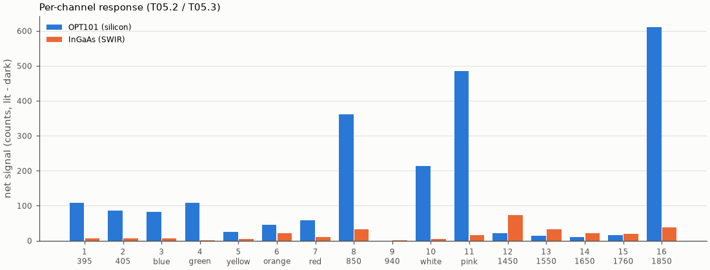
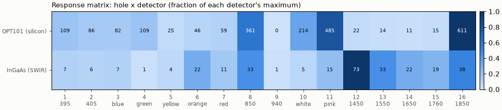
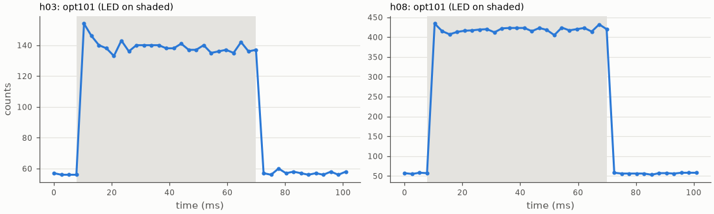

# LIO test report: 20261117-190641_host

**Verdict: NOT FUNCTIONAL**: 3 failing channels (more than 2): 8, 9, 13

- Target: `/dev/cu.usbmodem1101`
- Started 2026-11-17T19:06:41-05:00, finished 2026-11-17T19:08:07-05:00
- Sample: `black_cup`, operator: bench, notes: refresh after calibration fixes
- Firmware 2.5.1 (proto 1, build 2026-11-16)
- Config `/Users/coleloughbc/Documents/VSCode-Local/LIO/software/config/lio_hw.yaml` sha256 1dfc610f845d (thresholds provisional)
- Host: macOS-27.0.1-x86_64-i386-64bit, Python 3.12.4, lio 0.2.0, git 25a28f768d (dirty)
- Counts: PASS 15, FAIL 4
- LED duty budget: 0.0 s of cool-down waits, 0 over-budget on-time(s)

## Summary

| Test | Name | Status | Note |
|---|---|---|---|
| T05.1 | Rail gating by CE1 / CE2 | ✓ PASS |  |
| T05.2 | Per-channel response | ✕ FAIL |  |
| T05.3 | Channel address and isolation | ✕ FAIL |  |
| T05.4 | Off-state return after each MEAS | ✓ PASS |  |
| T05.5 | Repeatability (interleaved MEAS) | ✓ PASS | not judged (net < 1000 counts or detector unusable): 1/opt101, 2/opt101, 3/opt101, 4/opt101, 5/opt101, 6/opt101, 7/opt101, 8/opt101, 8/ingaas, 9/opt101, 9/ingaas, 10/opt101, 11/opt101, 12/ingaas, 13/ingaas, 14/ingaas, 15/ingaas |
| T06.1 | OPT101 | ✓ PASS |  |
| T06.2 | InGaAs TIA | ✓ PASS |  |
| T06.3 | Cross-calibration on the shared holes | ✕ FAIL |  |
| T07.1 | Step response and settling time | ✕ FAIL |  |
| T07.2 | Recommended settle time | ✓ PASS |  |
| T07.3 | MEAS timing | ✓ PASS |  |
| T09.2 | Each motor moves both ways | ✓ PASS |  |
| T09.3 | MOTOR STOP latency | ✓ PASS |  |
| T09.4 | Detector noise while a motor moves | ✓ PASS |  |
| T10.1 | Power-up dark state | ✓ PASS |  |
| T10.2 | On-time watchdog | ✓ PASS |  |
| T10.3 | Comms-loss failsafe | ✓ PASS |  |
| T10.4 | Single-channel invariant | ✓ PASS |  |
| T10.5 | Motion disarmed after comms loss | ✓ PASS |  |

### Per-channel response

### Response matrix

### Step responses

## T05

### T05.1 Rail gating by CE1 / CE2: PASS

| Check | Status | Result | Criterion |
|---|---|---|---|
| Hole 8 selected, CE1 low | ✓ PASS | opt101 56 (dark 56) | dark |
| Hole 8 selected, CE1 high | ✓ PASS | opt101 398 | light above the detection threshold |
| Hole 8 with CE2 (wrong rail) | ✓ PASS | ERR code=3 needs exactly one selected hole on this rail | refused (code 3) |
| Hole 12 selected, CE2 low | ✓ PASS | ingaas -168 (dark -168) | dark |
| Hole 12 selected, CE2 high | ✓ PASS | ingaas -96 | light above the detection threshold |
| Hole 12 with CE1 (wrong rail) | ✓ PASS | ERR code=3 needs exactly one selected hole on this rail | refused (code 3) |

### T05.2 Per-channel response: FAIL

| Check | Status | Result | Criterion |
|---|---|---|---|
| Hole 9 (940) on ingaas | ✕ FAIL | net +1 (none); expected signal, none seen | expect signal: signal >= 50 |
| Hole 9 (940) on opt101 | ✕ FAIL | net +0 (none); expected signal, none seen | expect signal: signal >= 15 |
| Hole 8 (850) on ingaas | ! WARN | net +33 (weak); weaker than expected | expect signal: signal >= 50 |
| Hole 13 (1550) on ingaas | ! WARN | net +33 (weak); weaker than expected | expect signal: signal >= 50 |
| Hole 14 (1650) on ingaas | ! WARN | net +22 (weak); weaker than expected | expect signal: signal >= 50 |
| Hole 1 (395) on opt101 | ✓ PASS | net +109 (signal); signal as expected | expect signal: signal >= 15 |
| Hole 2 (405) on opt101 | ✓ PASS | net +86 (signal); signal as expected | expect signal: signal >= 15 |
| Hole 3 (blue) on opt101 | ✓ PASS | net +82 (signal); signal as expected | expect signal: signal >= 15 |
| Hole 4 (green) on opt101 | ✓ PASS | net +109 (signal); signal as expected | expect signal: signal >= 15 |
| Hole 5 (yellow) on opt101 | ✓ PASS | net +25 (signal); signal as expected | expect signal: signal >= 15 |
| Hole 6 (orange) on opt101 | ✓ PASS | net +46 (signal); signal as expected | expect signal: signal >= 15 |
| Hole 7 (red) on opt101 | ✓ PASS | net +59 (signal); signal as expected | expect signal: signal >= 15 |
| Hole 8 (850) on opt101 | ✓ PASS | net +361 (signal); signal as expected | expect signal: signal >= 15 |
| Hole 10 (white) on opt101 | ✓ PASS | net +214 (signal); signal as expected | expect signal: signal >= 15 |
| Hole 11 (pink) on opt101 | ✓ PASS | net +485 (signal); signal as expected | expect signal: signal >= 15 |
| Hole 12 (1450) on ingaas | ✓ PASS | net +73 (signal); signal as expected | expect signal: signal >= 50 |
| Hole 15 (1760) on ingaas | ✓ PASS | net +19 (weak); weak (weak expected) | expect weak: signal >= 50 |
| Hole 1 (395) on ingaas | - SKIP | not judged: 395 is outside the ingaas range (judged by opt101); recorded net +7 | out-of-range readings are not judged (channel.judge_out_of_range: false) |
| Hole 2 (405) on ingaas | - SKIP | not judged: 405 is outside the ingaas range (judged by opt101); recorded net +6 | out-of-range readings are not judged (channel.judge_out_of_range: false) |
| Hole 3 (blue) on ingaas | - SKIP | not judged: blue is outside the ingaas range (judged by opt101); recorded net +7 | out-of-range readings are not judged (channel.judge_out_of_range: false) |
| Hole 4 (green) on ingaas | - SKIP | not judged: green is outside the ingaas range (judged by opt101); recorded net +1 | out-of-range readings are not judged (channel.judge_out_of_range: false) |
| Hole 5 (yellow) on ingaas | - SKIP | not judged: yellow is outside the ingaas range (judged by opt101); recorded net +4 | out-of-range readings are not judged (channel.judge_out_of_range: false) |
| Hole 6 (orange) on ingaas | - SKIP | not judged: orange is outside the ingaas range (judged by opt101); recorded net +22 | out-of-range readings are not judged (channel.judge_out_of_range: false) |
| Hole 7 (red) on ingaas | - SKIP | not judged: red is outside the ingaas range (judged by opt101); recorded net +11 | out-of-range readings are not judged (channel.judge_out_of_range: false) |
| Hole 10 (white) on ingaas | - SKIP | not judged: white is outside the ingaas range (judged by opt101); recorded net +5 | out-of-range readings are not judged (channel.judge_out_of_range: false) |
| Hole 11 (pink) on ingaas | - SKIP | not judged: pink is outside the ingaas range (judged by opt101); recorded net +15 | out-of-range readings are not judged (channel.judge_out_of_range: false) |
| Hole 12 (1450) on opt101 | - SKIP | not judged: 1450 is outside the opt101 range (judged by ingaas); recorded net +22 | out-of-range readings are not judged (channel.judge_out_of_range: false) |
| Hole 13 (1550) on opt101 | - SKIP | not judged: 1550 is outside the opt101 range (judged by ingaas); recorded net +14 | out-of-range readings are not judged (channel.judge_out_of_range: false) |
| Hole 14 (1650) on opt101 | - SKIP | not judged: 1650 is outside the opt101 range (judged by ingaas); recorded net +11 | out-of-range readings are not judged (channel.judge_out_of_range: false) |
| Hole 15 (1760) on opt101 | - SKIP | not judged: 1760 is outside the opt101 range (judged by ingaas); recorded net +15 | out-of-range readings are not judged (channel.judge_out_of_range: false) |
| Hole 16 (1850) on ingaas | - SKIP | not judged: 1850 is outside the ingaas range (judged by no detector); recorded net +38 | out-of-range readings are not judged (channel.judge_out_of_range: false) |
| Hole 16 (1850) on opt101 | - SKIP | not judged: 1850 is outside the opt101 range (judged by no detector); recorded net +611 | out-of-range readings are not judged (channel.judge_out_of_range: false) |

### T05.3 Channel address and isolation: FAIL

| Check | Status | Result | Criterion |
|---|---|---|---|
| Hole 9 (940) detector pattern | ✕ FAIL | no response on ['ingaas', 'opt101']: possible swapped, misrouted or stuck-on channel | expected ['ingaas', 'opt101'] |
| Hole 1 (395) detector pattern | ✓ PASS | seen by ['opt101'] as expected (ingaas not judged: outside its range) | expected ['opt101'] |
| Hole 2 (405) detector pattern | ✓ PASS | seen by ['opt101'] as expected (ingaas not judged: outside its range) | expected ['opt101'] |
| Hole 3 (blue) detector pattern | ✓ PASS | seen by ['opt101'] as expected (ingaas not judged: outside its range) | expected ['opt101'] |
| Hole 4 (green) detector pattern | ✓ PASS | seen by ['opt101'] as expected (ingaas not judged: outside its range) | expected ['opt101'] |
| Hole 5 (yellow) detector pattern | ✓ PASS | seen by ['opt101'] as expected (ingaas not judged: outside its range) | expected ['opt101'] |
| Hole 6 (orange) detector pattern | ✓ PASS | seen by ['opt101'] as expected (ingaas not judged: outside its range) | expected ['opt101'] |
| Hole 7 (red) detector pattern | ✓ PASS | seen by ['opt101'] as expected (ingaas not judged: outside its range) | expected ['opt101'] |
| Hole 8 (850) detector pattern | ✓ PASS | seen by ['ingaas', 'opt101'] as expected | expected ['ingaas', 'opt101'] |
| Hole 10 (white) detector pattern | ✓ PASS | seen by ['opt101'] as expected (ingaas not judged: outside its range) | expected ['opt101'] |
| Hole 11 (pink) detector pattern | ✓ PASS | seen by ['opt101'] as expected (ingaas not judged: outside its range) | expected ['opt101'] |
| Hole 12 (1450) detector pattern | ✓ PASS | seen by ['ingaas'] as expected (opt101 not judged: outside its range) | expected ['ingaas'] |
| Hole 13 (1550) detector pattern | ✓ PASS | seen by ['ingaas'] as expected (opt101 not judged: outside its range) | expected ['ingaas'] |
| Hole 14 (1650) detector pattern | ✓ PASS | seen by ['ingaas'] as expected (opt101 not judged: outside its range) | expected ['ingaas'] |
| Hole 15 (1760) detector pattern | ✓ PASS | seen by ['ingaas'] as expected (opt101 not judged: outside its range) | expected ['ingaas'] |
| Hole 16 (1850) detector pattern | ✓ PASS | seen by nothing as expected (ingaas, opt101 not judged: outside its range) | expected none |
| Signatures unique | ✓ PASS | no two channels look the same | cosine < 0.98 or amplitude differs by more than 1 % |

### T05.4 Off-state return after each MEAS: PASS

| Check | Status | Result | Criterion |
|---|---|---|---|
| Hole 1 ingaas back to dark | ✓ PASS | -167.0 after OFF vs dark -168 | within 5 sigma (24.8 counts) |
| Hole 1 opt101 back to dark | ✓ PASS | 56.2 after OFF vs dark 57 | within 5 sigma (3.5 counts) |
| Hole 2 ingaas back to dark | ✓ PASS | -166.5 after OFF vs dark -168 | within 5 sigma (24.8 counts) |
| Hole 2 opt101 back to dark | ✓ PASS | 56.8 after OFF vs dark 57 | within 5 sigma (3.5 counts) |
| Hole 3 ingaas back to dark | ✓ PASS | -167.0 after OFF vs dark -168 | within 5 sigma (24.8 counts) |
| Hole 3 opt101 back to dark | ✓ PASS | 56.5 after OFF vs dark 56 | within 5 sigma (3.5 counts) |
| Hole 4 ingaas back to dark | ✓ PASS | -166.2 after OFF vs dark -167 | within 5 sigma (24.8 counts) |
| Hole 4 opt101 back to dark | ✓ PASS | 56.0 after OFF vs dark 56 | within 5 sigma (3.5 counts) |
| Hole 5 ingaas back to dark | ✓ PASS | -166.8 after OFF vs dark -168 | within 5 sigma (24.8 counts) |
| Hole 5 opt101 back to dark | ✓ PASS | 56.2 after OFF vs dark 56 | within 5 sigma (3.5 counts) |
| Hole 6 ingaas back to dark | ✓ PASS | -166.5 after OFF vs dark -167 | within 5 sigma (24.8 counts) |
| Hole 6 opt101 back to dark | ✓ PASS | 56.0 after OFF vs dark 56 | within 5 sigma (3.5 counts) |
| Hole 7 ingaas back to dark | ✓ PASS | -166.5 after OFF vs dark -168 | within 5 sigma (24.8 counts) |
| Hole 7 opt101 back to dark | ✓ PASS | 56.5 after OFF vs dark 57 | within 5 sigma (3.5 counts) |
| Hole 8 ingaas back to dark | ✓ PASS | -166.5 after OFF vs dark -168 | within 5 sigma (24.8 counts) |
| Hole 8 opt101 back to dark | ✓ PASS | 56.5 after OFF vs dark 57 | within 5 sigma (3.5 counts) |
| Hole 9 ingaas back to dark | ✓ PASS | -166.2 after OFF vs dark -168 | within 5 sigma (24.8 counts) |
| Hole 9 opt101 back to dark | ✓ PASS | 56.2 after OFF vs dark 57 | within 5 sigma (3.5 counts) |
| Hole 10 ingaas back to dark | ✓ PASS | -166.8 after OFF vs dark -168 | within 5 sigma (24.8 counts) |
| Hole 10 opt101 back to dark | ✓ PASS | 56.5 after OFF vs dark 56 | within 5 sigma (3.5 counts) |
| Hole 11 ingaas back to dark | ✓ PASS | -167.2 after OFF vs dark -168 | within 5 sigma (24.8 counts) |
| Hole 11 opt101 back to dark | ✓ PASS | 57.0 after OFF vs dark 57 | within 5 sigma (3.5 counts) |
| Hole 12 ingaas back to dark | ✓ PASS | -167.0 after OFF vs dark -168 | within 5 sigma (24.8 counts) |
| Hole 12 opt101 back to dark | ✓ PASS | 56.2 after OFF vs dark 57 | within 5 sigma (3.5 counts) |
| Hole 13 ingaas back to dark | ✓ PASS | -167.0 after OFF vs dark -168 | within 5 sigma (24.8 counts) |
| Hole 13 opt101 back to dark | ✓ PASS | 56.0 after OFF vs dark 57 | within 5 sigma (3.5 counts) |
| Hole 14 ingaas back to dark | ✓ PASS | -166.8 after OFF vs dark -168 | within 5 sigma (24.8 counts) |
| Hole 14 opt101 back to dark | ✓ PASS | 56.8 after OFF vs dark 56 | within 5 sigma (3.5 counts) |
| Hole 15 ingaas back to dark | ✓ PASS | -167.5 after OFF vs dark -168 | within 5 sigma (24.8 counts) |
| Hole 15 opt101 back to dark | ✓ PASS | 56.0 after OFF vs dark 57 | within 5 sigma (3.5 counts) |
| Hole 16 ingaas back to dark | ✓ PASS | -166.8 after OFF vs dark -167 | within 5 sigma (24.8 counts) |
| Hole 16 opt101 back to dark | ✓ PASS | 56.8 after OFF vs dark 57 | within 5 sigma (3.5 counts) |

### T05.5 Repeatability (interleaved MEAS): PASS

not judged (net < 1000 counts or detector unusable): 1/opt101, 2/opt101, 3/opt101, 4/opt101, 5/opt101, 6/opt101, 7/opt101, 8/opt101, 8/ingaas, 9/opt101, 9/ingaas, 10/opt101, 11/opt101, 12/ingaas, 13/ingaas, 14/ingaas, 15/ingaas

## T06

### T06.1 OPT101: PASS

| Check | Status | Result | Criterion |
|---|---|---|---|
| opt101 dark offset | ✓ PASS | 56.2 counts | 0 to 800 counts |
| Responds to hole 1 (395) | ✓ PASS | net +109 | no zeros where light is expected |
| Responds to hole 2 (405) | ✓ PASS | net +86 | no zeros where light is expected |
| Responds to hole 3 (blue) | ✓ PASS | net +82 | no zeros where light is expected |
| Responds to hole 4 (green) | ✓ PASS | net +109 | no zeros where light is expected |
| Responds to hole 5 (yellow) | ✓ PASS | net +25 | no zeros where light is expected |
| Responds to hole 6 (orange) | ✓ PASS | net +46 | no zeros where light is expected |
| Responds to hole 7 (red) | ✓ PASS | net +59 | no zeros where light is expected |
| Responds to hole 10 (white) | ✓ PASS | net +214 | no zeros where light is expected |
| Responds to hole 11 (pink) | ✓ PASS | net +485 | no zeros where light is expected |
| Not saturated | ✓ PASS | peak 668 | < 29000 counts |

### T06.2 InGaAs TIA: PASS

| Check | Status | Result | Criterion |
|---|---|---|---|
| Dark signal steady | ✓ PASS | dark mean -168, sigma 7.0 | sigma <= 100 and mean >= -1500 |
| ingaas dark offset | ✓ PASS | -167.9 counts | -400 to 2000 counts |
| Polarity gate (hole 8) | ✓ PASS | net +34 | net >= -5 sigma |
| Hole 9 InGaAs polarity | ✓ PASS | net +1 | net not negative |
| Hole 12 InGaAs polarity | ✓ PASS | net +73 | net not negative |
| Hole 13 InGaAs polarity | ✓ PASS | net +33 | net not negative |
| Hole 14 InGaAs polarity | ✓ PASS | net +22 | net not negative |
| InGaAs not saturated | ✓ PASS | no hole saturates | < 27000 counts |

### T06.3 Cross-calibration on the shared holes: FAIL

| Check | Status | Result | Criterion |
|---|---|---|---|
| Hole 8 seen by both detectors | ✕ FAIL | one detector does not respond | both above the detection threshold |
| Hole 9 seen by both detectors | ✕ FAIL | one detector does not respond | both above the detection threshold |

## T07

### T07.1 Step response and settling time: FAIL

| Check | Status | Result | Criterion |
|---|---|---|---|
| Hole 13 step response | ✕ FAIL | no step on ingaas (baseline -161, plateau -133) | a step above the detection threshold |
| Hole 3 (opt101) step response | ✓ PASS | settled within a few samples: t99 <= 3.90 ms (upper bound, limited by the sample interval) | time to 99 % recorded |
| Hole 8 (opt101) step response | ✓ PASS | settled within one sample: t99 <= 1.32 ms (upper bound, limited by the sample interval) | time to 99 % recorded |

### T07.2 Recommended settle time: PASS

| Check | Status | Result | Criterion |
|---|---|---|---|
| Configured settle_ms is long enough | ✓ PASS | recommended 6 ms (max 3.90 ms x 1.5), configured 8 ms | recommended <= 8 ms |

### T07.3 MEAS timing: PASS

| Check | Status | Result | Criterion |
|---|---|---|---|
| MEAS 3 8 1 on-time | ✓ PASS | t_on_ms 25 | 21.3-32.0 ms and <= watchdog 2000 ms |
| MEAS 3 20 4 on-time | ✓ PASS | t_on_ms 91 | 73.1-106.9 ms and <= watchdog 2000 ms |

## T09

### T09.2 Each motor moves both ways: PASS

| Check | Status | Result | Criterion |
|---|---|---|---|
| Motor 1 +64 half-steps completes | ✓ PASS | # MOTOR m=1 steps=64 pos=64 done | '# MOTOR m=1 steps=64 ... done' |
| Operator saw motor 1 (LEFT) move up | ✓ PASS | confirmed | +steps = up (legacy U direction) |
| Motor 1 -64 half-steps completes | ✓ PASS | # MOTOR m=1 steps=64 pos=0 done | '# MOTOR m=1 steps=64 ... done' |
| Operator saw motor 1 (LEFT) move back down | ✓ PASS | confirmed | returned |
| Motor 1 idle, coils released, back at start | ✓ PASS | motor1=idle pos1=0 | idle, pos1=0 |
| Motor 2 +64 half-steps completes | ✓ PASS | # MOTOR m=2 steps=64 pos=64 done | '# MOTOR m=2 steps=64 ... done' |
| Operator saw motor 2 (RIGHT) move up | ✓ PASS | confirmed | +steps = up (legacy U direction) |
| Motor 2 -64 half-steps completes | ✓ PASS | # MOTOR m=2 steps=64 pos=0 done | '# MOTOR m=2 steps=64 ... done' |
| Operator saw motor 2 (RIGHT) move back down | ✓ PASS | confirmed | returned |
| Motor 2 idle, coils released, back at start | ✓ PASS | motor2=idle pos2=0 | idle, pos2=0 |

### T09.3 MOTOR STOP latency: PASS

| Check | Status | Result | Criterion |
|---|---|---|---|
| MOTOR STOP answered | ✓ PASS | 1.6 ms | < 50 ms |
| Motor stopped and stays stopped | ✓ PASS | moved 46 of 2048 half-steps; motor1=idle | idle, position frozen, move cut short |
| Motor 1 returned to the start | ✓ PASS | # MOTOR m=1 steps=46 pos=0 done | pos1=0 |

### T09.4 Detector noise while a motor moves: PASS

| Check | Status | Result | Criterion |
|---|---|---|---|
| Streams taken while the motor was moving | ✓ PASS | motor still running after both streams | motor1=run |
| ingaas noise during motion | ✓ PASS | sigma 5.04 moving vs 5.28 at rest (x0.95) | ratio <= 3 |
| opt101 noise during motion | ✓ PASS | sigma 0.69 moving vs 0.50 at rest (x0.69) | ratio <= 3 |

## T10

### T10.1 Power-up dark state: PASS

| Check | Status | Result | Criterion |
|---|---|---|---|
| STATUS safe after RESET | ✓ PASS | ch=0 ce1=0 ce2=0 mask=0x0000 armed=0 | ch=0 ce1=0 ce2=0 mask=0 armed=0, motors idle |
| Detectors dark after RESET | ✓ PASS | ingaas -168, opt101 56 | dark +- k sigma |
| STATUS safe after a port reopen | ✓ PASS | ch=0 ce1=0 ce2=0 mask=0x0000 armed=0 | ch=0 ce1=0 ce2=0 mask=0 armed=0, motors idle |
| Detectors dark after a port reopen | ✓ PASS | ingaas -168, opt101 56 | dark +- k sigma |

### T10.2 On-time watchdog: PASS

| Check | Status | Result | Criterion |
|---|---|---|---|
| CH 3 ON 60000 clamped to RAIL A limit | ✓ PASS | until_ms=2000 clamped=1 | until_ms=2000 clamped=1 |
| Hole 3 lit before the watchdog | ✓ PASS | light seen | light seen |
| Light gone after the watchdog limit | ✓ PASS | dark after 312 ms | <= 354 ms: limit 300 + tolerance 50 + detector settling 3.9 ms |
| '# WDT' received | ✓ PASS | # WDT ch=3 on_ms=301 off | '# WDT' with on_ms <= 350 |
| CH 10 ON 60000 clamped to RAIL B limit | ✓ PASS | until_ms=5000 clamped=1 | until_ms=5000 clamped=1 |
| Hole 10 lit before the watchdog | ✓ PASS | light seen | light seen |
| Light gone after the watchdog limit | ✓ PASS | dark after 316 ms | <= 389 ms: limit 300 + tolerance 50 + detector settling 39.1 ms |
| '# WDT' received | ✓ PASS | # WDT ch=10 on_ms=300 off | '# WDT' with on_ms <= 350 |

### T10.3 Comms-loss failsafe: PASS

| Check | Status | Result | Criterion |
|---|---|---|---|
| '# FAILSAFE' after the comms timeout | ✓ PASS | # FAILSAFE reason=comms idle_ms=10000 | idle_ms 10000-10050 |
| Everything off after the failsafe | ✓ PASS | ch=0 ce1=0 ce2=0 mask=0x0000 armed=0 | ch=0 ce1=0 ce2=0 mask=0 armed=0, motors idle |
| Failsafe counted | ✓ PASS | failsafe_trips=1 | >= 1 |

### T10.4 Single-channel invariant: PASS

| Check | Status | Result | Criterion |
|---|---|---|---|
| SR RAW 0x0000 then CE 1 1 | ✓ PASS | ERR code=3 needs exactly one selected hole on this rail; ce1=0 ce2=0 | refused (code 3), CE stays low |
| SR RAW 0x0005 then CE 1 1 | ✓ PASS | ERR code=3 needs exactly one selected hole on this rail; ce1=0 ce2=0 | refused (code 3), CE stays low |
| SR RAW 0x0101 then CE 1 1 | ✓ PASS | ERR code=3 needs exactly one selected hole on this rail; ce1=0 ce2=0 | refused (code 3), CE stays low |
| SR RAW 0x3000 then CE 2 1 | ✓ PASS | ERR code=3 needs exactly one selected hole on this rail; ce1=0 ce2=0 | refused (code 3), CE stays low |
| SR RAW 0x1004 then CE 1 1 | ✓ PASS | ERR code=3 needs exactly one selected hole on this rail; ce1=0 ce2=0 | refused (code 3), CE stays low |
| SR RAW 0x1004 then CE 2 1 | ✓ PASS | ERR code=3 needs exactly one selected hole on this rail; ce1=0 ce2=0 | refused (code 3), CE stays low |

### T10.5 Motion disarmed after comms loss: PASS

| Check | Status | Result | Criterion |
|---|---|---|---|
| Armed before the silence | ✓ PASS | armed=1 | armed=1 |
| Disarmed after the failsafe | ✓ PASS | armed=0 armed_ms=0 | armed=0 |
