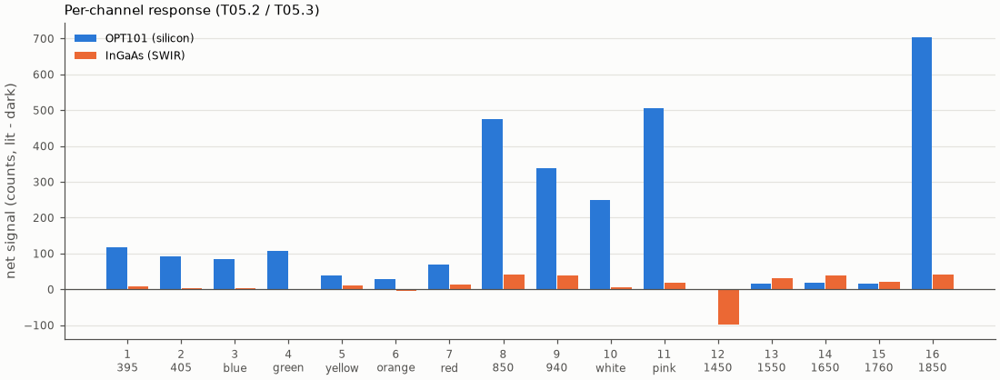
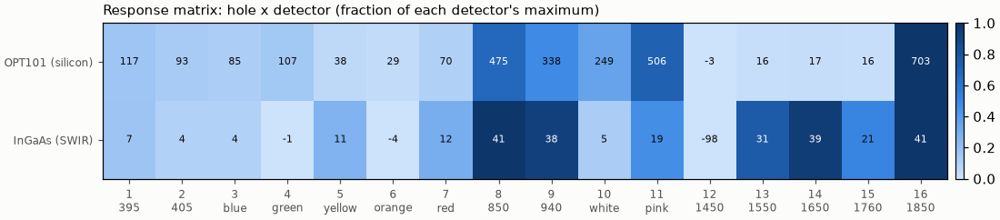
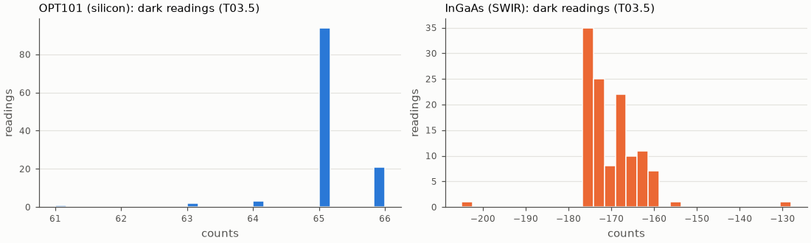
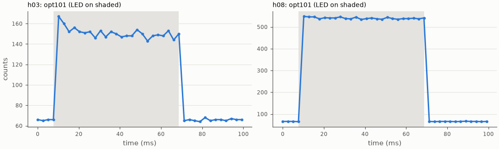
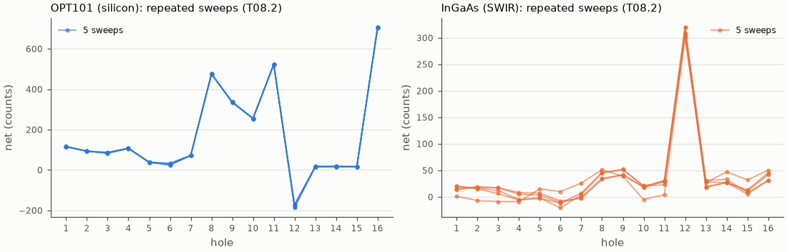

# LIO test report: 20261119-142221_host

**Verdict: NOT FUNCTIONAL**: failure in a critical module: T10.1, T10.2; failures not tied to a channel: T13.1

- Target: `/dev/cu.usbmodem101`
- Started 2026-11-19T14:22:21-05:00, finished 2026-11-19T16:12:26-05:00
- Sample: `black_cup`, operator: cursor-agent, notes: full suite after handoff; black cup in, chamber closed, head at bottom; no-prompt
- Firmware 2.5.2 (proto 1, build 2026-11-17)
- Config `/Users/coleloughbc/Documents/VSCode-Local/LIO/software/config/lio_hw.yaml` sha256 eb4a5aa9ccb1 (thresholds provisional)
- Host: macOS-27.0.1-x86_64-i386-64bit, Python 3.12.11, lio 0.2.0, git f05f1f2b10 (dirty)
- Counts: PASS 33, WARN 1, FAIL 8, SKIP 3
- LED duty budget: 0.0 s of cool-down waits, 0 over-budget on-time(s)

## Summary

| Test | Name | Status | Note |
|---|---|---|---|
| T01.1 | Python and dependency versions | ✓ PASS |  |
| T01.2 | Serial port discovery | ✓ PASS |  |
| T01.3 | Configuration loads and is self-consistent | ✓ PASS |  |
| T02.1 | Port open and boot banner | ✓ PASS |  |
| T02.2 | PING round-trip latency | ✓ PASS |  |
| T02.3 | INFO fields, versions and safety limits | ✓ PASS |  |
| T02.4 | Robustness to bad input | ✓ PASS |  |
| T02.5 | Sequence numbers and interleaved events | ✓ PASS |  |
| T02.6 | RESET restores the boot state | ✓ PASS |  |
| T03.1 | I2C scan finds the ADS1115 | ✓ PASS |  |
| T03.2 | Dark ADC noise, all inputs | ✓ PASS |  |
| T03.3 | Gain sweep on dark inputs | ✓ PASS |  |
| T03.4 | ADC data rate | ✓ PASS |  |
| T03.5 | Long-term dark stability | ✓ PASS |  |
| T04.1 | Shift-register patterns with CE low | ✓ PASS |  |
| T04.2 | Shift-register loopback (optional jumper) | - SKIP | loopback jumper not fitted (this build has no loop-back input (pins.LOOP), plan §6.3); the shift registers are verified optically by T05.3 |
| T04.3 | Optical address verification | - SKIP | covered by T05.3 (each hole must light only its own expected response) |
| T05.1 | Rail gating by CE1 / CE2 | ✓ PASS |  |
| T05.2 | Per-channel response | ✕ FAIL |  |
| T05.3 | Channel address and isolation | ✕ FAIL |  |
| T05.4 | Off-state return after each MEAS | ✓ PASS |  |
| T05.5 | Repeatability (interleaved MEAS) | ✓ PASS | not judged (net < 1000 counts or detector unusable): 1/opt101, 2/opt101, 3/opt101, 4/opt101, 5/opt101, 6/opt101, 7/opt101, 8/opt101, 8/ingaas, 9/opt101, 9/ingaas, 10/opt101, 11/opt101, 12/ingaas, 13/ingaas, 14/ingaas, 15/ingaas |
| T06.1 | OPT101 | ✓ PASS |  |
| T06.2 | InGaAs TIA | ✕ FAIL |  |
| T06.3 | Cross-calibration on the shared holes | ✓ PASS |  |
| T07.1 | Step response and settling time | ✕ FAIL |  |
| T07.2 | Recommended settle time | ! WARN |  |
| T07.3 | MEAS timing | ✓ PASS |  |
| T08.1 | SWEEP completes with a valid schema | ✓ PASS |  |
| T08.2 | Repeated sweeps | ✓ PASS |  |
| T08.3 | Sweep agrees with MEAS | ✕ FAIL |  |
| T08.4 | CSV output format | ✓ PASS |  |
| T09.1 | Motion arming | ✓ PASS |  |
| T09.2 | Each motor moves both ways | ✓ PASS |  |
| T09.3 | MOTOR STOP latency | ✓ PASS |  |
| T09.4 | Detector noise while a motor moves | ✓ PASS |  |
| T09.6 | Full travel, both motors in lockstep | ✓ PASS |  |
| T09.7 | Detectors while the chamber moves | ✓ PASS |  |
| T10.1 | Power-up dark state | ✕ FAIL |  |
| T10.2 | On-time watchdog | ✕ FAIL |  |
| T10.3 | Comms-loss failsafe | ✓ PASS |  |
| T10.4 | Single-channel invariant | ✓ PASS |  |
| T10.5 | Motion disarmed after comms loss | ✓ PASS |  |
| T11.1 | Comparison with the baseline | - SKIP | no baseline given (--baseline <file>); save one with --save-baseline |
| T13.1 | Diagnostic height sweep | ✕ FAIL | quick scan COMPLETE: NOT FUNCTIONAL (20261119-152512_scan_quick) |

### Per-channel response

### Response matrix

### Dark noise

### Step responses

### Repeated sweeps

## T01

### T01.1 Python and dependency versions: PASS

| Check | Status | Result | Criterion |
|---|---|---|---|
| Python version | ✓ PASS | 3.12.11 | >= 3.10 |
| pyserial installed | ✓ PASS | 3.5 | importable |
| pyyaml installed | ✓ PASS | 6.0.3 | importable |
| numpy installed | ✓ PASS | 2.5.4 | importable |
| matplotlib installed | ✓ PASS | 3.11.2 | importable |
| jinja2 installed | ✓ PASS | 3.1.6 | importable |

### T01.2 Serial port discovery: PASS

| Check | Status | Result | Criterion |
|---|---|---|---|
| Selected port is present | ✓ PASS | /dev/cu.usbmodem101: present | --lio-port names an existing serial port |
| USB-serial chip recognised | ✓ PASS | VID:PID 2341:0074 (Arduino Nano R4 (native USB)) | one of link.usb_ids |

### T01.3 Configuration loads and is self-consistent: PASS

| Check | Status | Result | Criterion |
|---|---|---|---|
| Config validates | ✓ PASS | lio_hw.yaml sha256 eb4a5aa9ccb1 |  |
| 16 holes | ✓ PASS | 16 entries |  |
| Rails split A = 1-8, B = 9-16 (as built) | ✓ PASS | A=[1, 2, 3, 4, 5, 6, 7, 8] B=[9, 10, 11, 12, 13, 14, 15, 16] |  |

## T02

### T02.1 Port open and boot banner: PASS

| Check | Status | Result | Criterion |
|---|---|---|---|
| Boot banner within the timeout | ✓ PASS | 0.06 s | <= 3 s |
| Banner identifies LIO firmware | ✓ PASS | # BOOT name=lio fw=2.5.2 proto=1 build=2026-11-17 adc_ok=1 hw_wdt=0 | name=lio, fw and proto present |

### T02.2 PING round-trip latency: PASS

| Check | Status | Result | Criterion |
|---|---|---|---|
| Every PING answered | ✓ PASS | 100/100 answered | all |
| p99 round trip | ✓ PASS | median 0.87 ms, p99 0.93 ms, max 0.94 ms | p99 < 50 ms |

### T02.3 INFO fields, versions and safety limits: PASS

| Check | Status | Result | Criterion |
|---|---|---|---|
| INFO fields present | ✓ PASS | 21 fields | all protocol-1 INFO fields |
| Firmware compatible with this host package | ✓ PASS | fw 2.5.2 proto 1 | >= 2.0.0, proto 1 |
| settle_ms matches lio_hw.yaml | ✓ PASS | 8 | 8 |
| wdt_a_ms matches lio_hw.yaml | ✓ PASS | 2000 | 2000 |
| wdt_b_ms matches lio_hw.yaml | ✓ PASS | 5000 | 5000 |
| wdt_a_cap_ms matches lio_hw.yaml | ✓ PASS | 5000 | 5000 |
| wdt_b_cap_ms matches lio_hw.yaml | ✓ PASS | 10000 | 10000 |
| comms_ms matches lio_hw.yaml | ✓ PASS | 10000 | 10000 |
| arm_ms matches lio_hw.yaml | ✓ PASS | 60000 | 60000 |
| step_max matches lio_hw.yaml | ✓ PASS | 2048 | 2048 |
| jog_max matches lio_hw.yaml | ✓ PASS | 2048 | 2048 |
| jog_v_max matches lio_hw.yaml | ✓ PASS | 1000 | 1000 |
| jog_acc_max matches lio_hw.yaml | ✓ PASS | 1000 | 1000 |
| wake_ms_max matches lio_hw.yaml | ✓ PASS | 3000 | 3000 |
| ADC address matches lio_hw.yaml | ✓ PASS | 0x48 | 0x48 |
| ADC gain matches lio_hw.yaml | ✓ PASS | 1 | 1 |
| ADC rate matches lio_hw.yaml | ✓ PASS | 128 | 128 |

### T02.4 Robustness to bad input: PASS

| Check | Status | Result | Criterion |
|---|---|---|---|
| Unknown command | ✓ PASS | @140 ERR FROBNICATE code=1 msg=unknown command | ERR code=1 |
| Bad argument | ✓ PASS | @141 ERR MEAS code=2 msg=usage: MEAS <1-16> [settle_ms] [n] | ERR code=2 |
| Missing argument | ✓ PASS | @142 ERR CH code=2 msg=usage: CH <1-16> ON [ms] | ERR code=2 |
| Line over 64 characters | ✓ PASS | ERR ? code=6 msg=line too long | ERR code=6 |
| Garbage bytes, then PING | ✓ PASS | PING OK | PING still answered |

### T02.5 Sequence numbers and interleaved events: PASS

| Check | Status | Result | Criterion |
|---|---|---|---|
| @1 echoed | ✓ PASS | @1 OK PING uptime_ms=323560 | @1 OK PING |
| @4242 echoed | ✓ PASS | @4242 OK PING uptime_ms=323561 | @4242 OK PING |
| @99999 echoed | ✓ PASS | @99999 OK PING uptime_ms=323562 | @99999 OK PING |
| No @seq, none echoed | ✓ PASS | OK PING uptime_ms=323562 | OK PING |
| Response found after interleaved events | ✓ PASS | 20 '# S' events then OK | 20 events |
| Asynchronous '# OFF' does not desynchronise | ✓ PASS | 10/10 PINGs matched; 1 timer event(s) seen | all PINGs answered in order, one '# OFF' |

### T02.6 RESET restores the boot state: PASS

| Check | Status | Result | Criterion |
|---|---|---|---|
| Banner after RESET | ✓ PASS | 0.01 s | <= 3 s |
| STATUS shows the safe state | ✓ PASS | ch=0 ce1=0 ce2=0 mask=0x0000 armed=0 | ch=0 ce1=0 ce2=0 mask=0 armed=0, motors idle |
| Settings back to defaults | ✓ PASS | wdt_a_ms=2000 (was set to 200) | 2000 |

## T03

### T03.1 I2C scan finds the ADS1115: PASS

| Check | Status | Result | Criterion |
|---|---|---|---|
| ADS1115 at 0x48 | ✓ PASS | found ['0x48'] | 0x48 acknowledges |
| I2C lines (SDA, SCL) | ✓ PASS | lines idle high with pull-ups, not bridged; 0x48 answers at 166.666 kHz | both idle high, rise on external pull-ups, not joined |
| No unexpected I2C devices | ✓ PASS | none | only the ADS1115 |

### T03.2 Dark ADC noise, all inputs: PASS

| Check | Status | Result | Criterion |
|---|---|---|---|
| ADS A0 (ingaas) dark noise | ✓ PASS | mean -168.6, sigma 4.80 counts (n=64) | sigma <= 20 counts |
| ADS A1 (opt101) dark noise | ✓ PASS | mean 65.5, sigma 0.50 counts (n=64) | sigma <= 20 counts |
| ADS A2 (unconnected) | ✓ PASS | recorded only: mean 4497.0, sigma 9.34 | floating input |
| ADS A3 (unconnected) | ✓ PASS | recorded only: mean 2628.9, sigma 2.61 | floating input |

### T03.3 Gain sweep on dark inputs: PASS

| Check | Status | Result | Criterion |
|---|---|---|---|
| GAIN 2/3 accepted | ✓ PASS | lsb 0.1875 mV | 0.1875 mV |
| GAIN 1 accepted | ✓ PASS | lsb 0.125 mV | 0.125 mV |
| GAIN 2 accepted | ✓ PASS | lsb 0.0625 mV | 0.0625 mV |
| GAIN 4 accepted | ✓ PASS | lsb 0.03125 mV | 0.03125 mV |
| GAIN 8 accepted | ✓ PASS | lsb 0.015625 mV | 0.015625 mV |
| GAIN 16 accepted | ✓ PASS | lsb 0.0078125 mV | 0.0078125 mV |
| ingaas at GAIN 2/3 agrees with GAIN 1 | ✓ PASS | -21.00 mV vs -21.00 mV | within 6.77 mV |
| ingaas at GAIN 1 agrees with GAIN 1 | ✓ PASS | -21.00 mV vs -21.00 mV | within 6.77 mV |
| ingaas at GAIN 2 agrees with GAIN 1 | ✓ PASS | -21.09 mV vs -21.00 mV | within 6.81 mV |
| ingaas at GAIN 4 agrees with GAIN 1 | ✓ PASS | -21.07 mV vs -21.00 mV | within 6.80 mV |
| ingaas at GAIN 8 agrees with GAIN 1 | ✓ PASS | -21.01 mV vs -21.00 mV | within 6.85 mV |
| ingaas at GAIN 16 agrees with GAIN 1 | ✓ PASS | -20.96 mV vs -21.00 mV | within 6.78 mV |
| GAIN 2/3 accepted | ✓ PASS | lsb 0.1875 mV | 0.1875 mV |
| GAIN 1 accepted | ✓ PASS | lsb 0.125 mV | 0.125 mV |
| GAIN 2 accepted | ✓ PASS | lsb 0.0625 mV | 0.0625 mV |
| GAIN 4 accepted | ✓ PASS | lsb 0.03125 mV | 0.03125 mV |
| GAIN 8 accepted | ✓ PASS | lsb 0.015625 mV | 0.015625 mV |
| GAIN 16 accepted | ✓ PASS | lsb 0.0078125 mV | 0.0078125 mV |
| opt101 at GAIN 2/3 agrees with GAIN 1 | ✓ PASS | 8.29 mV vs 8.17 mV | within 5.22 mV |
| opt101 at GAIN 1 agrees with GAIN 1 | ✓ PASS | 8.17 mV vs 8.17 mV | within 5.19 mV |
| opt101 at GAIN 2 agrees with GAIN 1 | ✓ PASS | 8.17 mV vs 8.17 mV | within 5.19 mV |
| opt101 at GAIN 4 agrees with GAIN 1 | ✓ PASS | 7.89 mV vs 8.17 mV | within 5.19 mV |
| opt101 at GAIN 8 agrees with GAIN 1 | ✓ PASS | 8.57 mV vs 8.17 mV | within 5.19 mV |
| opt101 at GAIN 16 agrees with GAIN 1 | ✓ PASS | 8.57 mV vs 8.17 mV | within 5.19 mV |

### T03.4 ADC data rate: PASS

| Check | Status | Result | Criterion |
|---|---|---|---|
| 8 SPS conversion interval | ✓ PASS | 120.746 ms (nominal 125.000 ms, overhead -4.254 ms) | 106.250-145.250 ms |
| 16 SPS conversion interval | ✓ PASS | 61.185 ms (nominal 62.500 ms, overhead -1.315 ms) | 53.125-73.375 ms |
| 32 SPS conversion interval | ✓ PASS | 31.242 ms (nominal 31.250 ms, overhead -0.008 ms) | 26.562-37.438 ms |
| 64 SPS conversion interval | ✓ PASS | 16.434 ms (nominal 15.625 ms, overhead +0.809 ms) | 13.281-19.469 ms |
| 128 SPS conversion interval | ✓ PASS | 8.863 ms (nominal 7.812 ms, overhead +1.050 ms) | 6.641-10.484 ms |
| 250 SPS conversion interval | ✓ PASS | 5.288 ms (nominal 4.000 ms, overhead +1.288 ms) | 3.400-6.100 ms |
| 475 SPS conversion interval | ✓ PASS | 3.341 ms (nominal 2.105 ms, overhead +1.236 ms) | 1.789-3.921 ms |
| 860 SPS conversion interval | ✓ PASS | 2.537 ms (nominal 1.163 ms, overhead +1.374 ms) | 0.988-2.837 ms |

### T03.5 Long-term dark stability: PASS

| Check | Status | Result | Criterion |
|---|---|---|---|
| ingaas drift over 60 s | ✓ PASS | -6.8 counts/min (0.021 % FS/min), sigma 7.15 | <= 2 % FS/min |
| opt101 drift over 60 s | ✓ PASS | +0.0 counts/min (0.000 % FS/min), sigma 0.63 | <= 2 % FS/min |

## T04

### T04.1 Shift-register patterns with CE low: PASS

| Check | Status | Result | Criterion |
|---|---|---|---|
| SR RAW 0x0000 | ✓ PASS | echoed, CE low, detectors dark | mask echoed in reply and STATUS; CE1 = CE2 = 0; detectors at dark |
| SR RAW 0xFFFF | ✓ PASS | echoed, CE low, detectors dark | mask echoed in reply and STATUS; CE1 = CE2 = 0; detectors at dark |
| SR RAW 0x0001 | ✓ PASS | echoed, CE low, detectors dark | mask echoed in reply and STATUS; CE1 = CE2 = 0; detectors at dark |
| SR RAW 0x0002 | ✓ PASS | echoed, CE low, detectors dark | mask echoed in reply and STATUS; CE1 = CE2 = 0; detectors at dark |
| SR RAW 0x0004 | ✓ PASS | echoed, CE low, detectors dark | mask echoed in reply and STATUS; CE1 = CE2 = 0; detectors at dark |
| SR RAW 0x0008 | ✓ PASS | echoed, CE low, detectors dark | mask echoed in reply and STATUS; CE1 = CE2 = 0; detectors at dark |
| SR RAW 0x0010 | ✓ PASS | echoed, CE low, detectors dark | mask echoed in reply and STATUS; CE1 = CE2 = 0; detectors at dark |
| SR RAW 0x0020 | ✓ PASS | echoed, CE low, detectors dark | mask echoed in reply and STATUS; CE1 = CE2 = 0; detectors at dark |
| SR RAW 0x0040 | ✓ PASS | echoed, CE low, detectors dark | mask echoed in reply and STATUS; CE1 = CE2 = 0; detectors at dark |
| SR RAW 0x0080 | ✓ PASS | echoed, CE low, detectors dark | mask echoed in reply and STATUS; CE1 = CE2 = 0; detectors at dark |
| SR RAW 0x0100 | ✓ PASS | echoed, CE low, detectors dark | mask echoed in reply and STATUS; CE1 = CE2 = 0; detectors at dark |
| SR RAW 0x0200 | ✓ PASS | echoed, CE low, detectors dark | mask echoed in reply and STATUS; CE1 = CE2 = 0; detectors at dark |
| SR RAW 0x0400 | ✓ PASS | echoed, CE low, detectors dark | mask echoed in reply and STATUS; CE1 = CE2 = 0; detectors at dark |
| SR RAW 0x0800 | ✓ PASS | echoed, CE low, detectors dark | mask echoed in reply and STATUS; CE1 = CE2 = 0; detectors at dark |
| SR RAW 0x1000 | ✓ PASS | echoed, CE low, detectors dark | mask echoed in reply and STATUS; CE1 = CE2 = 0; detectors at dark |
| SR RAW 0x2000 | ✓ PASS | echoed, CE low, detectors dark | mask echoed in reply and STATUS; CE1 = CE2 = 0; detectors at dark |
| SR RAW 0x4000 | ✓ PASS | echoed, CE low, detectors dark | mask echoed in reply and STATUS; CE1 = CE2 = 0; detectors at dark |
| SR RAW 0x8000 | ✓ PASS | echoed, CE low, detectors dark | mask echoed in reply and STATUS; CE1 = CE2 = 0; detectors at dark |
| SR RAW 0xFFFE | ✓ PASS | echoed, CE low, detectors dark | mask echoed in reply and STATUS; CE1 = CE2 = 0; detectors at dark |
| SR RAW 0xFFFD | ✓ PASS | echoed, CE low, detectors dark | mask echoed in reply and STATUS; CE1 = CE2 = 0; detectors at dark |
| SR RAW 0xFFFB | ✓ PASS | echoed, CE low, detectors dark | mask echoed in reply and STATUS; CE1 = CE2 = 0; detectors at dark |
| SR RAW 0xFFF7 | ✓ PASS | echoed, CE low, detectors dark | mask echoed in reply and STATUS; CE1 = CE2 = 0; detectors at dark |
| SR RAW 0xFFEF | ✓ PASS | echoed, CE low, detectors dark | mask echoed in reply and STATUS; CE1 = CE2 = 0; detectors at dark |
| SR RAW 0xFFDF | ✓ PASS | echoed, CE low, detectors dark | mask echoed in reply and STATUS; CE1 = CE2 = 0; detectors at dark |
| SR RAW 0xFFBF | ✓ PASS | echoed, CE low, detectors dark | mask echoed in reply and STATUS; CE1 = CE2 = 0; detectors at dark |
| SR RAW 0xFF7F | ✓ PASS | echoed, CE low, detectors dark | mask echoed in reply and STATUS; CE1 = CE2 = 0; detectors at dark |
| SR RAW 0xFEFF | ✓ PASS | echoed, CE low, detectors dark | mask echoed in reply and STATUS; CE1 = CE2 = 0; detectors at dark |
| SR RAW 0xFDFF | ✓ PASS | echoed, CE low, detectors dark | mask echoed in reply and STATUS; CE1 = CE2 = 0; detectors at dark |
| SR RAW 0xFBFF | ✓ PASS | echoed, CE low, detectors dark | mask echoed in reply and STATUS; CE1 = CE2 = 0; detectors at dark |
| SR RAW 0xF7FF | ✓ PASS | echoed, CE low, detectors dark | mask echoed in reply and STATUS; CE1 = CE2 = 0; detectors at dark |
| SR RAW 0xEFFF | ✓ PASS | echoed, CE low, detectors dark | mask echoed in reply and STATUS; CE1 = CE2 = 0; detectors at dark |
| SR RAW 0xDFFF | ✓ PASS | echoed, CE low, detectors dark | mask echoed in reply and STATUS; CE1 = CE2 = 0; detectors at dark |
| SR RAW 0xBFFF | ✓ PASS | echoed, CE low, detectors dark | mask echoed in reply and STATUS; CE1 = CE2 = 0; detectors at dark |
| SR RAW 0x7FFF | ✓ PASS | echoed, CE low, detectors dark | mask echoed in reply and STATUS; CE1 = CE2 = 0; detectors at dark |

### T04.2 Shift-register loopback (optional jumper): SKIP

loopback jumper not fitted (this build has no loop-back input (pins.LOOP), plan §6.3); the shift registers are verified optically by T05.3

### T04.3 Optical address verification: SKIP

covered by T05.3 (each hole must light only its own expected response)

## T05

### T05.1 Rail gating by CE1 / CE2: PASS

| Check | Status | Result | Criterion |
|---|---|---|---|
| Hole 8 selected, CE1 low | ✓ PASS | opt101 65 (dark 66) | dark |
| Hole 8 selected, CE1 high | ✓ PASS | opt101 539 | light above the detection threshold |
| Hole 8 with CE2 (wrong rail) | ✓ PASS | ERR code=3 needs exactly one selected hole on this rail | refused (code 3) |
| Hole 12 selected, CE2 low | ✓ PASS | ingaas -169 (dark -169) | dark |
| Hole 12 selected, CE2 high | ✓ PASS | ingaas -4 | light above the detection threshold |
| Hole 12 with CE1 (wrong rail) | ✓ PASS | ERR code=3 needs exactly one selected hole on this rail | refused (code 3) |

### T05.2 Per-channel response: FAIL

| Check | Status | Result | Criterion |
|---|---|---|---|
| Hole 12 (1450) on ingaas | ✕ FAIL | net -98 (none); expected signal, none seen | expect signal: signal >= 34 |
| Hole 13 (1550) on ingaas | ! WARN | net +31 (weak); weaker than expected | expect signal: signal >= 34 |
| Hole 1 (395) on opt101 | ✓ PASS | net +117 (signal); signal as expected | expect signal: signal >= 15 |
| Hole 2 (405) on opt101 | ✓ PASS | net +93 (signal); signal as expected | expect signal: signal >= 15 |
| Hole 3 (blue) on opt101 | ✓ PASS | net +85 (signal); signal as expected | expect signal: signal >= 15 |
| Hole 4 (green) on opt101 | ✓ PASS | net +107 (signal); signal as expected | expect signal: signal >= 15 |
| Hole 5 (yellow) on opt101 | ✓ PASS | net +38 (signal); signal as expected | expect signal: signal >= 15 |
| Hole 6 (orange) on opt101 | ✓ PASS | net +29 (signal); signal as expected | expect signal: signal >= 15 |
| Hole 7 (red) on opt101 | ✓ PASS | net +70 (signal); signal as expected | expect signal: signal >= 15 |
| Hole 8 (850) on ingaas | ✓ PASS | net +41 (signal); signal as expected | expect signal: signal >= 34 |
| Hole 8 (850) on opt101 | ✓ PASS | net +475 (signal); signal as expected | expect signal: signal >= 15 |
| Hole 9 (940) on ingaas | ✓ PASS | net +38 (signal); signal as expected | expect signal: signal >= 34 |
| Hole 9 (940) on opt101 | ✓ PASS | net +338 (signal); signal as expected | expect signal: signal >= 15 |
| Hole 10 (white) on opt101 | ✓ PASS | net +249 (signal); signal as expected | expect signal: signal >= 15 |
| Hole 11 (pink) on opt101 | ✓ PASS | net +506 (signal); signal as expected | expect signal: signal >= 15 |
| Hole 14 (1650) on ingaas | ✓ PASS | net +39 (signal); signal as expected | expect signal: signal >= 34 |
| Hole 15 (1760) on ingaas | ✓ PASS | net +21 (weak); weak (weak expected) | expect weak: signal >= 34 |
| Hole 1 (395) on ingaas | - SKIP | not judged: 395 is outside the ingaas range (judged by opt101); recorded net +7 | out-of-range readings are not judged (channel.judge_out_of_range: false) |
| Hole 2 (405) on ingaas | - SKIP | not judged: 405 is outside the ingaas range (judged by opt101); recorded net +4 | out-of-range readings are not judged (channel.judge_out_of_range: false) |
| Hole 3 (blue) on ingaas | - SKIP | not judged: blue is outside the ingaas range (judged by opt101); recorded net +4 | out-of-range readings are not judged (channel.judge_out_of_range: false) |
| Hole 4 (green) on ingaas | - SKIP | not judged: green is outside the ingaas range (judged by opt101); recorded net -1 | out-of-range readings are not judged (channel.judge_out_of_range: false) |
| Hole 5 (yellow) on ingaas | - SKIP | not judged: yellow is outside the ingaas range (judged by opt101); recorded net +11 | out-of-range readings are not judged (channel.judge_out_of_range: false) |
| Hole 6 (orange) on ingaas | - SKIP | not judged: orange is outside the ingaas range (judged by opt101); recorded net -4 | out-of-range readings are not judged (channel.judge_out_of_range: false) |
| Hole 7 (red) on ingaas | - SKIP | not judged: red is outside the ingaas range (judged by opt101); recorded net +12 | out-of-range readings are not judged (channel.judge_out_of_range: false) |
| Hole 10 (white) on ingaas | - SKIP | not judged: white is outside the ingaas range (judged by opt101); recorded net +5 | out-of-range readings are not judged (channel.judge_out_of_range: false) |
| Hole 11 (pink) on ingaas | - SKIP | not judged: pink is outside the ingaas range (judged by opt101); recorded net +19 | out-of-range readings are not judged (channel.judge_out_of_range: false) |
| Hole 12 (1450) on opt101 | - SKIP | not judged: 1450 is outside the opt101 range (judged by ingaas); recorded net -3 | out-of-range readings are not judged (channel.judge_out_of_range: false) |
| Hole 13 (1550) on opt101 | - SKIP | not judged: 1550 is outside the opt101 range (judged by ingaas); recorded net +16 | out-of-range readings are not judged (channel.judge_out_of_range: false) |
| Hole 14 (1650) on opt101 | - SKIP | not judged: 1650 is outside the opt101 range (judged by ingaas); recorded net +17 | out-of-range readings are not judged (channel.judge_out_of_range: false) |
| Hole 15 (1760) on opt101 | - SKIP | not judged: 1760 is outside the opt101 range (judged by ingaas); recorded net +16 | out-of-range readings are not judged (channel.judge_out_of_range: false) |
| Hole 16 (1850) on ingaas | - SKIP | not judged: 1850 is outside the ingaas range (judged by no detector); recorded net +41 | out-of-range readings are not judged (channel.judge_out_of_range: false) |
| Hole 16 (1850) on opt101 | - SKIP | not judged: 1850 is outside the opt101 range (judged by no detector); recorded net +703 | out-of-range readings are not judged (channel.judge_out_of_range: false) |

### T05.3 Channel address and isolation: FAIL

| Check | Status | Result | Criterion |
|---|---|---|---|
| Hole 12 (1450) detector pattern | ✕ FAIL | no response on ['ingaas']: possible swapped, misrouted or stuck-on channel | expected ['ingaas'] |
| Hole 1 (395) detector pattern | ✓ PASS | seen by ['opt101'] as expected (ingaas not judged: outside its range) | expected ['opt101'] |
| Hole 2 (405) detector pattern | ✓ PASS | seen by ['opt101'] as expected (ingaas not judged: outside its range) | expected ['opt101'] |
| Hole 3 (blue) detector pattern | ✓ PASS | seen by ['opt101'] as expected (ingaas not judged: outside its range) | expected ['opt101'] |
| Hole 4 (green) detector pattern | ✓ PASS | seen by ['opt101'] as expected (ingaas not judged: outside its range) | expected ['opt101'] |
| Hole 5 (yellow) detector pattern | ✓ PASS | seen by ['opt101'] as expected (ingaas not judged: outside its range) | expected ['opt101'] |
| Hole 6 (orange) detector pattern | ✓ PASS | seen by ['opt101'] as expected (ingaas not judged: outside its range) | expected ['opt101'] |
| Hole 7 (red) detector pattern | ✓ PASS | seen by ['opt101'] as expected (ingaas not judged: outside its range) | expected ['opt101'] |
| Hole 8 (850) detector pattern | ✓ PASS | seen by ['ingaas', 'opt101'] as expected | expected ['ingaas', 'opt101'] |
| Hole 9 (940) detector pattern | ✓ PASS | seen by ['ingaas', 'opt101'] as expected | expected ['ingaas', 'opt101'] |
| Hole 10 (white) detector pattern | ✓ PASS | seen by ['opt101'] as expected (ingaas not judged: outside its range) | expected ['opt101'] |
| Hole 11 (pink) detector pattern | ✓ PASS | seen by ['opt101'] as expected (ingaas not judged: outside its range) | expected ['opt101'] |
| Hole 13 (1550) detector pattern | ✓ PASS | seen by ['ingaas'] as expected (opt101 not judged: outside its range) | expected ['ingaas'] |
| Hole 14 (1650) detector pattern | ✓ PASS | seen by ['ingaas'] as expected (opt101 not judged: outside its range) | expected ['ingaas'] |
| Hole 15 (1760) detector pattern | ✓ PASS | seen by ['ingaas'] as expected (opt101 not judged: outside its range) | expected ['ingaas'] |
| Hole 16 (1850) detector pattern | ✓ PASS | seen by nothing as expected (ingaas, opt101 not judged: outside its range) | expected none |
| Signatures unique | ✓ PASS | no two channels look the same | cosine < 0.98 or amplitude differs by more than 1 % |

### T05.4 Off-state return after each MEAS: PASS

| Check | Status | Result | Criterion |
|---|---|---|---|
| Hole 1 ingaas back to dark | ✓ PASS | -167.5 after OFF vs dark -169 | within 5 sigma (17.0 counts) |
| Hole 1 opt101 back to dark | ✓ PASS | 65.8 after OFF vs dark 65 | within 5 sigma (3.5 counts) |
| Hole 2 ingaas back to dark | ✓ PASS | -168.0 after OFF vs dark -168 | within 5 sigma (17.0 counts) |
| Hole 2 opt101 back to dark | ✓ PASS | 65.2 after OFF vs dark 65 | within 5 sigma (3.5 counts) |
| Hole 3 ingaas back to dark | ✓ PASS | -168.5 after OFF vs dark -168 | within 5 sigma (17.0 counts) |
| Hole 3 opt101 back to dark | ✓ PASS | 65.2 after OFF vs dark 65 | within 5 sigma (3.5 counts) |
| Hole 4 ingaas back to dark | ✓ PASS | -169.2 after OFF vs dark -168 | within 5 sigma (17.0 counts) |
| Hole 4 opt101 back to dark | ✓ PASS | 65.2 after OFF vs dark 65 | within 5 sigma (3.5 counts) |
| Hole 5 ingaas back to dark | ✓ PASS | -169.2 after OFF vs dark -169 | within 5 sigma (17.0 counts) |
| Hole 5 opt101 back to dark | ✓ PASS | 65.2 after OFF vs dark 65 | within 5 sigma (3.5 counts) |
| Hole 6 ingaas back to dark | ✓ PASS | -168.2 after OFF vs dark -170 | within 5 sigma (17.0 counts) |
| Hole 6 opt101 back to dark | ✓ PASS | 65.0 after OFF vs dark 65 | within 5 sigma (3.5 counts) |
| Hole 7 ingaas back to dark | ✓ PASS | -168.0 after OFF vs dark -169 | within 5 sigma (17.0 counts) |
| Hole 7 opt101 back to dark | ✓ PASS | 65.0 after OFF vs dark 65 | within 5 sigma (3.5 counts) |
| Hole 8 ingaas back to dark | ✓ PASS | -169.0 after OFF vs dark -167 | within 5 sigma (17.0 counts) |
| Hole 8 opt101 back to dark | ✓ PASS | 65.8 after OFF vs dark 65 | within 5 sigma (3.5 counts) |
| Hole 9 ingaas back to dark | ✓ PASS | -169.8 after OFF vs dark -167 | within 5 sigma (17.0 counts) |
| Hole 9 opt101 back to dark | ✓ PASS | 65.5 after OFF vs dark 65 | within 5 sigma (3.5 counts) |
| Hole 10 ingaas back to dark | ✓ PASS | -168.8 after OFF vs dark -169 | within 5 sigma (17.0 counts) |
| Hole 10 opt101 back to dark | ✓ PASS | 65.8 after OFF vs dark 66 | within 5 sigma (3.5 counts) |
| Hole 11 ingaas back to dark | ✓ PASS | -167.8 after OFF vs dark -169 | within 5 sigma (17.0 counts) |
| Hole 11 opt101 back to dark | ✓ PASS | 65.2 after OFF vs dark 65 | within 5 sigma (3.5 counts) |
| Hole 12 ingaas back to dark | ✓ PASS | -167.2 after OFF vs dark -169 | within 5 sigma (17.0 counts) |
| Hole 12 opt101 back to dark | ✓ PASS | 65.2 after OFF vs dark 65 | within 5 sigma (3.5 counts) |
| Hole 13 ingaas back to dark | ✓ PASS | -167.8 after OFF vs dark -168 | within 5 sigma (17.0 counts) |
| Hole 13 opt101 back to dark | ✓ PASS | 65.0 after OFF vs dark 65 | within 5 sigma (3.5 counts) |
| Hole 14 ingaas back to dark | ✓ PASS | -168.8 after OFF vs dark -168 | within 5 sigma (17.0 counts) |
| Hole 14 opt101 back to dark | ✓ PASS | 65.0 after OFF vs dark 65 | within 5 sigma (3.5 counts) |
| Hole 15 ingaas back to dark | ✓ PASS | -169.2 after OFF vs dark -169 | within 5 sigma (17.0 counts) |
| Hole 15 opt101 back to dark | ✓ PASS | 65.0 after OFF vs dark 65 | within 5 sigma (3.5 counts) |
| Hole 16 ingaas back to dark | ✓ PASS | -168.0 after OFF vs dark -169 | within 5 sigma (17.0 counts) |
| Hole 16 opt101 back to dark | ✓ PASS | 65.8 after OFF vs dark 65 | within 5 sigma (3.5 counts) |

### T05.5 Repeatability (interleaved MEAS): PASS

not judged (net < 1000 counts or detector unusable): 1/opt101, 2/opt101, 3/opt101, 4/opt101, 5/opt101, 6/opt101, 7/opt101, 8/opt101, 8/ingaas, 9/opt101, 9/ingaas, 10/opt101, 11/opt101, 12/ingaas, 13/ingaas, 14/ingaas, 15/ingaas

## T06

### T06.1 OPT101: PASS

| Check | Status | Result | Criterion |
|---|---|---|---|
| opt101 dark offset | ✓ PASS | 65.5 counts | 0 to 800 counts |
| Responds to hole 1 (395) | ✓ PASS | net +117 | no zeros where light is expected |
| Responds to hole 2 (405) | ✓ PASS | net +93 | no zeros where light is expected |
| Responds to hole 3 (blue) | ✓ PASS | net +85 | no zeros where light is expected |
| Responds to hole 4 (green) | ✓ PASS | net +107 | no zeros where light is expected |
| Responds to hole 5 (yellow) | ✓ PASS | net +38 | no zeros where light is expected |
| Responds to hole 6 (orange) | ✓ PASS | net +29 | no zeros where light is expected |
| Responds to hole 7 (red) | ✓ PASS | net +70 | no zeros where light is expected |
| Responds to hole 10 (white) | ✓ PASS | net +249 | no zeros where light is expected |
| Responds to hole 11 (pink) | ✓ PASS | net +506 | no zeros where light is expected |
| Not saturated | ✓ PASS | peak 768 | < 29000 counts |

### T06.2 InGaAs TIA: FAIL

| Check | Status | Result | Criterion |
|---|---|---|---|
| Hole 12 InGaAs polarity | ✕ FAIL | net -98; the InGaAs photodiode is reversed: swap its two leads at the TIA input (anode <-> cathode), then rerun T06.2 | net not negative |
| Dark signal steady | ✓ PASS | dark mean -169, sigma 4.8 | sigma <= 100 and mean >= -1500 |
| ingaas dark offset | ✓ PASS | -168.6 counts | -400 to 2000 counts |
| Polarity gate (hole 8) | ✓ PASS | net +41 | net >= -5 sigma |
| Hole 9 InGaAs polarity | ✓ PASS | net +38 | net not negative |
| Hole 13 InGaAs polarity | ✓ PASS | net +31 | net not negative |
| Hole 14 InGaAs polarity | ✓ PASS | net +39 | net not negative |
| InGaAs not saturated | ✓ PASS | no hole saturates | < 27000 counts |

### T06.3 Cross-calibration on the shared holes: PASS

| Check | Status | Result | Criterion |
|---|---|---|---|
| Hole 8 seen by both detectors | ✓ PASS | InGaAs/OPT101 = 0.086 | both above the detection threshold |
| Hole 9 seen by both detectors | ✓ PASS | InGaAs/OPT101 = 0.112 | both above the detection threshold |

## T07

### T07.1 Step response and settling time: FAIL

| Check | Status | Result | Criterion |
|---|---|---|---|
| Hole 13 step response | ✕ FAIL | no step on ingaas (baseline -163, plateau -137) | a step above the detection threshold |
| Hole 3 (opt101) step response | ✓ PASS | t99 = 9.63 ms, tau 2.09 ms | time to 99 % recorded |
| Hole 8 (opt101) step response | ✓ PASS | settled within one sample: t99 <= 1.29 ms (upper bound, limited by the sample interval) | time to 99 % recorded |

### T07.2 Recommended settle time: WARN

| Check | Status | Result | Criterion |
|---|---|---|---|
| Configured settle_ms is long enough | ! WARN | recommended 15 ms (max 9.63 ms x 1.5), configured 8 ms: raise firmware.limits.settle_ms to 15 | recommended <= 8 ms |

### T07.3 MEAS timing: PASS

| Check | Status | Result | Criterion |
|---|---|---|---|
| MEAS 3 8 1 on-time | ✓ PASS | t_on_ms 25 | 21.3-32.0 ms and <= watchdog 2000 ms |
| MEAS 3 20 4 on-time | ✓ PASS | t_on_ms 90 | 73.1-106.9 ms and <= watchdog 2000 ms |

## T08

### T08.1 SWEEP completes with a valid schema: PASS

| Check | Status | Result | Criterion |
|---|---|---|---|
| 16 records, holes 1-16 in order | ✓ PASS | 16 records: [1, 2, 3, 4, 5, 6, 7, 8, 9, 10, 11, 12, 13, 14, 15, 16] | holes 1..16 |
| Sweep records parse | ✓ PASS | all '# M' fields present and integer |  |
| Sweep duration | ✓ PASS | 833 ms (host 834 ms) | <= 2.5 s |

### T08.2 Repeated sweeps: PASS

| Check | Status | Result | Criterion |
|---|---|---|---|
| ingaas dark stable between sweeps | ✓ PASS | per-sweep dark means span 0.38 counts | <= 6.00 counts |
| opt101 dark stable between sweeps | ✓ PASS | per-sweep dark means span 0.31 counts | <= 1.25 counts |

### T08.3 Sweep agrees with MEAS: FAIL

| Check | Status | Result | Criterion |
|---|---|---|---|
| Hole 12 ingaas sweep vs MEAS | ✕ FAIL | sweep 311 vs MEAS -98 (417.3 %) | within 23 counts (max of 10 %, 5 sigma) |
| Hole 1 opt101 sweep vs MEAS | ✓ PASS | sweep 116 vs MEAS 117 (1.0 %) | within 12 counts (max of 10 %, 5 sigma) |
| Hole 2 opt101 sweep vs MEAS | ✓ PASS | sweep 93 vs MEAS 93 (0.0 %) | within 9 counts (max of 10 %, 5 sigma) |
| Hole 3 opt101 sweep vs MEAS | ✓ PASS | sweep 85 vs MEAS 85 (0.0 %) | within 8 counts (max of 10 %, 5 sigma) |
| Hole 4 opt101 sweep vs MEAS | ✓ PASS | sweep 107 vs MEAS 107 (0.2 %) | within 11 counts (max of 10 %, 5 sigma) |
| Hole 7 opt101 sweep vs MEAS | ✓ PASS | sweep 72 vs MEAS 70 (2.9 %) | within 7 counts (max of 10 %, 5 sigma) |
| Hole 8 opt101 sweep vs MEAS | ✓ PASS | sweep 475 vs MEAS 475 (0.1 %) | within 48 counts (max of 10 %, 5 sigma) |
| Hole 9 opt101 sweep vs MEAS | ✓ PASS | sweep 336 vs MEAS 338 (0.6 %) | within 34 counts (max of 10 %, 5 sigma) |
| Hole 10 opt101 sweep vs MEAS | ✓ PASS | sweep 255 vs MEAS 249 (2.4 %) | within 25 counts (max of 10 %, 5 sigma) |
| Hole 11 opt101 sweep vs MEAS | ✓ PASS | sweep 523 vs MEAS 506 (3.4 %) | within 51 counts (max of 10 %, 5 sigma) |

### T08.4 CSV output format: PASS

| Check | Status | Result | Criterion |
|---|---|---|---|
| Header | ✓ PASS | hole,label,dark_ingaas,dark_opt101,ingaas,opt101,net_ingaas_V,net_opt101_V | hole,label,dark_ingaas,dark_opt101,ingaas,opt101,net_ingaas_V,net_opt101_V |
| One CRLF-terminated row per hole | ✓ PASS | 16 rows | 16 rows, CRLF |
| Rows byte-identical to the original logger's format | ✓ PASS | all rows identical | same columns, rounding, labels |

## T09

### T09.1 Motion arming: PASS

| Check | Status | Result | Criterion |
|---|---|---|---|
| MOTOR STEP without ARM is refused | ✓ PASS | @839 ERR MOTOR code=3 msg=not armed | ERR code=3 (not armed) |
| ARM with the wrong token is refused | ✓ PASS | @841 ERR MOTOR code=3 msg=wrong token | ERR code=3 |
| ARM with the INFO token | ✓ PASS | armed=1 armed_ms=59996 | armed=1, armed_ms <= 60000 |
| Arming expires after 60 s | ✓ PASS | armed=0 failsafe_trips=0 | armed=0 without a failsafe |
| MOTOR STEP after expiry is refused | ✓ PASS | @877 ERR MOTOR code=3 msg=not armed | ERR code=3 (not armed) |

### T09.2 Each motor moves both ways: PASS

| Check | Status | Result | Criterion |
|---|---|---|---|
| Motor 1 +64 half-steps completes | ✓ PASS | # MOTOR m=1 steps=64 pos=64 done | '# MOTOR m=1 steps=64 ... done' |
| Motor 1 -64 half-steps completes | ✓ PASS | # MOTOR m=1 steps=64 pos=0 done | '# MOTOR m=1 steps=64 ... done' |
| Motor 1 idle, coils released, back at start | ✓ PASS | motor1=idle pos1=0 | idle, pos1=0 |
| Motor 2 +64 half-steps completes | ✓ PASS | # MOTOR m=2 steps=64 pos=64 done | '# MOTOR m=2 steps=64 ... done' |
| Motor 2 -64 half-steps completes | ✓ PASS | # MOTOR m=2 steps=64 pos=0 done | '# MOTOR m=2 steps=64 ... done' |
| Motor 2 idle, coils released, back at start | ✓ PASS | motor2=idle pos2=0 | idle, pos2=0 |
| Operator saw motor 1 (LEFT) move up | - SKIP | not watched: the run was started without prompts (the step counts are checked) | +steps = up (legacy U direction) |
| Operator saw motor 1 (LEFT) move back down | - SKIP | not watched: the run was started without prompts (the step counts are checked) | returned |
| Operator saw motor 2 (RIGHT) move up | - SKIP | not watched: the run was started without prompts (the step counts are checked) | +steps = up (legacy U direction) |
| Operator saw motor 2 (RIGHT) move back down | - SKIP | not watched: the run was started without prompts (the step counts are checked) | returned |

### T09.3 MOTOR STOP latency: PASS

| Check | Status | Result | Criterion |
|---|---|---|---|
| MOTOR STOP answered | ✓ PASS | 1.5 ms | < 50 ms |
| Motor stopped and stays stopped | ✓ PASS | moved 46 of 2048 half-steps; motor1=idle | idle, position frozen, move cut short |
| Motor 1 returned to the start | ✓ PASS | # MOTOR m=1 steps=46 pos=0 done | pos1=0 |

### T09.4 Detector noise while a motor moves: PASS

| Check | Status | Result | Criterion |
|---|---|---|---|
| Streams taken while the motor was moving | ✓ PASS | motor still running after both streams | motor1=run |
| ingaas noise during motion | ✓ PASS | sigma 5.14 moving vs 4.95 at rest (x1.04) | ratio <= 3 |
| opt101 noise during motion | ✓ PASS | sigma 0.68 moving vs 0.35 at rest (x0.68) | ratio <= 3 |

### T09.6 Full travel, both motors in lockstep: PASS

| Check | Status | Result | Criterion |
|---|---|---|---|
| Top of travel reached | ✓ PASS | moved +415921 half-steps on both motors; positions (415921, 415921) (start (0, 0)) | both motors at start + 415921 (range 420017 - margin 4096) |
| Back at the bottom of travel | ✓ PASS | moved -415921 half-steps on both motors; positions (0, 0) (start (0, 0)) | both motors back at the start position |
| h08/opt101: response changes between bottom and top | ✓ PASS | bottom +474, top +164 | \|top - bottom\| >= 0.1 x max(\|bottom\|, 15) |
| h08/opt101: same response back at the bottom | ✓ PASS | first +474, after the round trip +459 | within 15% of the first reading |
| h08/ingaas: response changes between bottom and top | ✓ PASS | bottom +41, top +23 | \|top - bottom\| >= 0.1 x max(\|bottom\|, 15) |
| h08/ingaas: same response back at the bottom | ✓ PASS | first +41, after the round trip +40 | within 15% of the first reading |
| h13/ingaas: response changes between bottom and top | ✓ PASS | bottom +31, top +27 | \|top - bottom\| >= 0.1 x max(\|bottom\|, 15) |
| h13/ingaas: same response back at the bottom | ✓ PASS | first +31, after the round trip +29 | within 15% of the first reading |
| Operator: top back at its lowest position and level | - SKIP | not watched: the run was started without prompts (the step counts are checked) | operator confirms |

### T09.7 Detectors while the chamber moves: PASS

| Check | Status | Result | Criterion |
|---|---|---|---|
| Up and back down with measurements running | ✓ PASS | moved +415921 half-steps on both motors; moved -415921 half-steps on both motors; end (0, 0) (start (0, 0)) | both chunks complete, back at the start |
| MEAS accepted while moving | ✓ PASS | 16849 readings while moving, 0 refused | no refusals (MOTOR LIGHT 1) |
| Motors stay together while measuring | ✓ PASS | largest motor 1 - motor 2 difference during the run: 0 half-steps | <= 2 half-steps |
| No LED watchdog trips | ✓ PASS |  | wdt_trips unchanged |
| Hole 1 (395) on opt101 while moving | ✓ PASS | 713 readings; best +118 at position 2, range +66 to +118 | best >= 15 counts somewhere in the travel |
| Hole 4 (green) on opt101 while moving | ✓ PASS | 713 readings; best +109 at position 7215, range +37 to +109 | best >= 15 counts somewhere in the travel |
| Hole 7 (red) on opt101 while moving | ✓ PASS | 713 readings; best +69 at position 1052, range +25 to +69 | best >= 15 counts somewhere in the travel |
| Hole 8 (850) on opt101 while moving | ✓ PASS | 711 readings; best +458 at position 30, range +161 to +458 | best >= 15 counts somewhere in the travel |
| Hole 8 (850) on ingaas while moving | ✓ PASS | 711 readings; best +48 at position 207161, range +17 to +48 | best >= 15 counts somewhere in the travel |
| Hole 10 (white) on opt101 while moving | ✓ PASS | 2800 readings; best +248 at position 45, range +69 to +248 | best >= 15 counts somewhere in the travel |
| Hole 11 (pink) on opt101 while moving | ✓ PASS | 2800 readings; best +515 at position 62, range +163 to +515 | best >= 15 counts somewhere in the travel |
| Hole 12 (1450) on ingaas while moving | ✓ PASS | 2800 readings; best +123 at position 9028, range -34 to +123 | best >= 15 counts somewhere in the travel |
| Hole 13 (1550) on ingaas while moving | ✓ PASS | 2800 readings; best +35 at position 153812, range -100 to +35 | best >= 15 counts somewhere in the travel |
| Hole 14 (1650) on ingaas while moving | ✓ PASS | 2799 readings; best +46 at position 21304, range +18 to +46 | best >= 15 counts somewhere in the travel |

## T10

### T10.1 Power-up dark state: FAIL

| Check | Status | Result | Criterion |
|---|---|---|---|
| Detectors dark after RESET | ✕ FAIL | ingaas -169, opt101 59 | dark +- k sigma |
| Detectors dark after a port reopen | ✕ FAIL | ingaas -169, opt101 59 | dark +- k sigma |
| STATUS safe after RESET | ✓ PASS | ch=0 ce1=0 ce2=0 mask=0x0000 armed=0 | ch=0 ce1=0 ce2=0 mask=0 armed=0, motors idle |
| STATUS safe after a port reopen | ✓ PASS | ch=0 ce1=0 ce2=0 mask=0x0000 armed=0 | ch=0 ce1=0 ce2=0 mask=0 armed=0, motors idle |

### T10.2 On-time watchdog: FAIL

| Check | Status | Result | Criterion |
|---|---|---|---|
| Light gone after the watchdog limit | ✕ FAIL | never dark | <= 360 ms: limit 300 + tolerance 50 + detector settling 9.6 ms |
| Hole 13 lit before the watchdog | ✕ FAIL | no light on ingaas | light seen |
| Light gone after the watchdog limit | ✕ FAIL | never dark | <= 351 ms: limit 300 + tolerance 50 + detector settling 1.3 ms |
| CH 3 ON 60000 clamped to RAIL A limit | ✓ PASS | until_ms=2000 clamped=1 | until_ms=2000 clamped=1 |
| Hole 3 lit before the watchdog | ✓ PASS | light seen | light seen |
| '# WDT' received | ✓ PASS | # WDT ch=3 on_ms=300 off | '# WDT' with on_ms <= 350 |
| CH 13 ON 60000 clamped to RAIL B limit | ✓ PASS | until_ms=5000 clamped=1 | until_ms=5000 clamped=1 |
| '# WDT' received | ✓ PASS | # WDT ch=13 on_ms=300 off | '# WDT' with on_ms <= 350 |

### T10.3 Comms-loss failsafe: PASS

| Check | Status | Result | Criterion |
|---|---|---|---|
| '# FAILSAFE' after the comms timeout | ✓ PASS | # FAILSAFE reason=comms idle_ms=10000 | idle_ms 10000-10050 |
| Everything off after the failsafe | ✓ PASS | ch=0 ce1=0 ce2=0 mask=0x0000 armed=0 | ch=0 ce1=0 ce2=0 mask=0 armed=0, motors idle |
| Failsafe counted | ✓ PASS | failsafe_trips=1 | >= 1 |

### T10.4 Single-channel invariant: PASS

| Check | Status | Result | Criterion |
|---|---|---|---|
| SR RAW 0x0000 then CE 1 1 | ✓ PASS | ERR code=3 needs exactly one selected hole on this rail; ce1=0 ce2=0 | refused (code 3), CE stays low |
| SR RAW 0x0005 then CE 1 1 | ✓ PASS | ERR code=3 needs exactly one selected hole on this rail; ce1=0 ce2=0 | refused (code 3), CE stays low |
| SR RAW 0x0101 then CE 1 1 | ✓ PASS | ERR code=3 needs exactly one selected hole on this rail; ce1=0 ce2=0 | refused (code 3), CE stays low |
| SR RAW 0x0101 then CE 2 1 | ✓ PASS | ERR code=3 needs exactly one selected hole on this rail; ce1=0 ce2=0 | refused (code 3), CE stays low |
| SR RAW 0x3000 then CE 2 1 | ✓ PASS | ERR code=3 needs exactly one selected hole on this rail; ce1=0 ce2=0 | refused (code 3), CE stays low |
| SR RAW 0x1004 then CE 1 1 | ✓ PASS | ERR code=3 needs exactly one selected hole on this rail; ce1=0 ce2=0 | refused (code 3), CE stays low |
| SR RAW 0x1004 then CE 2 1 | ✓ PASS | ERR code=3 needs exactly one selected hole on this rail; ce1=0 ce2=0 | refused (code 3), CE stays low |

### T10.5 Motion disarmed after comms loss: PASS

| Check | Status | Result | Criterion |
|---|---|---|---|
| Armed before the silence | ✓ PASS | armed=1 | armed=1 |
| Disarmed after the failsafe | ✓ PASS | armed=0 armed_ms=0 | armed=0 |

## T11

### T11.1 Comparison with the baseline: SKIP

no baseline given (--baseline <file>); save one with --save-baseline

## T13

### T13.1 Diagnostic height sweep: FAIL

quick scan COMPLETE: NOT FUNCTIONAL (20261119-152512_scan_quick)

| Check | Status | Result | Criterion |
|---|---|---|---|
| hole 16 (1850) seen by opt101? | ✕ FAIL | opt101 cannot see 1850 nm; residual +411 counts over C +15.0; height-dependent (optical) \| why: A detector responds, with a height-dependent (optical) signal, to a hole whose wavelength it cannot see: the LED in this hole is not the one in the channel map (swapped with another hole, or the wrong part). \| parts: LED16 | < 30 counts (WARN), < 80 (FAIL) |
| hole 6 (orange) intermittent | ✕ FAIL | down and up readings disagree on both detectors at once at 2 height(s): -316037, -212056 \| why: This hole's readings jump on both detectors at the same moment: an electrical event (a joint opening for an instant, or an intermittent short), not light. \| parts: LED6, Q6, solder joints, breadboard contacts | both detectors within max(5 x noise floor, 0.1 x reading) of each other |
| hole 12 (1450) intermittent | ✕ FAIL | down and up readings disagree on both detectors at once at 2 height(s): -264047, -212056 \| why: This hole's readings jump on both detectors at the same moment: an electrical event (a joint opening for an instant, or an intermittent short), not light. \| parts: LED12, Q12, solder joints, breadboard contacts | both detectors within max(5 x noise floor, 0.1 x reading) of each other |
| ingaas: select-only coupling (MOSFET on, CE low) | ✕ FAIL | largest on hole 1: +30.9 counts \| why: Selecting a MOSFET (gate drive, no LED current) moves the detector output: gate-drive coupling. \| parts: Q gates, shift-register outputs, detector wiring | < 8 counts (WARN), < 20 (FAIL) |
| link and firmware (no unexpected reset, no lost replies) | ✓ PASS | firmware 2.5.2, no unexpected # BOOT |  |
| ADC / I²C (every reading answered) | ✓ PASS | 764 readings, no dropout |  |
| addressing (each hole lights its own LED) | ✓ PASS | 16 responding holes, all distinct |  |
| RAIL A (driver gates the LEDs) | ✓ PASS | 8/8 holes respond |  |
| RAIL B (driver gates the LEDs) | ✓ PASS | 7/8 holes respond |  |
| P4 interlock re-checks | ✓ PASS | light_while_moving: PASS; single_channel: PASS |  |
| LED duty (RAIL A <= budget per LED per minute) | ✓ PASS | max 989 ms of 1000 ms; 0 cool-down waits, 0 s in all |  |
| stage tracking (position trusted, soft limits respected) | ✓ PASS | position [-4096, -4096], limits respected |  |
| run complete | ✓ PASS | COMPLETE |  |
| hole 12 (1450) seen by opt101? | ✓ PASS | opt101 cannot see 1450 nm; residual +23 counts over C +15.0 | < 30 counts (WARN), < 80 (FAIL) |
| hole 13 (1550) seen by opt101? | ✓ PASS | opt101 cannot see 1550 nm; residual +0 counts over C +15.0 | < 30 counts (WARN), < 80 (FAIL) |
| hole 14 (1650) seen by opt101? | ✓ PASS | opt101 cannot see 1650 nm; residual +2 counts over C +15.0 | < 30 counts (WARN), < 80 (FAIL) |
| hole 15 (1760) seen by opt101? | ✓ PASS | opt101 cannot see 1760 nm; residual +0 counts over C +15.0 | < 30 counts (WARN), < 80 (FAIL) |
| opt101: signal electrical only (no light)? | ✓ PASS | 0/11 expected holes show no optical response; coupling present | FAIL when >= 75% of expected holes have O < 6 while \|C\| >= 8 |
| hole 1 (395) seen by ingaas? | ✓ PASS | ingaas cannot see 395 nm; residual +2 counts over C +4.0 | < 30 counts (WARN), < 80 (FAIL) |
| hole 2 (405) seen by ingaas? | ✓ PASS | ingaas cannot see 405 nm; residual +1 counts over C +4.0 | < 30 counts (WARN), < 80 (FAIL) |
| hole 3 (blue) seen by ingaas? | ✓ PASS | ingaas cannot see 465 nm; residual +1 counts over C +4.0 | < 30 counts (WARN), < 80 (FAIL) |
| hole 4 (green) seen by ingaas? | ✓ PASS | ingaas cannot see 525 nm; residual -2 counts over C +4.0 | < 30 counts (WARN), < 80 (FAIL) |
| hole 5 (yellow) seen by ingaas? | ✓ PASS | ingaas cannot see 590 nm; residual +4 counts over C +4.0 | < 30 counts (WARN), < 80 (FAIL) |
| hole 6 (orange) seen by ingaas? | ✓ PASS | ingaas cannot see 605 nm; residual +14 counts over C +4.0 | < 30 counts (WARN), < 80 (FAIL) |
| hole 7 (red) seen by ingaas? | ✓ PASS | ingaas cannot see 630 nm; residual +5 counts over C +4.0 | < 30 counts (WARN), < 80 (FAIL) |
| hole 10 (white) seen by ingaas? | ✓ PASS | ingaas cannot see 450 nm; residual -3 counts over C +7.0 | < 30 counts (WARN), < 80 (FAIL) |
| hole 11 (pink) seen by ingaas? | ✓ PASS | ingaas cannot see 450 nm; residual +3 counts over C +7.0 | < 30 counts (WARN), < 80 (FAIL) |
| hole 16 (1850) seen by ingaas? | ✓ PASS | ingaas cannot see 1850 nm; residual +20 counts over C +7.0 | < 30 counts (WARN), < 80 (FAIL) |
| ingaas: signal electrical only (no light)? | ✓ PASS | 0/5 expected holes show no optical response; coupling small | FAIL when >= 75% of expected holes have O < 6.11474 while \|C\| >= 8 |
| hole 1 (395) intermittent | ✓ PASS | down and up agree at 8 heights |  |
| hole 2 (405) intermittent | ✓ PASS | down and up agree at 8 heights |  |
| hole 3 (blue) intermittent | ✓ PASS | down and up agree at 8 heights |  |
| hole 4 (green) intermittent | ✓ PASS | down and up agree at 8 heights |  |
| hole 5 (yellow) intermittent | ✓ PASS | down and up agree at 8 heights |  |
| hole 7 (red) intermittent | ✓ PASS | down and up agree at 8 heights |  |
| hole 8 (850) intermittent | ✓ PASS | down and up agree at 8 heights |  |
| hole 9 (940) intermittent | ✓ PASS | down and up agree at 8 heights |  |
| hole 10 (white) intermittent | ✓ PASS | down and up agree at 8 heights |  |
| hole 11 (pink) intermittent | ✓ PASS | down and up agree at 8 heights |  |
| hole 13 (1550) intermittent | ✓ PASS | down and up agree at 8 heights |  |
| hole 14 (1650) intermittent | ✓ PASS | down and up agree at 8 heights |  |
| hole 15 (1760) intermittent | ✓ PASS | down and up agree at 8 heights |  |
| hole 16 (1850) intermittent | ✓ PASS | down and up agree at 8 heights |  |
| optimum height (all holes) | ✓ PASS | -108076 half-steps (-26.39 mm); weakest normalised response there 0.27 |  |
| opt101: signal-to-noise at the optimum | ✓ PASS | weakest hole 5: 28.2 dB (noise sigma 0.103 mV) | >= 20 dB |
| opt101: saturation headroom | ✓ PASS | highest lit reading 522 of 29600 counts | >= 10% |
| ingaas: signal-to-noise at the optimum | ✓ PASS | weakest hole 13: 23.9 dB (noise sigma 0.191 mV) | >= 20 dB |
| ingaas: saturation headroom | ✓ PASS | highest lit reading -25 of 28000 counts | >= 10% |
| opt101: electrical coupling (height-invariant, LED on) | ✓ PASS | rail A: +10.0 counts (+1.25 mV) inferred, rail B: +15.0 counts (+1.88 mV) from 5 blind holes | corrected in software below 20 counts (FAIL at or above) |
| opt101: ground shift (coupling vs rail current) | ✓ PASS | +0.333 counts/mA | corrected in software below 0.08 mV/mA (FAIL at or above) |
| ingaas: electrical coupling (height-invariant, LED on) | ✓ PASS | rail A: +4.0 counts (+0.50 mV) from 7 blind holes, rail B: +7.0 counts (+0.88 mV) from 3 blind holes | corrected in software below 20 counts (FAIL at or above) |
| ingaas: ground shift (coupling vs rail current) | ✓ PASS | +0.149 counts/mA | corrected in software below 0.08 mV/mA (FAIL at or above) |
| opt101: dark offset / leakage | ✓ PASS | +58.9 counts (+7.36 mV) | 0 to 800 counts (thresholds.dark) |
| ingaas: dark offset / leakage | ✓ PASS | -168.9 counts (-21.11 mV); equivalent input current +21.1 nA (Rf 1 MΩ) | -400 to 2000 counts (thresholds.dark) |
| opt101: dark drift over the run | ✓ PASS | +0.02 ± 0.06 mV/h; P4 - P1 +0.16 mV | \|slope\| < 3 mV/h (WARN), < 8 (FAIL) |
| ingaas: dark drift over the run | ✓ PASS | +0.13 ± 0.05 mV/h (-0.1 nA/h); P4 - P1 +0.06 mV | \|slope\| < 3 mV/h (WARN), < 8 (FAIL) |
| opt101: mains hum (coils off) | ✓ PASS | 60/120/180 Hz: 0.033 / 0.049 / 0.034 mV; 18% of the variance at mains harmonics; broadband sigma 0.103 mV; readings integrate whole mains periods, so it cancels in the measurements | 60 Hz amplitude < 0.3 mV (WARN; not when the readings reject it), < 1 (FAIL); mains fraction < 0.5 |
| ingaas: mains hum (coils off) | ✓ PASS | 60/120/180 Hz: 0.711 / 0.070 / 0.073 mV; 87% of the variance at mains harmonics; broadband sigma 0.191 mV; readings integrate whole mains periods, so it cancels in the measurements | 60 Hz amplitude < 1 mV (WARN; not when the readings reject it), < 3 (FAIL); mains fraction < 0.5 |
| opt101: coil interference (moving vs coils off) | ✓ PASS | sigma 1.183 mV moving vs 0.103 mV off (measured while moving, S0 D2); judged only when measuring while moving (continuous mode): every other reading is taken with the motors stopped | ratio < 3 (WARN), < 6 (FAIL) |
| ingaas: coil interference (moving vs coils off) | ✓ PASS | sigma 0.324 mV moving vs 0.191 mV off (measured while moving, S0 D2); judged only when measuring while moving (continuous mode): every other reading is taken with the motors stopped | ratio < 3 (WARN), < 6 (FAIL) |
| opt101: select-only coupling (MOSFET on, CE low) | ✓ PASS | largest on hole 15: -0.5 counts | < 8 counts (WARN), < 20 (FAIL) |
| opt101: CE-only coupling (driver enabled, no LED) | ✓ PASS | CE1: +0.0, CE2: -1.0 | < 8 counts (WARN), < 20 (FAIL) |
| ingaas: CE-only coupling (driver enabled, no LED) | ✓ PASS | CE1: +0.0, CE2: +1.0 | < 8 counts (WARN), < 20 (FAIL) |
| hole 1 dark with only RAIL B enabled | ✓ PASS | +1 counts on opt101 with the hole selected and RAIL B enabled | < 30 counts (WARN), < 80 (FAIL) |
| hole 2 dark with only RAIL B enabled | ✓ PASS | +0 counts on opt101 with the hole selected and RAIL B enabled | < 30 counts (WARN), < 80 (FAIL) |
| hole 3 dark with only RAIL B enabled | ✓ PASS | +0 counts on opt101 with the hole selected and RAIL B enabled | < 30 counts (WARN), < 80 (FAIL) |
| hole 4 dark with only RAIL B enabled | ✓ PASS | +0 counts on opt101 with the hole selected and RAIL B enabled | < 30 counts (WARN), < 80 (FAIL) |
| hole 5 dark with only RAIL B enabled | ✓ PASS | +0 counts on opt101 with the hole selected and RAIL B enabled | < 30 counts (WARN), < 80 (FAIL) |
| hole 6 dark with only RAIL B enabled | ✓ PASS | +0 counts on opt101 with the hole selected and RAIL B enabled | < 30 counts (WARN), < 80 (FAIL) |
| hole 7 dark with only RAIL B enabled | ✓ PASS | +1 counts on opt101 with the hole selected and RAIL B enabled | < 30 counts (WARN), < 80 (FAIL) |
| hole 8 dark with only RAIL B enabled | ✓ PASS | +1 counts on opt101 with the hole selected and RAIL B enabled | < 30 counts (WARN), < 80 (FAIL) |
| hole 9 dark with only RAIL A enabled | ✓ PASS | +0 counts on ingaas with the hole selected and RAIL A enabled | < 30 counts (WARN), < 80 (FAIL) |
| hole 10 dark with only RAIL A enabled | ✓ PASS | +0 counts on opt101 with the hole selected and RAIL A enabled | < 30 counts (WARN), < 80 (FAIL) |
| hole 11 dark with only RAIL A enabled | ✓ PASS | -1 counts on opt101 with the hole selected and RAIL A enabled | < 30 counts (WARN), < 80 (FAIL) |
| hole 12 dark with only RAIL A enabled | ✓ PASS | +0 counts on ingaas with the hole selected and RAIL A enabled | < 30 counts (WARN), < 80 (FAIL) |
| hole 13 dark with only RAIL A enabled | ✓ PASS | +1 counts on ingaas with the hole selected and RAIL A enabled | < 30 counts (WARN), < 80 (FAIL) |
| hole 14 dark with only RAIL A enabled | ✓ PASS | +1 counts on ingaas with the hole selected and RAIL A enabled | < 30 counts (WARN), < 80 (FAIL) |
| hole 15 dark with only RAIL A enabled | ✓ PASS | +0 counts on ingaas with the hole selected and RAIL A enabled | < 30 counts (WARN), < 80 (FAIL) |
| opt101: dark vs height (light leak at the shroud) | ✓ PASS | dark at the bottom -0.2 counts (-0.02 mV) vs the top | rise < 8 counts (WARN), < 25 (FAIL) |
| ingaas: dark vs height (light leak at the shroud) | ✓ PASS | dark at the bottom +0.2 counts (+0.03 mV) vs the top; 0.93% of the median signal | rise < 8 counts (WARN), < 25 (FAIL) |
| opt101: room-light flicker (120 Hz) | ✓ PASS | 120 Hz amplitude in the dark streams 0.049 mV; readings integrate whole mains periods, so it cancels | < 0.4 mV (WARN), < 1.2 (FAIL) |
| ingaas: room-light flicker (120 Hz) | ✓ PASS | 120 Hz amplitude in the dark streams 0.070 mV; readings integrate whole mains periods, so it cancels | < 0.4 mV (WARN), < 1.2 (FAIL) |
| travel (top to bottom) | ✓ PASS | tracked range 420017 / 420017 half-steps (left / right) (thresholds.motion.travel.range_steps not set: not compared) |  |
| lockstep (firmware positions level after every move) | ✓ PASS | 20 moves; 0 ended with the two sides at different positions (without home sensors only the commanded steps are seen: a side losing steps shows as mech/step_loss) |  |
| settle time after a move (dark-read convergence) | ✓ PASS | median 601 ms, max 610 ms (mechanical wait 300 ms) | max - median < 500 ms (WARN), < 1500 (FAIL) |
| hole 1 (395) on opt101 | - SKIP | sample 'black_cup' is not judged against absolute levels | O >= 15 (WARN below), >= 6 (FAIL below) |
| hole 2 (405) on opt101 | - SKIP | sample 'black_cup' is not judged against absolute levels | O >= 15 (WARN below), >= 6 (FAIL below) |
| hole 3 (blue) on opt101 | - SKIP | sample 'black_cup' is not judged against absolute levels | O >= 15 (WARN below), >= 6 (FAIL below) |
| hole 4 (green) on opt101 | - SKIP | sample 'black_cup' is not judged against absolute levels | O >= 15 (WARN below), >= 6 (FAIL below) |
| hole 5 (yellow) on opt101 | - SKIP | sample 'black_cup' is not judged against absolute levels | O >= 15 (WARN below), >= 6 (FAIL below) |
| hole 6 (orange) on opt101 | - SKIP | sample 'black_cup' is not judged against absolute levels | O >= 15 (WARN below), >= 6 (FAIL below) |
| hole 7 (red) on opt101 | - SKIP | sample 'black_cup' is not judged against absolute levels | O >= 15 (WARN below), >= 6 (FAIL below) |
| hole 8 (850) on opt101 | - SKIP | sample 'black_cup' is not judged against absolute levels | O >= 15 (WARN below), >= 6 (FAIL below) |
| hole 9 (940) on opt101 | - SKIP | sample 'black_cup' is not judged against absolute levels | O >= 15 (WARN below), >= 6 (FAIL below) |
| hole 10 (white) on opt101 | - SKIP | sample 'black_cup' is not judged against absolute levels | O >= 15 (WARN below), >= 6 (FAIL below) |
| hole 11 (pink) on opt101 | - SKIP | sample 'black_cup' is not judged against absolute levels | O >= 15 (WARN below), >= 6 (FAIL below) |
| opt101: optical throughput (window, alignment) | - SKIP | median O over 11 expected holes; spread (CV) 79% across holes | sample 'black_cup': judged against its baseline only |
| hole 8 (850) on ingaas | - SKIP | sample 'black_cup' is not judged against absolute levels | O >= 15 (WARN below), >= 6.11474 (FAIL below) |
| hole 9 (940) on ingaas | - SKIP | sample 'black_cup' is not judged against absolute levels | O >= 15 (WARN below), >= 6.11474 (FAIL below) |
| hole 12 (1450) on ingaas | - SKIP | sample 'black_cup' is not judged against absolute levels | O >= 15 (WARN below), >= 6.11474 (FAIL below) |
| hole 13 (1550) on ingaas | - SKIP | sample 'black_cup' is not judged against absolute levels | O >= 15 (WARN below), >= 6.11474 (FAIL below) |
| hole 14 (1650) on ingaas | - SKIP | sample 'black_cup' is not judged against absolute levels | O >= 15 (WARN below), >= 6.11474 (FAIL below) |
| ingaas: optical throughput (window, alignment) | - SKIP | median O over 5 expected holes; spread (CV) 55% across holes | sample 'black_cup': judged against its baseline only |
| stray light | - SKIP | needs a white_ptfe or empty reference (--reference) |  |
| effectiveness vs reference | - SKIP | needs a reference (baseline) of the same sample |  |
| lid sensitivity | - SKIP | optional operator step (lid ajar at two heights) |  |
| backlash (down vs up response curves) | - SKIP | -68887 ± 9786 half-steps (-16.818 mm) from 122 readings on 16 channels | < 600 (WARN), < 1500 (FAIL); not flagged within 3 sigma; not judged when the resolution is worse than 300 |
| step loss (offset growing over the up pass) | - SKIP | the stage falls behind by -67847 ± 20830 half-steps over a full upward travel (one side losing steps: about twice that on that side, and a tilt) | < 400 (WARN), < 1000 (FAIL); not flagged within 3 sigma |
| repeatability at the reference heights | - SKIP | no repeated reference visits in this mode (full, fine, repeatability have them) |  |
