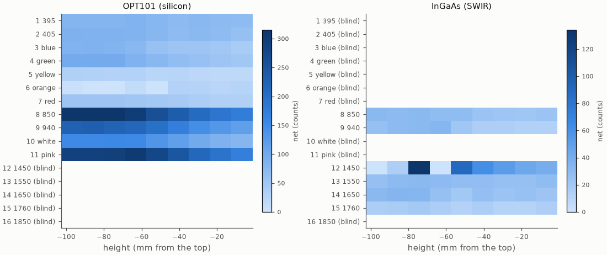
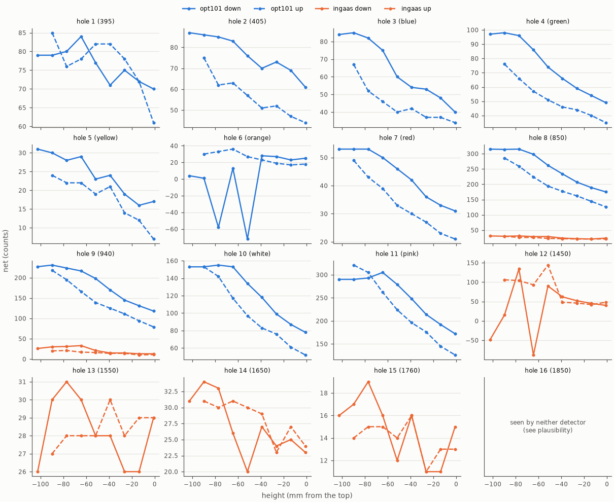
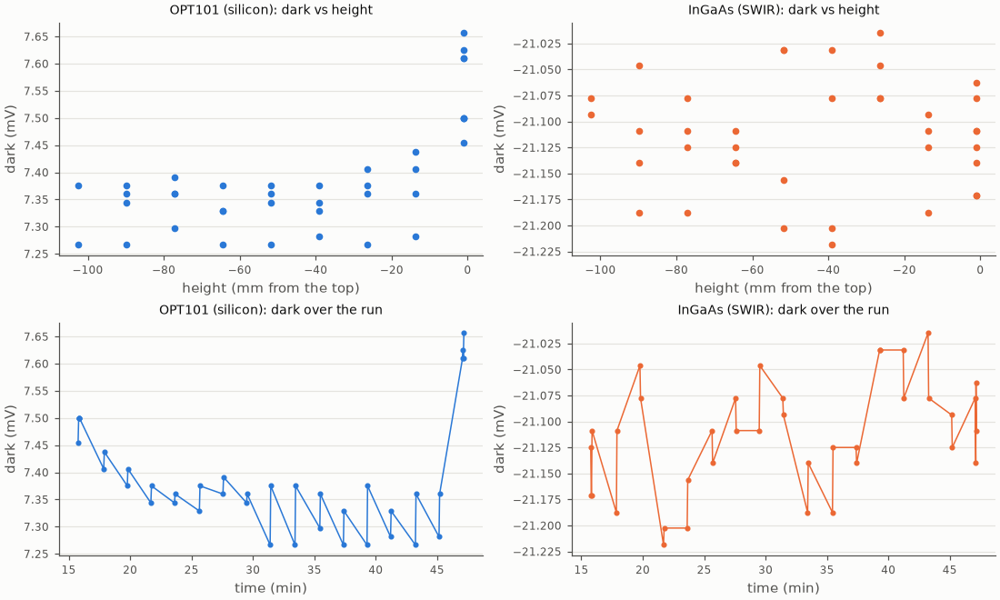
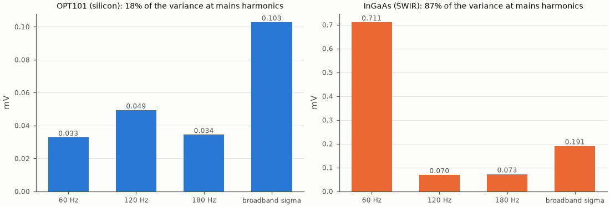

# LIO diagnostic sweep 20261119-152512_scan_quick

Mode **quick**, sample **black_cup**, status **COMPLETE**

## Verdict: NOT FUNCTIONAL

- failures not tied to a channel: T13.T06

## Subsystem health

| Subsystem | Parts | Health | Reason |
|---|---|---|---|
| Link / firmware | Nano R4, USB, firmware | ✓ OK | 1 checks pass |
| ADC / I²C | ADS1115, software I²C D11/D12 | ✓ OK | 1 checks pass |
| Shift registers | U1, U2 | ✓ OK | 1 checks pass |
| LED drivers / rails | DRV1 (RAIL A), DRV2 (RAIL B) | ✓ OK | 4 checks pass |
| LED / MOSFET channels | LED1-16, Q1-16 | ✕ ACT | optics/opt101/h16/plausibility: opt101 cannot see 1850 nm; residual +411 counts over C +15.0; height-dependent (optical) |
| OPT101 | OPT101 (A1) | ✓ OK | 8 checks pass |
| InGaAs TIA | D1, U5, Rf, Cf (A0) | ✕ ACT | elec/ingaas/select_only: largest on hole 1: +30.9 counts |
| Motors / lead screws | M1, M2, ULN2003, couplers, M6 rods | ✓ OK | 3 checks pass |
| Stage tracking | lio.stage, soft limits | ✓ OK | 1 checks pass |
| Safety | interlocks, duty budget | ✓ OK | 2 checks pass |
| Power / earthing | supplies, GND, earth bond | ✓ OK | 4 checks pass |
| Optical path / ambient | window, shroud, lid, sample | ✓ OK | 5 checks pass |
| Run | the scan itself | ✓ OK | 1 checks pass |

## Findings to act on

### ✕ FAIL `optics/opt101/h16/plausibility`: hole 16 (1850) seen by opt101?

opt101 cannot see 1850 nm; residual +411 counts over C +15.0; height-dependent (optical)

- **Why:** A detector responds, with a height-dependent (optical) signal, to a hole whose wavelength it cannot see: the LED in this hole is not the one in the channel map (swapped with another hole, or the wrong part).
- **Parts:** LED16
- **Next check:** Camera check of that hole (visible or not); compare the LED marking with docs/OPTICAL_CHANNEL_MAP.md; look for the hole it was swapped with (a response missing elsewhere).

### ✕ FAIL `optics/h06/intermittent`: hole 6 (orange) intermittent

down and up readings disagree on both detectors at once at 2 height(s): -316037, -212056

- **Why:** This hole's readings jump on both detectors at the same moment: an electrical event (a joint opening for an instant, or an intermittent short), not light.
- **Parts:** LED6, Q6, solder joints, breadboard contacts
- **Next check:** Wiggle-test the LED and MOSFET leads while watching 'lio ch 6 on' readings; reflow or re-seat the joints.

### ✕ FAIL `optics/h12/intermittent`: hole 12 (1450) intermittent

down and up readings disagree on both detectors at once at 2 height(s): -264047, -212056

- **Why:** This hole's readings jump on both detectors at the same moment: an electrical event (a joint opening for an instant, or an intermittent short), not light.
- **Parts:** LED12, Q12, solder joints, breadboard contacts
- **Next check:** Wiggle-test the LED and MOSFET leads while watching 'lio ch 12 on' readings; reflow or re-seat the joints.

### ✕ FAIL `elec/ingaas/select_only`: ingaas: select-only coupling (MOSFET on, CE low)

largest on hole 1: +30.9 counts

- **Why:** Selecting a MOSFET (gate drive, no LED current) moves the detector output: gate-drive coupling.
- **Parts:** Q gates, shift-register outputs, detector wiring
- **Next check:** Look for detector leads near the gate lines.

## Response vs height, per hole (down pass; blind holes blank)

## Response curves: down pass (solid) and up pass (dashed)

## Dark level vs height (light leak) and over time (drift)

## Dark noise: mains harmonics and broadband

## System

| Status | Metric | Value | Result | Criterion |
|---|---|---|---|---|
| ✓ PASS | `system/link` | 0 unexpected boots | firmware 2.5.2, no unexpected # BOOT |  |
| ✓ PASS | `system/adc` | 764 readings | 764 readings, no dropout |  |
| ✓ PASS | `system/addressing` | 0 pairs | 16 responding holes, all distinct |  |
| ✓ PASS | `system/rail/A` | 8 holes | 8/8 holes respond |  |
| ✓ PASS | `system/rail/B` | 7 holes | 7/8 holes respond |  |
| ✓ PASS | `system/interlocks` | 0 failed | light_while_moving: PASS; single_channel: PASS |  |
| ✓ PASS | `system/duty` | 989 ms/min | max 989 ms of 1000 ms; 0 cool-down waits, 0 s in all |  |
| ✓ PASS | `system/stage` |  | position [-4096, -4096], limits respected |  |
| ✓ PASS | `system/run` |  | COMPLETE |  |

## Optics

| Status | Metric | Value | Result | Criterion |
|---|---|---|---|---|
| - SKIP | `optics/opt101/h01/response` | 71.8 counts | sample 'black_cup' is not judged against absolute levels | O >= 15 (WARN below), >= 6 (FAIL below) |
| - SKIP | `optics/opt101/h02/response` | 77 counts | sample 'black_cup' is not judged against absolute levels | O >= 15 (WARN below), >= 6 (FAIL below) |
| - SKIP | `optics/opt101/h03/response` | 75 counts | sample 'black_cup' is not judged against absolute levels | O >= 15 (WARN below), >= 6 (FAIL below) |
| - SKIP | `optics/opt101/h04/response` | 88.7 counts | sample 'black_cup' is not judged against absolute levels | O >= 15 (WARN below), >= 6 (FAIL below) |
| - SKIP | `optics/opt101/h05/response` | 21.2 counts | sample 'black_cup' is not judged against absolute levels | O >= 15 (WARN below), >= 6 (FAIL below) |
| - SKIP | `optics/opt101/h06/response` | 24.6 counts | sample 'black_cup' is not judged against absolute levels | O >= 15 (WARN below), >= 6 (FAIL below) |
| - SKIP | `optics/opt101/h07/response` | 43.5 counts | sample 'black_cup' is not judged against absolute levels | O >= 15 (WARN below), >= 6 (FAIL below) |
| - SKIP | `optics/opt101/h08/response` | 307 counts | sample 'black_cup' is not judged against absolute levels | O >= 15 (WARN below), >= 6 (FAIL below) |
| - SKIP | `optics/opt101/h09/response` | 214.3 counts | sample 'black_cup' is not judged against absolute levels | O >= 15 (WARN below), >= 6 (FAIL below) |
| - SKIP | `optics/opt101/h10/response` | 140.6 counts | sample 'black_cup' is not judged against absolute levels | O >= 15 (WARN below), >= 6 (FAIL below) |
| - SKIP | `optics/opt101/h11/response` | 283.1 counts | sample 'black_cup' is not judged against absolute levels | O >= 15 (WARN below), >= 6 (FAIL below) |
| ✓ PASS | `optics/opt101/h12/plausibility` | 22.7 counts | opt101 cannot see 1450 nm; residual +23 counts over C +15.0 | < 30 counts (WARN), < 80 (FAIL) |
| ✓ PASS | `optics/opt101/h13/plausibility` | 0.2 counts | opt101 cannot see 1550 nm; residual +0 counts over C +15.0 | < 30 counts (WARN), < 80 (FAIL) |
| ✓ PASS | `optics/opt101/h14/plausibility` | 1.5 counts | opt101 cannot see 1650 nm; residual +2 counts over C +15.0 | < 30 counts (WARN), < 80 (FAIL) |
| ✓ PASS | `optics/opt101/h15/plausibility` | 0.4 counts | opt101 cannot see 1760 nm; residual +0 counts over C +15.0 | < 30 counts (WARN), < 80 (FAIL) |
| ✕ FAIL | `optics/opt101/h16/plausibility` | 411.3 counts | opt101 cannot see 1850 nm; residual +411 counts over C +15.0; height-dependent (optical) | < 30 counts (WARN), < 80 (FAIL) |
| ✓ PASS | `optics/opt101/electrical_only` | 0 fraction | 0/11 expected holes show no optical response; coupling present | FAIL when >= 75% of expected holes have O < 6 while |C| >= 8 |
| - SKIP | `optics/opt101/throughput` | 77 counts | median O over 11 expected holes; spread (CV) 79% across holes | sample 'black_cup': judged against its baseline only |
| ✓ PASS | `optics/ingaas/h01/plausibility` | 1.8 counts | ingaas cannot see 395 nm; residual +2 counts over C +4.0 | < 30 counts (WARN), < 80 (FAIL) |
| ✓ PASS | `optics/ingaas/h02/plausibility` | 0.8 counts | ingaas cannot see 405 nm; residual +1 counts over C +4.0 | < 30 counts (WARN), < 80 (FAIL) |
| ✓ PASS | `optics/ingaas/h03/plausibility` | 1 counts | ingaas cannot see 465 nm; residual +1 counts over C +4.0 | < 30 counts (WARN), < 80 (FAIL) |
| ✓ PASS | `optics/ingaas/h04/plausibility` | -2.2 counts | ingaas cannot see 525 nm; residual -2 counts over C +4.0 | < 30 counts (WARN), < 80 (FAIL) |
| ✓ PASS | `optics/ingaas/h05/plausibility` | 4 counts | ingaas cannot see 590 nm; residual +4 counts over C +4.0 | < 30 counts (WARN), < 80 (FAIL) |
| ✓ PASS | `optics/ingaas/h06/plausibility` | 13.7 counts | ingaas cannot see 605 nm; residual +14 counts over C +4.0 | < 30 counts (WARN), < 80 (FAIL) |
| ✓ PASS | `optics/ingaas/h07/plausibility` | 5.2 counts | ingaas cannot see 630 nm; residual +5 counts over C +4.0 | < 30 counts (WARN), < 80 (FAIL) |
| - SKIP | `optics/ingaas/h08/response` | 26.8 counts | sample 'black_cup' is not judged against absolute levels | O >= 15 (WARN below), >= 6.11474 (FAIL below) |
| - SKIP | `optics/ingaas/h09/response` | 25.6 counts | sample 'black_cup' is not judged against absolute levels | O >= 15 (WARN below), >= 6.11474 (FAIL below) |
| ✓ PASS | `optics/ingaas/h10/plausibility` | -3.5 counts | ingaas cannot see 450 nm; residual -3 counts over C +7.0 | < 30 counts (WARN), < 80 (FAIL) |
| ✓ PASS | `optics/ingaas/h11/plausibility` | 3.3 counts | ingaas cannot see 450 nm; residual +3 counts over C +7.0 | < 30 counts (WARN), < 80 (FAIL) |
| - SKIP | `optics/ingaas/h12/response` | 75.5 counts | sample 'black_cup' is not judged against absolute levels | O >= 15 (WARN below), >= 6.11474 (FAIL below) |
| - SKIP | `optics/ingaas/h13/response` | 24 counts | sample 'black_cup' is not judged against absolute levels | O >= 15 (WARN below), >= 6.11474 (FAIL below) |
| - SKIP | `optics/ingaas/h14/response` | 27.3 counts | sample 'black_cup' is not judged against absolute levels | O >= 15 (WARN below), >= 6.11474 (FAIL below) |
| ✓ PASS | `optics/ingaas/h16/plausibility` | 19.6 counts | ingaas cannot see 1850 nm; residual +20 counts over C +7.0 | < 30 counts (WARN), < 80 (FAIL) |
| ✓ PASS | `optics/ingaas/electrical_only` | 0 fraction | 0/5 expected holes show no optical response; coupling small | FAIL when >= 75% of expected holes have O < 6.11474 while |C| >= 8 |
| - SKIP | `optics/ingaas/throughput` | 26.8 counts | median O over 5 expected holes; spread (CV) 55% across holes | sample 'black_cup': judged against its baseline only |
| ✓ PASS | `optics/h01/intermittent` | 0 heights | down and up agree at 8 heights |  |
| ✓ PASS | `optics/h02/intermittent` | 0 heights | down and up agree at 8 heights |  |
| ✓ PASS | `optics/h03/intermittent` | 0 heights | down and up agree at 8 heights |  |
| ✓ PASS | `optics/h04/intermittent` | 0 heights | down and up agree at 8 heights |  |
| ✓ PASS | `optics/h05/intermittent` | 0 heights | down and up agree at 8 heights |  |
| ✕ FAIL | `optics/h06/intermittent` | 2 heights | down and up readings disagree on both detectors at once at 2 height(s): -316037, -212056 | both detectors within max(5 x noise floor, 0.1 x reading) of each other |
| ✓ PASS | `optics/h07/intermittent` | 0 heights | down and up agree at 8 heights |  |
| ✓ PASS | `optics/h08/intermittent` | 0 heights | down and up agree at 8 heights |  |
| ✓ PASS | `optics/h09/intermittent` | 0 heights | down and up agree at 8 heights |  |
| ✓ PASS | `optics/h10/intermittent` | 0 heights | down and up agree at 8 heights |  |
| ✓ PASS | `optics/h11/intermittent` | 0 heights | down and up agree at 8 heights |  |
| ✕ FAIL | `optics/h12/intermittent` | 2 heights | down and up readings disagree on both detectors at once at 2 height(s): -264047, -212056 | both detectors within max(5 x noise floor, 0.1 x reading) of each other |
| ✓ PASS | `optics/h13/intermittent` | 0 heights | down and up agree at 8 heights |  |
| ✓ PASS | `optics/h14/intermittent` | 0 heights | down and up agree at 8 heights |  |
| ✓ PASS | `optics/h15/intermittent` | 0 heights | down and up agree at 8 heights |  |
| ✓ PASS | `optics/h16/intermittent` | 0 heights | down and up agree at 8 heights |  |
| ✓ PASS | `optics/optimum` | -108076 half-steps | -108076 half-steps (-26.39 mm); weakest normalised response there 0.27 |  |
| ✓ PASS | `optics/opt101/snr` | 28.2 dB | weakest hole 5: 28.2 dB (noise sigma 0.103 mV) | >= 20 dB |
| ✓ PASS | `optics/opt101/headroom` | 98.2 % | highest lit reading 522 of 29600 counts | >= 10% |
| ✓ PASS | `optics/ingaas/snr` | 23.9 dB | weakest hole 13: 23.9 dB (noise sigma 0.191 mV) | >= 20 dB |
| ✓ PASS | `optics/ingaas/headroom` | 100.1 % | highest lit reading -25 of 28000 counts | >= 10% |
| - SKIP | `optics/stray` |  | needs a white_ptfe or empty reference (--reference) |  |
| - SKIP | `optics/effectiveness` |  | needs a reference (baseline) of the same sample |  |
| ✓ PASS | `optics/wrong_rail/h01` | 1 counts | +1 counts on opt101 with the hole selected and RAIL B enabled | < 30 counts (WARN), < 80 (FAIL) |
| ✓ PASS | `optics/wrong_rail/h02` | 0 counts | +0 counts on opt101 with the hole selected and RAIL B enabled | < 30 counts (WARN), < 80 (FAIL) |
| ✓ PASS | `optics/wrong_rail/h03` | 0 counts | +0 counts on opt101 with the hole selected and RAIL B enabled | < 30 counts (WARN), < 80 (FAIL) |
| ✓ PASS | `optics/wrong_rail/h04` | 0 counts | +0 counts on opt101 with the hole selected and RAIL B enabled | < 30 counts (WARN), < 80 (FAIL) |
| ✓ PASS | `optics/wrong_rail/h05` | 0 counts | +0 counts on opt101 with the hole selected and RAIL B enabled | < 30 counts (WARN), < 80 (FAIL) |
| ✓ PASS | `optics/wrong_rail/h06` | 0 counts | +0 counts on opt101 with the hole selected and RAIL B enabled | < 30 counts (WARN), < 80 (FAIL) |
| ✓ PASS | `optics/wrong_rail/h07` | 1 counts | +1 counts on opt101 with the hole selected and RAIL B enabled | < 30 counts (WARN), < 80 (FAIL) |
| ✓ PASS | `optics/wrong_rail/h08` | 1 counts | +1 counts on opt101 with the hole selected and RAIL B enabled | < 30 counts (WARN), < 80 (FAIL) |
| ✓ PASS | `optics/wrong_rail/h09` | 0 counts | +0 counts on ingaas with the hole selected and RAIL A enabled | < 30 counts (WARN), < 80 (FAIL) |
| ✓ PASS | `optics/wrong_rail/h10` | 0 counts | +0 counts on opt101 with the hole selected and RAIL A enabled | < 30 counts (WARN), < 80 (FAIL) |
| ✓ PASS | `optics/wrong_rail/h11` | -1 counts | -1 counts on opt101 with the hole selected and RAIL A enabled | < 30 counts (WARN), < 80 (FAIL) |
| ✓ PASS | `optics/wrong_rail/h12` | 0 counts | +0 counts on ingaas with the hole selected and RAIL A enabled | < 30 counts (WARN), < 80 (FAIL) |
| ✓ PASS | `optics/wrong_rail/h13` | 1 counts | +1 counts on ingaas with the hole selected and RAIL A enabled | < 30 counts (WARN), < 80 (FAIL) |
| ✓ PASS | `optics/wrong_rail/h14` | 1 counts | +1 counts on ingaas with the hole selected and RAIL A enabled | < 30 counts (WARN), < 80 (FAIL) |
| ✓ PASS | `optics/wrong_rail/h15` | 0 counts | +0 counts on ingaas with the hole selected and RAIL A enabled | < 30 counts (WARN), < 80 (FAIL) |

## Electrical

| Status | Metric | Value | Result | Criterion |
|---|---|---|---|---|
| ✓ PASS | `elec/opt101/coupling` | 15 counts | rail A: +10.0 counts (+1.25 mV) inferred, rail B: +15.0 counts (+1.88 mV) from 5 blind holes | corrected in software below 20 counts (FAIL at or above) |
| ✓ PASS | `elec/opt101/ground_shift` | 0.0417 mV/mA | +0.333 counts/mA | corrected in software below 0.08 mV/mA (FAIL at or above) |
| ✓ PASS | `elec/ingaas/coupling` | 7 counts | rail A: +4.0 counts (+0.50 mV) from 7 blind holes, rail B: +7.0 counts (+0.88 mV) from 3 blind holes | corrected in software below 20 counts (FAIL at or above) |
| ✓ PASS | `elec/ingaas/ground_shift` | 0.0186 mV/mA | +0.149 counts/mA | corrected in software below 0.08 mV/mA (FAIL at or above) |
| ✓ PASS | `elec/opt101/dark_offset` | 7.36 mV | +58.9 counts (+7.36 mV) | 0 to 800 counts (thresholds.dark) |
| ✓ PASS | `elec/ingaas/dark_offset` | -21.109 mV | -168.9 counts (-21.11 mV); equivalent input current +21.1 nA (Rf 1 MΩ) | -400 to 2000 counts (thresholds.dark) |
| ✓ PASS | `elec/opt101/drift` | 0.019 mV/h | +0.02 ± 0.06 mV/h; P4 - P1 +0.16 mV | |slope| < 3 mV/h (WARN), < 8 (FAIL) |
| ✓ PASS | `elec/ingaas/drift` | 0.129 mV/h | +0.13 ± 0.05 mV/h (-0.1 nA/h); P4 - P1 +0.06 mV | |slope| < 3 mV/h (WARN), < 8 (FAIL) |
| ✓ PASS | `elec/opt101/hum` | 0.0328 mV | 60/120/180 Hz: 0.033 / 0.049 / 0.034 mV; 18% of the variance at mains harmonics; broadband sigma 0.103 mV; readings integrate whole mains periods, so it cancels in the measurements | 60 Hz amplitude < 0.3 mV (WARN; not when the readings reject it), < 1 (FAIL); mains fraction < 0.5 |
| ✓ PASS | `elec/ingaas/hum` | 0.7109 mV | 60/120/180 Hz: 0.711 / 0.070 / 0.073 mV; 87% of the variance at mains harmonics; broadband sigma 0.191 mV; readings integrate whole mains periods, so it cancels in the measurements | 60 Hz amplitude < 1 mV (WARN; not when the readings reject it), < 3 (FAIL); mains fraction < 0.5 |
| ✓ PASS | `elec/opt101/coil_emi` | 9.46 x | sigma 1.183 mV moving vs 0.103 mV off (measured while moving, S0 D2); judged only when measuring while moving (continuous mode): every other reading is taken with the motors stopped | ratio < 3 (WARN), < 6 (FAIL) |
| ✓ PASS | `elec/ingaas/coil_emi` | 1.7 x | sigma 0.324 mV moving vs 0.191 mV off (measured while moving, S0 D2); judged only when measuring while moving (continuous mode): every other reading is taken with the motors stopped | ratio < 3 (WARN), < 6 (FAIL) |
| ✓ PASS | `elec/opt101/select_only` | 0.5 counts | largest on hole 15: -0.5 counts | < 8 counts (WARN), < 20 (FAIL) |
| ✕ FAIL | `elec/ingaas/select_only` | 30.9 counts | largest on hole 1: +30.9 counts | < 8 counts (WARN), < 20 (FAIL) |
| ✓ PASS | `elec/opt101/ce_only` | 1 counts | CE1: +0.0, CE2: -1.0 | < 8 counts (WARN), < 20 (FAIL) |
| ✓ PASS | `elec/ingaas/ce_only` | 1 counts | CE1: +0.0, CE2: +1.0 | < 8 counts (WARN), < 20 (FAIL) |
| - SKIP | `elec/rails` |  | A2/A3 not wired for rail and ground monitoring |  |

## Mechanics

| Status | Metric | Value | Result | Criterion |
|---|---|---|---|---|
| - SKIP | `mech/home_sensors` |  | no home sensors fitted |  |
| ✓ PASS | `mech/travel` | 420017 half-steps | tracked range 420017 / 420017 half-steps (left / right) (thresholds.motion.travel.range_steps not set: not compared) |  |
| ✓ PASS | `mech/lockstep` | 0 moves | 20 moves; 0 ended with the two sides at different positions (without home sensors only the commanded steps are seen: a side losing steps shows as mech/step_loss) |  |
| ✓ PASS | `mech/settle` | 601 ms | median 601 ms, max 610 ms (mechanical wait 300 ms) | max - median < 500 ms (WARN), < 1500 (FAIL) |
| - SKIP | `mech/backlash` | -68887 half-steps | -68887 ± 9786 half-steps (-16.818 mm) from 122 readings on 16 channels | < 600 (WARN), < 1500 (FAIL); not flagged within 3 sigma; not judged when the resolution is worse than 300 |
| - SKIP | `mech/step_loss` | -67847 half-steps per travel | the stage falls behind by -67847 ± 20830 half-steps over a full upward travel (one side losing steps: about twice that on that side, and a tilt) | < 400 (WARN), < 1000 (FAIL); not flagged within 3 sigma |
| - SKIP | `mech/repeatability` |  | no repeated reference visits in this mode (full, fine, repeatability have them) |  |

## Ambient

| Status | Metric | Value | Result | Criterion |
|---|---|---|---|---|
| ✓ PASS | `ambient/opt101/leak` | -0.2 counts | dark at the bottom -0.2 counts (-0.02 mV) vs the top | rise < 8 counts (WARN), < 25 (FAIL) |
| ✓ PASS | `ambient/ingaas/leak` | 0.2 counts | dark at the bottom +0.2 counts (+0.03 mV) vs the top; 0.93% of the median signal | rise < 8 counts (WARN), < 25 (FAIL) |
| ✓ PASS | `ambient/opt101/flicker` | 0.0494 mV | 120 Hz amplitude in the dark streams 0.049 mV; readings integrate whole mains periods, so it cancels | < 0.4 mV (WARN), < 1.2 (FAIL) |
| ✓ PASS | `ambient/ingaas/flicker` | 0.0697 mV | 120 Hz amplitude in the dark streams 0.070 mV; readings integrate whole mains periods, so it cancels | < 0.4 mV (WARN), < 1.2 (FAIL) |
| - SKIP | `ambient/lid` |  | optional operator step (lid ajar at two heights) |  |

## Not measured (capability)

- rail_monitor: A2/A3 not wired for rail and ground monitoring
- home_sensors: no home sensors fitted
