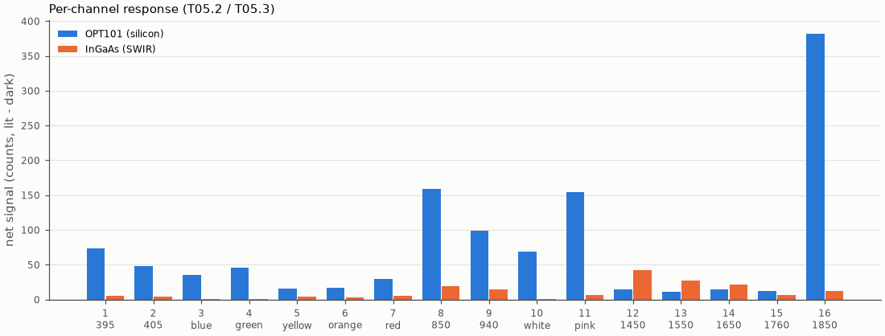
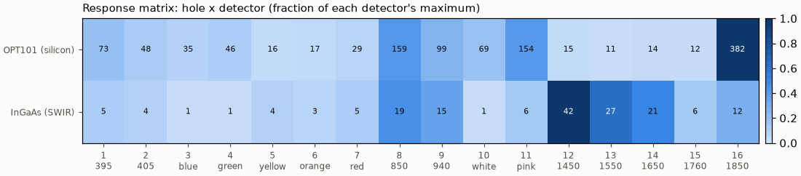
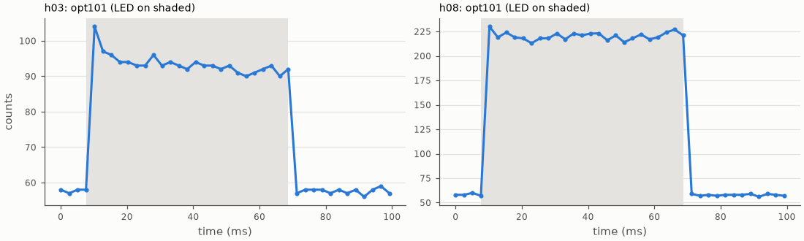
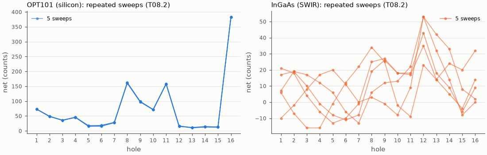

# LIO test report: 20261119-171453_host

**Verdict: NOT FUNCTIONAL**: 3 failing channels (more than 2): 8, 9, 13

- Target: `/dev/cu.usbmodem101`
- Started 2026-11-19T17:14:53-05:00, finished 2026-11-19T17:15:05-05:00
- Sample: `black_cup`, operator: unknown, notes: retest after reseating LEDs 12/13/6 with putty
- Firmware 2.5.2 (proto 1, build 2026-11-17)
- Config `/Users/coleloughbc/Documents/VSCode-Local/LIO/software/config/lio_hw.yaml` sha256 7b8098f06634 (thresholds provisional)
- Host: macOS-27.0.1-x86_64-i386-64bit, Python 3.12.11, lio 0.2.0, git f05f1f2b10 (dirty)
- Counts: PASS 11, WARN 2, FAIL 2
- LED duty budget: 0.0 s of cool-down waits, 0 over-budget on-time(s)

## Summary

| Test | Name | Status | Note |
|---|---|---|---|
| T05.1 | Rail gating by CE1 / CE2 | ✓ PASS |  |
| T05.2 | Per-channel response | ! WARN |  |
| T05.3 | Channel address and isolation | ! WARN |  |
| T05.4 | Off-state return after each MEAS | ✓ PASS |  |
| T05.5 | Repeatability (interleaved MEAS) | ✓ PASS | not judged (net < 1000 counts or detector unusable): 1/opt101, 2/opt101, 3/opt101, 4/opt101, 5/opt101, 6/opt101, 7/opt101, 8/opt101, 8/ingaas, 9/opt101, 9/ingaas, 10/opt101, 11/opt101, 12/ingaas, 13/ingaas, 14/ingaas, 15/ingaas |
| T06.1 | OPT101 | ✓ PASS |  |
| T06.2 | InGaAs TIA | ✓ PASS |  |
| T06.3 | Cross-calibration on the shared holes | ✕ FAIL |  |
| T07.1 | Step response and settling time | ✕ FAIL |  |
| T07.2 | Recommended settle time | ✓ PASS |  |
| T07.3 | MEAS timing | ✓ PASS |  |
| T08.1 | SWEEP completes with a valid schema | ✓ PASS |  |
| T08.2 | Repeated sweeps | ✓ PASS |  |
| T08.3 | Sweep agrees with MEAS | ✓ PASS |  |
| T08.4 | CSV output format | ✓ PASS |  |

### Per-channel response

### Response matrix

### Step responses

### Repeated sweeps

## T05

### T05.1 Rail gating by CE1 / CE2: PASS

| Check | Status | Result | Criterion |
|---|---|---|---|
| Hole 8 selected, CE1 low | ✓ PASS | opt101 57 (dark 57) | dark |
| Hole 8 selected, CE1 high | ✓ PASS | opt101 210 | light above the detection threshold |
| Hole 8 with CE2 (wrong rail) | ✓ PASS | ERR code=3 needs exactly one selected hole on this rail | refused (code 3) |
| Hole 12 selected, CE2 low | ✓ PASS | ingaas -169 (dark -169) | dark |
| Hole 12 selected, CE2 high | ✓ PASS | ingaas -128 | light above the detection threshold |
| Hole 12 with CE1 (wrong rail) | ✓ PASS | ERR code=3 needs exactly one selected hole on this rail | refused (code 3) |

### T05.2 Per-channel response: WARN

| Check | Status | Result | Criterion |
|---|---|---|---|
| Hole 8 (850) on ingaas | ! WARN | net +19 (weak); weaker than expected | expect signal: signal >= 38 |
| Hole 9 (940) on ingaas | ! WARN | net +15 (weak); weaker than expected | expect signal: signal >= 38 |
| Hole 13 (1550) on ingaas | ! WARN | net +27 (weak); weaker than expected | expect signal: signal >= 38 |
| Hole 14 (1650) on ingaas | ! WARN | net +21 (weak); weaker than expected | expect signal: signal >= 38 |
| Hole 15 (1760) on ingaas | ! WARN | net +6 (none); weak channel below the weak threshold | expect weak: signal >= 38 |
| Hole 1 (395) on opt101 | ✓ PASS | net +73 (signal); signal as expected | expect signal: signal >= 15 |
| Hole 2 (405) on opt101 | ✓ PASS | net +48 (signal); signal as expected | expect signal: signal >= 15 |
| Hole 3 (blue) on opt101 | ✓ PASS | net +35 (signal); signal as expected | expect signal: signal >= 15 |
| Hole 4 (green) on opt101 | ✓ PASS | net +46 (signal); signal as expected | expect signal: signal >= 15 |
| Hole 5 (yellow) on opt101 | ✓ PASS | net +16 (signal); signal as expected | expect signal: signal >= 15 |
| Hole 6 (orange) on opt101 | ✓ PASS | net +17 (signal); signal as expected | expect signal: signal >= 15 |
| Hole 7 (red) on opt101 | ✓ PASS | net +29 (signal); signal as expected | expect signal: signal >= 15 |
| Hole 8 (850) on opt101 | ✓ PASS | net +159 (signal); signal as expected | expect signal: signal >= 15 |
| Hole 9 (940) on opt101 | ✓ PASS | net +99 (signal); signal as expected | expect signal: signal >= 15 |
| Hole 10 (white) on opt101 | ✓ PASS | net +69 (signal); signal as expected | expect signal: signal >= 15 |
| Hole 11 (pink) on opt101 | ✓ PASS | net +154 (signal); signal as expected | expect signal: signal >= 15 |
| Hole 12 (1450) on ingaas | ✓ PASS | net +42 (signal); signal as expected | expect signal: signal >= 38 |
| Hole 1 (395) on ingaas | - SKIP | not judged: 395 is outside the ingaas range (judged by opt101); recorded net +5 | out-of-range readings are not judged (channel.judge_out_of_range: false) |
| Hole 2 (405) on ingaas | - SKIP | not judged: 405 is outside the ingaas range (judged by opt101); recorded net +4 | out-of-range readings are not judged (channel.judge_out_of_range: false) |
| Hole 3 (blue) on ingaas | - SKIP | not judged: blue is outside the ingaas range (judged by opt101); recorded net +1 | out-of-range readings are not judged (channel.judge_out_of_range: false) |
| Hole 4 (green) on ingaas | - SKIP | not judged: green is outside the ingaas range (judged by opt101); recorded net +1 | out-of-range readings are not judged (channel.judge_out_of_range: false) |
| Hole 5 (yellow) on ingaas | - SKIP | not judged: yellow is outside the ingaas range (judged by opt101); recorded net +4 | out-of-range readings are not judged (channel.judge_out_of_range: false) |
| Hole 6 (orange) on ingaas | - SKIP | not judged: orange is outside the ingaas range (judged by opt101); recorded net +3 | out-of-range readings are not judged (channel.judge_out_of_range: false) |
| Hole 7 (red) on ingaas | - SKIP | not judged: red is outside the ingaas range (judged by opt101); recorded net +5 | out-of-range readings are not judged (channel.judge_out_of_range: false) |
| Hole 10 (white) on ingaas | - SKIP | not judged: white is outside the ingaas range (judged by opt101); recorded net +1 | out-of-range readings are not judged (channel.judge_out_of_range: false) |
| Hole 11 (pink) on ingaas | - SKIP | not judged: pink is outside the ingaas range (judged by opt101); recorded net +6 | out-of-range readings are not judged (channel.judge_out_of_range: false) |
| Hole 12 (1450) on opt101 | - SKIP | not judged: 1450 is outside the opt101 range (judged by ingaas); recorded net +15 | out-of-range readings are not judged (channel.judge_out_of_range: false) |
| Hole 13 (1550) on opt101 | - SKIP | not judged: 1550 is outside the opt101 range (judged by ingaas); recorded net +11 | out-of-range readings are not judged (channel.judge_out_of_range: false) |
| Hole 14 (1650) on opt101 | - SKIP | not judged: 1650 is outside the opt101 range (judged by ingaas); recorded net +14 | out-of-range readings are not judged (channel.judge_out_of_range: false) |
| Hole 15 (1760) on opt101 | - SKIP | not judged: 1760 is outside the opt101 range (judged by ingaas); recorded net +12 | out-of-range readings are not judged (channel.judge_out_of_range: false) |
| Hole 16 (1850) on ingaas | - SKIP | not judged: 1850 is outside the ingaas range (judged by no detector); recorded net +12 | out-of-range readings are not judged (channel.judge_out_of_range: false) |
| Hole 16 (1850) on opt101 | - SKIP | not judged: 1850 is outside the opt101 range (judged by no detector); recorded net +382 | out-of-range readings are not judged (channel.judge_out_of_range: false) |

### T05.3 Channel address and isolation: WARN

| Check | Status | Result | Criterion |
|---|---|---|---|
| Hole 15 (1760) detector pattern | ! WARN | no response on ['ingaas']: possible swapped, misrouted or stuck-on channel | expected ['ingaas'] |
| Hole 1 (395) detector pattern | ✓ PASS | seen by ['opt101'] as expected (ingaas not judged: outside its range) | expected ['opt101'] |
| Hole 2 (405) detector pattern | ✓ PASS | seen by ['opt101'] as expected (ingaas not judged: outside its range) | expected ['opt101'] |
| Hole 3 (blue) detector pattern | ✓ PASS | seen by ['opt101'] as expected (ingaas not judged: outside its range) | expected ['opt101'] |
| Hole 4 (green) detector pattern | ✓ PASS | seen by ['opt101'] as expected (ingaas not judged: outside its range) | expected ['opt101'] |
| Hole 5 (yellow) detector pattern | ✓ PASS | seen by ['opt101'] as expected (ingaas not judged: outside its range) | expected ['opt101'] |
| Hole 6 (orange) detector pattern | ✓ PASS | seen by ['opt101'] as expected (ingaas not judged: outside its range) | expected ['opt101'] |
| Hole 7 (red) detector pattern | ✓ PASS | seen by ['opt101'] as expected (ingaas not judged: outside its range) | expected ['opt101'] |
| Hole 8 (850) detector pattern | ✓ PASS | seen by ['ingaas', 'opt101'] as expected | expected ['ingaas', 'opt101'] |
| Hole 9 (940) detector pattern | ✓ PASS | seen by ['ingaas', 'opt101'] as expected | expected ['ingaas', 'opt101'] |
| Hole 10 (white) detector pattern | ✓ PASS | seen by ['opt101'] as expected (ingaas not judged: outside its range) | expected ['opt101'] |
| Hole 11 (pink) detector pattern | ✓ PASS | seen by ['opt101'] as expected (ingaas not judged: outside its range) | expected ['opt101'] |
| Hole 12 (1450) detector pattern | ✓ PASS | seen by ['ingaas'] as expected (opt101 not judged: outside its range) | expected ['ingaas'] |
| Hole 13 (1550) detector pattern | ✓ PASS | seen by ['ingaas'] as expected (opt101 not judged: outside its range) | expected ['ingaas'] |
| Hole 14 (1650) detector pattern | ✓ PASS | seen by ['ingaas'] as expected (opt101 not judged: outside its range) | expected ['ingaas'] |
| Hole 16 (1850) detector pattern | ✓ PASS | seen by nothing as expected (ingaas, opt101 not judged: outside its range) | expected none |
| Signatures unique | ✓ PASS | no two channels look the same | cosine < 0.98 or amplitude differs by more than 1 % |

### T05.4 Off-state return after each MEAS: PASS

| Check | Status | Result | Criterion |
|---|---|---|---|
| Hole 1 ingaas back to dark | ✓ PASS | -168.8 after OFF vs dark -169 | within 5 sigma (18.8 counts) |
| Hole 1 opt101 back to dark | ✓ PASS | 57.8 after OFF vs dark 58 | within 5 sigma (3.5 counts) |
| Hole 2 ingaas back to dark | ✓ PASS | -168.0 after OFF vs dark -169 | within 5 sigma (18.8 counts) |
| Hole 2 opt101 back to dark | ✓ PASS | 57.2 after OFF vs dark 58 | within 5 sigma (3.5 counts) |
| Hole 3 ingaas back to dark | ✓ PASS | -168.0 after OFF vs dark -169 | within 5 sigma (18.8 counts) |
| Hole 3 opt101 back to dark | ✓ PASS | 57.2 after OFF vs dark 57 | within 5 sigma (3.5 counts) |
| Hole 4 ingaas back to dark | ✓ PASS | -168.0 after OFF vs dark -168 | within 5 sigma (18.8 counts) |
| Hole 4 opt101 back to dark | ✓ PASS | 57.2 after OFF vs dark 57 | within 5 sigma (3.5 counts) |
| Hole 5 ingaas back to dark | ✓ PASS | -169.2 after OFF vs dark -168 | within 5 sigma (18.8 counts) |
| Hole 5 opt101 back to dark | ✓ PASS | 57.2 after OFF vs dark 58 | within 5 sigma (3.5 counts) |
| Hole 6 ingaas back to dark | ✓ PASS | -169.0 after OFF vs dark -168 | within 5 sigma (18.8 counts) |
| Hole 6 opt101 back to dark | ✓ PASS | 57.8 after OFF vs dark 58 | within 5 sigma (3.5 counts) |
| Hole 7 ingaas back to dark | ✓ PASS | -168.8 after OFF vs dark -169 | within 5 sigma (18.8 counts) |
| Hole 7 opt101 back to dark | ✓ PASS | 57.2 after OFF vs dark 57 | within 5 sigma (3.5 counts) |
| Hole 8 ingaas back to dark | ✓ PASS | -168.5 after OFF vs dark -169 | within 5 sigma (18.8 counts) |
| Hole 8 opt101 back to dark | ✓ PASS | 57.5 after OFF vs dark 58 | within 5 sigma (3.5 counts) |
| Hole 9 ingaas back to dark | ✓ PASS | -168.5 after OFF vs dark -169 | within 5 sigma (18.8 counts) |
| Hole 9 opt101 back to dark | ✓ PASS | 57.5 after OFF vs dark 57 | within 5 sigma (3.5 counts) |
| Hole 10 ingaas back to dark | ✓ PASS | -168.5 after OFF vs dark -168 | within 5 sigma (18.8 counts) |
| Hole 10 opt101 back to dark | ✓ PASS | 57.0 after OFF vs dark 58 | within 5 sigma (3.5 counts) |
| Hole 11 ingaas back to dark | ✓ PASS | -169.0 after OFF vs dark -169 | within 5 sigma (18.8 counts) |
| Hole 11 opt101 back to dark | ✓ PASS | 57.5 after OFF vs dark 57 | within 5 sigma (3.5 counts) |
| Hole 12 ingaas back to dark | ✓ PASS | -167.5 after OFF vs dark -170 | within 5 sigma (18.8 counts) |
| Hole 12 opt101 back to dark | ✓ PASS | 57.8 after OFF vs dark 58 | within 5 sigma (3.5 counts) |
| Hole 13 ingaas back to dark | ✓ PASS | -168.8 after OFF vs dark -169 | within 5 sigma (18.8 counts) |
| Hole 13 opt101 back to dark | ✓ PASS | 57.5 after OFF vs dark 58 | within 5 sigma (3.5 counts) |
| Hole 14 ingaas back to dark | ✓ PASS | -167.2 after OFF vs dark -169 | within 5 sigma (18.8 counts) |
| Hole 14 opt101 back to dark | ✓ PASS | 57.2 after OFF vs dark 57 | within 5 sigma (3.5 counts) |
| Hole 15 ingaas back to dark | ✓ PASS | -167.8 after OFF vs dark -168 | within 5 sigma (18.8 counts) |
| Hole 15 opt101 back to dark | ✓ PASS | 57.2 after OFF vs dark 58 | within 5 sigma (3.5 counts) |
| Hole 16 ingaas back to dark | ✓ PASS | -168.0 after OFF vs dark -167 | within 5 sigma (18.8 counts) |
| Hole 16 opt101 back to dark | ✓ PASS | 57.5 after OFF vs dark 58 | within 5 sigma (3.5 counts) |

### T05.5 Repeatability (interleaved MEAS): PASS

not judged (net < 1000 counts or detector unusable): 1/opt101, 2/opt101, 3/opt101, 4/opt101, 5/opt101, 6/opt101, 7/opt101, 8/opt101, 8/ingaas, 9/opt101, 9/ingaas, 10/opt101, 11/opt101, 12/ingaas, 13/ingaas, 14/ingaas, 15/ingaas

## T06

### T06.1 OPT101: PASS

| Check | Status | Result | Criterion |
|---|---|---|---|
| opt101 dark offset | ✓ PASS | 57.2 counts | 0 to 800 counts |
| Responds to hole 1 (395) | ✓ PASS | net +73 | no zeros where light is expected |
| Responds to hole 2 (405) | ✓ PASS | net +48 | no zeros where light is expected |
| Responds to hole 3 (blue) | ✓ PASS | net +35 | no zeros where light is expected |
| Responds to hole 4 (green) | ✓ PASS | net +46 | no zeros where light is expected |
| Responds to hole 5 (yellow) | ✓ PASS | net +16 | no zeros where light is expected |
| Responds to hole 6 (orange) | ✓ PASS | net +17 | no zeros where light is expected |
| Responds to hole 7 (red) | ✓ PASS | net +29 | no zeros where light is expected |
| Responds to hole 10 (white) | ✓ PASS | net +69 | no zeros where light is expected |
| Responds to hole 11 (pink) | ✓ PASS | net +154 | no zeros where light is expected |
| Not saturated | ✓ PASS | peak 440 | < 29000 counts |

### T06.2 InGaAs TIA: PASS

| Check | Status | Result | Criterion |
|---|---|---|---|
| Dark signal steady | ✓ PASS | dark mean -169, sigma 5.3 | sigma <= 100 and mean >= -1500 |
| ingaas dark offset | ✓ PASS | -168.5 counts | -400 to 2000 counts |
| Polarity gate (hole 8) | ✓ PASS | net +18 | net >= -5 sigma |
| Hole 9 InGaAs polarity | ✓ PASS | net +15 | net not negative |
| Hole 12 InGaAs polarity | ✓ PASS | net +42 | net not negative |
| Hole 13 InGaAs polarity | ✓ PASS | net +27 | net not negative |
| Hole 14 InGaAs polarity | ✓ PASS | net +21 | net not negative |
| InGaAs not saturated | ✓ PASS | no hole saturates | < 27000 counts |

### T06.3 Cross-calibration on the shared holes: FAIL

| Check | Status | Result | Criterion |
|---|---|---|---|
| Hole 8 seen by both detectors | ✕ FAIL | one detector does not respond | both above the detection threshold |
| Hole 9 seen by both detectors | ✕ FAIL | one detector does not respond | both above the detection threshold |

## T07

### T07.1 Step response and settling time: FAIL

| Check | Status | Result | Criterion |
|---|---|---|---|
| Hole 13 step response | ✕ FAIL | no step on ingaas (baseline -172, plateau -140) | a step above the detection threshold |
| Hole 3 (opt101) step response | ✓ PASS | settled within a few samples: t99 <= 3.84 ms (upper bound, limited by the sample interval) | time to 99 % recorded |
| Hole 8 (opt101) step response | ✓ PASS | settled within one sample: t99 <= 1.29 ms (upper bound, limited by the sample interval) | time to 99 % recorded |

### T07.2 Recommended settle time: PASS

| Check | Status | Result | Criterion |
|---|---|---|---|
| Configured settle_ms is long enough | ✓ PASS | recommended 6 ms (max 3.84 ms x 1.5), configured 8 ms | recommended <= 8 ms |

### T07.3 MEAS timing: PASS

| Check | Status | Result | Criterion |
|---|---|---|---|
| MEAS 3 8 1 on-time | ✓ PASS | t_on_ms 25 | 21.3-32.0 ms and <= watchdog 2000 ms |
| MEAS 3 20 4 on-time | ✓ PASS | t_on_ms 90 | 73.1-106.9 ms and <= watchdog 2000 ms |

## T08

### T08.1 SWEEP completes with a valid schema: PASS

| Check | Status | Result | Criterion |
|---|---|---|---|
| 16 records, holes 1-16 in order | ✓ PASS | 16 records: [1, 2, 3, 4, 5, 6, 7, 8, 9, 10, 11, 12, 13, 14, 15, 16] | holes 1..16 |
| Sweep records parse | ✓ PASS | all '# M' fields present and integer |  |
| Sweep duration | ✓ PASS | 833 ms (host 836 ms) | <= 2.5 s |

### T08.2 Repeated sweeps: PASS

| Check | Status | Result | Criterion |
|---|---|---|---|
| ingaas dark stable between sweeps | ✓ PASS | per-sweep dark means span 4.94 counts | <= 6.65 counts |
| opt101 dark stable between sweeps | ✓ PASS | per-sweep dark means span 0.25 counts | <= 1.25 counts |

### T08.3 Sweep agrees with MEAS: PASS

| Check | Status | Result | Criterion |
|---|---|---|---|
| Hole 1 opt101 sweep vs MEAS | ✓ PASS | sweep 73 vs MEAS 73 (0.3 %) | within 7 counts (max of 10 %, 5 sigma) |
| Hole 8 opt101 sweep vs MEAS | ✓ PASS | sweep 162 vs MEAS 159 (1.6 %) | within 16 counts (max of 10 %, 5 sigma) |
| Hole 9 opt101 sweep vs MEAS | ✓ PASS | sweep 98 vs MEAS 99 (0.8 %) | within 10 counts (max of 10 %, 5 sigma) |
| Hole 10 opt101 sweep vs MEAS | ✓ PASS | sweep 72 vs MEAS 69 (3.8 %) | within 7 counts (max of 10 %, 5 sigma) |
| Hole 11 opt101 sweep vs MEAS | ✓ PASS | sweep 158 vs MEAS 154 (2.7 %) | within 15 counts (max of 10 %, 5 sigma) |

### T08.4 CSV output format: PASS

| Check | Status | Result | Criterion |
|---|---|---|---|
| Header | ✓ PASS | hole,label,dark_ingaas,dark_opt101,ingaas,opt101,net_ingaas_V,net_opt101_V | hole,label,dark_ingaas,dark_opt101,ingaas,opt101,net_ingaas_V,net_opt101_V |
| One CRLF-terminated row per hole | ✓ PASS | 16 rows | 16 rows, CRLF |
| Rows byte-identical to the original logger's format | ✓ PASS | all rows identical | same columns, rounding, labels |
