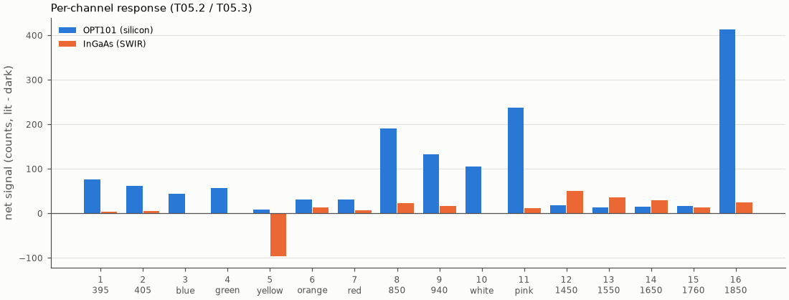
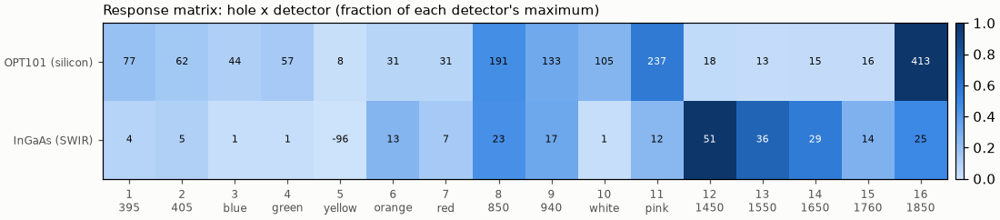
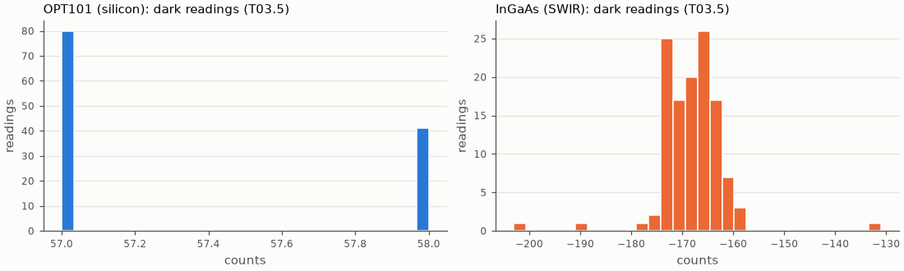
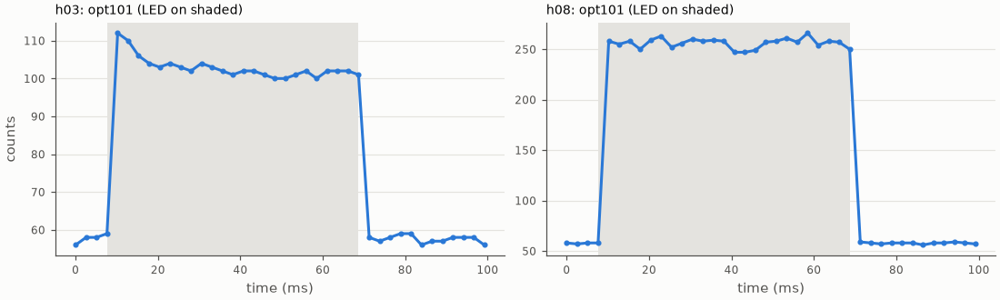
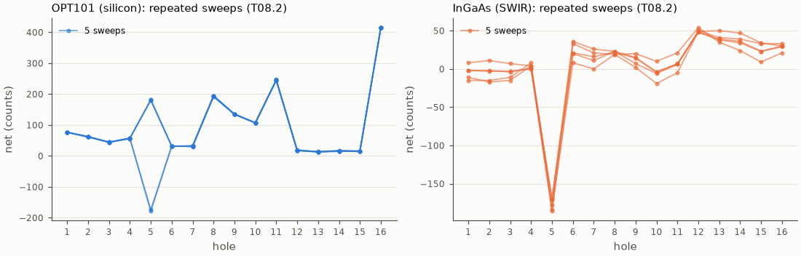

# LIO test report: 20261119-191703_host

**Verdict: FUNCTIONAL**: warnings: T05.2, T06.3, T07.1, T07.2

- Target: `/dev/cu.usbmodem101`
- Started 2026-11-19T19:17:03-05:00, finished 2026-11-19T19:52:25-05:00
- Sample: `empty`, operator: unknown
- Firmware 2.5.2 (proto 1, build 2026-11-17)
- Config `/Users/coleloughbc/Documents/VSCode-Local/LIO/software/config/lio_hw.yaml` sha256 ed3b4ba8e185 (thresholds provisional)
- Host: macOS-27.0.1-x86_64-i386-64bit, Python 3.12.11, lio 0.2.0, git 226efcf6de (dirty)
- Counts: PASS 31, WARN 4, SKIP 3
- LED duty budget: 0.0 s of cool-down waits, 0 over-budget on-time(s)

## Summary

| Test | Name | Status | Note |
|---|---|---|---|
| T01.1 | Python and dependency versions | ✓ PASS |  |
| T01.2 | Serial port discovery | ✓ PASS |  |
| T01.3 | Configuration loads and is self-consistent | ✓ PASS |  |
| T02.1 | Port open and boot banner | ✓ PASS |  |
| T02.2 | PING round-trip latency | ✓ PASS |  |
| T02.3 | INFO fields, versions and safety limits | ✓ PASS |  |
| T02.4 | Robustness to bad input | ✓ PASS |  |
| T02.5 | Sequence numbers and interleaved events | ✓ PASS |  |
| T02.6 | RESET restores the boot state | ✓ PASS |  |
| T03.1 | I2C scan finds the ADS1115 | ✓ PASS |  |
| T03.2 | Dark ADC noise, all inputs | ✓ PASS |  |
| T03.3 | Gain sweep on dark inputs | ✓ PASS |  |
| T03.4 | ADC data rate | ✓ PASS |  |
| T03.5 | Long-term dark stability | ✓ PASS |  |
| T04.1 | Shift-register patterns with CE low | ✓ PASS |  |
| T04.2 | Shift-register loopback (optional jumper) | - SKIP | loopback jumper not fitted (this build has no loop-back input (pins.LOOP), plan §6.3); the shift registers are verified optically by T05.3 |
| T04.3 | Optical address verification | - SKIP | covered by T05.3 (each hole must light only its own expected response) |
| T05.1 | Rail gating by CE1 / CE2 | ✓ PASS |  |
| T05.2 | Per-channel response | ! WARN |  |
| T05.3 | Channel address and isolation | ✓ PASS |  |
| T05.4 | Off-state return after each MEAS | ✓ PASS |  |
| T05.5 | Repeatability (interleaved MEAS) | ✓ PASS | not judged (net < 1000 counts or detector unusable): 1/opt101, 2/opt101, 3/opt101, 4/opt101, 5/opt101, 6/opt101, 7/opt101, 8/opt101, 8/ingaas, 9/opt101, 9/ingaas, 10/opt101, 11/opt101, 12/ingaas, 13/ingaas, 14/ingaas, 15/ingaas |
| T06.1 | OPT101 | ✓ PASS |  |
| T06.2 | InGaAs TIA | ✓ PASS |  |
| T06.3 | Cross-calibration on the shared holes | ! WARN |  |
| T07.1 | Step response and settling time | ! WARN |  |
| T07.2 | Recommended settle time | ! WARN |  |
| T07.3 | MEAS timing | ✓ PASS |  |
| T08.1 | SWEEP completes with a valid schema | ✓ PASS |  |
| T08.2 | Repeated sweeps | ✓ PASS |  |
| T08.3 | Sweep agrees with MEAS | ✓ PASS |  |
| T08.4 | CSV output format | ✓ PASS |  |
| T09.1 | Motion arming | ✓ PASS |  |
| T09.2 | Each motor moves both ways | ✓ PASS |  |
| T09.3 | MOTOR STOP latency | ✓ PASS |  |
| T09.4 | Detector noise while a motor moves | ✓ PASS |  |
| T09.6 | Full travel, both motors in lockstep | ✓ PASS |  |
| T09.7 | Detectors while the chamber moves | - SKIP | stopped by the operator |

### Per-channel response

### Response matrix

### Dark noise

### Step responses

### Repeated sweeps

## T01

### T01.1 Python and dependency versions: PASS

| Check | Status | Result | Criterion |
|---|---|---|---|
| Python version | ✓ PASS | 3.12.11 | >= 3.10 |
| pyserial installed | ✓ PASS | 3.5 | importable |
| pyyaml installed | ✓ PASS | 6.0.3 | importable |
| numpy installed | ✓ PASS | 2.5.4 | importable |
| matplotlib installed | ✓ PASS | 3.11.2 | importable |
| jinja2 installed | ✓ PASS | 3.1.6 | importable |

### T01.2 Serial port discovery: PASS

| Check | Status | Result | Criterion |
|---|---|---|---|
| Selected port is present | ✓ PASS | /dev/cu.usbmodem101: present | --lio-port names an existing serial port |
| USB-serial chip recognised | ✓ PASS | VID:PID 2341:0074 (Arduino Nano R4 (native USB)) | one of link.usb_ids |

### T01.3 Configuration loads and is self-consistent: PASS

| Check | Status | Result | Criterion |
|---|---|---|---|
| Config validates | ✓ PASS | lio_hw.yaml sha256 ed3b4ba8e185 |  |
| 16 holes | ✓ PASS | 16 entries |  |
| Rails split A = 1-8, B = 9-16 (as built) | ✓ PASS | A=[1, 2, 3, 4, 5, 6, 7, 8] B=[9, 10, 11, 12, 13, 14, 15, 16] |  |

## T02

### T02.1 Port open and boot banner: PASS

| Check | Status | Result | Criterion |
|---|---|---|---|
| Boot banner within the timeout | ✓ PASS | 0.06 s | <= 3 s |
| Banner identifies LIO firmware | ✓ PASS | # BOOT name=lio fw=2.5.2 proto=1 build=2026-11-17 adc_ok=1 hw_wdt=0 | name=lio, fw and proto present |

### T02.2 PING round-trip latency: PASS

| Check | Status | Result | Criterion |
|---|---|---|---|
| Every PING answered | ✓ PASS | 100/100 answered | all |
| p99 round trip | ✓ PASS | median 0.88 ms, p99 0.95 ms, max 0.96 ms | p99 < 50 ms |

### T02.3 INFO fields, versions and safety limits: PASS

| Check | Status | Result | Criterion |
|---|---|---|---|
| INFO fields present | ✓ PASS | 21 fields | all protocol-1 INFO fields |
| Firmware compatible with this host package | ✓ PASS | fw 2.5.2 proto 1 | >= 2.0.0, proto 1 |
| settle_ms matches lio_hw.yaml | ✓ PASS | 8 | 8 |
| wdt_a_ms matches lio_hw.yaml | ✓ PASS | 2000 | 2000 |
| wdt_b_ms matches lio_hw.yaml | ✓ PASS | 5000 | 5000 |
| wdt_a_cap_ms matches lio_hw.yaml | ✓ PASS | 5000 | 5000 |
| wdt_b_cap_ms matches lio_hw.yaml | ✓ PASS | 10000 | 10000 |
| comms_ms matches lio_hw.yaml | ✓ PASS | 10000 | 10000 |
| arm_ms matches lio_hw.yaml | ✓ PASS | 60000 | 60000 |
| step_max matches lio_hw.yaml | ✓ PASS | 2048 | 2048 |
| jog_max matches lio_hw.yaml | ✓ PASS | 2048 | 2048 |
| jog_v_max matches lio_hw.yaml | ✓ PASS | 1000 | 1000 |
| jog_acc_max matches lio_hw.yaml | ✓ PASS | 1000 | 1000 |
| wake_ms_max matches lio_hw.yaml | ✓ PASS | 3000 | 3000 |
| ADC address matches lio_hw.yaml | ✓ PASS | 0x48 | 0x48 |
| ADC gain matches lio_hw.yaml | ✓ PASS | 1 | 1 |
| ADC rate matches lio_hw.yaml | ✓ PASS | 128 | 128 |

### T02.4 Robustness to bad input: PASS

| Check | Status | Result | Criterion |
|---|---|---|---|
| Unknown command | ✓ PASS | @141 ERR FROBNICATE code=1 msg=unknown command | ERR code=1 |
| Bad argument | ✓ PASS | @142 ERR MEAS code=2 msg=usage: MEAS <1-16> [settle_ms] [n] | ERR code=2 |
| Missing argument | ✓ PASS | @143 ERR CH code=2 msg=usage: CH <1-16> ON [ms] | ERR code=2 |
| Line over 64 characters | ✓ PASS | ERR ? code=6 msg=line too long | ERR code=6 |
| Garbage bytes, then PING | ✓ PASS | PING OK | PING still answered |

### T02.5 Sequence numbers and interleaved events: PASS

| Check | Status | Result | Criterion |
|---|---|---|---|
| @1 echoed | ✓ PASS | @1 OK PING uptime_ms=18006260 | @1 OK PING |
| @4242 echoed | ✓ PASS | @4242 OK PING uptime_ms=18006261 | @4242 OK PING |
| @99999 echoed | ✓ PASS | @99999 OK PING uptime_ms=18006262 | @99999 OK PING |
| No @seq, none echoed | ✓ PASS | OK PING uptime_ms=18006263 | OK PING |
| Response found after interleaved events | ✓ PASS | 20 '# S' events then OK | 20 events |
| Asynchronous '# OFF' does not desynchronise | ✓ PASS | 10/10 PINGs matched; 1 timer event(s) seen | all PINGs answered in order, one '# OFF' |

### T02.6 RESET restores the boot state: PASS

| Check | Status | Result | Criterion |
|---|---|---|---|
| Banner after RESET | ✓ PASS | 0.01 s | <= 3 s |
| STATUS shows the safe state | ✓ PASS | ch=0 ce1=0 ce2=0 mask=0x0000 armed=0 | ch=0 ce1=0 ce2=0 mask=0 armed=0, motors idle |
| Settings back to defaults | ✓ PASS | wdt_a_ms=2000 (was set to 200) | 2000 |

## T03

### T03.1 I2C scan finds the ADS1115: PASS

| Check | Status | Result | Criterion |
|---|---|---|---|
| ADS1115 at 0x48 | ✓ PASS | found ['0x48'] | 0x48 acknowledges |
| I2C lines (SDA, SCL) | ✓ PASS | lines idle high with pull-ups, not bridged; 0x48 answers at 166.666 kHz | both idle high, rise on external pull-ups, not joined |
| No unexpected I2C devices | ✓ PASS | none | only the ADS1115 |

### T03.2 Dark ADC noise, all inputs: PASS

| Check | Status | Result | Criterion |
|---|---|---|---|
| ADS A0 (ingaas) dark noise | ✓ PASS | mean -168.2, sigma 4.71 counts (n=64) | sigma <= 20 counts |
| ADS A1 (opt101) dark noise | ✓ PASS | mean 57.5, sigma 0.50 counts (n=64) | sigma <= 20 counts |
| ADS A2 (unconnected) | ✓ PASS | recorded only: mean 4518.7, sigma 8.89 | floating input |
| ADS A3 (unconnected) | ✓ PASS | recorded only: mean 2641.1, sigma 2.12 | floating input |

### T03.3 Gain sweep on dark inputs: PASS

| Check | Status | Result | Criterion |
|---|---|---|---|
| GAIN 2/3 accepted | ✓ PASS | lsb 0.1875 mV | 0.1875 mV |
| GAIN 1 accepted | ✓ PASS | lsb 0.125 mV | 0.125 mV |
| GAIN 2 accepted | ✓ PASS | lsb 0.0625 mV | 0.0625 mV |
| GAIN 4 accepted | ✓ PASS | lsb 0.03125 mV | 0.03125 mV |
| GAIN 8 accepted | ✓ PASS | lsb 0.015625 mV | 0.015625 mV |
| GAIN 16 accepted | ✓ PASS | lsb 0.0078125 mV | 0.0078125 mV |
| ingaas at GAIN 2/3 agrees with GAIN 1 | ✓ PASS | -21.05 mV vs -21.05 mV | within 6.36 mV |
| ingaas at GAIN 1 agrees with GAIN 1 | ✓ PASS | -21.05 mV vs -21.05 mV | within 6.36 mV |
| ingaas at GAIN 2 agrees with GAIN 1 | ✓ PASS | -21.00 mV vs -21.05 mV | within 6.40 mV |
| ingaas at GAIN 4 agrees with GAIN 1 | ✓ PASS | -20.95 mV vs -21.05 mV | within 6.36 mV |
| ingaas at GAIN 8 agrees with GAIN 1 | ✓ PASS | -21.01 mV vs -21.05 mV | within 6.37 mV |
| ingaas at GAIN 16 agrees with GAIN 1 | ✓ PASS | -21.00 mV vs -21.05 mV | within 6.39 mV |
| GAIN 2/3 accepted | ✓ PASS | lsb 0.1875 mV | 0.1875 mV |
| GAIN 1 accepted | ✓ PASS | lsb 0.125 mV | 0.125 mV |
| GAIN 2 accepted | ✓ PASS | lsb 0.0625 mV | 0.0625 mV |
| GAIN 4 accepted | ✓ PASS | lsb 0.03125 mV | 0.03125 mV |
| GAIN 8 accepted | ✓ PASS | lsb 0.015625 mV | 0.015625 mV |
| GAIN 16 accepted | ✓ PASS | lsb 0.0078125 mV | 0.0078125 mV |
| opt101 at GAIN 2/3 agrees with GAIN 1 | ✓ PASS | 7.30 mV vs 7.20 mV | within 5.19 mV |
| opt101 at GAIN 1 agrees with GAIN 1 | ✓ PASS | 7.20 mV vs 7.20 mV | within 5.19 mV |
| opt101 at GAIN 2 agrees with GAIN 1 | ✓ PASS | 7.18 mV vs 7.20 mV | within 5.19 mV |
| opt101 at GAIN 4 agrees with GAIN 1 | ✓ PASS | 6.89 mV vs 7.20 mV | within 5.19 mV |
| opt101 at GAIN 8 agrees with GAIN 1 | ✓ PASS | 7.57 mV vs 7.20 mV | within 5.19 mV |
| opt101 at GAIN 16 agrees with GAIN 1 | ✓ PASS | 7.56 mV vs 7.20 mV | within 5.19 mV |

### T03.4 ADC data rate: PASS

| Check | Status | Result | Criterion |
|---|---|---|---|
| 8 SPS conversion interval | ✓ PASS | 120.746 ms (nominal 125.000 ms, overhead -4.254 ms) | 106.250-145.250 ms |
| 16 SPS conversion interval | ✓ PASS | 61.184 ms (nominal 62.500 ms, overhead -1.316 ms) | 53.125-73.375 ms |
| 32 SPS conversion interval | ✓ PASS | 31.243 ms (nominal 31.250 ms, overhead -0.007 ms) | 26.562-37.438 ms |
| 64 SPS conversion interval | ✓ PASS | 16.433 ms (nominal 15.625 ms, overhead +0.808 ms) | 13.281-19.469 ms |
| 128 SPS conversion interval | ✓ PASS | 8.863 ms (nominal 7.812 ms, overhead +1.050 ms) | 6.641-10.484 ms |
| 250 SPS conversion interval | ✓ PASS | 5.288 ms (nominal 4.000 ms, overhead +1.288 ms) | 3.400-6.100 ms |
| 475 SPS conversion interval | ✓ PASS | 3.342 ms (nominal 2.105 ms, overhead +1.237 ms) | 1.789-3.921 ms |
| 860 SPS conversion interval | ✓ PASS | 2.536 ms (nominal 1.163 ms, overhead +1.373 ms) | 0.988-2.837 ms |

### T03.5 Long-term dark stability: PASS

| Check | Status | Result | Criterion |
|---|---|---|---|
| ingaas drift over 60 s | ✓ PASS | +3.1 counts/min (0.010 % FS/min), sigma 6.41 | <= 2 % FS/min |
| opt101 drift over 60 s | ✓ PASS | +0.0 counts/min (0.000 % FS/min), sigma 0.48 | <= 2 % FS/min |

## T04

### T04.1 Shift-register patterns with CE low: PASS

| Check | Status | Result | Criterion |
|---|---|---|---|
| SR RAW 0x0000 | ✓ PASS | echoed, CE low, detectors dark | mask echoed in reply and STATUS; CE1 = CE2 = 0; detectors at dark |
| SR RAW 0xFFFF | ✓ PASS | echoed, CE low, detectors dark | mask echoed in reply and STATUS; CE1 = CE2 = 0; detectors at dark |
| SR RAW 0x0001 | ✓ PASS | echoed, CE low, detectors dark | mask echoed in reply and STATUS; CE1 = CE2 = 0; detectors at dark |
| SR RAW 0x0002 | ✓ PASS | echoed, CE low, detectors dark | mask echoed in reply and STATUS; CE1 = CE2 = 0; detectors at dark |
| SR RAW 0x0004 | ✓ PASS | echoed, CE low, detectors dark | mask echoed in reply and STATUS; CE1 = CE2 = 0; detectors at dark |
| SR RAW 0x0008 | ✓ PASS | echoed, CE low, detectors dark | mask echoed in reply and STATUS; CE1 = CE2 = 0; detectors at dark |
| SR RAW 0x0010 | ✓ PASS | echoed, CE low, detectors dark | mask echoed in reply and STATUS; CE1 = CE2 = 0; detectors at dark |
| SR RAW 0x0020 | ✓ PASS | echoed, CE low, detectors dark | mask echoed in reply and STATUS; CE1 = CE2 = 0; detectors at dark |
| SR RAW 0x0040 | ✓ PASS | echoed, CE low, detectors dark | mask echoed in reply and STATUS; CE1 = CE2 = 0; detectors at dark |
| SR RAW 0x0080 | ✓ PASS | echoed, CE low, detectors dark | mask echoed in reply and STATUS; CE1 = CE2 = 0; detectors at dark |
| SR RAW 0x0100 | ✓ PASS | echoed, CE low, detectors dark | mask echoed in reply and STATUS; CE1 = CE2 = 0; detectors at dark |
| SR RAW 0x0200 | ✓ PASS | echoed, CE low, detectors dark | mask echoed in reply and STATUS; CE1 = CE2 = 0; detectors at dark |
| SR RAW 0x0400 | ✓ PASS | echoed, CE low, detectors dark | mask echoed in reply and STATUS; CE1 = CE2 = 0; detectors at dark |
| SR RAW 0x0800 | ✓ PASS | echoed, CE low, detectors dark | mask echoed in reply and STATUS; CE1 = CE2 = 0; detectors at dark |
| SR RAW 0x1000 | ✓ PASS | echoed, CE low, detectors dark | mask echoed in reply and STATUS; CE1 = CE2 = 0; detectors at dark |
| SR RAW 0x2000 | ✓ PASS | echoed, CE low, detectors dark | mask echoed in reply and STATUS; CE1 = CE2 = 0; detectors at dark |
| SR RAW 0x4000 | ✓ PASS | echoed, CE low, detectors dark | mask echoed in reply and STATUS; CE1 = CE2 = 0; detectors at dark |
| SR RAW 0x8000 | ✓ PASS | echoed, CE low, detectors dark | mask echoed in reply and STATUS; CE1 = CE2 = 0; detectors at dark |
| SR RAW 0xFFFE | ✓ PASS | echoed, CE low, detectors dark | mask echoed in reply and STATUS; CE1 = CE2 = 0; detectors at dark |
| SR RAW 0xFFFD | ✓ PASS | echoed, CE low, detectors dark | mask echoed in reply and STATUS; CE1 = CE2 = 0; detectors at dark |
| SR RAW 0xFFFB | ✓ PASS | echoed, CE low, detectors dark | mask echoed in reply and STATUS; CE1 = CE2 = 0; detectors at dark |
| SR RAW 0xFFF7 | ✓ PASS | echoed, CE low, detectors dark | mask echoed in reply and STATUS; CE1 = CE2 = 0; detectors at dark |
| SR RAW 0xFFEF | ✓ PASS | echoed, CE low, detectors dark | mask echoed in reply and STATUS; CE1 = CE2 = 0; detectors at dark |
| SR RAW 0xFFDF | ✓ PASS | echoed, CE low, detectors dark | mask echoed in reply and STATUS; CE1 = CE2 = 0; detectors at dark |
| SR RAW 0xFFBF | ✓ PASS | echoed, CE low, detectors dark | mask echoed in reply and STATUS; CE1 = CE2 = 0; detectors at dark |
| SR RAW 0xFF7F | ✓ PASS | echoed, CE low, detectors dark | mask echoed in reply and STATUS; CE1 = CE2 = 0; detectors at dark |
| SR RAW 0xFEFF | ✓ PASS | echoed, CE low, detectors dark | mask echoed in reply and STATUS; CE1 = CE2 = 0; detectors at dark |
| SR RAW 0xFDFF | ✓ PASS | echoed, CE low, detectors dark | mask echoed in reply and STATUS; CE1 = CE2 = 0; detectors at dark |
| SR RAW 0xFBFF | ✓ PASS | echoed, CE low, detectors dark | mask echoed in reply and STATUS; CE1 = CE2 = 0; detectors at dark |
| SR RAW 0xF7FF | ✓ PASS | echoed, CE low, detectors dark | mask echoed in reply and STATUS; CE1 = CE2 = 0; detectors at dark |
| SR RAW 0xEFFF | ✓ PASS | echoed, CE low, detectors dark | mask echoed in reply and STATUS; CE1 = CE2 = 0; detectors at dark |
| SR RAW 0xDFFF | ✓ PASS | echoed, CE low, detectors dark | mask echoed in reply and STATUS; CE1 = CE2 = 0; detectors at dark |
| SR RAW 0xBFFF | ✓ PASS | echoed, CE low, detectors dark | mask echoed in reply and STATUS; CE1 = CE2 = 0; detectors at dark |
| SR RAW 0x7FFF | ✓ PASS | echoed, CE low, detectors dark | mask echoed in reply and STATUS; CE1 = CE2 = 0; detectors at dark |

### T04.2 Shift-register loopback (optional jumper): SKIP

loopback jumper not fitted (this build has no loop-back input (pins.LOOP), plan §6.3); the shift registers are verified optically by T05.3

### T04.3 Optical address verification: SKIP

covered by T05.3 (each hole must light only its own expected response)

## T05

### T05.1 Rail gating by CE1 / CE2: PASS

| Check | Status | Result | Criterion |
|---|---|---|---|
| Hole 8 selected, CE1 low | ✓ PASS | opt101 57 (dark 57) | dark |
| Hole 8 selected, CE1 high | ✓ PASS | opt101 238 | light above the detection threshold |
| Hole 8 with CE2 (wrong rail) | ✓ PASS | ERR code=3 needs exactly one selected hole on this rail | refused (code 3) |
| Hole 12 selected, CE2 low | ✓ PASS | ingaas -168 (dark -168) | dark |
| Hole 12 selected, CE2 high | ✓ PASS | ingaas -119 | light above the detection threshold |
| Hole 12 with CE1 (wrong rail) | ✓ PASS | ERR code=3 needs exactly one selected hole on this rail | refused (code 3) |

### T05.2 Per-channel response: WARN

| Check | Status | Result | Criterion |
|---|---|---|---|
| Hole 5 (yellow) on opt101 | ! WARN | net +8 (weak); weaker than expected | expect signal: signal >= 15 |
| Hole 8 (850) on ingaas | ! WARN | net +23 (weak); weaker than expected | expect signal: signal >= 33 |
| Hole 9 (940) on ingaas | ! WARN | net +17 (weak); weaker than expected | expect signal: signal >= 33 |
| Hole 14 (1650) on ingaas | ! WARN | net +29 (weak); weaker than expected | expect signal: signal >= 33 |
| Hole 1 (395) on opt101 | ✓ PASS | net +77 (signal); signal as expected | expect signal: signal >= 15 |
| Hole 2 (405) on opt101 | ✓ PASS | net +62 (signal); signal as expected | expect signal: signal >= 15 |
| Hole 3 (blue) on opt101 | ✓ PASS | net +44 (signal); signal as expected | expect signal: signal >= 15 |
| Hole 4 (green) on opt101 | ✓ PASS | net +57 (signal); signal as expected | expect signal: signal >= 15 |
| Hole 6 (orange) on opt101 | ✓ PASS | net +31 (signal); signal as expected | expect signal: signal >= 15 |
| Hole 7 (red) on opt101 | ✓ PASS | net +31 (signal); signal as expected | expect signal: signal >= 15 |
| Hole 8 (850) on opt101 | ✓ PASS | net +191 (signal); signal as expected | expect signal: signal >= 15 |
| Hole 9 (940) on opt101 | ✓ PASS | net +133 (signal); signal as expected | expect signal: signal >= 15 |
| Hole 10 (white) on opt101 | ✓ PASS | net +105 (signal); signal as expected | expect signal: signal >= 15 |
| Hole 11 (pink) on opt101 | ✓ PASS | net +237 (signal); signal as expected | expect signal: signal >= 15 |
| Hole 12 (1450) on ingaas | ✓ PASS | net +51 (signal); signal as expected | expect signal: signal >= 33 |
| Hole 13 (1550) on ingaas | ✓ PASS | net +36 (signal); signal as expected | expect signal: signal >= 33 |
| Hole 15 (1760) on ingaas | ✓ PASS | net +14 (weak); weak (weak expected) | expect weak: signal >= 33 |
| Hole 1 (395) on ingaas | - SKIP | not judged: 395 is outside the ingaas range (judged by opt101); recorded net +4 | out-of-range readings are not judged (channel.judge_out_of_range: false) |
| Hole 2 (405) on ingaas | - SKIP | not judged: 405 is outside the ingaas range (judged by opt101); recorded net +5 | out-of-range readings are not judged (channel.judge_out_of_range: false) |
| Hole 3 (blue) on ingaas | - SKIP | not judged: blue is outside the ingaas range (judged by opt101); recorded net +1 | out-of-range readings are not judged (channel.judge_out_of_range: false) |
| Hole 4 (green) on ingaas | - SKIP | not judged: green is outside the ingaas range (judged by opt101); recorded net +1 | out-of-range readings are not judged (channel.judge_out_of_range: false) |
| Hole 5 (yellow) on ingaas | - SKIP | not judged: yellow is outside the ingaas range (judged by opt101); recorded net -96 | out-of-range readings are not judged (channel.judge_out_of_range: false) |
| Hole 6 (orange) on ingaas | - SKIP | not judged: orange is outside the ingaas range (judged by opt101); recorded net +13 | out-of-range readings are not judged (channel.judge_out_of_range: false) |
| Hole 7 (red) on ingaas | - SKIP | not judged: red is outside the ingaas range (judged by opt101); recorded net +7 | out-of-range readings are not judged (channel.judge_out_of_range: false) |
| Hole 10 (white) on ingaas | - SKIP | not judged: white is outside the ingaas range (judged by opt101); recorded net +1 | out-of-range readings are not judged (channel.judge_out_of_range: false) |
| Hole 11 (pink) on ingaas | - SKIP | not judged: pink is outside the ingaas range (judged by opt101); recorded net +12 | out-of-range readings are not judged (channel.judge_out_of_range: false) |
| Hole 12 (1450) on opt101 | - SKIP | not judged: 1450 is outside the opt101 range (judged by ingaas); recorded net +18 | out-of-range readings are not judged (channel.judge_out_of_range: false) |
| Hole 13 (1550) on opt101 | - SKIP | not judged: 1550 is outside the opt101 range (judged by ingaas); recorded net +13 | out-of-range readings are not judged (channel.judge_out_of_range: false) |
| Hole 14 (1650) on opt101 | - SKIP | not judged: 1650 is outside the opt101 range (judged by ingaas); recorded net +15 | out-of-range readings are not judged (channel.judge_out_of_range: false) |
| Hole 15 (1760) on opt101 | - SKIP | not judged: 1760 is outside the opt101 range (judged by ingaas); recorded net +16 | out-of-range readings are not judged (channel.judge_out_of_range: false) |
| Hole 16 (1850) on ingaas | - SKIP | not judged: 1850 is outside the ingaas range (judged by no detector); recorded net +25 | out-of-range readings are not judged (channel.judge_out_of_range: false) |
| Hole 16 (1850) on opt101 | - SKIP | not judged: 1850 is outside the opt101 range (judged by no detector); recorded net +413 | out-of-range readings are not judged (channel.judge_out_of_range: false) |

### T05.3 Channel address and isolation: PASS

| Check | Status | Result | Criterion |
|---|---|---|---|
| Hole 1 (395) detector pattern | ✓ PASS | seen by ['opt101'] as expected (ingaas not judged: outside its range) | expected ['opt101'] |
| Hole 2 (405) detector pattern | ✓ PASS | seen by ['opt101'] as expected (ingaas not judged: outside its range) | expected ['opt101'] |
| Hole 3 (blue) detector pattern | ✓ PASS | seen by ['opt101'] as expected (ingaas not judged: outside its range) | expected ['opt101'] |
| Hole 4 (green) detector pattern | ✓ PASS | seen by ['opt101'] as expected (ingaas not judged: outside its range) | expected ['opt101'] |
| Hole 5 (yellow) detector pattern | ✓ PASS | seen by ['opt101'] as expected (ingaas not judged: outside its range) | expected ['opt101'] |
| Hole 6 (orange) detector pattern | ✓ PASS | seen by ['opt101'] as expected (ingaas not judged: outside its range) | expected ['opt101'] |
| Hole 7 (red) detector pattern | ✓ PASS | seen by ['opt101'] as expected (ingaas not judged: outside its range) | expected ['opt101'] |
| Hole 8 (850) detector pattern | ✓ PASS | seen by ['ingaas', 'opt101'] as expected | expected ['ingaas', 'opt101'] |
| Hole 9 (940) detector pattern | ✓ PASS | seen by ['ingaas', 'opt101'] as expected | expected ['ingaas', 'opt101'] |
| Hole 10 (white) detector pattern | ✓ PASS | seen by ['opt101'] as expected (ingaas not judged: outside its range) | expected ['opt101'] |
| Hole 11 (pink) detector pattern | ✓ PASS | seen by ['opt101'] as expected (ingaas not judged: outside its range) | expected ['opt101'] |
| Hole 12 (1450) detector pattern | ✓ PASS | seen by ['ingaas'] as expected (opt101 not judged: outside its range) | expected ['ingaas'] |
| Hole 13 (1550) detector pattern | ✓ PASS | seen by ['ingaas'] as expected (opt101 not judged: outside its range) | expected ['ingaas'] |
| Hole 14 (1650) detector pattern | ✓ PASS | seen by ['ingaas'] as expected (opt101 not judged: outside its range) | expected ['ingaas'] |
| Hole 15 (1760) detector pattern | ✓ PASS | seen by ['ingaas'] as expected (opt101 not judged: outside its range) | expected ['ingaas'] |
| Hole 16 (1850) detector pattern | ✓ PASS | seen by nothing as expected (ingaas, opt101 not judged: outside its range) | expected none |
| Signatures unique | ✓ PASS | no two channels look the same | cosine < 0.98 or amplitude differs by more than 1 % |

### T05.4 Off-state return after each MEAS: PASS

| Check | Status | Result | Criterion |
|---|---|---|---|
| Hole 1 ingaas back to dark | ✓ PASS | -168.2 after OFF vs dark -168 | within 5 sigma (16.7 counts) |
| Hole 1 opt101 back to dark | ✓ PASS | 57.8 after OFF vs dark 57 | within 5 sigma (3.5 counts) |
| Hole 2 ingaas back to dark | ✓ PASS | -168.8 after OFF vs dark -168 | within 5 sigma (16.7 counts) |
| Hole 2 opt101 back to dark | ✓ PASS | 57.5 after OFF vs dark 58 | within 5 sigma (3.5 counts) |
| Hole 3 ingaas back to dark | ✓ PASS | -168.5 after OFF vs dark -169 | within 5 sigma (16.7 counts) |
| Hole 3 opt101 back to dark | ✓ PASS | 57.5 after OFF vs dark 57 | within 5 sigma (3.5 counts) |
| Hole 4 ingaas back to dark | ✓ PASS | -167.5 after OFF vs dark -168 | within 5 sigma (16.7 counts) |
| Hole 4 opt101 back to dark | ✓ PASS | 57.5 after OFF vs dark 57 | within 5 sigma (3.5 counts) |
| Hole 5 ingaas back to dark | ✓ PASS | -168.0 after OFF vs dark -168 | within 5 sigma (16.7 counts) |
| Hole 5 opt101 back to dark | ✓ PASS | 57.5 after OFF vs dark 58 | within 5 sigma (3.5 counts) |
| Hole 6 ingaas back to dark | ✓ PASS | -168.2 after OFF vs dark -168 | within 5 sigma (16.7 counts) |
| Hole 6 opt101 back to dark | ✓ PASS | 57.8 after OFF vs dark 57 | within 5 sigma (3.5 counts) |
| Hole 7 ingaas back to dark | ✓ PASS | -168.5 after OFF vs dark -169 | within 5 sigma (16.7 counts) |
| Hole 7 opt101 back to dark | ✓ PASS | 58.0 after OFF vs dark 58 | within 5 sigma (3.5 counts) |
| Hole 8 ingaas back to dark | ✓ PASS | -168.0 after OFF vs dark -169 | within 5 sigma (16.7 counts) |
| Hole 8 opt101 back to dark | ✓ PASS | 57.2 after OFF vs dark 58 | within 5 sigma (3.5 counts) |
| Hole 9 ingaas back to dark | ✓ PASS | -168.0 after OFF vs dark -168 | within 5 sigma (16.7 counts) |
| Hole 9 opt101 back to dark | ✓ PASS | 57.8 after OFF vs dark 58 | within 5 sigma (3.5 counts) |
| Hole 10 ingaas back to dark | ✓ PASS | -168.2 after OFF vs dark -168 | within 5 sigma (16.7 counts) |
| Hole 10 opt101 back to dark | ✓ PASS | 58.0 after OFF vs dark 57 | within 5 sigma (3.5 counts) |
| Hole 11 ingaas back to dark | ✓ PASS | -168.2 after OFF vs dark -168 | within 5 sigma (16.7 counts) |
| Hole 11 opt101 back to dark | ✓ PASS | 58.0 after OFF vs dark 58 | within 5 sigma (3.5 counts) |
| Hole 12 ingaas back to dark | ✓ PASS | -168.0 after OFF vs dark -169 | within 5 sigma (16.7 counts) |
| Hole 12 opt101 back to dark | ✓ PASS | 57.8 after OFF vs dark 58 | within 5 sigma (3.5 counts) |
| Hole 13 ingaas back to dark | ✓ PASS | -167.5 after OFF vs dark -168 | within 5 sigma (16.7 counts) |
| Hole 13 opt101 back to dark | ✓ PASS | 57.8 after OFF vs dark 58 | within 5 sigma (3.5 counts) |
| Hole 14 ingaas back to dark | ✓ PASS | -168.0 after OFF vs dark -168 | within 5 sigma (16.7 counts) |
| Hole 14 opt101 back to dark | ✓ PASS | 58.0 after OFF vs dark 58 | within 5 sigma (3.5 counts) |
| Hole 15 ingaas back to dark | ✓ PASS | -168.2 after OFF vs dark -168 | within 5 sigma (16.7 counts) |
| Hole 15 opt101 back to dark | ✓ PASS | 57.8 after OFF vs dark 57 | within 5 sigma (3.5 counts) |
| Hole 16 ingaas back to dark | ✓ PASS | -168.8 after OFF vs dark -168 | within 5 sigma (16.7 counts) |
| Hole 16 opt101 back to dark | ✓ PASS | 58.0 after OFF vs dark 58 | within 5 sigma (3.5 counts) |

### T05.5 Repeatability (interleaved MEAS): PASS

not judged (net < 1000 counts or detector unusable): 1/opt101, 2/opt101, 3/opt101, 4/opt101, 5/opt101, 6/opt101, 7/opt101, 8/opt101, 8/ingaas, 9/opt101, 9/ingaas, 10/opt101, 11/opt101, 12/ingaas, 13/ingaas, 14/ingaas, 15/ingaas

## T06

### T06.1 OPT101: PASS

| Check | Status | Result | Criterion |
|---|---|---|---|
| opt101 dark offset | ✓ PASS | 57.5 counts | 0 to 800 counts |
| Responds to hole 1 (395) | ✓ PASS | net +77 | no zeros where light is expected |
| Responds to hole 2 (405) | ✓ PASS | net +62 | no zeros where light is expected |
| Responds to hole 3 (blue) | ✓ PASS | net +44 | no zeros where light is expected |
| Responds to hole 4 (green) | ✓ PASS | net +57 | no zeros where light is expected |
| Responds to hole 5 (yellow) | ✓ PASS | net +8 | no zeros where light is expected |
| Responds to hole 6 (orange) | ✓ PASS | net +31 | no zeros where light is expected |
| Responds to hole 7 (red) | ✓ PASS | net +31 | no zeros where light is expected |
| Responds to hole 10 (white) | ✓ PASS | net +105 | no zeros where light is expected |
| Responds to hole 11 (pink) | ✓ PASS | net +237 | no zeros where light is expected |
| Not saturated | ✓ PASS | peak 471 | < 29000 counts |

### T06.2 InGaAs TIA: PASS

| Check | Status | Result | Criterion |
|---|---|---|---|
| Dark signal steady | ✓ PASS | dark mean -168, sigma 4.7 | sigma <= 100 and mean >= -1500 |
| ingaas dark offset | ✓ PASS | -168.2 counts | -400 to 2000 counts |
| Polarity gate (hole 8) | ✓ PASS | net +22 | net >= -5 sigma |
| Hole 9 InGaAs polarity | ✓ PASS | net +17 | net not negative |
| Hole 12 InGaAs polarity | ✓ PASS | net +51 | net not negative |
| Hole 13 InGaAs polarity | ✓ PASS | net +36 | net not negative |
| Hole 14 InGaAs polarity | ✓ PASS | net +29 | net not negative |
| InGaAs not saturated | ✓ PASS | no hole saturates | < 27000 counts |

### T06.3 Cross-calibration on the shared holes: WARN

| Check | Status | Result | Criterion |
|---|---|---|---|
| Hole 8 seen by both detectors | ! WARN | both respond but one is weak (opt101=signal, ingaas=weak; ratio 0.120) | both above the detection threshold |
| Hole 9 seen by both detectors | ! WARN | both respond but one is weak (opt101=signal, ingaas=weak; ratio 0.128) | both above the detection threshold |

## T07

### T07.1 Step response and settling time: WARN

| Check | Status | Result | Criterion |
|---|---|---|---|
| Hole 13 step response | ! WARN | no step on ingaas (baseline -171, plateau -133) | a step above the detection threshold |
| Hole 3 (opt101) step response | ✓ PASS | settled within a few samples: t99 <= 6.38 ms (upper bound, limited by the sample interval) | time to 99 % recorded |
| Hole 8 (opt101) step response | ✓ PASS | settled within one sample: t99 <= 1.29 ms (upper bound, limited by the sample interval) | time to 99 % recorded |

### T07.2 Recommended settle time: WARN

| Check | Status | Result | Criterion |
|---|---|---|---|
| Configured settle_ms is long enough | ! WARN | recommended 10 ms (max 6.38 ms x 1.5), configured 8 ms: raise firmware.limits.settle_ms to 10 | recommended <= 8 ms |

### T07.3 MEAS timing: PASS

| Check | Status | Result | Criterion |
|---|---|---|---|
| MEAS 3 8 1 on-time | ✓ PASS | t_on_ms 25 | 21.3-32.0 ms and <= watchdog 2000 ms |
| MEAS 3 20 4 on-time | ✓ PASS | t_on_ms 90 | 73.1-106.9 ms and <= watchdog 2000 ms |

## T08

### T08.1 SWEEP completes with a valid schema: PASS

| Check | Status | Result | Criterion |
|---|---|---|---|
| 16 records, holes 1-16 in order | ✓ PASS | 16 records: [1, 2, 3, 4, 5, 6, 7, 8, 9, 10, 11, 12, 13, 14, 15, 16] | holes 1..16 |
| Sweep records parse | ✓ PASS | all '# M' fields present and integer |  |
| Sweep duration | ✓ PASS | 834 ms (host 835 ms) | <= 2.5 s |

### T08.2 Repeated sweeps: PASS

| Check | Status | Result | Criterion |
|---|---|---|---|
| ingaas dark stable between sweeps | ✓ PASS | per-sweep dark means span 1.25 counts | <= 5.89 counts |
| opt101 dark stable between sweeps | ✓ PASS | per-sweep dark means span 0.25 counts | <= 1.25 counts |

### T08.3 Sweep agrees with MEAS: PASS

| Check | Status | Result | Criterion |
|---|---|---|---|
| Hole 1 opt101 sweep vs MEAS | ✓ PASS | sweep 76 vs MEAS 77 (0.8 %) | within 8 counts (max of 10 %, 5 sigma) |
| Hole 2 opt101 sweep vs MEAS | ✓ PASS | sweep 62 vs MEAS 62 (0.0 %) | within 6 counts (max of 10 %, 5 sigma) |
| Hole 4 opt101 sweep vs MEAS | ✓ PASS | sweep 57 vs MEAS 57 (0.4 %) | within 6 counts (max of 10 %, 5 sigma) |
| Hole 8 opt101 sweep vs MEAS | ✓ PASS | sweep 193 vs MEAS 191 (1.3 %) | within 19 counts (max of 10 %, 5 sigma) |
| Hole 9 opt101 sweep vs MEAS | ✓ PASS | sweep 135 vs MEAS 133 (1.5 %) | within 13 counts (max of 10 %, 5 sigma) |
| Hole 10 opt101 sweep vs MEAS | ✓ PASS | sweep 107 vs MEAS 105 (1.9 %) | within 10 counts (max of 10 %, 5 sigma) |
| Hole 11 opt101 sweep vs MEAS | ✓ PASS | sweep 245 vs MEAS 237 (3.5 %) | within 24 counts (max of 10 %, 5 sigma) |
| Hole 12 ingaas sweep vs MEAS | ✓ PASS | sweep 50 vs MEAS 51 (2.4 %) | within 22 counts (max of 10 %, 5 sigma) |

### T08.4 CSV output format: PASS

| Check | Status | Result | Criterion |
|---|---|---|---|
| Header | ✓ PASS | hole,label,dark_ingaas,dark_opt101,ingaas,opt101,net_ingaas_V,net_opt101_V | hole,label,dark_ingaas,dark_opt101,ingaas,opt101,net_ingaas_V,net_opt101_V |
| One CRLF-terminated row per hole | ✓ PASS | 16 rows | 16 rows, CRLF |
| Rows byte-identical to the original logger's format | ✓ PASS | all rows identical | same columns, rounding, labels |

## T09

### T09.1 Motion arming: PASS

| Check | Status | Result | Criterion |
|---|---|---|---|
| MOTOR STEP without ARM is refused | ✓ PASS | @839 ERR MOTOR code=3 msg=not armed | ERR code=3 (not armed) |
| ARM with the wrong token is refused | ✓ PASS | @841 ERR MOTOR code=3 msg=wrong token | ERR code=3 |
| ARM with the INFO token | ✓ PASS | armed=1 armed_ms=59997 | armed=1, armed_ms <= 60000 |
| Arming expires after 60 s | ✓ PASS | armed=0 failsafe_trips=0 | armed=0 without a failsafe |
| MOTOR STEP after expiry is refused | ✓ PASS | @877 ERR MOTOR code=3 msg=not armed | ERR code=3 (not armed) |

### T09.2 Each motor moves both ways: PASS

| Check | Status | Result | Criterion |
|---|---|---|---|
| Motor 1 +64 half-steps completes | ✓ PASS | # MOTOR m=1 steps=64 pos=64 done | '# MOTOR m=1 steps=64 ... done' |
| Motor 1 -64 half-steps completes | ✓ PASS | # MOTOR m=1 steps=64 pos=0 done | '# MOTOR m=1 steps=64 ... done' |
| Motor 1 idle, coils released, back at start | ✓ PASS | motor1=idle pos1=0 | idle, pos1=0 |
| Motor 2 +64 half-steps completes | ✓ PASS | # MOTOR m=2 steps=64 pos=64 done | '# MOTOR m=2 steps=64 ... done' |
| Motor 2 -64 half-steps completes | ✓ PASS | # MOTOR m=2 steps=64 pos=0 done | '# MOTOR m=2 steps=64 ... done' |
| Motor 2 idle, coils released, back at start | ✓ PASS | motor2=idle pos2=0 | idle, pos2=0 |
| Operator saw motor 1 (LEFT) move up | - SKIP | not watched: the run was started without prompts (the step counts are checked) | +steps = up (legacy U direction) |
| Operator saw motor 1 (LEFT) move back down | - SKIP | not watched: the run was started without prompts (the step counts are checked) | returned |
| Operator saw motor 2 (RIGHT) move up | - SKIP | not watched: the run was started without prompts (the step counts are checked) | +steps = up (legacy U direction) |
| Operator saw motor 2 (RIGHT) move back down | - SKIP | not watched: the run was started without prompts (the step counts are checked) | returned |

### T09.3 MOTOR STOP latency: PASS

| Check | Status | Result | Criterion |
|---|---|---|---|
| MOTOR STOP answered | ✓ PASS | 1.4 ms | < 50 ms |
| Motor stopped and stays stopped | ✓ PASS | moved 46 of 2048 half-steps; motor1=idle | idle, position frozen, move cut short |
| Motor 1 returned to the start | ✓ PASS | # MOTOR m=1 steps=46 pos=0 done | pos1=0 |

### T09.4 Detector noise while a motor moves: PASS

| Check | Status | Result | Criterion |
|---|---|---|---|
| Streams taken while the motor was moving | ✓ PASS | motor still running after both streams | motor1=run |
| ingaas noise during motion | ✓ PASS | sigma 2.79 moving vs 2.75 at rest (x1.01) | ratio <= 3 |
| opt101 noise during motion | ✓ PASS | sigma 0.69 moving vs 0.51 at rest (x0.69) | ratio <= 3 |

### T09.6 Full travel, both motors in lockstep: PASS

| Check | Status | Result | Criterion |
|---|---|---|---|
| Top of travel reached | ✓ PASS | moved +309412 half-steps on both motors; positions (64731, 64731) (start (-244681, -244681)) | both motors at start + 309412 (range 325796 - margin 16384) |
| Back at the bottom of travel | ✓ PASS | moved -309412 half-steps on both motors; positions (-244681, -244681) (start (-244681, -244681)) | both motors back at the start position |
| h08/opt101: response changes between bottom and top | ✓ PASS | bottom +348, top +159 | \|top - bottom\| >= 0.1 x max(\|bottom\|, 15) |
| h08/opt101: same response back at the bottom | ✓ PASS | first +348, after the round trip +344 | within 15% of the first reading |
| h08/ingaas: response changes between bottom and top | ✓ PASS | bottom +32, top +19 | \|top - bottom\| >= 0.1 x max(\|bottom\|, 15) |
| h08/ingaas: same response back at the bottom | ✓ PASS | first +32, after the round trip +33 | within 15% of the first reading |
| h13/ingaas: response changes between bottom and top | ✓ PASS | bottom +30, top +33 | \|top - bottom\| >= 0.1 x max(\|bottom\|, 15) |
| h13/ingaas: same response back at the bottom | ✓ PASS | first +30, after the round trip +33 | within 15% of the first reading |
| Operator: top back at its lowest position and level | - SKIP | not watched: the run was started without prompts (the step counts are checked) | operator confirms |

### T09.7 Detectors while the chamber moves: SKIP

stopped by the operator
