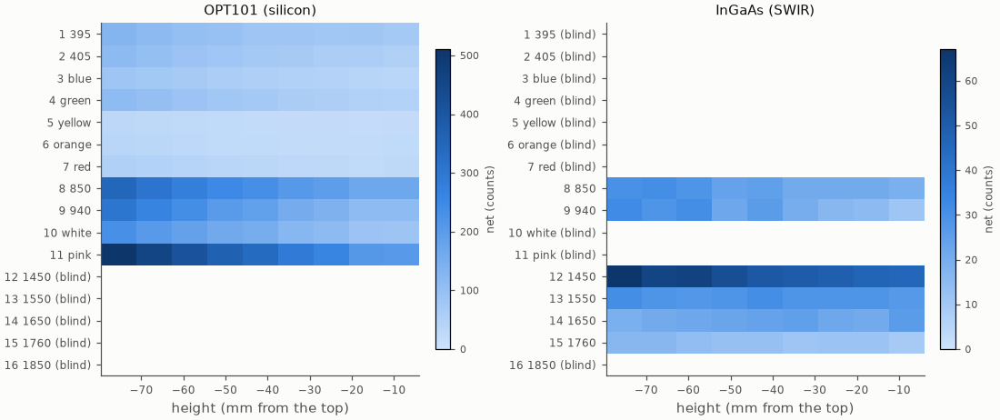
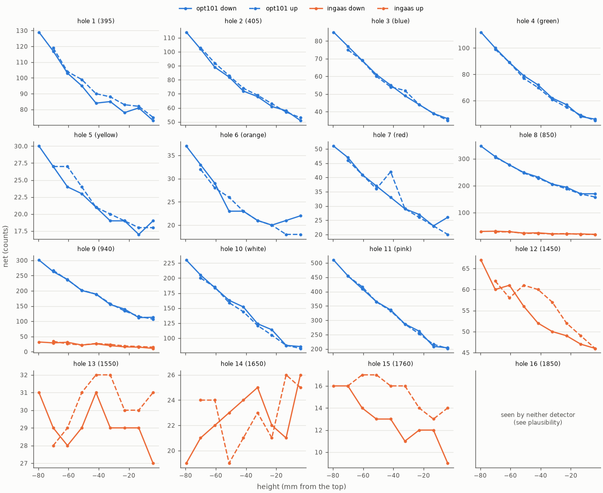
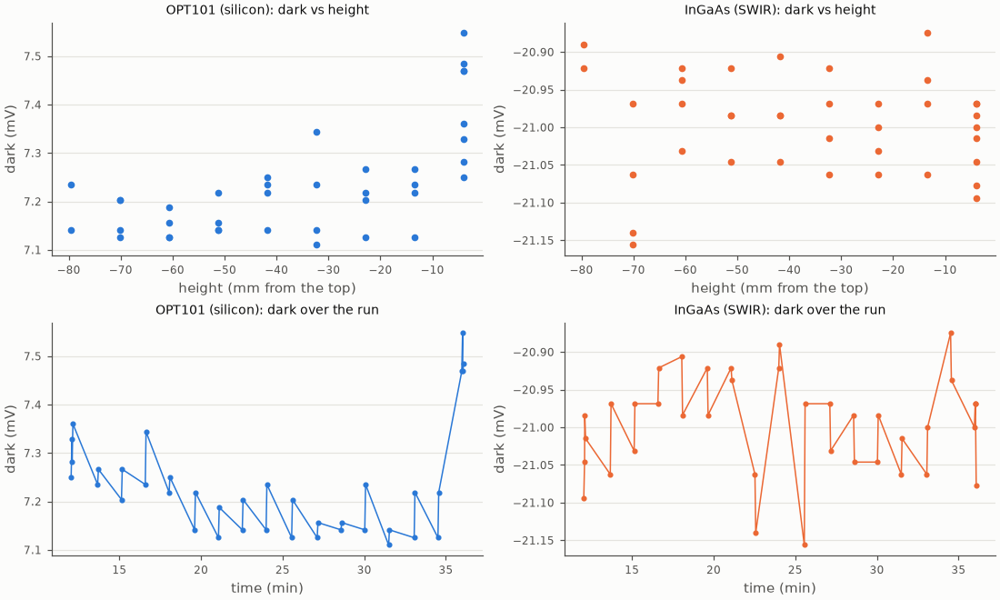
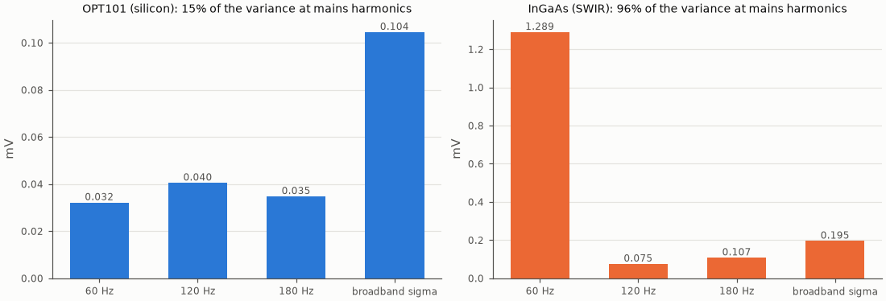

# LIO diagnostic sweep 20261120-012619_scan_quick

Mode **quick**, sample **empty**, status **COMPLETE**

## Verdict: FUNCTIONAL

- warnings: T13.T05, T13.T06

## Subsystem health

| Subsystem | Parts | Health | Reason |
|---|---|---|---|
| Link / firmware | Nano R4, USB, firmware | ✓ OK | 1 checks pass |
| ADC / I²C | ADS1115, software I²C D11/D12 | ✓ OK | 1 checks pass |
| Shift registers | U1, U2 | ✓ OK | 1 checks pass |
| LED drivers / rails | DRV1 (RAIL A), DRV2 (RAIL B) | ✓ OK | 4 checks pass |
| LED / MOSFET channels | LED1-16, Q1-16 | ! WATCH | optics/opt101/h16/plausibility: opt101 cannot see 1850 nm; residual +724 counts over C +13.0; height-dependent (optical) |
| OPT101 | OPT101 (A1) | ✓ OK | 8 checks pass |
| InGaAs TIA | D1, U5, Rf, Cf (A0) | ! WATCH | optics/ingaas/throughput: median O over 5 expected holes; spread (CV) 53% across holes |
| Motors / lead screws | M1, M2, ULN2003, couplers, M6 rods | ✓ OK | 3 checks pass |
| Stage tracking | lio.stage, soft limits | ✓ OK | 1 checks pass |
| Safety | interlocks, duty budget | ✓ OK | 2 checks pass |
| Power / earthing | supplies, GND, earth bond | ✓ OK | 4 checks pass |
| Optical path / ambient | window, shroud, lid, sample | ✓ OK | 5 checks pass |
| Run | the scan itself | ✓ OK | 1 checks pass |

## Findings to act on

### ! WARN `optics/opt101/h16/plausibility`: hole 16 (1850) seen by opt101?

opt101 cannot see 1850 nm; residual +724 counts over C +13.0; height-dependent (optical)

- **Why:** A detector responds, with a height-dependent (optical) signal, to a hole whose wavelength it cannot see: the LED in this hole is not the one in the channel map (swapped with another hole, or the wrong part).
- **Parts:** LED16
- **Next check:** Camera check of that hole (visible or not); compare the LED marking with docs/OPTICAL_CHANNEL_MAP.md; look for the hole it was swapped with (a response missing elsewhere).

### ! WARN `optics/ingaas/h14/response`: hole 14 (1650) on ingaas

O 14 counts at h -16384, C +11.0, modulation 0.42

- **Why:** This hole gives no (or little) height-dependent light on a detector that should see it: the LED is dead or reversed, its MOSFET is open, it is wired to the wrong rail, or it is an LED that this detector cannot see (swapped or wrong part).
- **Parts:** LED14, Q14, rail wiring
- **Next check:** Phone-camera check of the hole while it is lit (lio ch 14 on); meter the Q gate and drain; compare with the rail map.

### ! WARN `optics/ingaas/throughput`: ingaas: optical throughput (window, alignment)

median O over 5 expected holes; spread (CV) 53% across holes

- **Why:** Every hole on this detector is weaker than expected while the shape vs height is normal: less light reaches the detector (a dirty or blocked window, misalignment, or a weaker sample).
- **Parts:** detector window, alignment, sample
- **Next check:** Inspect and clean the deck window over the detector; re-run with the white tile.

### ! WARN `optics/ingaas/snr`: ingaas: signal-to-noise at the optimum

weakest hole 14: 19.1 dB (noise sigma 0.195 mV)

- **Why:** A hole's signal is close to the noise.
- **Parts:** LED, detector
- **Next check:** See the noise metrics; compare with the baseline.

## Response vs height, per hole (down pass; blind holes blank)

## Response curves: down pass (solid) and up pass (dashed)

## Dark level vs height (light leak) and over time (drift)

## Dark noise: mains harmonics and broadband

## System

| Status | Metric | Value | Result | Criterion |
|---|---|---|---|---|
| ✓ PASS | `system/link` | 0 unexpected boots | firmware 2.5.2, no unexpected # BOOT |  |
| ✓ PASS | `system/adc` | 764 readings | 764 readings, no dropout |  |
| ✓ PASS | `system/addressing` | 0 pairs | 15 responding holes, all distinct |  |
| ✓ PASS | `system/rail/A` | 8 holes | 8/8 holes respond |  |
| ✓ PASS | `system/rail/B` | 6 holes | 6/8 holes respond |  |
| ✓ PASS | `system/interlocks` | 0 failed | light_while_moving: PASS; single_channel: PASS |  |
| ✓ PASS | `system/duty` | 981 ms/min | max 981 ms of 1000 ms; 0 cool-down waits, 0 s in all |  |
| ✓ PASS | `system/stage` |  | position [-16384, -16384], limits respected |  |
| ✓ PASS | `system/run` |  | COMPLETE |  |

## Optics

| Status | Metric | Value | Result | Criterion |
|---|---|---|---|---|
| ✓ PASS | `optics/opt101/h01/response` | 120.7 counts | O 121 counts at h -325796, C +8.7, modulation 0.45 | O >= 15 (WARN below), >= 6 (FAIL below) |
| ✓ PASS | `optics/opt101/h02/response` | 105.5 counts | O 105 counts at h -325796, C +8.7, modulation 0.59 | O >= 15 (WARN below), >= 6 (FAIL below) |
| ✓ PASS | `optics/opt101/h03/response` | 76.3 counts | O 76 counts at h -325796, C +8.7, modulation 0.65 | O >= 15 (WARN below), >= 6 (FAIL below) |
| ✓ PASS | `optics/opt101/h04/response` | 103.2 counts | O 103 counts at h -325796, C +8.7, modulation 0.65 | O >= 15 (WARN below), >= 6 (FAIL below) |
| ✓ PASS | `optics/opt101/h05/response` | 21.3 counts | O 21 counts at h -325796, C +8.7, modulation 0.57 | O >= 15 (WARN below), >= 6 (FAIL below) |
| ✓ PASS | `optics/opt101/h06/response` | 28.3 counts | O 28 counts at h -325796, C +8.7, modulation 0.59 | O >= 15 (WARN below), >= 6 (FAIL below) |
| ✓ PASS | `optics/opt101/h07/response` | 42.7 counts | O 43 counts at h -325796, C +8.7, modulation 0.63 | O >= 15 (WARN below), >= 6 (FAIL below) |
| ✓ PASS | `optics/opt101/h08/response` | 337 counts | O 337 counts at h -325796, C +8.7, modulation 0.53 | O >= 15 (WARN below), >= 6 (FAIL below) |
| ✓ PASS | `optics/opt101/h09/response` | 286 counts | O 286 counts at h -325796, C +13.0, modulation 0.67 | O >= 15 (WARN below), >= 6 (FAIL below) |
| ✓ PASS | `optics/opt101/h10/response` | 216.3 counts | O 216 counts at h -325796, C +13.0, modulation 0.68 | O >= 15 (WARN below), >= 6 (FAIL below) |
| ✓ PASS | `optics/opt101/h11/response` | 495.3 counts | O 495 counts at h -325796, C +13.0, modulation 0.63 | O >= 15 (WARN below), >= 6 (FAIL below) |
| ✓ PASS | `optics/opt101/h12/plausibility` | 4.8 counts | opt101 cannot see 1450 nm; residual +5 counts over C +13.0 | < 30 counts (WARN), < 80 (FAIL) |
| ✓ PASS | `optics/opt101/h13/plausibility` | -0.3 counts | opt101 cannot see 1550 nm; residual -0 counts over C +13.0 | < 30 counts (WARN), < 80 (FAIL) |
| ✓ PASS | `optics/opt101/h14/plausibility` | -2.5 counts | opt101 cannot see 1650 nm; residual -3 counts over C +13.0 | < 30 counts (WARN), < 80 (FAIL) |
| ✓ PASS | `optics/opt101/h15/plausibility` | 0.2 counts | opt101 cannot see 1760 nm; residual +0 counts over C +13.0 | < 30 counts (WARN), < 80 (FAIL) |
| ! WARN | `optics/opt101/h16/plausibility` | 724.5 counts | opt101 cannot see 1850 nm; residual +724 counts over C +13.0; height-dependent (optical) | < 30 counts (WARN); FAIL capped to WARN: no in-range detector for this hole |
| ✓ PASS | `optics/opt101/electrical_only` | 0 fraction | 0/11 expected holes show no optical response; coupling present | FAIL when >= 75% of expected holes have O < 6 while |C| >= 8 |
| ✓ PASS | `optics/opt101/throughput` | 105.5 counts | median O over 11 expected holes; spread (CV) 86% across holes | median O >= 60 (WARN below), >= 20 (FAIL below) for empty |
| ✓ PASS | `optics/ingaas/h01/plausibility` | 2 counts | ingaas cannot see 395 nm; residual +2 counts over C +4.0 | < 30 counts (WARN), < 80 (FAIL) |
| ✓ PASS | `optics/ingaas/h02/plausibility` | 1.3 counts | ingaas cannot see 405 nm; residual +1 counts over C +4.0 | < 30 counts (WARN), < 80 (FAIL) |
| ✓ PASS | `optics/ingaas/h03/plausibility` | -2.8 counts | ingaas cannot see 465 nm; residual -3 counts over C +4.0 | < 30 counts (WARN), < 80 (FAIL) |
| ✓ PASS | `optics/ingaas/h04/plausibility` | -2.1 counts | ingaas cannot see 525 nm; residual -2 counts over C +4.0 | < 30 counts (WARN), < 80 (FAIL) |
| ✓ PASS | `optics/ingaas/h05/plausibility` | 3.7 counts | ingaas cannot see 590 nm; residual +4 counts over C +4.0 | < 30 counts (WARN), < 80 (FAIL) |
| ✓ PASS | `optics/ingaas/h06/plausibility` | 5.6 counts | ingaas cannot see 605 nm; residual +6 counts over C +4.0 | < 30 counts (WARN), < 80 (FAIL) |
| ✓ PASS | `optics/ingaas/h07/plausibility` | -0.8 counts | ingaas cannot see 630 nm; residual -1 counts over C +4.0 | < 30 counts (WARN), < 80 (FAIL) |
| ✓ PASS | `optics/ingaas/h08/response` | 27 counts | O 27 counts at h -287120, C +4.0, modulation 0.43 | O >= 15 (WARN below), >= 6.24607 (FAIL below) |
| ✓ PASS | `optics/ingaas/h09/response` | 20.4 counts | O 20 counts at h -287120, C +11.0, modulation 0.98 | O >= 15 (WARN below), >= 6.24607 (FAIL below) |
| ✓ PASS | `optics/ingaas/h10/plausibility` | -5.7 counts | ingaas cannot see 450 nm; residual -6 counts over C +11.0 | < 30 counts (WARN), < 80 (FAIL) |
| ✓ PASS | `optics/ingaas/h11/plausibility` | 4.3 counts | ingaas cannot see 450 nm; residual +4 counts over C +11.0 | < 30 counts (WARN), < 80 (FAIL) |
| ✓ PASS | `optics/ingaas/h12/response` | 54.7 counts | O 55 counts at h -325796, C +11.0, modulation 0.36 | O >= 15 (WARN below), >= 6.24607 (FAIL below) |
| ✓ PASS | `optics/ingaas/h13/response` | 19.8 counts | O 20 counts at h -325796, C +11.0, modulation 0.18 | O >= 15 (WARN below), >= 6.24607 (FAIL below) |
| ! WARN | `optics/ingaas/h14/response` | 14 counts | O 14 counts at h -16384, C +11.0, modulation 0.42 | O >= 15 (WARN below), >= 6.24607 (FAIL below) |
| ✓ PASS | `optics/ingaas/h16/plausibility` | 24.7 counts | ingaas cannot see 1850 nm; residual +25 counts over C +11.0 | < 30 counts (WARN); FAIL capped to WARN: no in-range detector for this hole |
| ✓ PASS | `optics/ingaas/electrical_only` | 0 fraction | 0/5 expected holes show no optical response; coupling present | FAIL when >= 75% of expected holes have O < 6.24607 while |C| >= 8 |
| ! WARN | `optics/ingaas/throughput` | 20.4 counts | median O over 5 expected holes; spread (CV) 53% across holes | median O >= 60 (WARN below), >= 20 (FAIL below) for empty |
| ✓ PASS | `optics/h01/intermittent` | 0 heights | down and up agree at 8 heights |  |
| ✓ PASS | `optics/h02/intermittent` | 0 heights | down and up agree at 8 heights |  |
| ✓ PASS | `optics/h03/intermittent` | 0 heights | down and up agree at 8 heights |  |
| ✓ PASS | `optics/h04/intermittent` | 0 heights | down and up agree at 8 heights |  |
| ✓ PASS | `optics/h05/intermittent` | 0 heights | down and up agree at 8 heights |  |
| ✓ PASS | `optics/h06/intermittent` | 0 heights | down and up agree at 8 heights |  |
| ✓ PASS | `optics/h07/intermittent` | 0 heights | down and up agree at 8 heights |  |
| ✓ PASS | `optics/h08/intermittent` | 0 heights | down and up agree at 8 heights |  |
| ✓ PASS | `optics/h09/intermittent` | 0 heights | down and up agree at 8 heights |  |
| ✓ PASS | `optics/h10/intermittent` | 0 heights | down and up agree at 8 heights |  |
| ✓ PASS | `optics/h11/intermittent` | 0 heights | down and up agree at 8 heights |  |
| ✓ PASS | `optics/h12/intermittent` | 0 heights | down and up agree at 8 heights |  |
| ✓ PASS | `optics/h13/intermittent` | 0 heights | down and up agree at 8 heights |  |
| ✓ PASS | `optics/h14/intermittent` | 0 heights | down and up agree at 8 heights |  |
| ✓ PASS | `optics/h15/intermittent` | 0 heights | down and up agree at 8 heights |  |
| ✓ PASS | `optics/h16/intermittent` | 0 heights | down and up agree at 8 heights |  |
| ✓ PASS | `optics/optimum` | -287120 half-steps | -287120 half-steps (-70.10 mm); weakest normalised response there 0.70 |  |
| ✓ PASS | `optics/opt101/snr` | 28.1 dB | weakest hole 5: 28.1 dB (noise sigma 0.104 mV) | >= 20 dB |
| ✓ PASS | `optics/opt101/headroom` | 97.3 % | highest lit reading 795 of 29600 counts | >= 10% |
| ! WARN | `optics/ingaas/snr` | 19.1 dB | weakest hole 14: 19.1 dB (noise sigma 0.195 mV) | >= 20 dB |
| ✓ PASS | `optics/ingaas/headroom` | 100.4 % | highest lit reading -101 of 28000 counts | >= 10% |
| - SKIP | `optics/stray` |  | needs a black_cup run (with a white_ptfe reference) |  |
| - SKIP | `optics/effectiveness` |  | needs a reference (baseline) of the same sample |  |
| ✓ PASS | `optics/wrong_rail/h01` | 0 counts | +0 counts on opt101 with the hole selected and RAIL B enabled | < 30 counts (WARN), < 80 (FAIL) |
| ✓ PASS | `optics/wrong_rail/h02` | 0 counts | +0 counts on opt101 with the hole selected and RAIL B enabled | < 30 counts (WARN), < 80 (FAIL) |
| ✓ PASS | `optics/wrong_rail/h03` | 0 counts | +0 counts on opt101 with the hole selected and RAIL B enabled | < 30 counts (WARN), < 80 (FAIL) |
| ✓ PASS | `optics/wrong_rail/h04` | 0 counts | +0 counts on opt101 with the hole selected and RAIL B enabled | < 30 counts (WARN), < 80 (FAIL) |
| ✓ PASS | `optics/wrong_rail/h05` | 1 counts | +1 counts on opt101 with the hole selected and RAIL B enabled | < 30 counts (WARN), < 80 (FAIL) |
| ✓ PASS | `optics/wrong_rail/h06` | 1 counts | +1 counts on opt101 with the hole selected and RAIL B enabled | < 30 counts (WARN), < 80 (FAIL) |
| ✓ PASS | `optics/wrong_rail/h07` | -1 counts | -1 counts on opt101 with the hole selected and RAIL B enabled | < 30 counts (WARN), < 80 (FAIL) |
| ✓ PASS | `optics/wrong_rail/h08` | 1 counts | +1 counts on ingaas with the hole selected and RAIL B enabled | < 30 counts (WARN), < 80 (FAIL) |
| ✓ PASS | `optics/wrong_rail/h09` | 0 counts | +0 counts on opt101 with the hole selected and RAIL A enabled | < 30 counts (WARN), < 80 (FAIL) |
| ✓ PASS | `optics/wrong_rail/h10` | 0 counts | +0 counts on opt101 with the hole selected and RAIL A enabled | < 30 counts (WARN), < 80 (FAIL) |
| ✓ PASS | `optics/wrong_rail/h11` | 0 counts | +0 counts on opt101 with the hole selected and RAIL A enabled | < 30 counts (WARN), < 80 (FAIL) |
| ✓ PASS | `optics/wrong_rail/h12` | -1 counts | -1 counts on ingaas with the hole selected and RAIL A enabled | < 30 counts (WARN), < 80 (FAIL) |
| ✓ PASS | `optics/wrong_rail/h13` | 0 counts | +0 counts on ingaas with the hole selected and RAIL A enabled | < 30 counts (WARN), < 80 (FAIL) |
| ✓ PASS | `optics/wrong_rail/h14` | -1 counts | -1 counts on ingaas with the hole selected and RAIL A enabled | < 30 counts (WARN), < 80 (FAIL) |
| ✓ PASS | `optics/wrong_rail/h15` | 0 counts | +0 counts on ingaas with the hole selected and RAIL A enabled | < 30 counts (WARN), < 80 (FAIL) |

## Electrical

| Status | Metric | Value | Result | Criterion |
|---|---|---|---|---|
| ✓ PASS | `elec/opt101/coupling` | 13 counts | rail A: +8.7 counts (+1.08 mV) inferred, rail B: +13.0 counts (+1.62 mV) from 5 blind holes | corrected in software below 20 counts (FAIL at or above) |
| ✓ PASS | `elec/opt101/ground_shift` | 0.0361 mV/mA | +0.289 counts/mA | corrected in software below 0.08 mV/mA (FAIL at or above) |
| ✓ PASS | `elec/ingaas/coupling` | 11 counts | rail A: +4.0 counts (+0.50 mV) from 7 blind holes, rail B: +11.0 counts (+1.38 mV) from 3 blind holes | corrected in software below 20 counts (FAIL at or above) |
| ✓ PASS | `elec/ingaas/ground_shift` | 0.0263 mV/mA | +0.210 counts/mA | corrected in software below 0.08 mV/mA (FAIL at or above) |
| ✓ PASS | `elec/opt101/dark_offset` | 7.219 mV | +57.8 counts (+7.22 mV) | 0 to 800 counts (thresholds.dark) |
| ✓ PASS | `elec/ingaas/dark_offset` | -20.984 mV | -167.9 counts (-20.98 mV); equivalent input current +21.0 nA (Rf 1 MΩ) | -400 to 2000 counts (thresholds.dark) |
| ✓ PASS | `elec/opt101/drift` | 0.071 mV/h | +0.07 ± 0.10 mV/h; P4 - P1 +0.19 mV | |slope| < 3 mV/h (WARN), < 8 (FAIL) |
| ✓ PASS | `elec/ingaas/drift` | 0.002 mV/h | +0.00 ± 0.08 mV/h (-0.0 nA/h); P4 - P1 +0.05 mV | |slope| < 3 mV/h (WARN), < 8 (FAIL) |
| ✓ PASS | `elec/opt101/hum` | 0.0321 mV | 60/120/180 Hz: 0.032 / 0.040 / 0.035 mV; 15% of the variance at mains harmonics; broadband sigma 0.104 mV; readings integrate whole mains periods, so it cancels in the measurements | 60 Hz amplitude < 0.3 mV (WARN; not when the readings reject it), < 1 (FAIL); mains fraction < 0.5 |
| ✓ PASS | `elec/ingaas/hum` | 1.2891 mV | 60/120/180 Hz: 1.289 / 0.075 / 0.107 mV; 96% of the variance at mains harmonics; broadband sigma 0.195 mV; readings integrate whole mains periods, so it cancels in the measurements | 60 Hz amplitude < 1 mV (WARN; not when the readings reject it), < 3 (FAIL); mains fraction < 0.5 |
| ✓ PASS | `elec/opt101/coil_emi` | 8.9 x | sigma 1.112 mV moving vs 0.104 mV off (measured while moving, S0 D2); judged only when measuring while moving (continuous mode): every other reading is taken with the motors stopped | ratio < 3 (WARN), < 6 (FAIL) |
| ✓ PASS | `elec/ingaas/coil_emi` | 1.56 x | sigma 0.304 mV moving vs 0.195 mV off (measured while moving, S0 D2); judged only when measuring while moving (continuous mode): every other reading is taken with the motors stopped | ratio < 3 (WARN), < 6 (FAIL) |
| ✓ PASS | `elec/opt101/h16/select_only` | 0.4 counts | largest on hole 16: -0.4 counts | < 8 counts (WARN); FAIL capped to WARN (gate coupling, LED off) |
| ✓ PASS | `elec/ingaas/h03/select_only` | 0.5 counts | largest on hole 3: -0.5 counts | < 8 counts (WARN); FAIL capped to WARN (gate coupling, LED off) |
| ✓ PASS | `elec/opt101/ce_only` | 0 counts | CE1: +0.0, CE2: +0.0 | < 8 counts (WARN), < 20 (FAIL) |
| ✓ PASS | `elec/ingaas/ce_only` | 0 counts | CE1: +0.0, CE2: +0.0 | < 8 counts (WARN), < 20 (FAIL) |
| - SKIP | `elec/rails` |  | A2/A3 not wired for rail and ground monitoring |  |

## Mechanics

| Status | Metric | Value | Result | Criterion |
|---|---|---|---|---|
| - SKIP | `mech/home_sensors` |  | no home sensors fitted |  |
| ✓ PASS | `mech/travel` | 325796 half-steps | tracked range 325796 / 325796 half-steps (left / right) (thresholds.motion.travel.range_steps not set: not compared) |  |
| ✓ PASS | `mech/lockstep` | 0 moves | 20 moves; 0 ended with the two sides at different positions (without home sensors only the commanded steps are seen: a side losing steps shows as mech/step_loss) |  |
| ✓ PASS | `mech/settle` | 602 ms | median 602 ms, max 604 ms (mechanical wait 300 ms) | max - median < 500 ms (WARN), < 1500 (FAIL) |
| - SKIP | `mech/backlash` | -21852 half-steps | -21852 ± 3885 half-steps (-5.335 mm) from 120 readings on 15 channels | < 600 (WARN), < 1500 (FAIL); not flagged within 3 sigma; not judged when the resolution is worse than 300 |
| - SKIP | `mech/step_loss` | 51826 half-steps per travel | the stage falls behind by +51826 ± 7640 half-steps over a full upward travel (one side losing steps: about twice that on that side, and a tilt) | < 400 (WARN), < 1000 (FAIL); not flagged within 3 sigma |
| - SKIP | `mech/repeatability` |  | no repeated reference visits in this mode (full, fine, repeatability have them) |  |

## Ambient

| Status | Metric | Value | Result | Criterion |
|---|---|---|---|---|
| ✓ PASS | `ambient/opt101/leak` | -0.3 counts | dark at the bottom -0.3 counts (-0.04 mV) vs the top | rise < 8 counts (WARN), < 25 (FAIL) |
| ✓ PASS | `ambient/ingaas/leak` | 0.7 counts | dark at the bottom +0.7 counts (+0.09 mV) vs the top; 3.38% of the median signal | rise < 8 counts (WARN), < 25 (FAIL) |
| ✓ PASS | `ambient/opt101/flicker` | 0.0405 mV | 120 Hz amplitude in the dark streams 0.040 mV; readings integrate whole mains periods, so it cancels | < 0.4 mV (WARN), < 1.2 (FAIL) |
| ✓ PASS | `ambient/ingaas/flicker` | 0.0749 mV | 120 Hz amplitude in the dark streams 0.075 mV; readings integrate whole mains periods, so it cancels | < 0.4 mV (WARN), < 1.2 (FAIL) |
| - SKIP | `ambient/lid` |  | optional operator step (lid ajar at two heights) |  |

## Not measured (capability)

- rail_monitor: A2/A3 not wired for rail and ground monitoring
- home_sensors: no home sensors fitted
