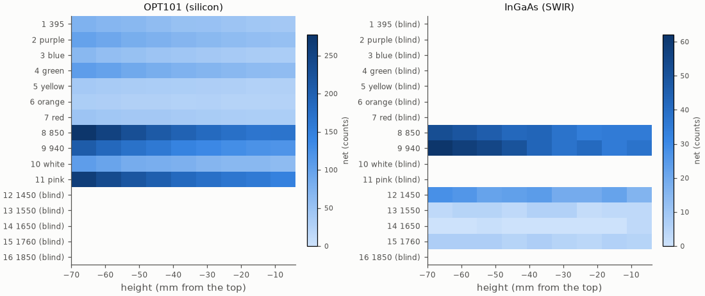
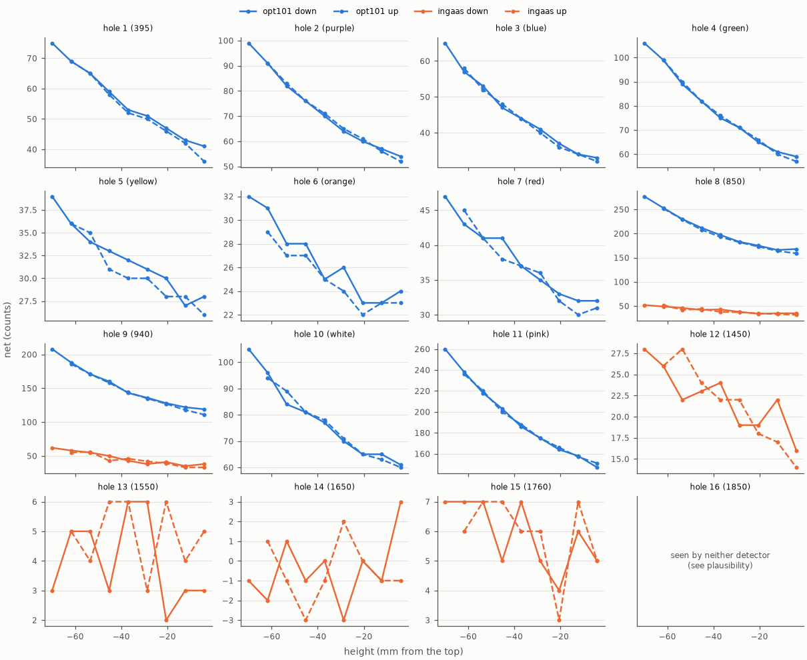
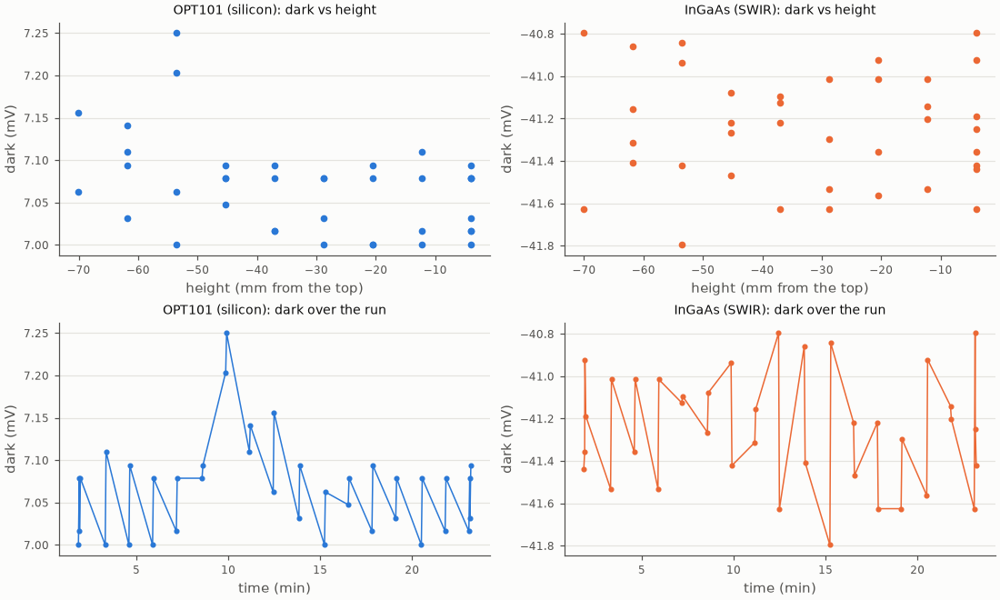
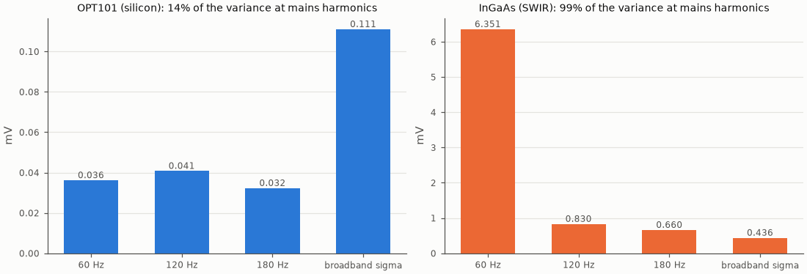

# LIO diagnostic sweep 20261123-003133_scan_quick

Mode **quick**, sample **empty**, status **COMPLETE**

## Verdict: NOT FUNCTIONAL

- failures not tied to a channel: T13.T06
- 3 failing channels (more than 2): 12, 13, 14

## Subsystem health

| Subsystem | Parts | Health | Reason |
|---|---|---|---|
| Link / firmware | Nano R4, USB, firmware | ✓ OK | 1 checks pass |
| ADC / I²C | ADS1115, software I²C D11/D12 | ✓ OK | 1 checks pass |
| Shift registers | U1, U2 | ✓ OK | 1 checks pass |
| LED drivers / rails | DRV1 (RAIL A), DRV2 (RAIL B) | ✓ OK | 4 checks pass |
| LED / MOSFET channels | LED1-16, Q1-16 | ✕ ACT | optics/ingaas/h12/response: O 12 counts at h -286884, C +16.0, modulation 0.88 |
| OPT101 | OPT101 (A1) | ✓ OK | 8 checks pass |
| InGaAs TIA | D1, U5, Rf, Cf (A0) | ✕ ACT | optics/ingaas/throughput: median O over 5 expected holes; spread (CV) 163% across holes |
| Motors / lead screws | M1, M2, ULN2003, couplers, M6 rods | ! WATCH | mech/travel: tracked range 286884 / 429461 half-steps (M1/right / M2/left): the two sides differ (thresholds.motion.travel.range_steps not set: not compared) |
| Stage tracking | lio.stage, soft limits | ✓ OK | 1 checks pass |
| Safety | interlocks, duty budget | ✓ OK | 2 checks pass |
| Power / earthing | supplies, GND, earth bond | ✕ ACT | elec/ingaas/hum: 60/120/180 Hz: 6.351 / 0.830 / 0.660 mV; 99% of the variance at mains harmonics; broadband sigma 0.436 mV; readings integrate whole mains periods, so it cancels in the measurements |
| Optical path / ambient | window, shroud, lid, sample | ✕ ACT | trend/compare: every hole on both detectors: supply, geometry or the sample |
| Run | the scan itself | ✓ OK | 1 checks pass |

## Findings to act on

### ! WARN `optics/opt101/h16/plausibility`: hole 16 (1850) seen by opt101?

opt101 cannot see 1850 nm; residual +389 counts over C +2.0; height-dependent (optical)

- **Why:** A detector responds, with a height-dependent (optical) signal, to a hole whose wavelength it cannot see: the LED in this hole is not the one in the channel map (swapped with another hole, or the wrong part).
- **Parts:** LED16
- **Next check:** Camera check of that hole (visible or not); compare the LED marking with docs/OPTICAL_CHANNEL_MAP.md; look for the hole it was swapped with (a response missing elsewhere).

### ✕ FAIL `optics/ingaas/h12/response`: hole 12 (1450) on ingaas

O 12 counts at h -286884, C +16.0, modulation 0.88

- **Why:** This hole gives no (or little) height-dependent light on a detector that should see it: the LED is dead or reversed, its MOSFET is open, it is wired to the wrong rail, or it is an LED that this detector cannot see (swapped or wrong part).
- **Parts:** LED12, Q12, rail wiring
- **Next check:** Phone-camera check of the hole while it is lit (lio ch 12 on); meter the Q gate and drain; compare with the rail map.

### ✕ FAIL `optics/ingaas/h13/response`: hole 13 (1550) on ingaas

O -11 counts at h -151634, C +16.0, modulation 0.31

- **Why:** This hole gives no (or little) height-dependent light on a detector that should see it: the LED is dead or reversed, its MOSFET is open, it is wired to the wrong rail, or it is an LED that this detector cannot see (swapped or wrong part).
- **Parts:** LED13, Q13, rail wiring
- **Next check:** Phone-camera check of the hole while it is lit (lio ch 13 on); meter the Q gate and drain; compare with the rail map.

### ✕ FAIL `optics/ingaas/h14/response`: hole 14 (1650) on ingaas

O -14 counts at h -16384, C +16.0, modulation 0.28

- **Why:** This hole gives no (or little) height-dependent light on a detector that should see it: the LED is dead or reversed, its MOSFET is open, it is wired to the wrong rail, or it is an LED that this detector cannot see (swapped or wrong part).
- **Parts:** LED14, Q14, rail wiring
- **Next check:** Phone-camera check of the hole while it is lit (lio ch 14 on); meter the Q gate and drain; compare with the rail map.

### ! WARN `optics/ingaas/h16/plausibility`: hole 16 (1850) seen by ingaas?

ingaas cannot see 1850 nm; residual +44 counts over C +16.0; height-dependent (optical)

- **Why:** A detector responds, with a height-dependent (optical) signal, to a hole whose wavelength it cannot see: the LED in this hole is not the one in the channel map (swapped with another hole, or the wrong part).
- **Parts:** LED16
- **Next check:** Camera check of that hole (visible or not); compare the LED marking with docs/OPTICAL_CHANNEL_MAP.md; look for the hole it was swapped with (a response missing elsewhere).

### ✕ FAIL `optics/ingaas/throughput`: ingaas: optical throughput (window, alignment)

median O over 5 expected holes; spread (CV) 163% across holes

- **Why:** Every hole on this detector is weaker than expected while the shape vs height is normal: less light reaches the detector (a dirty or blocked window, misalignment, or a weaker sample).
- **Parts:** detector window, alignment, sample
- **Next check:** Inspect and clean the deck window over the detector; re-run with the white tile.

### ! WARN `optics/optimum`: optimum height (all holes)

-286884 half-steps (-70.04 mm); weakest normalised response there 1.00; at an end of the travel: the true peak may lie beyond

- **Why:** The best height is at an end of the travel: the true optimum may lie beyond it.
- **Parts:** geometry
- **Next check:** Check the sample position.

### ✕ FAIL `elec/ingaas/hum`: ingaas: mains hum (coils off)

60/120/180 Hz: 6.351 / 0.830 / 0.660 mV; 99% of the variance at mains harmonics; broadband sigma 0.436 mV; readings integrate whole mains periods, so it cancels in the measurements

- **Why:** Mains hum on the detector output: a missing earth bond or leakage from a charger.
- **Parts:** earth bond, chargers, GND
- **Next check:** Check the earth bond (circuit GND to mains earth); unplug the laptop charger and repeat.

### ! WARN `mech/travel`: travel (top to bottom)

tracked range 286884 / 429461 half-steps (M1/right / M2/left): the two sides differ (thresholds.motion.travel.range_steps not set: not compared)

- **Why:** The tracked travel differs from the configured one (or between the sides).
- **Parts:** stage limits
- **Next check:** Re-mark the top and bottom.

### ✕ FAIL `trend/compare`: 20261123-003133_scan_quick vs 20261116-202110_scan_quick

every hole on both detectors: supply, geometry or the sample

- **Why:** The response changed against the previous baseline; where it sits points to the part (one hole: that LED or its alignment; one detector: that detector or its front end; everything: supply, geometry or the sample).
- **Parts:** see the localisation
- **Next check:** Repeat with the same sample; check what changed.

## Response vs height, per hole (down pass; blind holes blank)

## Response curves: down pass (solid) and up pass (dashed)

## Dark level vs height (light leak) and over time (drift)

## Dark noise: mains harmonics and broadband

## System

| Status | Metric | Value | Result | Criterion |
|---|---|---|---|---|
| ✓ PASS | `system/link` | 0 unexpected boots | firmware 2.5.2, no unexpected # BOOT |  |
| ✓ PASS | `system/adc` | 764 readings | 764 readings, no dropout |  |
| ✓ PASS | `system/addressing` | 0 pairs | 13 responding holes, all distinct |  |
| ✓ PASS | `system/rail/A` | 8 holes | 8/8 holes respond |  |
| ✓ PASS | `system/rail/B` | 3 holes | 3/8 holes respond |  |
| ✓ PASS | `system/interlocks` | 0 failed | light_while_moving: PASS; single_channel: PASS |  |
| ✓ PASS | `system/duty` | 252 ms/min | max 252 ms of 1000 ms; 0 cool-down waits, 0 s in all |  |
| ✓ PASS | `system/stage` |  | position [-16384, -16384], limits respected |  |
| ✓ PASS | `system/run` |  | COMPLETE |  |

## Optics

| Status | Metric | Value | Result | Criterion |
|---|---|---|---|---|
| ✓ PASS | `optics/opt101/h01/response` | 73.3 counts | O 73 counts at h -286884, C +1.3, modulation 0.46 | O >= 15 (WARN below), >= 6 (FAIL below) |
| ✓ PASS | `optics/opt101/h02/response` | 97.8 counts | O 98 counts at h -286884, C +1.3, modulation 0.46 | O >= 15 (WARN below), >= 6 (FAIL below) |
| ✓ PASS | `optics/opt101/h03/response` | 63 counts | O 63 counts at h -286884, C +1.3, modulation 0.50 | O >= 15 (WARN below), >= 6 (FAIL below) |
| ✓ PASS | `optics/opt101/h04/response` | 105.2 counts | O 105 counts at h -286884, C +1.3, modulation 0.45 | O >= 15 (WARN below), >= 6 (FAIL below) |
| ✓ PASS | `optics/opt101/h05/response` | 37.5 counts | O 37 counts at h -286884, C +1.3, modulation 0.31 | O >= 15 (WARN below), >= 6 (FAIL below) |
| ✓ PASS | `optics/opt101/h06/response` | 31 counts | O 31 counts at h -286884, C +1.3, modulation 0.31 | O >= 15 (WARN below), >= 6 (FAIL below) |
| ✓ PASS | `optics/opt101/h07/response` | 45.3 counts | O 45 counts at h -286884, C +1.3, modulation 0.33 | O >= 15 (WARN below), >= 6 (FAIL below) |
| ✓ PASS | `optics/opt101/h08/response` | 275.5 counts | O 275 counts at h -286884, C +1.3, modulation 0.40 | O >= 15 (WARN below), >= 6 (FAIL below) |
| ✓ PASS | `optics/opt101/h09/response` | 205.5 counts | O 205 counts at h -286884, C +2.0, modulation 0.43 | O >= 15 (WARN below), >= 6 (FAIL below) |
| ✓ PASS | `optics/opt101/h10/response` | 103.5 counts | O 103 counts at h -286884, C +2.0, modulation 0.42 | O >= 15 (WARN below), >= 6 (FAIL below) |
| ✓ PASS | `optics/opt101/h11/response` | 257.7 counts | O 258 counts at h -286884, C +2.0, modulation 0.43 | O >= 15 (WARN below), >= 6 (FAIL below) |
| ✓ PASS | `optics/opt101/h12/plausibility` | 11.7 counts | opt101 cannot see 1450 nm; residual +12 counts over C +2.0 | < 30 counts (WARN), < 80 (FAIL) |
| ✓ PASS | `optics/opt101/h13/plausibility` | 0.1 counts | opt101 cannot see 1550 nm; residual +0 counts over C +2.0 | < 30 counts (WARN), < 80 (FAIL) |
| ✓ PASS | `optics/opt101/h14/plausibility` | -1.2 counts | opt101 cannot see 1650 nm; residual -1 counts over C +2.0 | < 30 counts (WARN), < 80 (FAIL) |
| ✓ PASS | `optics/opt101/h15/plausibility` | 0.6 counts | opt101 cannot see 1760 nm; residual +1 counts over C +2.0 | < 30 counts (WARN), < 80 (FAIL) |
| ! WARN | `optics/opt101/h16/plausibility` | 389 counts | opt101 cannot see 1850 nm; residual +389 counts over C +2.0; height-dependent (optical) | < 30 counts (WARN); FAIL capped to WARN: no in-range detector for this hole |
| ✓ PASS | `optics/opt101/electrical_only` | 0 fraction | 0/11 expected holes show no optical response; coupling small | FAIL when >= 75% of expected holes have O < 6 while |C| >= 8 |
| ✓ PASS | `optics/opt101/throughput` | 97.8 counts | median O over 11 expected holes; spread (CV) 71% across holes | median O >= 60 (WARN below), >= 20 (FAIL below) for empty |
| ✓ PASS | `optics/ingaas/h01/plausibility` | 1.8 counts | ingaas cannot see 395 nm; residual +2 counts over C +5.0 | < 30 counts (WARN), < 80 (FAIL) |
| ✓ PASS | `optics/ingaas/h02/plausibility` | -2.6 counts | ingaas cannot see 405 nm; residual -3 counts over C +5.0 | < 30 counts (WARN), < 80 (FAIL) |
| ✓ PASS | `optics/ingaas/h03/plausibility` | -3.2 counts | ingaas cannot see 465 nm; residual -3 counts over C +5.0 | < 30 counts (WARN), < 80 (FAIL) |
| ✓ PASS | `optics/ingaas/h04/plausibility` | -2.5 counts | ingaas cannot see 525 nm; residual -2 counts over C +5.0 | < 30 counts (WARN), < 80 (FAIL) |
| ✓ PASS | `optics/ingaas/h05/plausibility` | 7.3 counts | ingaas cannot see 590 nm; residual +7 counts over C +5.0 | < 30 counts (WARN), < 80 (FAIL) |
| ✓ PASS | `optics/ingaas/h06/plausibility` | 8.6 counts | ingaas cannot see 605 nm; residual +9 counts over C +5.0 | < 30 counts (WARN), < 80 (FAIL) |
| ✓ PASS | `optics/ingaas/h07/plausibility` | 7.8 counts | ingaas cannot see 630 nm; residual +8 counts over C +5.0 | < 30 counts (WARN), < 80 (FAIL) |
| ✓ PASS | `optics/ingaas/h08/response` | 47 counts | O 47 counts at h -286884, C +5.0, modulation 0.38 | O >= 27.9188 (WARN below), >= 13.9594 (FAIL below) |
| ✓ PASS | `optics/ingaas/h09/response` | 45.8 counts | O 46 counts at h -286884, C +16.0, modulation 0.55 | O >= 27.9188 (WARN below), >= 13.9594 (FAIL below) |
| ✓ PASS | `optics/ingaas/h10/plausibility` | -9.1 counts | ingaas cannot see 450 nm; residual -9 counts over C +16.0 | < 30 counts (WARN), < 80 (FAIL) |
| ✓ PASS | `optics/ingaas/h11/plausibility` | 6.3 counts | ingaas cannot see 450 nm; residual +6 counts over C +16.0 | < 30 counts (WARN), < 80 (FAIL) |
| ✕ FAIL | `optics/ingaas/h12/response` | 12.3 counts | O 12 counts at h -286884, C +16.0, modulation 0.88 | O >= 27.9188 (WARN below), >= 13.9594 (FAIL below) |
| ✕ FAIL | `optics/ingaas/h13/response` | -10.6 counts | O -11 counts at h -151634, C +16.0, modulation 0.31 | O >= 27.9188 (WARN below), >= 13.9594 (FAIL below) |
| ✕ FAIL | `optics/ingaas/h14/response` | -13.8 counts | O -14 counts at h -16384, C +16.0, modulation 0.28 | O >= 27.9188 (WARN below), >= 13.9594 (FAIL below) |
| ! WARN | `optics/ingaas/h16/plausibility` | 43.8 counts | ingaas cannot see 1850 nm; residual +44 counts over C +16.0; height-dependent (optical) | < 30 counts (WARN); FAIL capped to WARN: no in-range detector for this hole |
| ✓ PASS | `optics/ingaas/electrical_only` | 0.6 fraction | 3/5 expected holes show no optical response; coupling present | FAIL when >= 75% of expected holes have O < 13.9594 while |C| >= 8 |
| ✕ FAIL | `optics/ingaas/throughput` | 12.3 counts | median O over 5 expected holes; spread (CV) 163% across holes | median O >= 60 (WARN below), >= 20 (FAIL below) for empty |
| ✓ PASS | `optics/h01/intermittent` | 0 heights | down and up agree at 8 heights |  |
| ✓ PASS | `optics/h02/intermittent` | 0 heights | down and up agree at 8 heights |  |
| ✓ PASS | `optics/h03/intermittent` | 0 heights | down and up agree at 8 heights |  |
| ✓ PASS | `optics/h04/intermittent` | 0 heights | down and up agree at 8 heights |  |
| ✓ PASS | `optics/h05/intermittent` | 0 heights | down and up agree at 8 heights |  |
| ✓ PASS | `optics/h06/intermittent` | 0 heights | down and up agree at 8 heights |  |
| ✓ PASS | `optics/h07/intermittent` | 0 heights | down and up agree at 8 heights |  |
| ✓ PASS | `optics/h08/intermittent` | 0 heights | down and up agree at 8 heights |  |
| ✓ PASS | `optics/h09/intermittent` | 0 heights | down and up agree at 8 heights |  |
| ✓ PASS | `optics/h10/intermittent` | 0 heights | down and up agree at 8 heights |  |
| ✓ PASS | `optics/h11/intermittent` | 0 heights | down and up agree at 8 heights |  |
| ✓ PASS | `optics/h12/intermittent` | 0 heights | down and up agree at 8 heights |  |
| ✓ PASS | `optics/h13/intermittent` | 0 heights | down and up agree at 8 heights |  |
| ✓ PASS | `optics/h14/intermittent` | 0 heights | down and up agree at 8 heights |  |
| ✓ PASS | `optics/h15/intermittent` | 0 heights | down and up agree at 8 heights |  |
| ✓ PASS | `optics/h16/intermittent` | 0 heights | down and up agree at 8 heights |  |
| ! WARN | `optics/optimum` | -286884 half-steps | -286884 half-steps (-70.04 mm); weakest normalised response there 1.00; at an end of the travel: the true peak may lie beyond |  |
| ✓ PASS | `optics/opt101/snr` | 30.9 dB | weakest hole 6: 30.9 dB (noise sigma 0.111 mV) | >= 20 dB |
| ✓ PASS | `optics/opt101/headroom` | 98.5 % | highest lit reading 448 of 29600 counts | >= 10% |
| ✓ PASS | `optics/ingaas/snr` | 22.4 dB | weakest hole 9: 22.4 dB (noise sigma 0.436 mV) | >= 20 dB |
| ✓ PASS | `optics/ingaas/headroom` | 101 % | highest lit reading -268 of 28000 counts | >= 10% |
| - SKIP | `optics/stray` |  | needs a black_cup run (with a white_ptfe reference) |  |
| - SKIP | `optics/effectiveness` |  | needs a reference (baseline) of the same sample |  |
| ✓ PASS | `optics/wrong_rail/h01` | 0 counts | +0 counts on opt101 with the hole selected and RAIL B enabled | < 30 counts (WARN), < 80 (FAIL) |
| ✓ PASS | `optics/wrong_rail/h02` | 0 counts | +0 counts on opt101 with the hole selected and RAIL B enabled | < 30 counts (WARN), < 80 (FAIL) |
| ✓ PASS | `optics/wrong_rail/h03` | 0 counts | +0 counts on opt101 with the hole selected and RAIL B enabled | < 30 counts (WARN), < 80 (FAIL) |
| ✓ PASS | `optics/wrong_rail/h04` | 0 counts | +0 counts on opt101 with the hole selected and RAIL B enabled | < 30 counts (WARN), < 80 (FAIL) |
| ✓ PASS | `optics/wrong_rail/h05` | -1 counts | -1 counts on opt101 with the hole selected and RAIL B enabled | < 30 counts (WARN), < 80 (FAIL) |
| ✓ PASS | `optics/wrong_rail/h06` | 1 counts | +1 counts on opt101 with the hole selected and RAIL B enabled | < 30 counts (WARN), < 80 (FAIL) |
| ✓ PASS | `optics/wrong_rail/h07` | 0 counts | +0 counts on opt101 with the hole selected and RAIL B enabled | < 30 counts (WARN), < 80 (FAIL) |
| ✓ PASS | `optics/wrong_rail/h08` | 0 counts | +0 counts on opt101 with the hole selected and RAIL B enabled | < 30 counts (WARN), < 80 (FAIL) |
| ✓ PASS | `optics/wrong_rail/h09` | 0 counts | +0 counts on ingaas with the hole selected and RAIL A enabled | < 30 counts (WARN), < 80 (FAIL) |
| ✓ PASS | `optics/wrong_rail/h10` | 0 counts | +0 counts on opt101 with the hole selected and RAIL A enabled | < 30 counts (WARN), < 80 (FAIL) |
| ✓ PASS | `optics/wrong_rail/h11` | 0 counts | +0 counts on opt101 with the hole selected and RAIL A enabled | < 30 counts (WARN), < 80 (FAIL) |
| ✓ PASS | `optics/wrong_rail/h12` | -1 counts | -1 counts on ingaas with the hole selected and RAIL A enabled | < 30 counts (WARN), < 80 (FAIL) |
| ✓ PASS | `optics/wrong_rail/h13` | 0 counts | +0 counts on ingaas with the hole selected and RAIL A enabled | < 30 counts (WARN), < 80 (FAIL) |
| ✓ PASS | `optics/wrong_rail/h14` | 0 counts | +0 counts on ingaas with the hole selected and RAIL A enabled | < 30 counts (WARN), < 80 (FAIL) |
| ✓ PASS | `optics/wrong_rail/h15` | -1 counts | -1 counts on ingaas with the hole selected and RAIL A enabled | < 30 counts (WARN), < 80 (FAIL) |

## Electrical

| Status | Metric | Value | Result | Criterion |
|---|---|---|---|---|
| ✓ PASS | `elec/opt101/coupling` | 2 counts | rail A: +1.3 counts (+0.17 mV) inferred, rail B: +2.0 counts (+0.25 mV) from 5 blind holes | corrected in software below 20 counts (FAIL at or above) |
| ✓ PASS | `elec/opt101/ground_shift` | 0.0056 mV/mA | +0.044 counts/mA | corrected in software below 0.08 mV/mA (FAIL at or above) |
| ✓ PASS | `elec/ingaas/coupling` | 16 counts | rail A: +5.0 counts (+0.62 mV) from 7 blind holes, rail B: +16.0 counts (+2.00 mV) from 3 blind holes | corrected in software below 20 counts (FAIL at or above) |
| ✓ PASS | `elec/ingaas/ground_shift` | 0.0372 mV/mA | +0.297 counts/mA; does not scale with the rail current | corrected in software below 0.08 mV/mA (FAIL at or above) |
| ✓ PASS | `elec/opt101/dark_offset` | 7.079 mV | +56.6 counts (+7.08 mV) | 0 to 800 counts (thresholds.dark) |
| ✓ PASS | `elec/ingaas/dark_offset` | -41.234 mV | -329.9 counts (-41.23 mV); equivalent input current +41.2 nA (Rf 1 MΩ) | -400 to 2000 counts (thresholds.dark) |
| ✓ PASS | `elec/opt101/drift` | -0.027 mV/h | -0.03 ± 0.07 mV/h; P4 - P1 +0.02 mV | |slope| < 3 mV/h (WARN), < 8 (FAIL) |
| ✓ PASS | `elec/ingaas/drift` | -0.273 mV/h | -0.27 ± 0.38 mV/h (+0.3 nA/h); P4 - P1 +0.06 mV | |slope| < 3 mV/h (WARN), < 8 (FAIL) |
| ✓ PASS | `elec/opt101/hum` | 0.0362 mV | 60/120/180 Hz: 0.036 / 0.041 / 0.032 mV; 14% of the variance at mains harmonics; broadband sigma 0.111 mV; readings integrate whole mains periods, so it cancels in the measurements | 60 Hz amplitude < 0.3 mV (WARN; not when the readings reject it), < 1 (FAIL); mains fraction < 0.5 |
| ✕ FAIL | `elec/ingaas/hum` | 6.3515 mV | 60/120/180 Hz: 6.351 / 0.830 / 0.660 mV; 99% of the variance at mains harmonics; broadband sigma 0.436 mV; readings integrate whole mains periods, so it cancels in the measurements | 60 Hz amplitude < 1 mV (WARN; not when the readings reject it), < 3 (FAIL); mains fraction < 0.5 |
| ✓ PASS | `elec/opt101/coil_emi` | 10.06 x | sigma 1.257 mV moving vs 0.111 mV off (measured while moving, S0 D2); judged only when measuring while moving (continuous mode): every other reading is taken with the motors stopped | ratio < 3 (WARN), < 6 (FAIL) |
| ✓ PASS | `elec/ingaas/coil_emi` | 1.04 x | sigma 0.453 mV moving vs 0.436 mV off (measured while moving, S0 D2); judged only when measuring while moving (continuous mode): every other reading is taken with the motors stopped | ratio < 3 (WARN), < 6 (FAIL) |
| ✓ PASS | `elec/opt101/h13/select_only` | 0.4 counts | largest on hole 13: +0.4 counts | < 8 counts (WARN); FAIL capped to WARN (gate coupling, LED off) |
| ✓ PASS | `elec/ingaas/h09/select_only` | 0.9 counts | largest on hole 9: -0.9 counts | < 8 counts (WARN); FAIL capped to WARN (gate coupling, LED off) |
| ✓ PASS | `elec/opt101/ce_only` | 1 counts | CE1: +0.0, CE2: -1.0 | < 8 counts (WARN), < 20 (FAIL) |
| ✓ PASS | `elec/ingaas/ce_only` | 1 counts | CE1: +0.0, CE2: -1.0 | < 8 counts (WARN), < 20 (FAIL) |
| - SKIP | `elec/rails` |  | A2/A3 not wired for rail and ground monitoring |  |

## Mechanics

| Status | Metric | Value | Result | Criterion |
|---|---|---|---|---|
| - SKIP | `mech/home_sensors` |  | no home sensors fitted |  |
| ! WARN | `mech/travel` | 286884 half-steps | tracked range 286884 / 429461 half-steps (M1/right / M2/left): the two sides differ (thresholds.motion.travel.range_steps not set: not compared) |  |
| ✓ PASS | `mech/lockstep` | 0 moves | 20 moves; 0 ended with the two sides at different positions (without home sensors only the commanded steps are seen: a side losing steps shows as mech/step_loss) |  |
| ✓ PASS | `mech/settle` | 601 ms | median 601 ms, max 604 ms (mechanical wait 300 ms) | max - median < 500 ms (WARN), < 1500 (FAIL) |
| - SKIP | `mech/backlash` | 85 half-steps | +85 ± 3469 half-steps (+0.021 mm) from 103 readings on 13 channels | < 600 (WARN), < 1500 (FAIL); not flagged within 3 sigma; not judged when the resolution is worse than 300 |
| - SKIP | `mech/step_loss` | -12849 half-steps per travel | the stage falls behind by -12849 ± 6624 half-steps over a full upward travel (one side losing steps: about twice that on that side, and a tilt) | < 400 (WARN), < 1000 (FAIL); not flagged within 3 sigma |
| - SKIP | `mech/repeatability` |  | no repeated reference visits in this mode (full, fine, repeatability have them) |  |

## Ambient

| Status | Metric | Value | Result | Criterion |
|---|---|---|---|---|
| ✓ PASS | `ambient/opt101/leak` | 0.7 counts | dark at the bottom +0.7 counts (+0.09 mV) vs the top; 0.70% of the median signal | rise < 8 counts (WARN), < 25 (FAIL) |
| ✓ PASS | `ambient/ingaas/leak` | -0.1 counts | dark at the bottom -0.1 counts (-0.01 mV) vs the top | rise < 8 counts (WARN), < 25 (FAIL) |
| ✓ PASS | `ambient/opt101/flicker` | 0.0408 mV | 120 Hz amplitude in the dark streams 0.041 mV; readings integrate whole mains periods, so it cancels | < 0.4 mV (WARN), < 1.2 (FAIL) |
| ✓ PASS | `ambient/ingaas/flicker` | 0.8297 mV | 120 Hz amplitude in the dark streams 0.830 mV; readings integrate whole mains periods, so it cancels | < 0.4 mV (WARN), < 1.2 (FAIL) |
| - SKIP | `ambient/lid` |  | optional operator step (lid ajar at two heights) |  |

## Trend

| Status | Metric | Value | Result | Criterion |
|---|---|---|---|---|
| ✕ FAIL | `trend/compare` | 0.379 x (furthest per-hole ratio) | every hole on both detectors: supply, geometry or the sample | per-hole ratio within ±0.1 (WARN), ±0.25 (FAIL) |
| - SKIP | `trend/control` |  | needs 5 baselines of empty (have 1) |  |

## Not measured (capability)

- rail_monitor: A2/A3 not wired for rail and ground monitoring
- home_sensors: no home sensors fitted
