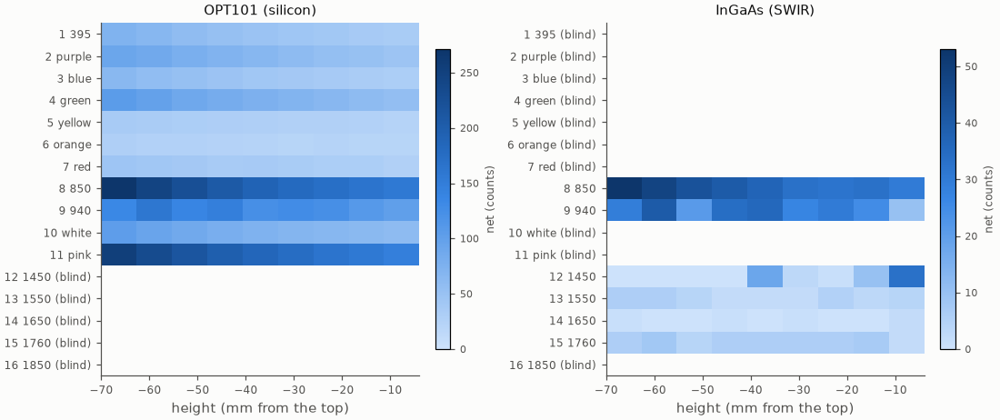
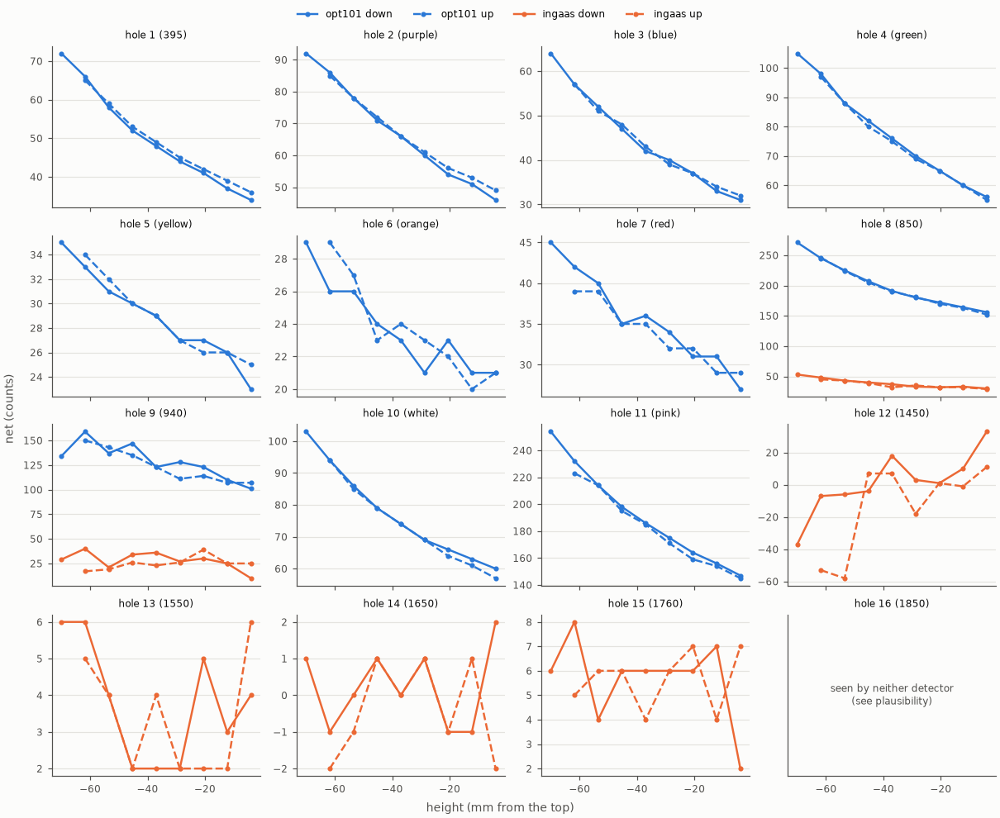
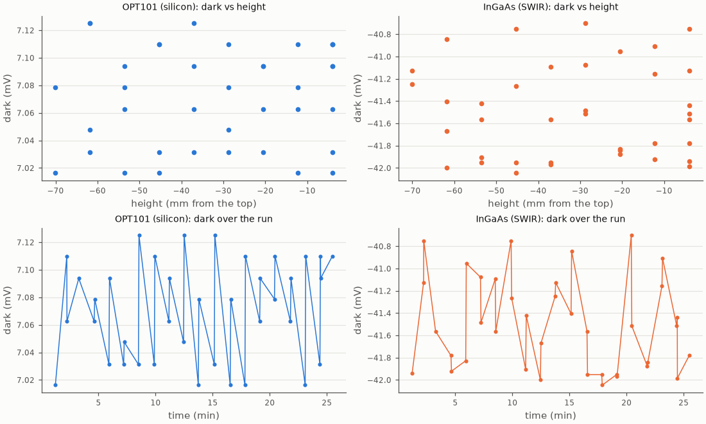
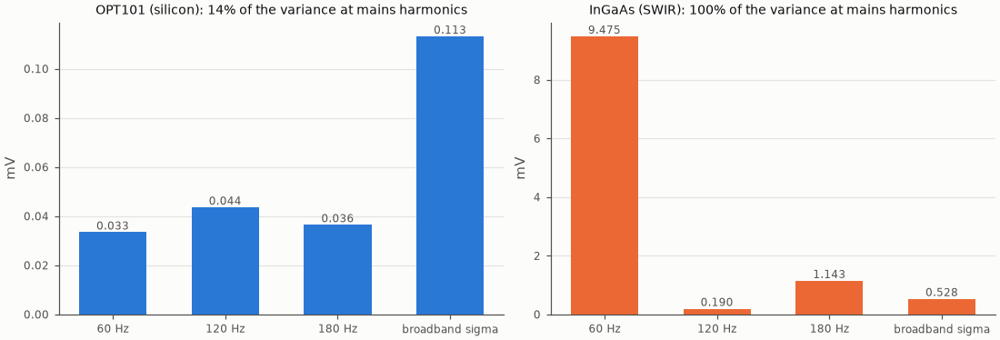

# LIO diagnostic sweep 20261123-173108_scan_quick

Mode **quick**, sample **empty**, status **COMPLETE**

## Verdict: NOT FUNCTIONAL

- failures not tied to a channel: T13.T06

## Subsystem health

| Subsystem | Parts | Health | Reason |
|---|---|---|---|
| Link / firmware | Nano R4, USB, firmware | ✓ OK | 1 checks pass |
| ADC / I²C | ADS1115, software I²C D11/D12 | ✓ OK | 1 checks pass |
| Shift registers | U1, U2 | ✓ OK | 1 checks pass |
| LED drivers / rails | DRV1 (RAIL A), DRV2 (RAIL B) | ✓ OK | 4 checks pass |
| LED / MOSFET channels | LED1-16, Q1-16 | ✕ ACT | optics/ingaas/h13/response: O -5 counts at h -286884, C +11.0, modulation 1.02 |
| OPT101 | OPT101 (A1) | ✓ OK | 8 checks pass |
| InGaAs TIA | D1, U5, Rf, Cf (A0) | ✕ ACT | optics/ingaas/throughput: median O over 5 expected holes; spread (CV) 136% across holes |
| Motors / lead screws | M1, M2, ULN2003, couplers, M6 rods | ! WATCH | mech/travel: tracked range 286884 / 429461 half-steps (M1/right / M2/left): the two sides differ (thresholds.motion.travel.range_steps not set: not compared) |
| Stage tracking | lio.stage, soft limits | ✓ OK | 1 checks pass |
| Safety | interlocks, duty budget | ✓ OK | 2 checks pass |
| Power / earthing | supplies, GND, earth bond | ✕ ACT | elec/ingaas/hum: 60/120/180 Hz: 9.475 / 0.190 / 1.143 mV; 100% of the variance at mains harmonics; broadband sigma 0.528 mV; readings integrate whole mains periods, so it cancels in the measurements |
| Optical path / ambient | window, shroud, lid, sample | ! WATCH | optics/optimum: -16384 half-steps (-4.00 mm); weakest normalised response there 0.03; at an end of the travel: the true peak may lie beyond |
| Run | the scan itself | ✓ OK | 1 checks pass |

## Findings to act on

### ! WARN `optics/opt101/h12/plausibility`: hole 12 (1450) seen by opt101?

opt101 cannot see 1450 nm; residual +33 counts over C +1.0; height-dependent (optical)

- **Why:** A detector responds, with a height-dependent (optical) signal, to a hole whose wavelength it cannot see: the LED in this hole is not the one in the channel map (swapped with another hole, or the wrong part).
- **Parts:** LED12
- **Next check:** Camera check of that hole (visible or not); compare the LED marking with docs/OPTICAL_CHANNEL_MAP.md; look for the hole it was swapped with (a response missing elsewhere).

### ! WARN `optics/opt101/h16/plausibility`: hole 16 (1850) seen by opt101?

opt101 cannot see 1850 nm; residual +381 counts over C +1.0; height-dependent (optical)

- **Why:** A detector responds, with a height-dependent (optical) signal, to a hole whose wavelength it cannot see: the LED in this hole is not the one in the channel map (swapped with another hole, or the wrong part).
- **Parts:** LED16
- **Next check:** Camera check of that hole (visible or not); compare the LED marking with docs/OPTICAL_CHANNEL_MAP.md; look for the hole it was swapped with (a response missing elsewhere).

### ! WARN `optics/ingaas/h09/response`: hole 9 (940) on ingaas

O 23 counts at h -151634, C +11.0, modulation 0.97

- **Why:** This hole gives no (or little) height-dependent light on a detector that should see it: the LED is dead or reversed, its MOSFET is open, it is wired to the wrong rail, or it is an LED that this detector cannot see (swapped or wrong part).
- **Parts:** LED9, Q9, rail wiring
- **Next check:** Phone-camera check of the hole while it is lit (lio ch 9 on); meter the Q gate and drain; compare with the rail map.

### ! WARN `optics/ingaas/h12/response`: hole 12 (1450) on ingaas

O 20 counts at h -16384, C +11.0, modulation 3.19

- **Why:** This hole gives no (or little) height-dependent light on a detector that should see it: the LED is dead or reversed, its MOSFET is open, it is wired to the wrong rail, or it is an LED that this detector cannot see (swapped or wrong part).
- **Parts:** LED12, Q12, rail wiring
- **Next check:** Phone-camera check of the hole while it is lit (lio ch 12 on); meter the Q gate and drain; compare with the rail map.

### ✕ FAIL `optics/ingaas/h13/response`: hole 13 (1550) on ingaas

O -5 counts at h -286884, C +11.0, modulation 1.02

- **Why:** This hole gives no (or little) height-dependent light on a detector that should see it: the LED is dead or reversed, its MOSFET is open, it is wired to the wrong rail, or it is an LED that this detector cannot see (swapped or wrong part).
- **Parts:** LED13, Q13, rail wiring
- **Next check:** Phone-camera check of the hole while it is lit (lio ch 13 on); meter the Q gate and drain; compare with the rail map.

### ✕ FAIL `optics/ingaas/h14/response`: hole 14 (1650) on ingaas

O -10 counts at h -16384, C +11.0, modulation 0.25

- **Why:** This hole gives no (or little) height-dependent light on a detector that should see it: the LED is dead or reversed, its MOSFET is open, it is wired to the wrong rail, or it is an LED that this detector cannot see (swapped or wrong part).
- **Parts:** LED14, Q14, rail wiring
- **Next check:** Phone-camera check of the hole while it is lit (lio ch 14 on); meter the Q gate and drain; compare with the rail map.

### ! WARN `optics/ingaas/h16/plausibility`: hole 16 (1850) seen by ingaas?

ingaas cannot see 1850 nm; residual +40 counts over C +11.0; height-dependent (optical)

- **Why:** A detector responds, with a height-dependent (optical) signal, to a hole whose wavelength it cannot see: the LED in this hole is not the one in the channel map (swapped with another hole, or the wrong part).
- **Parts:** LED16
- **Next check:** Camera check of that hole (visible or not); compare the LED marking with docs/OPTICAL_CHANNEL_MAP.md; look for the hole it was swapped with (a response missing elsewhere).

### ✕ FAIL `optics/ingaas/throughput`: ingaas: optical throughput (window, alignment)

median O over 5 expected holes; spread (CV) 136% across holes

- **Why:** Every hole on this detector is weaker than expected while the shape vs height is normal: less light reaches the detector (a dirty or blocked window, misalignment, or a weaker sample).
- **Parts:** detector window, alignment, sample
- **Next check:** Inspect and clean the deck window over the detector; re-run with the white tile.

### ! WARN `optics/optimum`: optimum height (all holes)

-16384 half-steps (-4.00 mm); weakest normalised response there 0.03; at an end of the travel: the true peak may lie beyond

- **Why:** The best height is at an end of the travel: the true optimum may lie beyond it.
- **Parts:** geometry
- **Next check:** Check the sample position.

### ! WARN `optics/ingaas/snr`: ingaas: signal-to-noise at the optimum

weakest hole 12: 13.4 dB (noise sigma 0.528 mV)

- **Why:** A hole's signal is close to the noise.
- **Parts:** LED, detector
- **Next check:** See the noise metrics; compare with the baseline.

### ✕ FAIL `elec/ingaas/hum`: ingaas: mains hum (coils off)

60/120/180 Hz: 9.475 / 0.190 / 1.143 mV; 100% of the variance at mains harmonics; broadband sigma 0.528 mV; readings integrate whole mains periods, so it cancels in the measurements

- **Why:** Mains hum on the detector output: a missing earth bond or leakage from a charger.
- **Parts:** earth bond, chargers, GND
- **Next check:** Check the earth bond (circuit GND to mains earth); unplug the laptop charger and repeat.

### ! WARN `mech/travel`: travel (top to bottom)

tracked range 286884 / 429461 half-steps (M1/right / M2/left): the two sides differ (thresholds.motion.travel.range_steps not set: not compared)

- **Why:** The tracked travel differs from the configured one (or between the sides).
- **Parts:** stage limits
- **Next check:** Re-mark the top and bottom.

## Response vs height, per hole (down pass; blind holes blank)

## Response curves: down pass (solid) and up pass (dashed)

## Dark level vs height (light leak) and over time (drift)

## Dark noise: mains harmonics and broadband

## System

| Status | Metric | Value | Result | Criterion |
|---|---|---|---|---|
| ✓ PASS | `system/link` | 0 unexpected boots | firmware 2.5.2, no unexpected # BOOT |  |
| ✓ PASS | `system/adc` | 764 readings | 764 readings, no dropout |  |
| ✓ PASS | `system/addressing` | 0 pairs | 13 responding holes, all distinct |  |
| ✓ PASS | `system/rail/A` | 8 holes | 8/8 holes respond |  |
| ✓ PASS | `system/rail/B` | 4 holes | 4/8 holes respond |  |
| ✓ PASS | `system/interlocks` | 0 failed | light_while_moving: PASS; single_channel: SKIP: host refused before transmission (CE on refused: no single selected hole to reserve duty against); firmware interlock not exercised |  |
| ✓ PASS | `system/duty` | 92 ms/min | max 92 ms of 1000 ms; 3 cool-down waits, 175.41 s in all |  |
| ✓ PASS | `system/stage` |  | position [-16384, -16384], limits respected |  |
| ✓ PASS | `system/run` |  | COMPLETE |  |

## Optics

| Status | Metric | Value | Result | Criterion |
|---|---|---|---|---|
| ✓ PASS | `optics/opt101/h01/response` | 71.7 counts | O 72 counts at h -286884, C +0.7, modulation 0.54 | O >= 15 (WARN below), >= 6 (FAIL below) |
| ✓ PASS | `optics/opt101/h02/response` | 91.7 counts | O 92 counts at h -286884, C +0.7, modulation 0.50 | O >= 15 (WARN below), >= 6 (FAIL below) |
| ✓ PASS | `optics/opt101/h03/response` | 63 counts | O 63 counts at h -286884, C +0.7, modulation 0.52 | O >= 15 (WARN below), >= 6 (FAIL below) |
| ✓ PASS | `optics/opt101/h04/response` | 104.8 counts | O 105 counts at h -286884, C +0.7, modulation 0.47 | O >= 15 (WARN below), >= 6 (FAIL below) |
| ✓ PASS | `optics/opt101/h05/response` | 34.3 counts | O 34 counts at h -286884, C +0.7, modulation 0.34 | O >= 15 (WARN below), >= 6 (FAIL below) |
| ✓ PASS | `optics/opt101/h06/response` | 27.8 counts | O 28 counts at h -286884, C +0.7, modulation 0.28 | O >= 15 (WARN below), >= 6 (FAIL below) |
| ✓ PASS | `optics/opt101/h07/response` | 44.2 counts | O 44 counts at h -286884, C +0.7, modulation 0.39 | O >= 15 (WARN below), >= 6 (FAIL below) |
| ✓ PASS | `optics/opt101/h08/response` | 269.3 counts | O 269 counts at h -286884, C +0.7, modulation 0.42 | O >= 15 (WARN below), >= 6 (FAIL below) |
| ✓ PASS | `optics/opt101/h09/response` | 148.4 counts | O 148 counts at h -219259, C +1.0, modulation 0.33 | O >= 15 (WARN below), >= 6 (FAIL below) |
| ✓ PASS | `optics/opt101/h10/response` | 101.8 counts | O 102 counts at h -286884, C +1.0, modulation 0.42 | O >= 15 (WARN below), >= 6 (FAIL below) |
| ✓ PASS | `optics/opt101/h11/response` | 252.3 counts | O 252 counts at h -286884, C +1.0, modulation 0.42 | O >= 15 (WARN below), >= 6 (FAIL below) |
| ! WARN | `optics/opt101/h12/plausibility` | 33 counts | opt101 cannot see 1450 nm; residual +33 counts over C +1.0; height-dependent (optical) | < 30 counts (WARN), < 80 (FAIL) |
| ✓ PASS | `optics/opt101/h13/plausibility` | 0.1 counts | opt101 cannot see 1550 nm; residual +0 counts over C +1.0 | < 30 counts (WARN), < 80 (FAIL) |
| ✓ PASS | `optics/opt101/h14/plausibility` | -0.5 counts | opt101 cannot see 1650 nm; residual -1 counts over C +1.0 | < 30 counts (WARN), < 80 (FAIL) |
| ✓ PASS | `optics/opt101/h15/plausibility` | 0.8 counts | opt101 cannot see 1760 nm; residual +1 counts over C +1.0 | < 30 counts (WARN), < 80 (FAIL) |
| ! WARN | `optics/opt101/h16/plausibility` | 381.5 counts | opt101 cannot see 1850 nm; residual +381 counts over C +1.0; height-dependent (optical) | < 30 counts (WARN); FAIL capped to WARN: no in-range detector for this hole |
| ✓ PASS | `optics/opt101/electrical_only` | 0 fraction | 0/11 expected holes show no optical response; coupling small | FAIL when >= 75% of expected holes have O < 6 while |C| >= 8 |
| ✓ PASS | `optics/opt101/throughput` | 91.7 counts | median O over 11 expected holes; spread (CV) 72% across holes | median O >= 60 (WARN below), >= 20 (FAIL below) for empty |
| ✓ PASS | `optics/ingaas/h01/plausibility` | -1 counts | ingaas cannot see 395 nm; residual -1 counts over C +3.0 | < 30 counts (WARN), < 80 (FAIL) |
| ✓ PASS | `optics/ingaas/h02/plausibility` | 0.2 counts | ingaas cannot see 405 nm; residual +0 counts over C +3.0 | < 30 counts (WARN), < 80 (FAIL) |
| ✓ PASS | `optics/ingaas/h03/plausibility` | -0.8 counts | ingaas cannot see 465 nm; residual -1 counts over C +3.0 | < 30 counts (WARN), < 80 (FAIL) |
| ✓ PASS | `optics/ingaas/h04/plausibility` | 0.1 counts | ingaas cannot see 525 nm; residual +0 counts over C +3.0 | < 30 counts (WARN), < 80 (FAIL) |
| ✓ PASS | `optics/ingaas/h05/plausibility` | 5.7 counts | ingaas cannot see 590 nm; residual +6 counts over C +3.0 | < 30 counts (WARN), < 80 (FAIL) |
| ✓ PASS | `optics/ingaas/h06/plausibility` | 6.3 counts | ingaas cannot see 605 nm; residual +6 counts over C +3.0 | < 30 counts (WARN), < 80 (FAIL) |
| ✓ PASS | `optics/ingaas/h07/plausibility` | 6.1 counts | ingaas cannot see 630 nm; residual +6 counts over C +3.0 | < 30 counts (WARN), < 80 (FAIL) |
| ✓ PASS | `optics/ingaas/h08/response` | 50 counts | O 50 counts at h -286884, C +3.0, modulation 0.45 | O >= 33.7671 (WARN below), >= 16.8835 (FAIL below) |
| ! WARN | `optics/ingaas/h09/response` | 23 counts | O 23 counts at h -151634, C +11.0, modulation 0.97 | O >= 33.7671 (WARN below), >= 16.8835 (FAIL below) |
| ✓ PASS | `optics/ingaas/h10/plausibility` | -6.2 counts | ingaas cannot see 450 nm; residual -6 counts over C +11.0 | < 30 counts (WARN), < 80 (FAIL) |
| ✓ PASS | `optics/ingaas/h11/plausibility` | 5.2 counts | ingaas cannot see 450 nm; residual +5 counts over C +11.0 | < 30 counts (WARN), < 80 (FAIL) |
| ! WARN | `optics/ingaas/h12/response` | 19.7 counts | O 20 counts at h -16384, C +11.0, modulation 3.19 | O >= 33.7671 (WARN below), >= 16.8835 (FAIL below) |
| ✕ FAIL | `optics/ingaas/h13/response` | -4.7 counts | O -5 counts at h -286884, C +11.0, modulation 1.02 | O >= 33.7671 (WARN below), >= 16.8835 (FAIL below) |
| ✕ FAIL | `optics/ingaas/h14/response` | -9.5 counts | O -10 counts at h -16384, C +11.0, modulation 0.25 | O >= 33.7671 (WARN below), >= 16.8835 (FAIL below) |
| ! WARN | `optics/ingaas/h16/plausibility` | 40.2 counts | ingaas cannot see 1850 nm; residual +40 counts over C +11.0; height-dependent (optical) | < 30 counts (WARN); FAIL capped to WARN: no in-range detector for this hole |
| ✓ PASS | `optics/ingaas/electrical_only` | 0.4 fraction | 2/5 expected holes show no optical response; coupling present | FAIL when >= 75% of expected holes have O < 16.8835 while |C| >= 8 |
| ✕ FAIL | `optics/ingaas/throughput` | 19.7 counts | median O over 5 expected holes; spread (CV) 136% across holes | median O >= 60 (WARN below), >= 20 (FAIL below) for empty |
| ✓ PASS | `optics/h01/intermittent` | 0 heights | down and up agree at 8 heights |  |
| ✓ PASS | `optics/h02/intermittent` | 0 heights | down and up agree at 8 heights |  |
| ✓ PASS | `optics/h03/intermittent` | 0 heights | down and up agree at 8 heights |  |
| ✓ PASS | `optics/h04/intermittent` | 0 heights | down and up agree at 8 heights |  |
| ✓ PASS | `optics/h05/intermittent` | 0 heights | down and up agree at 8 heights |  |
| ✓ PASS | `optics/h06/intermittent` | 0 heights | down and up agree at 8 heights |  |
| ✓ PASS | `optics/h07/intermittent` | 0 heights | down and up agree at 8 heights |  |
| ✓ PASS | `optics/h08/intermittent` | 0 heights | down and up agree at 8 heights |  |
| ✓ PASS | `optics/h09/intermittent` | 0 heights | down and up agree at 8 heights |  |
| ✓ PASS | `optics/h10/intermittent` | 0 heights | down and up agree at 8 heights |  |
| ✓ PASS | `optics/h11/intermittent` | 0 heights | down and up agree at 8 heights |  |
| ✓ PASS | `optics/h12/intermittent` | 0 heights | down and up agree at 8 heights |  |
| ✓ PASS | `optics/h13/intermittent` | 0 heights | down and up agree at 8 heights |  |
| ✓ PASS | `optics/h14/intermittent` | 0 heights | down and up agree at 8 heights |  |
| ✓ PASS | `optics/h15/intermittent` | 0 heights | down and up agree at 8 heights |  |
| ✓ PASS | `optics/h16/intermittent` | 0 heights | down and up agree at 8 heights |  |
| ! WARN | `optics/optimum` | -16384 half-steps | -16384 half-steps (-4.00 mm); weakest normalised response there 0.03; at an end of the travel: the true peak may lie beyond |  |
| ✓ PASS | `optics/opt101/snr` | 29.8 dB | weakest hole 6: 29.8 dB (noise sigma 0.113 mV) | >= 20 dB |
| ✓ PASS | `optics/opt101/headroom` | 98.5 % | highest lit reading 439 of 29600 counts | >= 10% |
| ! WARN | `optics/ingaas/snr` | 13.4 dB | weakest hole 12: 13.4 dB (noise sigma 0.528 mV) | >= 20 dB |
| ✓ PASS | `optics/ingaas/headroom` | 101 % | highest lit reading -279 of 28000 counts | >= 10% |
| - SKIP | `optics/stray` |  | needs a black_cup run (with a white_ptfe reference) |  |
| - SKIP | `optics/effectiveness` |  | needs a reference (baseline) of the same sample |  |
| ✓ PASS | `optics/wrong_rail/h01` | -1 counts | -1 counts on opt101 with the hole selected and RAIL B enabled | < 30 counts (WARN), < 80 (FAIL) |
| ✓ PASS | `optics/wrong_rail/h02` | 0 counts | +0 counts on opt101 with the hole selected and RAIL B enabled | < 30 counts (WARN), < 80 (FAIL) |
| ✓ PASS | `optics/wrong_rail/h03` | 0 counts | +0 counts on opt101 with the hole selected and RAIL B enabled | < 30 counts (WARN), < 80 (FAIL) |
| ✓ PASS | `optics/wrong_rail/h04` | 0 counts | +0 counts on opt101 with the hole selected and RAIL B enabled | < 30 counts (WARN), < 80 (FAIL) |
| ✓ PASS | `optics/wrong_rail/h05` | 0 counts | +0 counts on opt101 with the hole selected and RAIL B enabled | < 30 counts (WARN), < 80 (FAIL) |
| ✓ PASS | `optics/wrong_rail/h06` | 1 counts | +1 counts on opt101 with the hole selected and RAIL B enabled | < 30 counts (WARN), < 80 (FAIL) |
| ✓ PASS | `optics/wrong_rail/h07` | 0 counts | +0 counts on opt101 with the hole selected and RAIL B enabled | < 30 counts (WARN), < 80 (FAIL) |
| ✓ PASS | `optics/wrong_rail/h08` | 2 counts | +2 counts on ingaas with the hole selected and RAIL B enabled | < 30 counts (WARN), < 80 (FAIL) |
| ✓ PASS | `optics/wrong_rail/h09` | 1 counts | +1 counts on ingaas with the hole selected and RAIL A enabled | < 30 counts (WARN), < 80 (FAIL) |
| ✓ PASS | `optics/wrong_rail/h10` | 0 counts | +0 counts on opt101 with the hole selected and RAIL A enabled | < 30 counts (WARN), < 80 (FAIL) |
| ✓ PASS | `optics/wrong_rail/h11` | 1 counts | +1 counts on opt101 with the hole selected and RAIL A enabled | < 30 counts (WARN), < 80 (FAIL) |
| ✓ PASS | `optics/wrong_rail/h12` | -1 counts | -1 counts on ingaas with the hole selected and RAIL A enabled | < 30 counts (WARN), < 80 (FAIL) |
| ✓ PASS | `optics/wrong_rail/h13` | 2 counts | +2 counts on ingaas with the hole selected and RAIL A enabled | < 30 counts (WARN), < 80 (FAIL) |
| ✓ PASS | `optics/wrong_rail/h14` | -1 counts | -1 counts on ingaas with the hole selected and RAIL A enabled | < 30 counts (WARN), < 80 (FAIL) |
| ✓ PASS | `optics/wrong_rail/h15` | 0 counts | +0 counts on ingaas with the hole selected and RAIL A enabled | < 30 counts (WARN), < 80 (FAIL) |

## Electrical

| Status | Metric | Value | Result | Criterion |
|---|---|---|---|---|
| ✓ PASS | `elec/opt101/coupling` | 1 counts | rail A: +0.7 counts (+0.08 mV) inferred, rail B: +1.0 counts (+0.12 mV) from 5 blind holes | corrected in software below 20 counts (FAIL at or above) |
| ✓ PASS | `elec/opt101/ground_shift` | 0.0028 mV/mA | +0.022 counts/mA | corrected in software below 0.08 mV/mA (FAIL at or above) |
| ✓ PASS | `elec/ingaas/coupling` | 11 counts | rail A: +3.0 counts (+0.38 mV) from 7 blind holes, rail B: +11.0 counts (+1.38 mV) from 3 blind holes | corrected in software below 20 counts (FAIL at or above) |
| ✓ PASS | `elec/ingaas/ground_shift` | 0.025 mV/mA | +0.200 counts/mA | corrected in software below 0.08 mV/mA (FAIL at or above) |
| ✓ PASS | `elec/opt101/dark_offset` | 7.079 mV | +56.6 counts (+7.08 mV) | 0 to 800 counts (thresholds.dark) |
| ✓ PASS | `elec/ingaas/dark_offset` | -41.539 mV | -332.3 counts (-41.54 mV); equivalent input current +41.5 nA (Rf 1 MΩ) | -400 to 2000 counts (thresholds.dark) |
| ✓ PASS | `elec/opt101/drift` | 0.042 mV/h | +0.04 ± 0.05 mV/h; P4 - P1 +0.04 mV | |slope| < 3 mV/h (WARN), < 8 (FAIL) |
| ✓ PASS | `elec/ingaas/drift` | -0.542 mV/h | -0.54 ± 0.58 mV/h (+0.5 nA/h); P4 - P1 -0.35 mV | |slope| < 3 mV/h (WARN), < 8 (FAIL) |
| ✓ PASS | `elec/opt101/hum` | 0.0334 mV | 60/120/180 Hz: 0.033 / 0.044 / 0.036 mV; 14% of the variance at mains harmonics; broadband sigma 0.113 mV; readings integrate whole mains periods, so it cancels in the measurements | 60 Hz amplitude < 0.3 mV (WARN; not when the readings reject it), < 1 (FAIL); mains fraction < 0.5 |
| ✕ FAIL | `elec/ingaas/hum` | 9.4753 mV | 60/120/180 Hz: 9.475 / 0.190 / 1.143 mV; 100% of the variance at mains harmonics; broadband sigma 0.528 mV; readings integrate whole mains periods, so it cancels in the measurements | 60 Hz amplitude < 1 mV (WARN; not when the readings reject it), < 3 (FAIL); mains fraction < 0.5 |
| ✓ PASS | `elec/opt101/coil_emi` | 9.45 x | sigma 1.182 mV moving vs 0.113 mV off (measured while moving, S0 D2); judged only when measuring while moving (continuous mode): every other reading is taken with the motors stopped | ratio < 3 (WARN), < 6 (FAIL) |
| ✓ PASS | `elec/ingaas/coil_emi` | 1.09 x | sigma 0.577 mV moving vs 0.528 mV off (measured while moving, S0 D2); judged only when measuring while moving (continuous mode): every other reading is taken with the motors stopped | ratio < 3 (WARN), < 6 (FAIL) |
| ✓ PASS | `elec/opt101/h01/select_only` | 0.2 counts | largest on hole 1: -0.2 counts | < 8 counts (WARN); FAIL capped to WARN (gate coupling, LED off) |
| ✓ PASS | `elec/ingaas/h14/select_only` | 1.2 counts | largest on hole 14: +1.2 counts | < 8 counts (WARN); FAIL capped to WARN (gate coupling, LED off) |
| ✓ PASS | `elec/opt101/ce_only` | 1 counts | CE1: +0.0, CE2: +1.0 | < 8 counts (WARN), < 20 (FAIL) |
| ✓ PASS | `elec/ingaas/ce_only` | 1 counts | CE1: +0.0, CE2: -1.0 | < 8 counts (WARN), < 20 (FAIL) |
| - SKIP | `elec/rails` |  | A2/A3 not wired for rail and ground monitoring |  |

## Mechanics

| Status | Metric | Value | Result | Criterion |
|---|---|---|---|---|
| - SKIP | `mech/home_sensors` |  | no home sensors fitted |  |
| ! WARN | `mech/travel` | 286884 half-steps | tracked range 286884 / 429461 half-steps (M1/right / M2/left): the two sides differ (thresholds.motion.travel.range_steps not set: not compared) |  |
| ✓ PASS | `mech/lockstep` | 0 moves | 20 moves; 0 ended with the two sides at different positions (without home sensors only the commanded steps are seen: a side losing steps shows as mech/step_loss) |  |
| ✓ PASS | `mech/settle` | 602 ms | median 602 ms, max 607 ms (mechanical wait 300 ms) | max - median < 500 ms (WARN), < 1500 (FAIL) |
| - SKIP | `mech/backlash` | -35503 half-steps | -35503 ± 6339 half-steps (-8.668 mm) from 100 readings on 14 channels | < 600 (WARN), < 1500 (FAIL); not flagged within 3 sigma; not judged when the resolution is worse than 300 |
| - SKIP | `mech/step_loss` | 54099 half-steps per travel | the stage falls behind by +54099 ± 8329 half-steps over a full upward travel (one side losing steps: about twice that on that side, and a tilt) | < 400 (WARN), < 1000 (FAIL); not flagged within 3 sigma |
| - SKIP | `mech/repeatability` |  | no repeated reference visits in this mode (full, fine, repeatability have them) |  |

## Ambient

| Status | Metric | Value | Result | Criterion |
|---|---|---|---|---|
| ✓ PASS | `ambient/opt101/leak` | 0.1 counts | dark at the bottom +0.1 counts (+0.01 mV) vs the top; 0.07% of the median signal | rise < 8 counts (WARN), < 25 (FAIL) |
| ✓ PASS | `ambient/ingaas/leak` | 2.3 counts | dark at the bottom +2.3 counts (+0.29 mV) vs the top; 10.03% of the median signal | rise < 8 counts (WARN), < 25 (FAIL) |
| ✓ PASS | `ambient/opt101/flicker` | 0.0435 mV | 120 Hz amplitude in the dark streams 0.044 mV; readings integrate whole mains periods, so it cancels | < 0.4 mV (WARN), < 1.2 (FAIL) |
| ✓ PASS | `ambient/ingaas/flicker` | 0.1903 mV | 120 Hz amplitude in the dark streams 0.190 mV; readings integrate whole mains periods, so it cancels | < 0.4 mV (WARN), < 1.2 (FAIL) |
| - SKIP | `ambient/lid` |  | optional operator step (lid ajar at two heights) |  |

## Not measured (capability)

- rail_monitor: A2/A3 not wired for rail and ground monitoring
- home_sensors: no home sensors fitted
