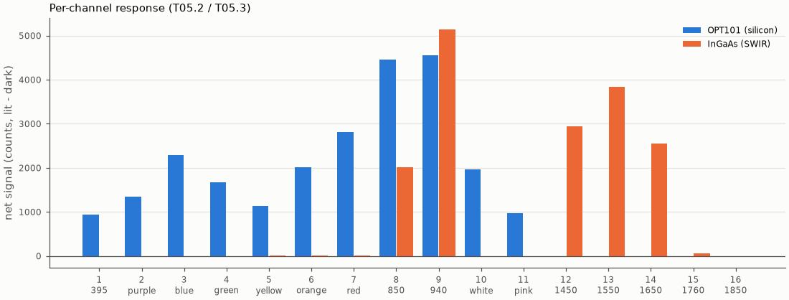
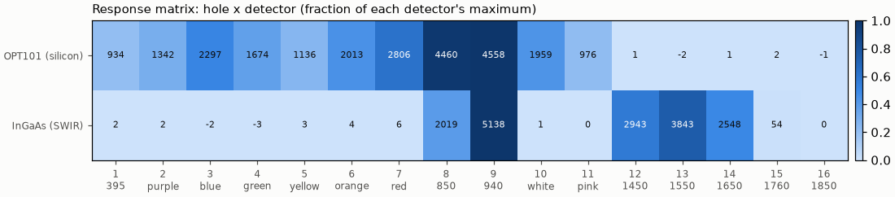
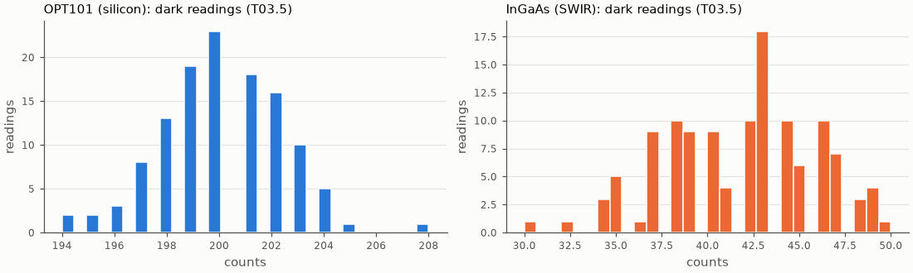
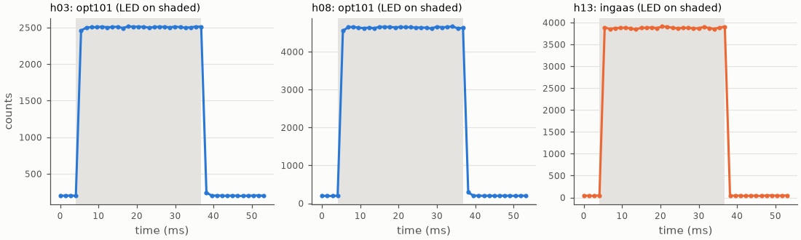
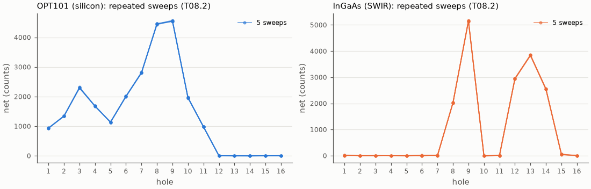

# LIO test report: 20261124-134801_sim

**Verdict: FUNCTIONAL**: no failures or warnings

- Target: `sim`
- Started 2026-11-24T13:48:01-05:00, finished 2026-11-24T13:51:47-05:00
- Sample: `none-empty-chamber`, operator: unknown
- Firmware 2.5.2 (proto 1, build 2026-11-16)
- Config `/Users/coleloughbc/Documents/VSCode-Local/LIO/software/config/lio_hw.yaml` sha256 ea6c8a3fbe33 (thresholds provisional)
- Host: macOS-27.0.1-x86_64-i386-64bit, Python 3.12.11, lio 0.2.0, git e38b248da4 (dirty)
- Counts: PASS 43, SKIP 5
- LED duty budget: 147.9 s of cool-down waits, 0 over-budget on-time(s)

## Summary

| Test | Name | Status | Note |
|---|---|---|---|
| T01.1 | Python and dependency versions | ✓ PASS |  |
| T01.2 | Serial port discovery | ✓ PASS |  |
| T01.3 | Configuration loads and is self-consistent | ✓ PASS |  |
| T02.1 | Port open and boot banner | ✓ PASS |  |
| T02.2 | PING round-trip latency | ✓ PASS |  |
| T02.3 | INFO fields, versions and safety limits | ✓ PASS |  |
| T02.4 | Robustness to bad input | ✓ PASS |  |
| T02.5 | Sequence numbers and interleaved events | ✓ PASS |  |
| T02.6 | RESET restores the boot state | ✓ PASS |  |
| T03.1 | I2C scan finds the ADS1115 | ✓ PASS |  |
| T03.2 | Dark ADC noise, all inputs | ✓ PASS |  |
| T03.3 | Gain sweep on dark inputs | ✓ PASS |  |
| T03.4 | ADC data rate | ✓ PASS |  |
| T03.5 | Long-term dark stability | ✓ PASS |  |
| T04.1 | Shift-register patterns with CE low | ✓ PASS |  |
| T04.2 | Shift-register loopback (optional jumper) | - SKIP | loopback jumper not fitted (this build has no loop-back input (pins.LOOP), plan §6.3); the shift registers are verified optically by T05.3 |
| T04.3 | Optical address verification | - SKIP | covered by T05.3 (each hole must light only its own expected response) |
| T04.4 | Walk test (operator) | ✓ PASS |  |
| T05.1 | Rail gating by CE1 / CE2 | ✓ PASS |  |
| T05.2 | Per-channel response | ✓ PASS |  |
| T05.3 | Channel address and isolation | ✓ PASS |  |
| T05.4 | Off-state return after each MEAS | ✓ PASS |  |
| T05.5 | Repeatability (interleaved MEAS) | ✓ PASS |  |
| T05.6 | Driver current with a meter (operator) | ✓ PASS |  |
| T06.1 | OPT101 | ✓ PASS |  |
| T06.2 | InGaAs TIA | ✓ PASS |  |
| T06.3 | Cross-calibration on the shared holes | ✓ PASS |  |
| T06.4 | Ambient light sensitivity (operator) | ✓ PASS |  |
| T07.1 | Step response and settling time | ✓ PASS |  |
| T07.2 | Recommended settle time | ✓ PASS |  |
| T07.3 | MEAS timing | ✓ PASS |  |
| T08.1 | SWEEP completes with a valid schema | ✓ PASS |  |
| T08.2 | Repeated sweeps | ✓ PASS |  |
| T08.3 | Sweep agrees with MEAS | ✓ PASS |  |
| T08.4 | CSV output format | ✓ PASS |  |
| T09.1 | Motion arming | ✓ PASS |  |
| T09.2 | Each motor moves both ways | ✓ PASS |  |
| T09.3 | MOTOR STOP latency | ✓ PASS |  |
| T09.4 | Detector noise while a motor moves | ✓ PASS |  |
| T09.6 | Full travel, both motors in lockstep | - SKIP | travel not measured: mark the top and bottom (Motors tab, or lio stage set-top / mark-bottom), or set thresholds.motion.travel.range_steps |
| T09.7 | Detectors while the chamber moves | - SKIP | travel not measured: mark the top and bottom (Motors tab, or lio stage set-top / mark-bottom), or set thresholds.motion.travel.range_steps |
| T10.1 | Power-up dark state | ✓ PASS |  |
| T10.2 | On-time watchdog | ✓ PASS |  |
| T10.3 | Comms-loss failsafe | ✓ PASS |  |
| T10.4 | Single-channel invariant | ✓ PASS |  |
| T10.5 | Motion disarmed after comms loss | ✓ PASS |  |
| T11.1 | Comparison with the baseline | - SKIP | no baseline given (--baseline <file>); save one with --save-baseline |
| T13.1 | Diagnostic height sweep | ✓ PASS | quick scan COMPLETE: FUNCTIONAL (20261124-134802_scan_quick) |

### Per-channel response

### Response matrix

### Dark noise

### Step responses

### Repeated sweeps

## T01

### T01.1 Python and dependency versions: PASS

| Check | Status | Result | Criterion |
|---|---|---|---|
| Python version | ✓ PASS | 3.12.11 | >= 3.10 |
| pyserial installed | ✓ PASS | 3.5 | importable |
| pyyaml installed | ✓ PASS | 6.0.3 | importable |
| numpy installed | ✓ PASS | 2.5.4 | importable |
| matplotlib installed | ✓ PASS | 3.11.2 | importable |
| jinja2 installed | ✓ PASS | 3.1.6 | importable |

### T01.2 Serial port discovery: PASS

| Check | Status | Result | Criterion |
|---|---|---|---|
| Port discovery | ✓ PASS | simulator target; 3 serial port(s) on this host recorded only |  |

### T01.3 Configuration loads and is self-consistent: PASS

| Check | Status | Result | Criterion |
|---|---|---|---|
| Config validates | ✓ PASS | lio_hw.yaml sha256 ea6c8a3fbe33 |  |
| 16 holes | ✓ PASS | 16 entries |  |
| Rails split A = 1-8, B = 9-16 (as built) | ✓ PASS | A=[1, 2, 3, 4, 5, 6, 7, 8] B=[9, 10, 11, 12, 13, 14, 15, 16] |  |

## T02

### T02.1 Port open and boot banner: PASS

| Check | Status | Result | Criterion |
|---|---|---|---|
| Boot banner within the timeout | ✓ PASS | 1.61 s | <= 3 s |
| Banner identifies LIO firmware | ✓ PASS | # BOOT name=lio fw=2.5.2 proto=1 build=2026-11-16 adc_ok=1 hw_wdt=0 | name=lio, fw and proto present |

### T02.2 PING round-trip latency: PASS

| Check | Status | Result | Criterion |
|---|---|---|---|
| Every PING answered | ✓ PASS | 100/100 answered | all |
| p99 round trip | ✓ PASS | median 4.31 ms, p99 4.49 ms, max 4.49 ms | p99 < 50 ms |

### T02.3 INFO fields, versions and safety limits: PASS

| Check | Status | Result | Criterion |
|---|---|---|---|
| INFO fields present | ✓ PASS | 21 fields | all protocol-1 INFO fields |
| Firmware compatible with this host package | ✓ PASS | fw 2.5.2 proto 1 | >= 2.0.0, proto 1 |
| settle_ms matches lio_hw.yaml | ✓ PASS | 8 | 8 |
| wdt_a_ms matches lio_hw.yaml | ✓ PASS | 2000 | 2000 |
| wdt_b_ms matches lio_hw.yaml | ✓ PASS | 5000 | 5000 |
| wdt_a_cap_ms matches lio_hw.yaml | ✓ PASS | 5000 | 5000 |
| wdt_b_cap_ms matches lio_hw.yaml | ✓ PASS | 10000 | 10000 |
| comms_ms matches lio_hw.yaml | ✓ PASS | 10000 | 10000 |
| arm_ms matches lio_hw.yaml | ✓ PASS | 60000 | 60000 |
| step_max matches lio_hw.yaml | ✓ PASS | 2048 | 2048 |
| jog_max matches lio_hw.yaml | ✓ PASS | 2048 | 2048 |
| jog_v_max matches lio_hw.yaml | ✓ PASS | 1000 | 1000 |
| jog_acc_max matches lio_hw.yaml | ✓ PASS | 1000 | 1000 |
| wake_ms_max matches lio_hw.yaml | ✓ PASS | 3000 | 3000 |
| ADC address matches lio_hw.yaml | ✓ PASS | 0x48 | 0x48 |
| ADC gain matches lio_hw.yaml | ✓ PASS | 1 | 1 |
| ADC rate matches lio_hw.yaml | ✓ PASS | 128 | 128 |

### T02.4 Robustness to bad input: PASS

| Check | Status | Result | Criterion |
|---|---|---|---|
| Unknown command | ✓ PASS | @146 ERR FROBNICATE code=1 msg=unknown command | ERR code=1 |
| Bad argument | ✓ PASS | @147 ERR MEAS code=2 msg=usage: MEAS <1-16> [settle_ms] [n] | ERR code=2 |
| Missing argument | ✓ PASS | @148 ERR CH code=2 msg=usage: CH <1-16> ON [ms] | ERR code=2 |
| Line over 64 characters | ✓ PASS | ERR ? code=6 msg=line too long | ERR code=6 |
| Garbage bytes, then PING | ✓ PASS | PING OK | PING still answered |

### T02.5 Sequence numbers and interleaved events: PASS

| Check | Status | Result | Criterion |
|---|---|---|---|
| @1 echoed | ✓ PASS | @1 OK PING uptime_ms=2301 | @1 OK PING |
| @4242 echoed | ✓ PASS | @4242 OK PING uptime_ms=2306 | @4242 OK PING |
| @99999 echoed | ✓ PASS | @99999 OK PING uptime_ms=2311 | @99999 OK PING |
| No @seq, none echoed | ✓ PASS | OK PING uptime_ms=2315 | OK PING |
| Response found after interleaved events | ✓ PASS | 20 '# S' events then OK | 20 events |
| Asynchronous '# OFF' does not desynchronise | ✓ PASS | 10/10 PINGs matched; 1 timer event(s) seen | all PINGs answered in order, one '# OFF' |

### T02.6 RESET restores the boot state: PASS

| Check | Status | Result | Criterion |
|---|---|---|---|
| Banner after RESET | ✓ PASS | 0.06 s | <= 3 s |
| STATUS shows the safe state | ✓ PASS | ch=0 ce1=0 ce2=0 mask=0x0000 armed=0 | ch=0 ce1=0 ce2=0 mask=0 armed=0, motors idle |
| Settings back to defaults | ✓ PASS | wdt_a_ms=2000 (was set to 200) | 2000 |

## T03

### T03.1 I2C scan finds the ADS1115: PASS

| Check | Status | Result | Criterion |
|---|---|---|---|
| ADS1115 at 0x48 | ✓ PASS | found ['0x48'] | 0x48 acknowledges |
| I2C lines (SDA, SCL) | ✓ PASS | lines idle high with pull-ups, not bridged; 0x48 answers at 400 kHz | both idle high, rise on external pull-ups, not joined |
| No unexpected I2C devices | ✓ PASS | none | only the ADS1115 |

### T03.2 Dark ADC noise, all inputs: PASS

| Check | Status | Result | Criterion |
|---|---|---|---|
| ADS A0 (ingaas) dark noise | ✓ PASS | mean 39.9, sigma 4.17 counts (n=64) | sigma <= 20 counts |
| ADS A1 (opt101) dark noise | ✓ PASS | mean 200.2, sigma 2.79 counts (n=64) | sigma <= 20 counts |
| ADS A2 (unconnected) | ✓ PASS | recorded only: mean 1752.6, sigma 67.27 | floating input |
| ADS A3 (unconnected) | ✓ PASS | recorded only: mean 2180.4, sigma 73.72 | floating input |

### T03.3 Gain sweep on dark inputs: PASS

| Check | Status | Result | Criterion |
|---|---|---|---|
| GAIN 2/3 accepted | ✓ PASS | lsb 0.1875 mV | 0.1875 mV |
| GAIN 1 accepted | ✓ PASS | lsb 0.125 mV | 0.125 mV |
| GAIN 2 accepted | ✓ PASS | lsb 0.0625 mV | 0.0625 mV |
| GAIN 4 accepted | ✓ PASS | lsb 0.03125 mV | 0.03125 mV |
| GAIN 8 accepted | ✓ PASS | lsb 0.015625 mV | 0.015625 mV |
| GAIN 16 accepted | ✓ PASS | lsb 0.0078125 mV | 0.0078125 mV |
| ingaas at GAIN 2/3 agrees with GAIN 1 | ✓ PASS | 4.97 mV vs 5.11 mV | within 6.58 mV |
| ingaas at GAIN 1 agrees with GAIN 1 | ✓ PASS | 5.11 mV vs 5.11 mV | within 6.58 mV |
| ingaas at GAIN 2 agrees with GAIN 1 | ✓ PASS | 5.13 mV vs 5.11 mV | within 6.58 mV |
| ingaas at GAIN 4 agrees with GAIN 1 | ✓ PASS | 4.69 mV vs 5.11 mV | within 6.58 mV |
| ingaas at GAIN 8 agrees with GAIN 1 | ✓ PASS | 4.95 mV vs 5.11 mV | within 6.58 mV |
| ingaas at GAIN 16 agrees with GAIN 1 | ✓ PASS | 5.11 mV vs 5.11 mV | within 6.76 mV |
| GAIN 2/3 accepted | ✓ PASS | lsb 0.1875 mV | 0.1875 mV |
| GAIN 1 accepted | ✓ PASS | lsb 0.125 mV | 0.125 mV |
| GAIN 2 accepted | ✓ PASS | lsb 0.0625 mV | 0.0625 mV |
| GAIN 4 accepted | ✓ PASS | lsb 0.03125 mV | 0.03125 mV |
| GAIN 8 accepted | ✓ PASS | lsb 0.015625 mV | 0.015625 mV |
| GAIN 16 accepted | ✓ PASS | lsb 0.0078125 mV | 0.0078125 mV |
| opt101 at GAIN 2/3 agrees with GAIN 1 | ✓ PASS | 24.96 mV vs 25.05 mV | within 6.02 mV |
| opt101 at GAIN 1 agrees with GAIN 1 | ✓ PASS | 25.05 mV vs 25.05 mV | within 6.02 mV |
| opt101 at GAIN 2 agrees with GAIN 1 | ✓ PASS | 25.13 mV vs 25.05 mV | within 6.02 mV |
| opt101 at GAIN 4 agrees with GAIN 1 | ✓ PASS | 25.10 mV vs 25.05 mV | within 6.02 mV |
| opt101 at GAIN 8 agrees with GAIN 1 | ✓ PASS | 25.11 mV vs 25.05 mV | within 6.02 mV |
| opt101 at GAIN 16 agrees with GAIN 1 | ✓ PASS | 25.09 mV vs 25.05 mV | within 6.02 mV |

### T03.4 ADC data rate: PASS

| Check | Status | Result | Criterion |
|---|---|---|---|
| 8 SPS conversion interval | ✓ PASS | 125.200 ms (nominal 125.000 ms, overhead +0.200 ms) | 106.250-145.250 ms |
| 16 SPS conversion interval | ✓ PASS | 62.700 ms (nominal 62.500 ms, overhead +0.200 ms) | 53.125-73.375 ms |
| 32 SPS conversion interval | ✓ PASS | 31.450 ms (nominal 31.250 ms, overhead +0.200 ms) | 26.562-37.438 ms |
| 64 SPS conversion interval | ✓ PASS | 15.825 ms (nominal 15.625 ms, overhead +0.200 ms) | 13.281-19.469 ms |
| 128 SPS conversion interval | ✓ PASS | 8.012 ms (nominal 7.812 ms, overhead +0.200 ms) | 6.641-10.484 ms |
| 250 SPS conversion interval | ✓ PASS | 4.200 ms (nominal 4.000 ms, overhead +0.200 ms) | 3.400-6.100 ms |
| 475 SPS conversion interval | ✓ PASS | 2.305 ms (nominal 2.105 ms, overhead +0.200 ms) | 1.789-3.921 ms |
| 860 SPS conversion interval | ✓ PASS | 1.363 ms (nominal 1.163 ms, overhead +0.200 ms) | 0.988-2.837 ms |

### T03.5 Long-term dark stability: PASS

| Check | Status | Result | Criterion |
|---|---|---|---|
| ingaas drift over 60 s | ✓ PASS | +0.1 counts/min (0.000 % FS/min), sigma 4.11 | <= 2 % FS/min |
| opt101 drift over 60 s | ✓ PASS | +0.9 counts/min (0.003 % FS/min), sigma 2.33 | <= 2 % FS/min |

## T04

### T04.1 Shift-register patterns with CE low: PASS

| Check | Status | Result | Criterion |
|---|---|---|---|
| SR RAW 0x0000 | ✓ PASS | echoed, CE low, detectors dark | mask echoed in reply and STATUS; CE1 = CE2 = 0; detectors at dark |
| SR RAW 0xFFFF | ✓ PASS | echoed, CE low, detectors dark | mask echoed in reply and STATUS; CE1 = CE2 = 0; detectors at dark |
| SR RAW 0x0001 | ✓ PASS | echoed, CE low, detectors dark | mask echoed in reply and STATUS; CE1 = CE2 = 0; detectors at dark |
| SR RAW 0x0002 | ✓ PASS | echoed, CE low, detectors dark | mask echoed in reply and STATUS; CE1 = CE2 = 0; detectors at dark |
| SR RAW 0x0004 | ✓ PASS | echoed, CE low, detectors dark | mask echoed in reply and STATUS; CE1 = CE2 = 0; detectors at dark |
| SR RAW 0x0008 | ✓ PASS | echoed, CE low, detectors dark | mask echoed in reply and STATUS; CE1 = CE2 = 0; detectors at dark |
| SR RAW 0x0010 | ✓ PASS | echoed, CE low, detectors dark | mask echoed in reply and STATUS; CE1 = CE2 = 0; detectors at dark |
| SR RAW 0x0020 | ✓ PASS | echoed, CE low, detectors dark | mask echoed in reply and STATUS; CE1 = CE2 = 0; detectors at dark |
| SR RAW 0x0040 | ✓ PASS | echoed, CE low, detectors dark | mask echoed in reply and STATUS; CE1 = CE2 = 0; detectors at dark |
| SR RAW 0x0080 | ✓ PASS | echoed, CE low, detectors dark | mask echoed in reply and STATUS; CE1 = CE2 = 0; detectors at dark |
| SR RAW 0x0100 | ✓ PASS | echoed, CE low, detectors dark | mask echoed in reply and STATUS; CE1 = CE2 = 0; detectors at dark |
| SR RAW 0x0200 | ✓ PASS | echoed, CE low, detectors dark | mask echoed in reply and STATUS; CE1 = CE2 = 0; detectors at dark |
| SR RAW 0x0400 | ✓ PASS | echoed, CE low, detectors dark | mask echoed in reply and STATUS; CE1 = CE2 = 0; detectors at dark |
| SR RAW 0x0800 | ✓ PASS | echoed, CE low, detectors dark | mask echoed in reply and STATUS; CE1 = CE2 = 0; detectors at dark |
| SR RAW 0x1000 | ✓ PASS | echoed, CE low, detectors dark | mask echoed in reply and STATUS; CE1 = CE2 = 0; detectors at dark |
| SR RAW 0x2000 | ✓ PASS | echoed, CE low, detectors dark | mask echoed in reply and STATUS; CE1 = CE2 = 0; detectors at dark |
| SR RAW 0x4000 | ✓ PASS | echoed, CE low, detectors dark | mask echoed in reply and STATUS; CE1 = CE2 = 0; detectors at dark |
| SR RAW 0x8000 | ✓ PASS | echoed, CE low, detectors dark | mask echoed in reply and STATUS; CE1 = CE2 = 0; detectors at dark |
| SR RAW 0xFFFE | ✓ PASS | echoed, CE low, detectors dark | mask echoed in reply and STATUS; CE1 = CE2 = 0; detectors at dark |
| SR RAW 0xFFFD | ✓ PASS | echoed, CE low, detectors dark | mask echoed in reply and STATUS; CE1 = CE2 = 0; detectors at dark |
| SR RAW 0xFFFB | ✓ PASS | echoed, CE low, detectors dark | mask echoed in reply and STATUS; CE1 = CE2 = 0; detectors at dark |
| SR RAW 0xFFF7 | ✓ PASS | echoed, CE low, detectors dark | mask echoed in reply and STATUS; CE1 = CE2 = 0; detectors at dark |
| SR RAW 0xFFEF | ✓ PASS | echoed, CE low, detectors dark | mask echoed in reply and STATUS; CE1 = CE2 = 0; detectors at dark |
| SR RAW 0xFFDF | ✓ PASS | echoed, CE low, detectors dark | mask echoed in reply and STATUS; CE1 = CE2 = 0; detectors at dark |
| SR RAW 0xFFBF | ✓ PASS | echoed, CE low, detectors dark | mask echoed in reply and STATUS; CE1 = CE2 = 0; detectors at dark |
| SR RAW 0xFF7F | ✓ PASS | echoed, CE low, detectors dark | mask echoed in reply and STATUS; CE1 = CE2 = 0; detectors at dark |
| SR RAW 0xFEFF | ✓ PASS | echoed, CE low, detectors dark | mask echoed in reply and STATUS; CE1 = CE2 = 0; detectors at dark |
| SR RAW 0xFDFF | ✓ PASS | echoed, CE low, detectors dark | mask echoed in reply and STATUS; CE1 = CE2 = 0; detectors at dark |
| SR RAW 0xFBFF | ✓ PASS | echoed, CE low, detectors dark | mask echoed in reply and STATUS; CE1 = CE2 = 0; detectors at dark |
| SR RAW 0xF7FF | ✓ PASS | echoed, CE low, detectors dark | mask echoed in reply and STATUS; CE1 = CE2 = 0; detectors at dark |
| SR RAW 0xEFFF | ✓ PASS | echoed, CE low, detectors dark | mask echoed in reply and STATUS; CE1 = CE2 = 0; detectors at dark |
| SR RAW 0xDFFF | ✓ PASS | echoed, CE low, detectors dark | mask echoed in reply and STATUS; CE1 = CE2 = 0; detectors at dark |
| SR RAW 0xBFFF | ✓ PASS | echoed, CE low, detectors dark | mask echoed in reply and STATUS; CE1 = CE2 = 0; detectors at dark |
| SR RAW 0x7FFF | ✓ PASS | echoed, CE low, detectors dark | mask echoed in reply and STATUS; CE1 = CE2 = 0; detectors at dark |

### T04.2 Shift-register loopback (optional jumper): SKIP

loopback jumper not fitted (this build has no loop-back input (pins.LOOP), plan §6.3); the shift registers are verified optically by T05.3

### T04.3 Optical address verification: SKIP

covered by T05.3 (each hole must light only its own expected response)

### T04.4 Walk test (operator): PASS

| Check | Status | Result | Criterion |
|---|---|---|---|
| Holes 1-11 seen by eye in order | ✓ PASS | confirmed | operator confirms the order |
| Holes 8-9 seen through the camera in order | ✓ PASS | confirmed | operator confirms the order |
| Holes 12-16 | - SKIP | n/a: SWIR emitters cannot be seen; covered optically by T05.2/T05.3 |  |

## T05

### T05.1 Rail gating by CE1 / CE2: PASS

| Check | Status | Result | Criterion |
|---|---|---|---|
| Hole 8 selected, CE1 low | ✓ PASS | opt101 202 (dark 200) | dark |
| Hole 8 selected, CE1 high | ✓ PASS | opt101 2423 | light above the detection threshold |
| Hole 8 with CE2 (wrong rail) | ✓ PASS | ERR code=3 needs exactly one selected hole on this rail | refused (code 3) |
| Hole 12 selected, CE2 low | ✓ PASS | ingaas 38 (dark 40) | dark |
| Hole 12 selected, CE2 high | ✓ PASS | ingaas 1512 | light above the detection threshold |
| Hole 12 with CE1 (wrong rail) | ✓ PASS | ERR code=3 needs exactly one selected hole on this rail | refused (code 3) |

### T05.2 Per-channel response: PASS

| Check | Status | Result | Criterion |
|---|---|---|---|
| Hole 1 (395) on opt101 | ✓ PASS | net +934 (signal); signal as expected | expect signal: signal >= 20 |
| Hole 2 (purple) on opt101 | ✓ PASS | net +1342 (signal); signal as expected | expect signal: signal >= 20 |
| Hole 3 (blue) on opt101 | ✓ PASS | net +2297 (signal); signal as expected | expect signal: signal >= 20 |
| Hole 4 (green) on opt101 | ✓ PASS | net +1674 (signal); signal as expected | expect signal: signal >= 20 |
| Hole 5 (yellow) on opt101 | ✓ PASS | net +1136 (signal); signal as expected | expect signal: signal >= 20 |
| Hole 6 (orange) on opt101 | ✓ PASS | net +2013 (signal); signal as expected | expect signal: signal >= 20 |
| Hole 7 (red) on opt101 | ✓ PASS | net +2806 (signal); signal as expected | expect signal: signal >= 20 |
| Hole 8 (850) on ingaas | ✓ PASS | net +2019 (signal); signal as expected | expect signal: signal >= 29 |
| Hole 8 (850) on opt101 | ✓ PASS | net +4460 (signal); signal as expected | expect signal: signal >= 20 |
| Hole 9 (940) on ingaas | ✓ PASS | net +5138 (signal); signal as expected | expect signal: signal >= 29 |
| Hole 9 (940) on opt101 | ✓ PASS | net +4558 (signal); signal as expected | expect signal: signal >= 20 |
| Hole 10 (white) on opt101 | ✓ PASS | net +1959 (signal); signal as expected | expect signal: signal >= 20 |
| Hole 11 (pink) on opt101 | ✓ PASS | net +976 (signal); signal as expected | expect signal: signal >= 20 |
| Hole 12 (1450) on ingaas | ✓ PASS | net +2943 (signal); signal as expected | expect signal: signal >= 29 |
| Hole 13 (1550) on ingaas | ✓ PASS | net +3843 (signal); signal as expected | expect signal: signal >= 29 |
| Hole 14 (1650) on ingaas | ✓ PASS | net +2548 (signal); signal as expected | expect signal: signal >= 29 |
| Hole 15 (1760) on ingaas | ✓ PASS | net +54 (signal); signal (weak expected) | expect weak: signal >= 29 |
| Hole 1 (395) on ingaas | - SKIP | not judged: 395 is outside the ingaas range (judged by opt101); recorded net +2 | out-of-range readings are not judged (channel.judge_out_of_range: false) |
| Hole 2 (purple) on ingaas | - SKIP | not judged: purple is outside the ingaas range (judged by opt101); recorded net +2 | out-of-range readings are not judged (channel.judge_out_of_range: false) |
| Hole 3 (blue) on ingaas | - SKIP | not judged: blue is outside the ingaas range (judged by opt101); recorded net -2 | out-of-range readings are not judged (channel.judge_out_of_range: false) |
| Hole 4 (green) on ingaas | - SKIP | not judged: green is outside the ingaas range (judged by opt101); recorded net -3 | out-of-range readings are not judged (channel.judge_out_of_range: false) |
| Hole 5 (yellow) on ingaas | - SKIP | not judged: yellow is outside the ingaas range (judged by opt101); recorded net +3 | out-of-range readings are not judged (channel.judge_out_of_range: false) |
| Hole 6 (orange) on ingaas | - SKIP | not judged: orange is outside the ingaas range (judged by opt101); recorded net +4 | out-of-range readings are not judged (channel.judge_out_of_range: false) |
| Hole 7 (red) on ingaas | - SKIP | not judged: red is outside the ingaas range (judged by opt101); recorded net +6 | out-of-range readings are not judged (channel.judge_out_of_range: false) |
| Hole 10 (white) on ingaas | - SKIP | not judged: white is outside the ingaas range (judged by opt101); recorded net +1 | out-of-range readings are not judged (channel.judge_out_of_range: false) |
| Hole 11 (pink) on ingaas | - SKIP | not judged: pink is outside the ingaas range (judged by opt101); recorded net +0 | out-of-range readings are not judged (channel.judge_out_of_range: false) |
| Hole 12 (1450) on opt101 | - SKIP | not judged: 1450 is outside the opt101 range (judged by ingaas); recorded net +1 | out-of-range readings are not judged (channel.judge_out_of_range: false) |
| Hole 13 (1550) on opt101 | - SKIP | not judged: 1550 is outside the opt101 range (judged by ingaas); recorded net -2 | out-of-range readings are not judged (channel.judge_out_of_range: false) |
| Hole 14 (1650) on opt101 | - SKIP | not judged: 1650 is outside the opt101 range (judged by ingaas); recorded net +1 | out-of-range readings are not judged (channel.judge_out_of_range: false) |
| Hole 15 (1760) on opt101 | - SKIP | not judged: 1760 is outside the opt101 range (judged by ingaas); recorded net +2 | out-of-range readings are not judged (channel.judge_out_of_range: false) |
| Hole 16 (1850) on ingaas | - SKIP | not judged: 1850 is outside the ingaas range (judged by no detector); recorded net +0 | out-of-range readings are not judged (channel.judge_out_of_range: false) |
| Hole 16 (1850) on opt101 | - SKIP | not judged: 1850 is outside the opt101 range (judged by no detector); recorded net -1 | out-of-range readings are not judged (channel.judge_out_of_range: false) |

### T05.3 Channel address and isolation: PASS

| Check | Status | Result | Criterion |
|---|---|---|---|
| Hole 1 (395) detector pattern | ✓ PASS | seen by ['opt101'] as expected (ingaas not judged: outside its range) | expected ['opt101'] |
| Hole 2 (purple) detector pattern | ✓ PASS | seen by ['opt101'] as expected (ingaas not judged: outside its range) | expected ['opt101'] |
| Hole 3 (blue) detector pattern | ✓ PASS | seen by ['opt101'] as expected (ingaas not judged: outside its range) | expected ['opt101'] |
| Hole 4 (green) detector pattern | ✓ PASS | seen by ['opt101'] as expected (ingaas not judged: outside its range) | expected ['opt101'] |
| Hole 5 (yellow) detector pattern | ✓ PASS | seen by ['opt101'] as expected (ingaas not judged: outside its range) | expected ['opt101'] |
| Hole 6 (orange) detector pattern | ✓ PASS | seen by ['opt101'] as expected (ingaas not judged: outside its range) | expected ['opt101'] |
| Hole 7 (red) detector pattern | ✓ PASS | seen by ['opt101'] as expected (ingaas not judged: outside its range) | expected ['opt101'] |
| Hole 8 (850) detector pattern | ✓ PASS | seen by ['ingaas', 'opt101'] as expected | expected ['ingaas', 'opt101'] |
| Hole 9 (940) detector pattern | ✓ PASS | seen by ['ingaas', 'opt101'] as expected | expected ['ingaas', 'opt101'] |
| Hole 10 (white) detector pattern | ✓ PASS | seen by ['opt101'] as expected (ingaas not judged: outside its range) | expected ['opt101'] |
| Hole 11 (pink) detector pattern | ✓ PASS | seen by ['opt101'] as expected (ingaas not judged: outside its range) | expected ['opt101'] |
| Hole 12 (1450) detector pattern | ✓ PASS | seen by ['ingaas'] as expected (opt101 not judged: outside its range) | expected ['ingaas'] |
| Hole 13 (1550) detector pattern | ✓ PASS | seen by ['ingaas'] as expected (opt101 not judged: outside its range) | expected ['ingaas'] |
| Hole 14 (1650) detector pattern | ✓ PASS | seen by ['ingaas'] as expected (opt101 not judged: outside its range) | expected ['ingaas'] |
| Hole 15 (1760) detector pattern | ✓ PASS | seen by ['ingaas'] as expected (opt101 not judged: outside its range) | expected ['ingaas'] |
| Hole 16 (1850) detector pattern | ✓ PASS | seen by nothing as expected (ingaas, opt101 not judged: outside its range) | expected none |
| Signatures unique | ✓ PASS | no two channels look the same | cosine < 0.98 or amplitude differs by more than 1 % |

### T05.4 Off-state return after each MEAS: PASS

| Check | Status | Result | Criterion |
|---|---|---|---|
| Hole 1 ingaas back to dark | ✓ PASS | 42.0 after OFF vs dark 44 | within 5 sigma (14.7 counts) |
| Hole 1 opt101 back to dark | ✓ PASS | 202.8 after OFF vs dark 199 | within 5 sigma (9.9 counts) |
| Hole 2 ingaas back to dark | ✓ PASS | 37.5 after OFF vs dark 41 | within 5 sigma (14.7 counts) |
| Hole 2 opt101 back to dark | ✓ PASS | 200.5 after OFF vs dark 198 | within 5 sigma (9.9 counts) |
| Hole 3 ingaas back to dark | ✓ PASS | 43.0 after OFF vs dark 42 | within 5 sigma (14.7 counts) |
| Hole 3 opt101 back to dark | ✓ PASS | 198.8 after OFF vs dark 202 | within 5 sigma (9.9 counts) |
| Hole 4 ingaas back to dark | ✓ PASS | 39.8 after OFF vs dark 39 | within 5 sigma (14.7 counts) |
| Hole 4 opt101 back to dark | ✓ PASS | 199.0 after OFF vs dark 202 | within 5 sigma (9.9 counts) |
| Hole 5 ingaas back to dark | ✓ PASS | 36.5 after OFF vs dark 39 | within 5 sigma (14.7 counts) |
| Hole 5 opt101 back to dark | ✓ PASS | 200.0 after OFF vs dark 200 | within 5 sigma (9.9 counts) |
| Hole 6 ingaas back to dark | ✓ PASS | 39.2 after OFF vs dark 38 | within 5 sigma (14.7 counts) |
| Hole 6 opt101 back to dark | ✓ PASS | 198.8 after OFF vs dark 201 | within 5 sigma (9.9 counts) |
| Hole 7 ingaas back to dark | ✓ PASS | 39.8 after OFF vs dark 37 | within 5 sigma (14.7 counts) |
| Hole 7 opt101 back to dark | ✓ PASS | 198.8 after OFF vs dark 200 | within 5 sigma (9.9 counts) |
| Hole 8 ingaas back to dark | ✓ PASS | 36.0 after OFF vs dark 40 | within 5 sigma (14.7 counts) |
| Hole 8 opt101 back to dark | ✓ PASS | 200.8 after OFF vs dark 201 | within 5 sigma (9.9 counts) |
| Hole 9 ingaas back to dark | ✓ PASS | 41.8 after OFF vs dark 39 | within 5 sigma (14.7 counts) |
| Hole 9 opt101 back to dark | ✓ PASS | 198.8 after OFF vs dark 202 | within 5 sigma (9.9 counts) |
| Hole 10 ingaas back to dark | ✓ PASS | 40.8 after OFF vs dark 41 | within 5 sigma (14.7 counts) |
| Hole 10 opt101 back to dark | ✓ PASS | 199.8 after OFF vs dark 202 | within 5 sigma (9.9 counts) |
| Hole 11 ingaas back to dark | ✓ PASS | 41.5 after OFF vs dark 41 | within 5 sigma (14.7 counts) |
| Hole 11 opt101 back to dark | ✓ PASS | 200.0 after OFF vs dark 202 | within 5 sigma (9.9 counts) |
| Hole 12 ingaas back to dark | ✓ PASS | 43.5 after OFF vs dark 40 | within 5 sigma (14.7 counts) |
| Hole 12 opt101 back to dark | ✓ PASS | 201.5 after OFF vs dark 199 | within 5 sigma (9.9 counts) |
| Hole 13 ingaas back to dark | ✓ PASS | 36.8 after OFF vs dark 38 | within 5 sigma (14.7 counts) |
| Hole 13 opt101 back to dark | ✓ PASS | 199.2 after OFF vs dark 201 | within 5 sigma (9.9 counts) |
| Hole 14 ingaas back to dark | ✓ PASS | 40.2 after OFF vs dark 40 | within 5 sigma (14.7 counts) |
| Hole 14 opt101 back to dark | ✓ PASS | 198.5 after OFF vs dark 199 | within 5 sigma (9.9 counts) |
| Hole 15 ingaas back to dark | ✓ PASS | 36.0 after OFF vs dark 39 | within 5 sigma (14.7 counts) |
| Hole 15 opt101 back to dark | ✓ PASS | 199.2 after OFF vs dark 199 | within 5 sigma (9.9 counts) |
| Hole 16 ingaas back to dark | ✓ PASS | 39.0 after OFF vs dark 41 | within 5 sigma (14.7 counts) |
| Hole 16 opt101 back to dark | ✓ PASS | 200.0 after OFF vs dark 202 | within 5 sigma (9.9 counts) |

### T05.5 Repeatability (interleaved MEAS): PASS

| Check | Status | Result | Criterion |
|---|---|---|---|
| Hole 1 opt101 repeatability, N=10 | ✓ PASS | mean +933.6 (95% +931.7..+935.5), SD 2.63, n 10/10; CV 0.3 %; SD 2.63 <= 11.84 counts | SD <= 5 counts, every record present |
| Hole 2 opt101 repeatability, N=10 | ✓ PASS | mean +1338.5 (95% +1336.9..+1340.1), SD 2.22, n 10/10; CV 0.2 %; SD 2.22 <= 11.84 counts | SD <= 5 counts, every record present |
| Hole 3 opt101 repeatability, N=10 | ✓ PASS | mean +2302.6 (95% +2299.1..+2306.1), SD 4.95, n 10/10; CV 0.2 %; SD 4.95 <= 11.84 counts | SD <= 5 counts, every record present |
| Hole 4 opt101 repeatability, N=10 | ✓ PASS | mean +1671.3 (95% +1669.4..+1673.2), SD 2.71, n 10/10; CV 0.2 %; SD 2.71 <= 11.84 counts | SD <= 5 counts, every record present |
| Hole 5 opt101 repeatability, N=10 | ✓ PASS | mean +1136.6 (95% +1134.8..+1138.4), SD 2.55, n 10/10; CV 0.2 %; SD 2.55 <= 11.84 counts | SD <= 5 counts, every record present |
| Hole 6 opt101 repeatability, N=10 | ✓ PASS | mean +2007.5 (95% +2004.9..+2010.1), SD 3.57, n 10/10; CV 0.2 %; SD 3.57 <= 11.84 counts | SD <= 5 counts, every record present |
| Hole 7 opt101 repeatability, N=10 | ✓ PASS | mean +2804.7 (95% +2801.3..+2808.1), SD 4.79, n 10/10; CV 0.2 %; SD 4.79 <= 11.84 counts | SD <= 5 counts, every record present |
| Hole 8 opt101 repeatability, N=10 | ✓ PASS | mean +4444.8 (95% +4440.2..+4449.4), SD 6.41, n 10/10; CV 0.1 %; SD 6.41 <= 11.84 counts | SD <= 5 counts, every record present |
| Hole 8 ingaas repeatability, N=10 | ✓ PASS | mean +2019.0 (95% +2016.1..+2021.9), SD 4.08, n 10/10; CV 0.2 %; SD 4.08 <= 17.69 counts | SD <= 5 counts, every record present |
| Hole 9 opt101 repeatability, N=10 | ✓ PASS | mean +4554.6 (95% +4549.2..+4560.0), SD 7.49, n 10/10; CV 0.2 %; SD 7.49 <= 11.84 counts | SD <= 5 counts, every record present |
| Hole 9 ingaas repeatability, N=10 | ✓ PASS | mean +5141.0 (95% +5136.4..+5145.6), SD 6.45, n 10/10; CV 0.1 %; SD 6.45 <= 17.69 counts | SD <= 5 counts, every record present |
| Hole 10 opt101 repeatability, N=10 | ✓ PASS | mean +1965.6 (95% +1962.3..+1968.9), SD 4.58, n 10/10; CV 0.2 %; SD 4.58 <= 11.84 counts | SD <= 5 counts, every record present |
| Hole 11 opt101 repeatability, N=10 | ✓ PASS | mean +981.3 (95% +979.1..+983.5), SD 3.02, n 10/10; CV 0.3 %; SD 3.02 <= 11.84 counts | SD <= 5 counts, every record present |
| Hole 12 ingaas repeatability, N=10 | ✓ PASS | mean +2945.1 (95% +2941.1..+2949.1), SD 5.53, n 10/10; CV 0.2 %; SD 5.53 <= 17.69 counts | SD <= 5 counts, every record present |
| Hole 13 ingaas repeatability, N=10 | ✓ PASS | mean +3839.7 (95% +3835.6..+3843.8), SD 5.74, n 10/10; CV 0.1 %; SD 5.74 <= 17.69 counts | SD <= 5 counts, every record present |
| Hole 14 ingaas repeatability, N=10 | ✓ PASS | mean +2548.2 (95% +2545.1..+2551.3), SD 4.29, n 10/10; CV 0.2 %; SD 4.29 <= 17.69 counts | SD <= 5 counts, every record present |
| Hole 15 ingaas repeatability, N=10 | ✓ PASS | mean +50.4 (95% +48.5..+52.3), SD 2.72, n 10/10; CV 5.4 %; SD 2.72 <= 17.69 counts | SD <= 5 counts, every record present |

### T05.6 Driver current with a meter (operator): PASS

| Check | Status | Result | Criterion |
|---|---|---|---|
| RAIL A driver current (hole 4) | ✓ PASS | 30 mA vs nominal 30 mA (0 % off) | within 15 % (WARN to 30 %) |
| RAIL B driver current (hole 10) | ✓ PASS | 45 mA vs nominal 45 mA (0 % off) | within 15 % (WARN to 30 %) |

## T06

### T06.1 OPT101: PASS

| Check | Status | Result | Criterion |
|---|---|---|---|
| opt101 dark offset | ✓ PASS | 200.2 counts | 0 to 800 counts |
| Responds to hole 1 (395) | ✓ PASS | net +934 | no zeros where light is expected |
| Responds to hole 2 (purple) | ✓ PASS | net +1342 | no zeros where light is expected |
| Responds to hole 3 (blue) | ✓ PASS | net +2297 | no zeros where light is expected |
| Responds to hole 4 (green) | ✓ PASS | net +1674 | no zeros where light is expected |
| Responds to hole 5 (yellow) | ✓ PASS | net +1136 | no zeros where light is expected |
| Responds to hole 6 (orange) | ✓ PASS | net +2013 | no zeros where light is expected |
| Responds to hole 7 (red) | ✓ PASS | net +2806 | no zeros where light is expected |
| Responds to hole 10 (white) | ✓ PASS | net +1959 | no zeros where light is expected |
| Responds to hole 11 (pink) | ✓ PASS | net +976 | no zeros where light is expected |
| Not saturated | ✓ PASS | peak 4760 | < 29000 counts |

### T06.2 InGaAs TIA: PASS

| Check | Status | Result | Criterion |
|---|---|---|---|
| Dark signal steady | ✓ PASS | dark mean 40, sigma 4.2 | sigma <= 100 and mean >= -1500 |
| ingaas dark offset | ✓ PASS | 39.9 counts | -400 to 2000 counts |
| Polarity gate (hole 8) | ✓ PASS | net +2021 | net >= -5 sigma |
| Hole 9 InGaAs polarity | ✓ PASS | net +5138 | net not negative |
| Hole 12 InGaAs polarity | ✓ PASS | net +2943 | net not negative |
| Hole 13 InGaAs polarity | ✓ PASS | net +3843 | net not negative |
| Hole 14 InGaAs polarity | ✓ PASS | net +2548 | net not negative |
| InGaAs not saturated | ✓ PASS | no hole saturates | < 27000 counts |

### T06.3 Cross-calibration on the shared holes: PASS

| Check | Status | Result | Criterion |
|---|---|---|---|
| Hole 8 seen by both detectors | ✓ PASS | InGaAs/OPT101 = 0.453 | both above the detection threshold |
| Hole 9 seen by both detectors | ✓ PASS | InGaAs/OPT101 = 1.127 | both above the detection threshold |

### T06.4 Ambient light sensitivity (operator): PASS

| Check | Status | Result | Criterion |
|---|---|---|---|
| ingaas change with the lid open | ✓ PASS | recorded: +300 counts (39 -> 340) | recorded only (quantifies light-tightness) |
| ingaas back to dark after closing | ✓ PASS | 40 vs dark 40 | dark +- k sigma |
| opt101 change with the lid open | ✓ PASS | recorded: +1500 counts (200 -> 1700) | recorded only (quantifies light-tightness) |
| opt101 back to dark after closing | ✓ PASS | 200 vs dark 200 | dark +- k sigma |

## T07

### T07.1 Step response and settling time: PASS

| Check | Status | Result | Criterion |
|---|---|---|---|
| Hole 3 (opt101) step response | ✓ PASS | settled within a few samples: t99 <= 2.04 ms (upper bound, limited by the sample interval) | time to 99 % recorded |
| Hole 8 (opt101) step response | ✓ PASS | settled within one sample: t99 <= 0.68 ms (upper bound, limited by the sample interval) | time to 99 % recorded |
| Hole 13 (ingaas) step response | ✓ PASS | settled within one sample: t99 <= 0.68 ms (upper bound, limited by the sample interval) | time to 99 % recorded |

### T07.2 Recommended settle time: PASS

| Check | Status | Result | Criterion |
|---|---|---|---|
| Configured settle_ms is long enough | ✓ PASS | recommended 4 ms (max 2.04 ms x 1.5), configured 8 ms | recommended <= 8 ms |

### T07.3 MEAS timing: PASS

| Check | Status | Result | Criterion |
|---|---|---|---|
| MEAS 3 8 1 on-time | ✓ PASS | t_on_ms 24 | 21.3-32.0 ms and <= watchdog 2000 ms |
| MEAS 3 20 4 on-time | ✓ PASS | t_on_ms 84 | 73.1-106.9 ms and <= watchdog 2000 ms |

## T08

### T08.1 SWEEP completes with a valid schema: PASS

| Check | Status | Result | Criterion |
|---|---|---|---|
| 16 records, holes 1-16 in order | ✓ PASS | 16 records: [1, 2, 3, 4, 5, 6, 7, 8, 9, 10, 11, 12, 13, 14, 15, 16] | holes 1..16 |
| Sweep records parse | ✓ PASS | all '# M' fields present and integer |  |
| Sweep duration | ✓ PASS | 769 ms (host 52828 ms) | <= 2.5 s |

### T08.2 Repeated sweeps: PASS

| Check | Status | Result | Criterion |
|---|---|---|---|
| Hole 2 opt101 sweep-to-sweep CV | ✓ PASS | mean 1342, CV 0.39 % | CV <= 2 % |
| Hole 3 opt101 sweep-to-sweep CV | ✓ PASS | mean 2299, CV 0.50 % | CV <= 2 % |
| Hole 4 opt101 sweep-to-sweep CV | ✓ PASS | mean 1678, CV 0.34 % | CV <= 2 % |
| Hole 5 opt101 sweep-to-sweep CV | ✓ PASS | mean 1135, CV 0.44 % | CV <= 2 % |
| Hole 6 opt101 sweep-to-sweep CV | ✓ PASS | mean 2007, CV 0.36 % | CV <= 2 % |
| Hole 7 opt101 sweep-to-sweep CV | ✓ PASS | mean 2807, CV 0.29 % | CV <= 2 % |
| Hole 8 opt101 sweep-to-sweep CV | ✓ PASS | mean 4451, CV 0.24 % | CV <= 2 % |
| Hole 8 ingaas sweep-to-sweep CV | ✓ PASS | mean 2021, CV 0.28 % | CV <= 2 % |
| Hole 9 opt101 sweep-to-sweep CV | ✓ PASS | mean 4552, CV 0.29 % | CV <= 2 % |
| Hole 9 ingaas sweep-to-sweep CV | ✓ PASS | mean 5152, CV 0.29 % | CV <= 2 % |
| Hole 10 opt101 sweep-to-sweep CV | ✓ PASS | mean 1964, CV 0.50 % | CV <= 2 % |
| Hole 12 ingaas sweep-to-sweep CV | ✓ PASS | mean 2945, CV 0.34 % | CV <= 2 % |
| Hole 13 ingaas sweep-to-sweep CV | ✓ PASS | mean 3840, CV 0.30 % | CV <= 2 % |
| Hole 14 ingaas sweep-to-sweep CV | ✓ PASS | mean 2547, CV 0.48 % | CV <= 2 % |
| Hole 1 opt101 SWEEP net repeatability over 5 sweeps | ✓ PASS | mean +935.2, SD 4.97, range +930..+942; SD 4.97 <= 11.84 counts (SWEEP mode, not MEAS) | SD <= 5 counts, a record in every sweep |
| Hole 2 opt101 SWEEP net repeatability over 5 sweeps | ✓ PASS | mean +1342.2, SD 5.22, range +1336..+1346; SD 5.22 <= 11.84 counts (SWEEP mode, not MEAS) | SD <= 5 counts, a record in every sweep |
| Hole 3 opt101 SWEEP net repeatability over 5 sweeps | ✓ PASS | mean +2299.4, SD 11.39, range +2286..+2316; SD 11.39 <= 11.84 counts (SWEEP mode, not MEAS) | SD <= 5 counts, a record in every sweep |
| Hole 4 opt101 SWEEP net repeatability over 5 sweeps | ✓ PASS | mean +1678.4, SD 5.68, range +1670..+1683; SD 5.68 <= 11.84 counts (SWEEP mode, not MEAS) | SD <= 5 counts, a record in every sweep |
| Hole 5 opt101 SWEEP net repeatability over 5 sweeps | ✓ PASS | mean +1135.4, SD 4.98, range +1128..+1142; SD 4.98 <= 11.84 counts (SWEEP mode, not MEAS) | SD <= 5 counts, a record in every sweep |
| Hole 6 opt101 SWEEP net repeatability over 5 sweeps | ✓ PASS | mean +2007.4, SD 7.30, range +1999..+2014; SD 7.30 <= 11.84 counts (SWEEP mode, not MEAS) | SD <= 5 counts, a record in every sweep |
| Hole 7 opt101 SWEEP net repeatability over 5 sweeps | ✓ PASS | mean +2806.6, SD 8.23, range +2793..+2814; SD 8.23 <= 11.84 counts (SWEEP mode, not MEAS) | SD <= 5 counts, a record in every sweep |
| Hole 8 opt101 SWEEP net repeatability over 5 sweeps | ✓ PASS | mean +4451.2, SD 10.76, range +4434..+4461; SD 10.76 <= 11.84 counts (SWEEP mode, not MEAS) | SD <= 5 counts, a record in every sweep |
| Hole 8 ingaas SWEEP net repeatability over 5 sweeps | ✓ PASS | mean +2021.2, SD 5.63, range +2014..+2028; SD 5.63 <= 17.69 counts (SWEEP mode, not MEAS) | SD <= 5 counts, a record in every sweep |
| Hole 9 opt101 SWEEP net repeatability over 5 sweeps | ✓ PASS | mean +4551.6, SD 13.11, range +4541..+4573; CV 0.29 % <= 2 % (SWEEP mode, not MEAS) | SD <= 5 counts, a record in every sweep |
| Hole 9 ingaas SWEEP net repeatability over 5 sweeps | ✓ PASS | mean +5152.2, SD 14.86, range +5138..+5173; SD 14.86 <= 17.69 counts (SWEEP mode, not MEAS) | SD <= 5 counts, a record in every sweep |
| Hole 10 opt101 SWEEP net repeatability over 5 sweeps | ✓ PASS | mean +1963.6, SD 9.74, range +1952..+1975; SD 9.74 <= 11.84 counts (SWEEP mode, not MEAS) | SD <= 5 counts, a record in every sweep |
| Hole 11 opt101 SWEEP net repeatability over 5 sweeps | ✓ PASS | mean +981.2, SD 5.26, range +974..+988; SD 5.26 <= 11.84 counts (SWEEP mode, not MEAS) | SD <= 5 counts, a record in every sweep |
| Hole 12 ingaas SWEEP net repeatability over 5 sweeps | ✓ PASS | mean +2945.4, SD 10.11, range +2935..+2961; SD 10.11 <= 17.69 counts (SWEEP mode, not MEAS) | SD <= 5 counts, a record in every sweep |
| Hole 13 ingaas SWEEP net repeatability over 5 sweeps | ✓ PASS | mean +3840.4, SD 11.67, range +3828..+3854; SD 11.67 <= 17.69 counts (SWEEP mode, not MEAS) | SD <= 5 counts, a record in every sweep |
| Hole 14 ingaas SWEEP net repeatability over 5 sweeps | ✓ PASS | mean +2547.2, SD 12.11, range +2536..+2566; SD 12.11 <= 17.69 counts (SWEEP mode, not MEAS) | SD <= 5 counts, a record in every sweep |
| Hole 15 ingaas SWEEP net repeatability over 5 sweeps | ✓ PASS | mean +50.2, SD 8.32, range +40..+62; SD 8.32 <= 17.69 counts (SWEEP mode, not MEAS) | SD <= 5 counts, a record in every sweep |
| ingaas dark stable between sweeps | ✓ PASS | per-sweep dark means span 2.38 counts | <= 5.21 counts |
| opt101 dark stable between sweeps | ✓ PASS | per-sweep dark means span 1.31 counts | <= 3.49 counts |

### T08.3 Sweep agrees with MEAS: PASS

| Check | Status | Result | Criterion |
|---|---|---|---|
| Hole 1 opt101 sweep vs MEAS | ✓ PASS | sweep 935 vs MEAS 934 (0.1 %) | within 93 counts (max of 10 %, 5 sigma) |
| Hole 2 opt101 sweep vs MEAS | ✓ PASS | sweep 1342 vs MEAS 1342 (0.0 %) | within 134 counts (max of 10 %, 5 sigma) |
| Hole 3 opt101 sweep vs MEAS | ✓ PASS | sweep 2299 vs MEAS 2297 (0.1 %) | within 230 counts (max of 10 %, 5 sigma) |
| Hole 4 opt101 sweep vs MEAS | ✓ PASS | sweep 1678 vs MEAS 1674 (0.3 %) | within 167 counts (max of 10 %, 5 sigma) |
| Hole 5 opt101 sweep vs MEAS | ✓ PASS | sweep 1135 vs MEAS 1136 (0.1 %) | within 114 counts (max of 10 %, 5 sigma) |
| Hole 6 opt101 sweep vs MEAS | ✓ PASS | sweep 2007 vs MEAS 2013 (0.3 %) | within 201 counts (max of 10 %, 5 sigma) |
| Hole 7 opt101 sweep vs MEAS | ✓ PASS | sweep 2807 vs MEAS 2806 (0.0 %) | within 281 counts (max of 10 %, 5 sigma) |
| Hole 8 opt101 sweep vs MEAS | ✓ PASS | sweep 4451 vs MEAS 4460 (0.2 %) | within 446 counts (max of 10 %, 5 sigma) |
| Hole 8 ingaas sweep vs MEAS | ✓ PASS | sweep 2021 vs MEAS 2019 (0.1 %) | within 202 counts (max of 10 %, 5 sigma) |
| Hole 9 opt101 sweep vs MEAS | ✓ PASS | sweep 4552 vs MEAS 4558 (0.1 %) | within 456 counts (max of 10 %, 5 sigma) |
| Hole 9 ingaas sweep vs MEAS | ✓ PASS | sweep 5152 vs MEAS 5138 (0.3 %) | within 514 counts (max of 10 %, 5 sigma) |
| Hole 10 opt101 sweep vs MEAS | ✓ PASS | sweep 1964 vs MEAS 1959 (0.2 %) | within 196 counts (max of 10 %, 5 sigma) |
| Hole 11 opt101 sweep vs MEAS | ✓ PASS | sweep 981 vs MEAS 976 (0.5 %) | within 98 counts (max of 10 %, 5 sigma) |
| Hole 12 ingaas sweep vs MEAS | ✓ PASS | sweep 2945 vs MEAS 2943 (0.1 %) | within 294 counts (max of 10 %, 5 sigma) |
| Hole 13 ingaas sweep vs MEAS | ✓ PASS | sweep 3840 vs MEAS 3843 (0.1 %) | within 384 counts (max of 10 %, 5 sigma) |
| Hole 14 ingaas sweep vs MEAS | ✓ PASS | sweep 2547 vs MEAS 2548 (0.0 %) | within 255 counts (max of 10 %, 5 sigma) |
| Hole 15 ingaas sweep vs MEAS | ✓ PASS | sweep 50 vs MEAS 54 (7.0 %) | within 20 counts (max of 10 %, 5 sigma) |

### T08.4 CSV output format: PASS

| Check | Status | Result | Criterion |
|---|---|---|---|
| Header | ✓ PASS | hole,label,dark_ingaas,dark_opt101,ingaas,opt101,net_ingaas_V,net_opt101_V | hole,label,dark_ingaas,dark_opt101,ingaas,opt101,net_ingaas_V,net_opt101_V |
| One CRLF-terminated row per hole | ✓ PASS | 16 rows | 16 rows, CRLF |
| Rows byte-identical to the original logger's format | ✓ PASS | all rows identical | same columns, rounding, labels |

## T09

### T09.1 Motion arming: PASS

| Check | Status | Result | Criterion |
|---|---|---|---|
| MOTOR STEP without ARM is refused | ✓ PASS | @1134 ERR MOTOR code=3 msg=not armed | ERR code=3 (not armed) |
| ARM with the wrong token is refused | ✓ PASS | @1136 ERR MOTOR code=3 msg=wrong token | ERR code=3 |
| ARM with the INFO token | ✓ PASS | armed=1 armed_ms=59995 | armed=1, armed_ms <= 60000 |
| Arming expires after 60 s | ✓ PASS | armed=0 failsafe_trips=0 | armed=0 without a failsafe |
| MOTOR STEP after expiry is refused | ✓ PASS | @1172 ERR MOTOR code=3 msg=not armed | ERR code=3 (not armed) |

### T09.2 Each motor moves both ways: PASS

| Check | Status | Result | Criterion |
|---|---|---|---|
| Motor 1 +64 half-steps completes | ✓ PASS | # MOTOR m=1 steps=64 pos=64 done | '# MOTOR m=1 steps=64 ... done' |
| Operator saw motor 1 (RIGHT) move up | ✓ PASS | confirmed | +steps = up (legacy U direction) |
| Motor 1 -64 half-steps completes | ✓ PASS | # MOTOR m=1 steps=64 pos=0 done | '# MOTOR m=1 steps=64 ... done' |
| Operator saw motor 1 (RIGHT) move back down | ✓ PASS | confirmed | returned |
| Motor 1 idle, coils released, back at start | ✓ PASS | motor1=idle pos1=0 | idle, pos1=0 |
| Motor 2 +64 half-steps completes | ✓ PASS | # MOTOR m=2 steps=64 pos=64 done | '# MOTOR m=2 steps=64 ... done' |
| Operator saw motor 2 (LEFT) move up | ✓ PASS | confirmed | +steps = up (legacy U direction) |
| Motor 2 -64 half-steps completes | ✓ PASS | # MOTOR m=2 steps=64 pos=0 done | '# MOTOR m=2 steps=64 ... done' |
| Operator saw motor 2 (LEFT) move back down | ✓ PASS | confirmed | returned |
| Motor 2 idle, coils released, back at start | ✓ PASS | motor2=idle pos2=0 | idle, pos2=0 |

### T09.3 MOTOR STOP latency: PASS

| Check | Status | Result | Criterion |
|---|---|---|---|
| MOTOR STOP answered | ✓ PASS | 5.3 ms | < 50 ms |
| Motor stopped and stays stopped | ✓ PASS | moved 32 of 2048 half-steps; motor1=idle | idle, position frozen, move cut short |
| Motor 1 returned to the start | ✓ PASS | # MOTOR m=1 steps=32 pos=0 done | pos1=0 |

### T09.4 Detector noise while a motor moves: PASS

| Check | Status | Result | Criterion |
|---|---|---|---|
| Streams taken while the motor was moving | ✓ PASS | motor still running after both streams | motor1=run |
| ingaas noise during motion | ✓ PASS | sigma 3.95 moving vs 4.29 at rest (x0.92) | ratio <= 3 |
| opt101 noise during motion | ✓ PASS | sigma 2.57 moving vs 2.57 at rest (x1.00) | ratio <= 3 |

### T09.6 Full travel, both motors in lockstep: SKIP

travel not measured: mark the top and bottom (Motors tab, or lio stage set-top / mark-bottom), or set thresholds.motion.travel.range_steps

### T09.7 Detectors while the chamber moves: SKIP

travel not measured: mark the top and bottom (Motors tab, or lio stage set-top / mark-bottom), or set thresholds.motion.travel.range_steps

## T10

### T10.1 Power-up dark state: PASS

| Check | Status | Result | Criterion |
|---|---|---|---|
| STATUS safe after RESET | ✓ PASS | ch=0 ce1=0 ce2=0 mask=0x0000 armed=0 | ch=0 ce1=0 ce2=0 mask=0 armed=0, motors idle |
| Detectors dark after RESET | ✓ PASS | ingaas 40, opt101 199 | dark +- k sigma |
| STATUS safe after a port reopen | ✓ PASS | ch=0 ce1=0 ce2=0 mask=0x0000 armed=0 | ch=0 ce1=0 ce2=0 mask=0 armed=0, motors idle |
| Detectors dark after a port reopen | ✓ PASS | ingaas 37, opt101 198 | dark +- k sigma |

### T10.2 On-time watchdog: PASS

| Check | Status | Result | Criterion |
|---|---|---|---|
| CH 3 ON 60000 clamped to RAIL A limit | ✓ PASS | until_ms=2000 clamped=1 | until_ms=2000 clamped=1 |
| Hole 3 lit before the watchdog | ✓ PASS | light seen | light seen |
| Light gone after the watchdog limit | ✓ PASS | dark after 319 ms | <= 352 ms: limit 300 + tolerance 50 + detector settling 2.0 ms |
| '# WDT' received | ✓ PASS | # WDT ch=3 on_ms=300 off | '# WDT' with on_ms <= 350 |
| CH 13 ON 60000 clamped to RAIL B limit | ✓ PASS | until_ms=5000 clamped=1 | until_ms=5000 clamped=1 |
| Hole 13 lit before the watchdog | ✓ PASS | light seen | light seen |
| Light gone after the watchdog limit | ✓ PASS | dark after 304 ms | <= 351 ms: limit 300 + tolerance 50 + detector settling 0.7 ms |
| '# WDT' received | ✓ PASS | # WDT ch=13 on_ms=300 off | '# WDT' with on_ms <= 350 |

### T10.3 Comms-loss failsafe: PASS

| Check | Status | Result | Criterion |
|---|---|---|---|
| '# FAILSAFE' after the comms timeout | ✓ PASS | # FAILSAFE reason=comms idle_ms=10000 | idle_ms 10000-10050 |
| Everything off after the failsafe | ✓ PASS | ch=0 ce1=0 ce2=0 mask=0x0000 armed=0 | ch=0 ce1=0 ce2=0 mask=0 armed=0, motors idle |
| Failsafe counted | ✓ PASS | failsafe_trips=1 | >= 1 |

### T10.4 Single-channel invariant: PASS

| Check | Status | Result | Criterion |
|---|---|---|---|
| SR RAW 0x0000 then CE 1 1 | ✓ PASS | ERR code=3 needs exactly one selected hole on this rail; ce1=0 ce2=0 | refused (code 3 or host gate), CE stays low |
| SR RAW 0x0005 then CE 1 1 | ✓ PASS | ERR code=3 needs exactly one selected hole on this rail; ce1=0 ce2=0 | refused (code 3 or host gate), CE stays low |
| SR RAW 0x0101 then CE 1 1 | ✓ PASS | ERR code=3 needs exactly one selected hole on this rail; ce1=0 ce2=0 | refused (code 3 or host gate), CE stays low |
| SR RAW 0x0101 then CE 2 1 | ✓ PASS | ERR code=3 needs exactly one selected hole on this rail; ce1=0 ce2=0 | refused (code 3 or host gate), CE stays low |
| SR RAW 0x3000 then CE 2 1 | ✓ PASS | ERR code=3 needs exactly one selected hole on this rail; ce1=0 ce2=0 | refused (code 3 or host gate), CE stays low |
| SR RAW 0x1004 then CE 1 1 | ✓ PASS | ERR code=3 needs exactly one selected hole on this rail; ce1=0 ce2=0 | refused (code 3 or host gate), CE stays low |
| SR RAW 0x1004 then CE 2 1 | ✓ PASS | ERR code=3 needs exactly one selected hole on this rail; ce1=0 ce2=0 | refused (code 3 or host gate), CE stays low |

### T10.5 Motion disarmed after comms loss: PASS

| Check | Status | Result | Criterion |
|---|---|---|---|
| Armed before the silence | ✓ PASS | armed=1 | armed=1 |
| Disarmed after the failsafe | ✓ PASS | armed=0 armed_ms=0 | armed=0 |

## T11

### T11.1 Comparison with the baseline: SKIP

no baseline given (--baseline <file>); save one with --save-baseline

## T13

### T13.1 Diagnostic height sweep: PASS

quick scan COMPLETE: FUNCTIONAL (20261124-134802_scan_quick)

| Check | Status | Result | Criterion |
|---|---|---|---|
| link and firmware (no unexpected reset, no lost replies) | ✓ PASS | firmware 2.5.2, no unexpected # BOOT |  |
| ADC / I²C (every reading answered) | ✓ PASS | 764 readings, no dropout |  |
| addressing (each hole lights its own LED) | ✓ PASS | 15 responding holes, all distinct |  |
| RAIL A (driver gates the LEDs) | ✓ PASS | 8/8 holes respond |  |
| RAIL B (driver gates the LEDs) | ✓ PASS | 7/8 holes respond |  |
| P4 interlock re-checks | ✓ PASS | light_while_moving: PASS; single_channel: PASS |  |
| LED duty (RAIL A <= budget per LED per minute) | ✓ PASS | max 998 ms of 1000 ms; 3 cool-down waits, 147.88 s in all |  |
| stage tracking (position trusted, soft limits respected) | ✓ PASS | position [-16384, -16384], limits respected |  |
| run complete | ✓ PASS | COMPLETE |  |
| hole 1 (395) on opt101 | ✓ PASS | O 2750 counts at h -369563, C +0.7, modulation 0.66 | O >= 19.0736 (WARN below), >= 9.53682 (FAIL below) |
| hole 2 (purple) on opt101 | ✓ PASS | O 3933 counts at h -369563, C +0.7, modulation 0.66 | O >= 19.0736 (WARN below), >= 9.53682 (FAIL below) |
| hole 3 (blue) on opt101 | ✓ PASS | O 6744 counts at h -369563, C +0.7, modulation 0.66 | O >= 19.0736 (WARN below), >= 9.53682 (FAIL below) |
| hole 4 (green) on opt101 | ✓ PASS | O 4875 counts at h -369563, C +0.7, modulation 0.66 | O >= 19.0736 (WARN below), >= 9.53682 (FAIL below) |
| hole 5 (yellow) on opt101 | ✓ PASS | O 3323 counts at h -319109, C +0.7, modulation 0.66 | O >= 19.0736 (WARN below), >= 9.53682 (FAIL below) |
| hole 6 (orange) on opt101 | ✓ PASS | O 5891 counts at h -319109, C +0.7, modulation 0.66 | O >= 19.0736 (WARN below), >= 9.53682 (FAIL below) |
| hole 7 (red) on opt101 | ✓ PASS | O 8251 counts at h -319109, C +0.7, modulation 0.66 | O >= 19.0736 (WARN below), >= 9.53682 (FAIL below) |
| hole 8 (850) on opt101 | ✓ PASS | O 13095 counts at h -319109, C +0.7, modulation 0.66 | O >= 19.0736 (WARN below), >= 9.53682 (FAIL below) |
| hole 9 (940) on opt101 | ✓ PASS | O 13461 counts at h -319109, C +1.0, modulation 0.67 | O >= 19.0736 (WARN below), >= 9.53682 (FAIL below) |
| hole 10 (white) on opt101 | ✓ PASS | O 5808 counts at h -319109, C +1.0, modulation 0.66 | O >= 19.0736 (WARN below), >= 9.53682 (FAIL below) |
| hole 11 (pink) on opt101 | ✓ PASS | O 2907 counts at h -319109, C +1.0, modulation 0.67 | O >= 19.0736 (WARN below), >= 9.53682 (FAIL below) |
| hole 12 (1450) seen by opt101? | ✓ PASS | opt101 cannot see 1450 nm; residual +0 counts over C +1.0 | < 30 counts (WARN), < 80 (FAIL) |
| hole 13 (1550) seen by opt101? | ✓ PASS | opt101 cannot see 1550 nm; residual +1 counts over C +1.0 | < 30 counts (WARN), < 80 (FAIL) |
| hole 14 (1650) seen by opt101? | ✓ PASS | opt101 cannot see 1650 nm; residual +1 counts over C +1.0 | < 30 counts (WARN), < 80 (FAIL) |
| hole 15 (1760) seen by opt101? | ✓ PASS | opt101 cannot see 1760 nm; residual +1 counts over C +1.0 | < 30 counts (WARN), < 80 (FAIL) |
| hole 16 (1850) seen by opt101? | ✓ PASS | opt101 cannot see 1850 nm; residual +0 counts over C +1.0 | < 30 counts (WARN); FAIL capped to WARN: no in-range detector for this hole |
| opt101: signal electrical only (no light)? | ✓ PASS | 0/11 expected holes show no optical response; coupling small | FAIL when >= 75% of expected holes have O < 9.53682 while \|C\| >= 8 |
| opt101: optical throughput (window, alignment) | ✓ PASS | median O over 11 expected holes; spread (CV) 56% across holes | median O >= 60 (WARN below), >= 20 (FAIL below) for empty |
| hole 1 (395) seen by ingaas? | ✓ PASS | ingaas cannot see 395 nm; residual +0 counts over C +2.0 | < 30 counts (WARN), < 80 (FAIL) |
| hole 2 (purple) seen by ingaas? | ✓ PASS | ingaas cannot see 405 nm; residual +1 counts over C +2.0 | < 30 counts (WARN), < 80 (FAIL) |
| hole 3 (blue) seen by ingaas? | ✓ PASS | ingaas cannot see 465 nm; residual +1 counts over C +2.0 | < 30 counts (WARN), < 80 (FAIL) |
| hole 4 (green) seen by ingaas? | ✓ PASS | ingaas cannot see 525 nm; residual +1 counts over C +2.0 | < 30 counts (WARN), < 80 (FAIL) |
| hole 5 (yellow) seen by ingaas? | ✓ PASS | ingaas cannot see 590 nm; residual +1 counts over C +2.0 | < 30 counts (WARN), < 80 (FAIL) |
| hole 6 (orange) seen by ingaas? | ✓ PASS | ingaas cannot see 605 nm; residual +0 counts over C +2.0 | < 30 counts (WARN), < 80 (FAIL) |
| hole 7 (red) seen by ingaas? | ✓ PASS | ingaas cannot see 630 nm; residual +2 counts over C +2.0 | < 30 counts (WARN), < 80 (FAIL) |
| hole 8 (850) on ingaas | ✓ PASS | O 5950 counts at h -319109, C +2.0, modulation 0.66 | O >= 29.0145 (WARN below), >= 14.5072 (FAIL below) |
| hole 9 (940) on ingaas | ✓ PASS | O 15175 counts at h -319109, C +2.0, modulation 0.66 | O >= 29.0145 (WARN below), >= 14.5072 (FAIL below) |
| hole 10 (white) seen by ingaas? | ✓ PASS | ingaas cannot see 450 nm; residual +1 counts over C +2.0 | < 30 counts (WARN), < 80 (FAIL) |
| hole 11 (pink) seen by ingaas? | ✓ PASS | ingaas cannot see 450 nm; residual +2 counts over C +2.0 | < 30 counts (WARN), < 80 (FAIL) |
| hole 12 (1450) on ingaas | ✓ PASS | O 8701 counts at h -319109, C +2.0, modulation 0.67 | O >= 29.0145 (WARN below), >= 14.5072 (FAIL below) |
| hole 13 (1550) on ingaas | ✓ PASS | O 11357 counts at h -319109, C +2.0, modulation 0.67 | O >= 29.0145 (WARN below), >= 14.5072 (FAIL below) |
| hole 14 (1650) on ingaas | ✓ PASS | O 7524 counts at h -319109, C +2.0, modulation 0.67 | O >= 29.0145 (WARN below), >= 14.5072 (FAIL below) |
| hole 16 (1850) seen by ingaas? | ✓ PASS | ingaas cannot see 1850 nm; residual +2 counts over C +2.0 | < 30 counts (WARN); FAIL capped to WARN: no in-range detector for this hole |
| ingaas: signal electrical only (no light)? | ✓ PASS | 0/5 expected holes show no optical response; coupling small | FAIL when >= 75% of expected holes have O < 14.5072 while \|C\| >= 8 |
| ingaas: optical throughput (window, alignment) | ✓ PASS | median O over 5 expected holes; spread (CV) 33% across holes | median O >= 60 (WARN below), >= 20 (FAIL below) for empty |
| hole 1 (395) intermittent | ✓ PASS | down and up agree at 8 heights |  |
| hole 2 (purple) intermittent | ✓ PASS | down and up agree at 8 heights |  |
| hole 3 (blue) intermittent | ✓ PASS | down and up agree at 8 heights |  |
| hole 4 (green) intermittent | ✓ PASS | down and up agree at 8 heights |  |
| hole 5 (yellow) intermittent | ✓ PASS | down and up agree at 8 heights |  |
| hole 6 (orange) intermittent | ✓ PASS | down and up agree at 8 heights |  |
| hole 7 (red) intermittent | ✓ PASS | down and up agree at 8 heights |  |
| hole 8 (850) intermittent | ✓ PASS | down and up agree at 8 heights |  |
| hole 9 (940) intermittent | ✓ PASS | down and up agree at 8 heights |  |
| hole 10 (white) intermittent | ✓ PASS | down and up agree at 8 heights |  |
| hole 11 (pink) intermittent | ✓ PASS | down and up agree at 8 heights |  |
| hole 12 (1450) intermittent | ✓ PASS | down and up agree at 8 heights |  |
| hole 13 (1550) intermittent | ✓ PASS | down and up agree at 8 heights |  |
| hole 14 (1650) intermittent | ✓ PASS | down and up agree at 8 heights |  |
| hole 15 (1760) intermittent | ✓ PASS | down and up agree at 8 heights |  |
| hole 16 (1850) intermittent | ✓ PASS | down and up agree at 8 heights |  |
| optimum height (all holes) | ✓ PASS | -319109 half-steps (-77.91 mm); weakest normalised response there 0.97 |  |
| opt101: signal-to-noise at the optimum | ✓ PASS | weakest hole 1: 61.2 dB (noise sigma 0.298 mV) | >= 20 dB |
| opt101: saturation headroom | ✓ PASS | highest lit reading 13844 of 29600 counts | >= 10% |
| ingaas: signal-to-noise at the optimum | ✓ PASS | weakest hole 8: 64.3 dB (noise sigma 0.453 mV) | >= 20 dB |
| ingaas: saturation headroom | ✓ PASS | highest lit reading 15427 of 28000 counts | >= 10% |
| opt101: electrical coupling (height-invariant, LED on) | ✓ PASS | rail A: +0.7 counts (+0.08 mV) inferred, rail B: +1.0 counts (+0.12 mV) from 5 blind holes | corrected in software below 20 counts (FAIL at or above) |
| opt101: ground shift (coupling vs rail current) | ✓ PASS | +0.022 counts/mA | corrected in software below 0.08 mV/mA (FAIL at or above) |
| ingaas: electrical coupling (height-invariant, LED on) | ✓ PASS | rail A: +2.0 counts (+0.25 mV) from 7 blind holes, rail B: +2.0 counts (+0.25 mV) from 3 blind holes | corrected in software below 20 counts (FAIL at or above) |
| ingaas: ground shift (coupling vs rail current) | ✓ PASS | +0.051 counts/mA | corrected in software below 0.08 mV/mA (FAIL at or above) |
| opt101: dark offset (ADC) | ✓ PASS | +200.1 counts (+25.01 mV); equivalent input current not computed (Rf unsupported or unknown) | 0 to 800 counts (thresholds.dark) |
| ingaas: dark offset (ADC) | ✓ PASS | +39.7 counts (+4.96 mV); equivalent input current not computed (InGaAs physical current blocked: input_range=unverified) | -400 to 2000 counts (thresholds.dark) |
| opt101: dark drift over the run | ✓ PASS | +0.06 ± 0.10 mV/h; P4 - P1 +0.09 mV | \|slope\| < 3 mV/h (WARN), < 8 (FAIL) |
| ingaas: dark drift over the run | ✓ PASS | +0.22 ± 0.17 mV/h (-0.2 nA/h); P4 - P1 +0.17 mV | \|slope\| < 3 mV/h (WARN), < 8 (FAIL) |
| opt101: mains hum (coils off) | ✓ PASS | 60/120/180 Hz: 0.102 / 0.096 / 0.088 mV; 13% of the variance at mains harmonics; broadband sigma 0.298 mV; readings integrate whole mains periods, so it cancels in the measurements | 60 Hz amplitude < 0.3 mV (WARN; not when the readings reject it), < 1 (FAIL); mains fraction < 0.5 |
| ingaas: mains hum (coils off) | ✓ PASS | 60/120/180 Hz: 0.292 / 0.127 / 0.157 mV; 23% of the variance at mains harmonics; broadband sigma 0.453 mV; readings integrate whole mains periods, so it cancels in the measurements | 60 Hz amplitude < 1 mV (WARN; not when the readings reject it), < 3 (FAIL); mains fraction < 0.5 |
| opt101: coil interference (moving vs coils off) | ✓ PASS | sigma 0.291 mV moving vs 0.298 mV off (measured while moving, S0 D2); judged only when measuring while moving (continuous mode): every other reading is taken with the motors stopped | ratio < 3 (WARN), < 6 (FAIL) |
| ingaas: coil interference (moving vs coils off) | ✓ PASS | sigma 0.447 mV moving vs 0.453 mV off (measured while moving, S0 D2); judged only when measuring while moving (continuous mode): every other reading is taken with the motors stopped | ratio < 3 (WARN), < 6 (FAIL) |
| opt101: select-only coupling (MOSFET on, CE low) | ✓ PASS | largest on hole 16: -2.6 counts | < 8 counts (WARN); FAIL capped to WARN (gate coupling, LED off) |
| ingaas: select-only coupling (MOSFET on, CE low) | ✓ PASS | largest on hole 6: -3.9 counts | < 8 counts (WARN); FAIL capped to WARN (gate coupling, LED off) |
| opt101: CE-only coupling (driver enabled, no LED) | ✓ PASS | CE1: +0.0, CE2: +1.0 | < 8 counts (WARN), < 20 (FAIL) |
| ingaas: CE-only coupling (driver enabled, no LED) | ✓ PASS | CE1: +1.0, CE2: -1.0 | < 8 counts (WARN), < 20 (FAIL) |
| hole 1 dark with only RAIL B enabled | ✓ PASS | +1 counts on opt101 with the hole selected and RAIL B enabled | < 30 counts (WARN), < 80 (FAIL) |
| hole 2 dark with only RAIL B enabled | ✓ PASS | +0 counts on opt101 with the hole selected and RAIL B enabled | < 30 counts (WARN), < 80 (FAIL) |
| hole 3 dark with only RAIL B enabled | ✓ PASS | -1 counts on opt101 with the hole selected and RAIL B enabled | < 30 counts (WARN), < 80 (FAIL) |
| hole 4 dark with only RAIL B enabled | ✓ PASS | +0 counts on opt101 with the hole selected and RAIL B enabled | < 30 counts (WARN), < 80 (FAIL) |
| hole 5 dark with only RAIL B enabled | ✓ PASS | +0 counts on opt101 with the hole selected and RAIL B enabled | < 30 counts (WARN), < 80 (FAIL) |
| hole 6 dark with only RAIL B enabled | ✓ PASS | -1 counts on opt101 with the hole selected and RAIL B enabled | < 30 counts (WARN), < 80 (FAIL) |
| hole 7 dark with only RAIL B enabled | ✓ PASS | +0 counts on opt101 with the hole selected and RAIL B enabled | < 30 counts (WARN), < 80 (FAIL) |
| hole 8 dark with only RAIL B enabled | ✓ PASS | +0 counts on opt101 with the hole selected and RAIL B enabled | < 30 counts (WARN), < 80 (FAIL) |
| hole 9 dark with only RAIL A enabled | ✓ PASS | +2 counts on ingaas with the hole selected and RAIL A enabled | < 30 counts (WARN), < 80 (FAIL) |
| hole 10 dark with only RAIL A enabled | ✓ PASS | -1 counts on opt101 with the hole selected and RAIL A enabled | < 30 counts (WARN), < 80 (FAIL) |
| hole 11 dark with only RAIL A enabled | ✓ PASS | +1 counts on opt101 with the hole selected and RAIL A enabled | < 30 counts (WARN), < 80 (FAIL) |
| hole 12 dark with only RAIL A enabled | ✓ PASS | +0 counts on ingaas with the hole selected and RAIL A enabled | < 30 counts (WARN), < 80 (FAIL) |
| hole 13 dark with only RAIL A enabled | ✓ PASS | +0 counts on ingaas with the hole selected and RAIL A enabled | < 30 counts (WARN), < 80 (FAIL) |
| hole 14 dark with only RAIL A enabled | ✓ PASS | -2 counts on ingaas with the hole selected and RAIL A enabled | < 30 counts (WARN), < 80 (FAIL) |
| hole 15 dark with only RAIL A enabled | ✓ PASS | +2 counts on ingaas with the hole selected and RAIL A enabled | < 30 counts (WARN), < 80 (FAIL) |
| opt101: dark vs height (light leak at the shroud) | ✓ PASS | dark at the bottom +0.4 counts (+0.05 mV) vs the top; 0.01% of the median signal | rise < 8 counts (WARN), < 25 (FAIL) |
| ingaas: dark vs height (light leak at the shroud) | ✓ PASS | dark at the bottom -0.4 counts (-0.05 mV) vs the top | rise < 8 counts (WARN), < 25 (FAIL) |
| opt101: room-light flicker (120 Hz) | ✓ PASS | 120 Hz amplitude in the dark streams 0.096 mV; readings integrate whole mains periods, so it cancels | < 0.4 mV (WARN), < 1.2 (FAIL) |
| ingaas: room-light flicker (120 Hz) | ✓ PASS | 120 Hz amplitude in the dark streams 0.127 mV; readings integrate whole mains periods, so it cancels | < 0.4 mV (WARN), < 1.2 (FAIL) |
| travel (top to bottom) | ✓ PASS | tracked range 420017 / 420017 half-steps (M1/right / M2/left) (thresholds.motion.travel.range_steps not set: not compared) |  |
| lockstep (firmware positions level after every move) | ✓ PASS | 20 moves; 0 ended with the two sides at different positions (without home sensors only the commanded steps are seen: a side losing steps shows as mech/step_loss) |  |
| settle time after a move (dark-read convergence) | ✓ PASS | median 588 ms, max 589 ms (mechanical wait 300 ms) | max - median < 500 ms (WARN), < 1500 (FAIL) |
| backlash (down vs up response curves) | ✓ PASS | +126 ± 61 half-steps (+0.031 mm) from 128 readings on 16 channels | < 600 (WARN), < 1500 (FAIL); not flagged within 3 sigma; not judged when the resolution is worse than 300 |
| step loss (offset growing over the up pass) | ✓ PASS | the stage falls behind by -252 ± 136 half-steps over a full upward travel (one side losing steps: about twice that on that side, and a tilt) | < 400 (WARN), < 1000 (FAIL); not flagged within 3 sigma |
| stray light | - SKIP | needs a black_cup run (with a white_ptfe reference) |  |
| effectiveness vs reference | - SKIP | needs a reference (baseline) of the same sample |  |
| lid sensitivity | - SKIP | optional operator step (lid ajar at two heights) |  |
| repeatability at the reference heights | - SKIP | no repeated reference visits in this mode (full, fine, repeatability have them) |  |
