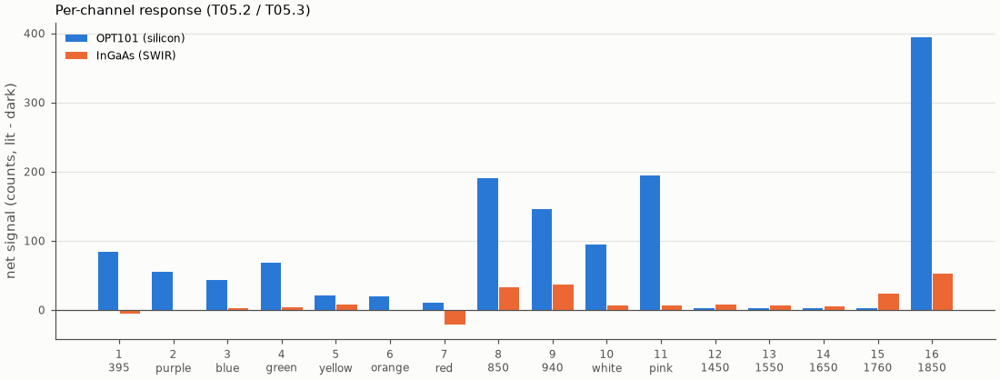
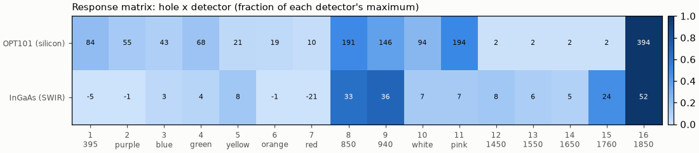
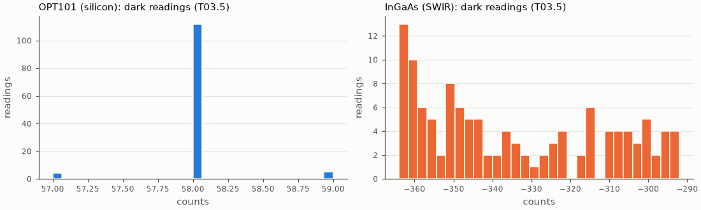
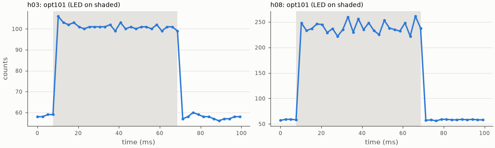
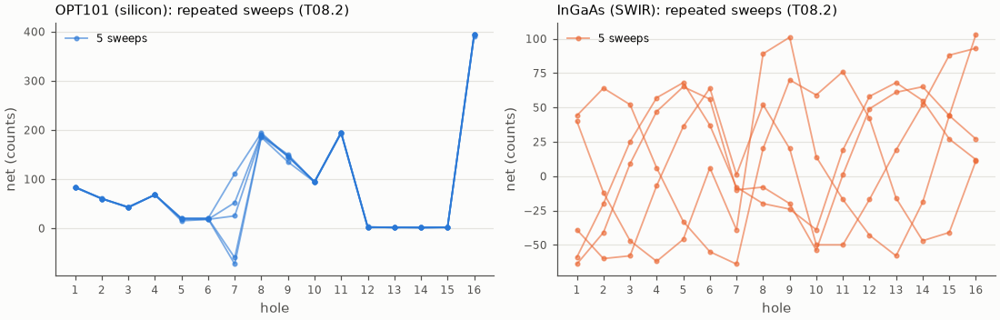

# LIO test report: 20261125-141131_regrade_of_20261125-125629_host

**Verdict: FUNCTIONAL**: warnings: T03.2, T05.1, T05.2, T05.3, T05.5, T06.3, T07.1, T08.2, T13.1

- Target: `/dev/cu.usbmodem101`
- Started 2026-11-25T12:56:29-05:00, finished 2026-11-25T13:23:18-05:00
- Sample: `empty`, operator: unknown
- Firmware 2.5.2 (proto 1, build 2026-11-17)
- Config `/Users/coleloughbc/Documents/VSCode-Local/LIO/software/config/lio_hw.yaml` sha256 ea6c8a3fbe33 (thresholds provisional)
- Host: macOS-27.2.1-x86_64-i386-64bit, Python 3.12.11, lio 0.2.0, git ce9491f230
- Counts: PASS 30, WARN 9, SKIP 6
- LED duty budget: 38.8 s of cool-down waits, 0 over-budget on-time(s)

## Summary

| Test | Name | Status | Note |
|---|---|---|---|
| T01.1 | Python and dependency versions | ✓ PASS |  |
| T01.2 | Serial port discovery | ✓ PASS |  |
| T01.3 | Configuration loads and is self-consistent | ✓ PASS |  |
| T02.1 | Port open and boot banner | ✓ PASS |  |
| T02.2 | PING round-trip latency | ✓ PASS |  |
| T02.3 | INFO fields, versions and safety limits | ✓ PASS |  |
| T02.4 | Robustness to bad input | ✓ PASS |  |
| T02.5 | Sequence numbers and interleaved events | ✓ PASS |  |
| T02.6 | RESET restores the boot state | ✓ PASS |  |
| T03.1 | I2C scan finds the ADS1115 | ✓ PASS |  |
| T03.2 | Dark ADC noise, all inputs | ! WARN |  |
| T03.3 | Gain sweep on dark inputs | ✓ PASS |  |
| T03.4 | ADC data rate | ✓ PASS |  |
| T03.5 | Long-term dark stability | ✓ PASS |  |
| T04.1 | Shift-register patterns with CE low | ✓ PASS |  |
| T04.2 | Shift-register loopback (optional jumper) | - SKIP | loopback jumper not fitted (this build has no loop-back input (pins.LOOP), plan §6.3); the shift registers are verified optically by T05.3 |
| T04.3 | Optical address verification | - SKIP | covered by T05.3 (each hole must light only its own expected response) |
| T05.1 | Rail gating by CE1 / CE2 | ! WARN |  |
| T05.2 | Per-channel response | ! WARN |  |
| T05.3 | Channel address and isolation | ! WARN |  |
| T05.4 | Off-state return after each MEAS | ✓ PASS |  |
| T05.5 | Repeatability (interleaved MEAS) | ! WARN |  |
| T06.1 | OPT101 | ✓ PASS |  |
| T06.2 | InGaAs TIA | ✓ PASS |  |
| T06.3 | Cross-calibration on the shared holes | ! WARN |  |
| T07.1 | Step response and settling time | ! WARN |  |
| T07.2 | Recommended settle time | ✓ PASS |  |
| T07.3 | MEAS timing | ✓ PASS |  |
| T08.1 | SWEEP completes with a valid schema | ✓ PASS |  |
| T08.2 | Repeated sweeps | ! WARN |  |
| T08.3 | Sweep agrees with MEAS | ✓ PASS |  |
| T08.4 | CSV output format | ✓ PASS |  |
| T09.1 | Motion arming | ✓ PASS |  |
| T09.2 | Each motor moves both ways | ✓ PASS |  |
| T09.3 | MOTOR STOP latency | ✓ PASS |  |
| T09.4 | Detector noise while a motor moves | ✓ PASS |  |
| T09.6 | Full travel, both motors in lockstep | - SKIP | the tracked distances to the two marked bottoms differ (M1/right -268388, M2/left -410965 half-steps; counters -18496/-18496). This compares the recorded bottom marks, not a measured tilt: verify level and the marks physically before any single-motor move |
| T09.7 | Detectors while the chamber moves | - SKIP | the tracked distances to the two marked bottoms differ (M1/right -268388, M2/left -410965 half-steps; counters -18496/-18496). This compares the recorded bottom marks, not a measured tilt: verify level and the marks physically before any single-motor move |
| T10.1 | Power-up dark state | ✓ PASS |  |
| T10.2 | On-time watchdog | - SKIP |  |
| T10.3 | Comms-loss failsafe | ✓ PASS |  |
| T10.4 | Single-channel invariant | ✓ PASS |  |
| T10.5 | Motion disarmed after comms loss | ✓ PASS |  |
| T11.1 | Comparison with the baseline | - SKIP | no baseline given (--baseline <file>); save one with --save-baseline |
| T13.1 | Diagnostic height sweep | ! WARN | quick scan COMPLETE: FUNCTIONAL (20261125-130035_scan_quick) |

### Per-channel response

### Response matrix

### Dark noise

### Step responses

### Repeated sweeps

## T01

### T01.1 Python and dependency versions: PASS

| Check | Status | Result | Criterion |
|---|---|---|---|
| Python version | ✓ PASS | 3.12.11 | >= 3.10 |
| pyserial installed | ✓ PASS | 3.5 | importable |
| pyyaml installed | ✓ PASS | 6.0.3 | importable |
| numpy installed | ✓ PASS | 2.5.4 | importable |
| matplotlib installed | ✓ PASS | 3.11.2 | importable |
| jinja2 installed | ✓ PASS | 3.1.6 | importable |

### T01.2 Serial port discovery: PASS

| Check | Status | Result | Criterion |
|---|---|---|---|
| Selected port is present | ✓ PASS | /dev/cu.usbmodem101: present | --lio-port names an existing serial port |
| USB-serial chip recognised | ✓ PASS | VID:PID 2341:0074 (Arduino Nano R4 (native USB)) | one of link.usb_ids |

### T01.3 Configuration loads and is self-consistent: PASS

| Check | Status | Result | Criterion |
|---|---|---|---|
| Config validates | ✓ PASS | lio_hw.yaml sha256 ea6c8a3fbe33 |  |
| 16 holes | ✓ PASS | 16 entries |  |
| Rails split A = 1-8, B = 9-16 (as built) | ✓ PASS | A=[1, 2, 3, 4, 5, 6, 7, 8] B=[9, 10, 11, 12, 13, 14, 15, 16] |  |

## T02

### T02.1 Port open and boot banner: PASS

| Check | Status | Result | Criterion |
|---|---|---|---|
| Boot banner within the timeout | ✓ PASS | 0.08 s | <= 3 s |
| Banner identifies LIO firmware | ✓ PASS | # BOOT name=lio fw=2.5.2 proto=1 build=2026-11-17 adc_ok=1 hw_wdt=0 | name=lio, fw and proto present |

### T02.2 PING round-trip latency: PASS

| Check | Status | Result | Criterion |
|---|---|---|---|
| Every PING answered | ✓ PASS | 100/100 answered | all |
| p99 round trip | ✓ PASS | median 0.87 ms, p99 0.95 ms, max 0.98 ms | p99 < 50 ms |

### T02.3 INFO fields, versions and safety limits: PASS

| Check | Status | Result | Criterion |
|---|---|---|---|
| INFO fields present | ✓ PASS | 21 fields | all protocol-1 INFO fields |
| Firmware compatible with this host package | ✓ PASS | fw 2.5.2 proto 1 | >= 2.0.0, proto 1 |
| settle_ms matches lio_hw.yaml | ✓ PASS | 8 | 8 |
| wdt_a_ms matches lio_hw.yaml | ✓ PASS | 2000 | 2000 |
| wdt_b_ms matches lio_hw.yaml | ✓ PASS | 5000 | 5000 |
| wdt_a_cap_ms matches lio_hw.yaml | ✓ PASS | 5000 | 5000 |
| wdt_b_cap_ms matches lio_hw.yaml | ✓ PASS | 10000 | 10000 |
| comms_ms matches lio_hw.yaml | ✓ PASS | 10000 | 10000 |
| arm_ms matches lio_hw.yaml | ✓ PASS | 60000 | 60000 |
| step_max matches lio_hw.yaml | ✓ PASS | 2048 | 2048 |
| jog_max matches lio_hw.yaml | ✓ PASS | 2048 | 2048 |
| jog_v_max matches lio_hw.yaml | ✓ PASS | 1000 | 1000 |
| jog_acc_max matches lio_hw.yaml | ✓ PASS | 1000 | 1000 |
| wake_ms_max matches lio_hw.yaml | ✓ PASS | 3000 | 3000 |
| ADC address matches lio_hw.yaml | ✓ PASS | 0x48 | 0x48 |
| ADC gain matches lio_hw.yaml | ✓ PASS | 1 | 1 |
| ADC rate matches lio_hw.yaml | ✓ PASS | 128 | 128 |

### T02.4 Robustness to bad input: PASS

| Check | Status | Result | Criterion |
|---|---|---|---|
| Unknown command | ✓ PASS | @148 ERR FROBNICATE code=1 msg=unknown command | ERR code=1 |
| Bad argument | ✓ PASS | refused before write | OwnershipError refuse (no production light bypass) |
| Missing argument | ✓ PASS | refused before write | OwnershipError refuse (no production light bypass) |
| Line over 64 characters | ✓ PASS | ERR ? code=6 msg=line too long | ERR code=6 |
| Garbage bytes, then PING | ✓ PASS | PING OK | PING still answered |

### T02.5 Sequence numbers and interleaved events: PASS

| Check | Status | Result | Criterion |
|---|---|---|---|
| @1 echoed | ✓ PASS | @1 OK PING uptime_ms=186056 | @1 OK PING |
| @4242 echoed | ✓ PASS | @4242 OK PING uptime_ms=186057 | @4242 OK PING |
| @99999 echoed | ✓ PASS | @99999 OK PING uptime_ms=186058 | @99999 OK PING |
| No @seq, none echoed | ✓ PASS | OK PING uptime_ms=186059 | OK PING |
| Response found after interleaved events | ✓ PASS | 20 '# S' events then OK | 20 events |
| Asynchronous '# OFF' does not desynchronise | ✓ PASS | 10/10 PINGs matched; 1 timer event(s) seen | all PINGs answered in order, one '# OFF' |

### T02.6 RESET restores the boot state: PASS

| Check | Status | Result | Criterion |
|---|---|---|---|
| Banner after RESET | ✓ PASS | 0.01 s | <= 3 s |
| STATUS shows the safe state | ✓ PASS | ch=0 ce1=0 ce2=0 mask=0x0000 armed=0 | ch=0 ce1=0 ce2=0 mask=0 armed=0, motors idle |
| Settings back to defaults | ✓ PASS | wdt_a_ms=2000 (was set to 200) | 2000 |

## T03

### T03.1 I2C scan finds the ADS1115: PASS

| Check | Status | Result | Criterion |
|---|---|---|---|
| ADS1115 at 0x48 | ✓ PASS | found ['0x48'] | 0x48 acknowledges |
| I2C lines (SDA, SCL) | ✓ PASS | lines idle high with pull-ups, not bridged; 0x48 answers at 166.666 kHz | both idle high, rise on external pull-ups, not joined |
| No unexpected I2C devices | ✓ PASS | none | only the ADS1115 |

### T03.2 Dark ADC noise, all inputs: WARN

| Check | Status | Result | Criterion |
|---|---|---|---|
| ADS A0 (ingaas) dark noise | ! WARN | mean -328.1, sigma 24.75 counts; raw (non-integrated) noise above the limit [re-graded 2026-11-25 under the current thresholds; was FAIL] | sigma <= 20 counts (WARN up to 50) |
| ADS A1 (opt101) dark noise | ✓ PASS | mean 58.1, sigma 0.35 counts (n=64) | sigma <= 20 counts |
| ADS A2 (unconnected) | ✓ PASS | recorded only: mean 4606.6, sigma 10.36 | floating input |
| ADS A3 (unconnected) | ✓ PASS | recorded only: mean 2816.0, sigma 2.68 | floating input |

### T03.3 Gain sweep on dark inputs: PASS

| Check | Status | Result | Criterion |
|---|---|---|---|
| GAIN 2/3 accepted | ✓ PASS | lsb 0.1875 mV | 0.1875 mV |
| GAIN 1 accepted | ✓ PASS | lsb 0.125 mV | 0.125 mV |
| GAIN 2 accepted | ✓ PASS | lsb 0.0625 mV | 0.0625 mV |
| GAIN 4 accepted | ✓ PASS | lsb 0.03125 mV | 0.03125 mV |
| GAIN 8 accepted | ✓ PASS | lsb 0.015625 mV | 0.015625 mV |
| GAIN 16 accepted | ✓ PASS | lsb 0.0078125 mV | 0.0078125 mV |
| ingaas at GAIN 2/3 agrees with GAIN 1 | ✓ PASS | -41.25 mV vs -41.26 mV | within 14.57 mV |
| ingaas at GAIN 1 agrees with GAIN 1 | ✓ PASS | -41.26 mV vs -41.26 mV | within 14.57 mV |
| ingaas at GAIN 2 agrees with GAIN 1 | ✓ PASS | -41.14 mV vs -41.26 mV | within 14.57 mV |
| ingaas at GAIN 4 agrees with GAIN 1 | ✓ PASS | -41.15 mV vs -41.26 mV | within 14.57 mV |
| ingaas at GAIN 8 agrees with GAIN 1 | ✓ PASS | -40.88 mV vs -41.26 mV | within 14.57 mV |
| ingaas at GAIN 16 agrees with GAIN 1 | ✓ PASS | -40.80 mV vs -41.26 mV | within 14.57 mV |
| GAIN 2/3 accepted | ✓ PASS | lsb 0.1875 mV | 0.1875 mV |
| GAIN 1 accepted | ✓ PASS | lsb 0.125 mV | 0.125 mV |
| GAIN 2 accepted | ✓ PASS | lsb 0.0625 mV | 0.0625 mV |
| GAIN 4 accepted | ✓ PASS | lsb 0.03125 mV | 0.03125 mV |
| GAIN 8 accepted | ✓ PASS | lsb 0.015625 mV | 0.015625 mV |
| GAIN 16 accepted | ✓ PASS | lsb 0.0078125 mV | 0.0078125 mV |
| opt101 at GAIN 2/3 agrees with GAIN 1 | ✓ PASS | 7.43 mV vs 7.24 mV | within 5.28 mV |
| opt101 at GAIN 1 agrees with GAIN 1 | ✓ PASS | 7.24 mV vs 7.24 mV | within 5.09 mV |
| opt101 at GAIN 2 agrees with GAIN 1 | ✓ PASS | 7.25 mV vs 7.24 mV | within 5.09 mV |
| opt101 at GAIN 4 agrees with GAIN 1 | ✓ PASS | 6.96 mV vs 7.24 mV | within 5.09 mV |
| opt101 at GAIN 8 agrees with GAIN 1 | ✓ PASS | 7.64 mV vs 7.24 mV | within 5.09 mV |
| opt101 at GAIN 16 agrees with GAIN 1 | ✓ PASS | 7.64 mV vs 7.24 mV | within 5.09 mV |

### T03.4 ADC data rate: PASS

| Check | Status | Result | Criterion |
|---|---|---|---|
| 8 SPS conversion interval | ✓ PASS | 120.748 ms (nominal 125.000 ms, overhead -4.252 ms) | 106.250-145.250 ms |
| 16 SPS conversion interval | ✓ PASS | 61.186 ms (nominal 62.500 ms, overhead -1.314 ms) | 53.125-73.375 ms |
| 32 SPS conversion interval | ✓ PASS | 31.242 ms (nominal 31.250 ms, overhead -0.008 ms) | 26.562-37.438 ms |
| 64 SPS conversion interval | ✓ PASS | 16.433 ms (nominal 15.625 ms, overhead +0.808 ms) | 13.281-19.469 ms |
| 128 SPS conversion interval | ✓ PASS | 8.863 ms (nominal 7.812 ms, overhead +1.050 ms) | 6.641-10.484 ms |
| 250 SPS conversion interval | ✓ PASS | 5.288 ms (nominal 4.000 ms, overhead +1.288 ms) | 3.400-6.100 ms |
| 475 SPS conversion interval | ✓ PASS | 3.342 ms (nominal 2.105 ms, overhead +1.237 ms) | 1.789-3.921 ms |
| 860 SPS conversion interval | ✓ PASS | 2.537 ms (nominal 1.163 ms, overhead +1.374 ms) | 0.988-2.837 ms |

### T03.5 Long-term dark stability: PASS

| Check | Status | Result | Criterion |
|---|---|---|---|
| ingaas drift over 60 s | ✓ PASS | +6.8 counts/min (0.021 % FS/min), sigma 23.21 | <= 2 % FS/min |
| opt101 drift over 60 s | ✓ PASS | -0.0 counts/min (0.000 % FS/min), sigma 0.27 | <= 2 % FS/min |

## T04

### T04.1 Shift-register patterns with CE low: PASS

| Check | Status | Result | Criterion |
|---|---|---|---|
| SR RAW 0x0000 | ✓ PASS | echoed, CE low, detectors dark | mask echoed in reply and STATUS; CE1 = CE2 = 0; detectors at dark |
| SR RAW 0xFFFF | ✓ PASS | echoed, CE low, detectors dark | mask echoed in reply and STATUS; CE1 = CE2 = 0; detectors at dark |
| SR RAW 0x0001 | ✓ PASS | echoed, CE low, detectors dark | mask echoed in reply and STATUS; CE1 = CE2 = 0; detectors at dark |
| SR RAW 0x0002 | ✓ PASS | echoed, CE low, detectors dark | mask echoed in reply and STATUS; CE1 = CE2 = 0; detectors at dark |
| SR RAW 0x0004 | ✓ PASS | echoed, CE low, detectors dark | mask echoed in reply and STATUS; CE1 = CE2 = 0; detectors at dark |
| SR RAW 0x0008 | ✓ PASS | echoed, CE low, detectors dark | mask echoed in reply and STATUS; CE1 = CE2 = 0; detectors at dark |
| SR RAW 0x0010 | ✓ PASS | echoed, CE low, detectors dark | mask echoed in reply and STATUS; CE1 = CE2 = 0; detectors at dark |
| SR RAW 0x0020 | ✓ PASS | echoed, CE low, detectors dark | mask echoed in reply and STATUS; CE1 = CE2 = 0; detectors at dark |
| SR RAW 0x0040 | ✓ PASS | echoed, CE low, detectors dark | mask echoed in reply and STATUS; CE1 = CE2 = 0; detectors at dark |
| SR RAW 0x0080 | ✓ PASS | echoed, CE low, detectors dark | mask echoed in reply and STATUS; CE1 = CE2 = 0; detectors at dark |
| SR RAW 0x0100 | ✓ PASS | echoed, CE low, detectors dark | mask echoed in reply and STATUS; CE1 = CE2 = 0; detectors at dark |
| SR RAW 0x0200 | ✓ PASS | echoed, CE low, detectors dark | mask echoed in reply and STATUS; CE1 = CE2 = 0; detectors at dark |
| SR RAW 0x0400 | ✓ PASS | echoed, CE low, detectors dark | mask echoed in reply and STATUS; CE1 = CE2 = 0; detectors at dark |
| SR RAW 0x0800 | ✓ PASS | echoed, CE low, detectors dark | mask echoed in reply and STATUS; CE1 = CE2 = 0; detectors at dark |
| SR RAW 0x1000 | ✓ PASS | echoed, CE low, detectors dark | mask echoed in reply and STATUS; CE1 = CE2 = 0; detectors at dark |
| SR RAW 0x2000 | ✓ PASS | echoed, CE low, detectors dark | mask echoed in reply and STATUS; CE1 = CE2 = 0; detectors at dark |
| SR RAW 0x4000 | ✓ PASS | echoed, CE low, detectors dark | mask echoed in reply and STATUS; CE1 = CE2 = 0; detectors at dark |
| SR RAW 0x8000 | ✓ PASS | echoed, CE low, detectors dark | mask echoed in reply and STATUS; CE1 = CE2 = 0; detectors at dark |
| SR RAW 0xFFFE | ✓ PASS | echoed, CE low, detectors dark | mask echoed in reply and STATUS; CE1 = CE2 = 0; detectors at dark |
| SR RAW 0xFFFD | ✓ PASS | echoed, CE low, detectors dark | mask echoed in reply and STATUS; CE1 = CE2 = 0; detectors at dark |
| SR RAW 0xFFFB | ✓ PASS | echoed, CE low, detectors dark | mask echoed in reply and STATUS; CE1 = CE2 = 0; detectors at dark |
| SR RAW 0xFFF7 | ✓ PASS | echoed, CE low, detectors dark | mask echoed in reply and STATUS; CE1 = CE2 = 0; detectors at dark |
| SR RAW 0xFFEF | ✓ PASS | echoed, CE low, detectors dark | mask echoed in reply and STATUS; CE1 = CE2 = 0; detectors at dark |
| SR RAW 0xFFDF | ✓ PASS | echoed, CE low, detectors dark | mask echoed in reply and STATUS; CE1 = CE2 = 0; detectors at dark |
| SR RAW 0xFFBF | ✓ PASS | echoed, CE low, detectors dark | mask echoed in reply and STATUS; CE1 = CE2 = 0; detectors at dark |
| SR RAW 0xFF7F | ✓ PASS | echoed, CE low, detectors dark | mask echoed in reply and STATUS; CE1 = CE2 = 0; detectors at dark |
| SR RAW 0xFEFF | ✓ PASS | echoed, CE low, detectors dark | mask echoed in reply and STATUS; CE1 = CE2 = 0; detectors at dark |
| SR RAW 0xFDFF | ✓ PASS | echoed, CE low, detectors dark | mask echoed in reply and STATUS; CE1 = CE2 = 0; detectors at dark |
| SR RAW 0xFBFF | ✓ PASS | echoed, CE low, detectors dark | mask echoed in reply and STATUS; CE1 = CE2 = 0; detectors at dark |
| SR RAW 0xF7FF | ✓ PASS | echoed, CE low, detectors dark | mask echoed in reply and STATUS; CE1 = CE2 = 0; detectors at dark |
| SR RAW 0xEFFF | ✓ PASS | echoed, CE low, detectors dark | mask echoed in reply and STATUS; CE1 = CE2 = 0; detectors at dark |
| SR RAW 0xDFFF | ✓ PASS | echoed, CE low, detectors dark | mask echoed in reply and STATUS; CE1 = CE2 = 0; detectors at dark |
| SR RAW 0xBFFF | ✓ PASS | echoed, CE low, detectors dark | mask echoed in reply and STATUS; CE1 = CE2 = 0; detectors at dark |
| SR RAW 0x7FFF | ✓ PASS | echoed, CE low, detectors dark | mask echoed in reply and STATUS; CE1 = CE2 = 0; detectors at dark |

### T04.2 Shift-register loopback (optional jumper): SKIP

loopback jumper not fitted (this build has no loop-back input (pins.LOOP), plan §6.3); the shift registers are verified optically by T05.3

### T04.3 Optical address verification: SKIP

covered by T05.3 (each hole must light only its own expected response)

## T05

### T05.1 Rail gating by CE1 / CE2: WARN

| Check | Status | Result | Criterion |
|---|---|---|---|
| Hole 12 selected, CE2 high | ! WARN | ingaas -316; no light: RAIL B driver, CE2 or the LED is dead — superseded: RAIL B gating is now judged on hole 11 with the OPT101 (an empty chamber returns too little light to hole 12 for the InGaAs to resolve); not re-measured here [re-graded 2026-11-25 under the current thresholds; was FAIL] | light above the detection threshold |
| Hole 8 selected, CE1 low | ✓ PASS | opt101 58 (dark 58) | dark |
| Hole 8 selected, CE1 high | ✓ PASS | opt101 227 | light above the detection threshold |
| Hole 8 with CE2 (wrong rail) | ✓ PASS | ERR code=3 needs exactly one selected hole on this rail | refused (code 3) |
| Hole 12 selected, CE2 low | ✓ PASS | ingaas -328 (dark -328) | dark |
| Hole 12 with CE1 (wrong rail) | ✓ PASS | ERR code=3 needs exactly one selected hole on this rail | refused (code 3) |

### T05.2 Per-channel response: WARN

| Check | Status | Result | Criterion |
|---|---|---|---|
| Hole 7 (red) on opt101 | ! WARN | net +10 (weak); weaker than expected | expect signal: signal >= 15 |
| Hole 8 (850) on ingaas | ! WARN | net +33 (none); not resolved by this reading: detection limit 53 counts (noise sigma 17.5); the integrated height scan (T13.1) and the baseline judge this channel [re-graded 2026-11-25 under the current thresholds; was FAIL] | expect signal: signal >= 175 |
| Hole 9 (940) on ingaas | ! WARN | net +36 (none); not resolved by this reading: detection limit 53 counts (noise sigma 17.5); the integrated height scan (T13.1) and the baseline judge this channel [re-graded 2026-11-25 under the current thresholds; was FAIL] | expect signal: signal >= 175 |
| Hole 12 (1450) on ingaas | ! WARN | net +8 (none); not resolved by this reading: detection limit 53 counts (noise sigma 17.5); the integrated height scan (T13.1) and the baseline judge this channel [re-graded 2026-11-25 under the current thresholds; was FAIL] | expect signal: signal >= 175 |
| Hole 13 (1550) on ingaas | ! WARN | net +6 (none); weak channel below the weak threshold [re-graded 2026-11-25 under the current thresholds; was FAIL] | expect weak: >= 53 |
| Hole 14 (1650) on ingaas | ! WARN | net +5 (none); weak channel below the weak threshold [re-graded 2026-11-25 under the current thresholds; was FAIL] | expect weak: >= 53 |
| Hole 15 (1760) on ingaas | ! WARN | net +24 (none); weak channel below the weak threshold | expect weak: signal >= 175 |
| Hole 1 (395) on opt101 | ✓ PASS | net +84 (signal); signal as expected | expect signal: signal >= 15 |
| Hole 2 (purple) on opt101 | ✓ PASS | net +55 (signal); signal as expected | expect signal: signal >= 15 |
| Hole 3 (blue) on opt101 | ✓ PASS | net +43 (signal); signal as expected | expect signal: signal >= 15 |
| Hole 4 (green) on opt101 | ✓ PASS | net +68 (signal); signal as expected | expect signal: signal >= 15 |
| Hole 5 (yellow) on opt101 | ✓ PASS | net +21 (signal); signal as expected | expect signal: signal >= 15 |
| Hole 6 (orange) on opt101 | ✓ PASS | net +19 (signal); signal as expected | expect signal: signal >= 15 |
| Hole 8 (850) on opt101 | ✓ PASS | net +191 (signal); signal as expected | expect signal: signal >= 15 |
| Hole 9 (940) on opt101 | ✓ PASS | net +146 (signal); signal as expected | expect signal: signal >= 15 |
| Hole 10 (white) on opt101 | ✓ PASS | net +94 (signal); signal as expected | expect signal: signal >= 15 |
| Hole 11 (pink) on opt101 | ✓ PASS | net +194 (signal); signal as expected | expect signal: signal >= 15 |
| Hole 1 (395) on ingaas | - SKIP | not judged: 395 is outside the ingaas range (judged by opt101); recorded net -5 | out-of-range readings are not judged (channel.judge_out_of_range: false) |
| Hole 2 (purple) on ingaas | - SKIP | not judged: purple is outside the ingaas range (judged by opt101); recorded net -1 | out-of-range readings are not judged (channel.judge_out_of_range: false) |
| Hole 3 (blue) on ingaas | - SKIP | not judged: blue is outside the ingaas range (judged by opt101); recorded net +3 | out-of-range readings are not judged (channel.judge_out_of_range: false) |
| Hole 4 (green) on ingaas | - SKIP | not judged: green is outside the ingaas range (judged by opt101); recorded net +4 | out-of-range readings are not judged (channel.judge_out_of_range: false) |
| Hole 5 (yellow) on ingaas | - SKIP | not judged: yellow is outside the ingaas range (judged by opt101); recorded net +8 | out-of-range readings are not judged (channel.judge_out_of_range: false) |
| Hole 6 (orange) on ingaas | - SKIP | not judged: orange is outside the ingaas range (judged by opt101); recorded net -1 | out-of-range readings are not judged (channel.judge_out_of_range: false) |
| Hole 7 (red) on ingaas | - SKIP | not judged: red is outside the ingaas range (judged by opt101); recorded net -21 | out-of-range readings are not judged (channel.judge_out_of_range: false) |
| Hole 10 (white) on ingaas | - SKIP | not judged: white is outside the ingaas range (judged by opt101); recorded net +7 | out-of-range readings are not judged (channel.judge_out_of_range: false) |
| Hole 11 (pink) on ingaas | - SKIP | not judged: pink is outside the ingaas range (judged by opt101); recorded net +7 | out-of-range readings are not judged (channel.judge_out_of_range: false) |
| Hole 12 (1450) on opt101 | - SKIP | not judged: 1450 is outside the opt101 range (judged by ingaas); recorded net +2 | out-of-range readings are not judged (channel.judge_out_of_range: false) |
| Hole 13 (1550) on opt101 | - SKIP | not judged: 1550 is outside the opt101 range (judged by ingaas); recorded net +2 | out-of-range readings are not judged (channel.judge_out_of_range: false) |
| Hole 14 (1650) on opt101 | - SKIP | not judged: 1650 is outside the opt101 range (judged by ingaas); recorded net +2 | out-of-range readings are not judged (channel.judge_out_of_range: false) |
| Hole 15 (1760) on opt101 | - SKIP | not judged: 1760 is outside the opt101 range (judged by ingaas); recorded net +2 | out-of-range readings are not judged (channel.judge_out_of_range: false) |
| Hole 16 (1850) on ingaas | - SKIP | not judged: 1850 is outside the ingaas range (judged by no detector); recorded net +52 | out-of-range readings are not judged (channel.judge_out_of_range: false) |
| Hole 16 (1850) on opt101 | - SKIP | not judged: 1850 is outside the opt101 range (judged by no detector); recorded net +394 | out-of-range readings are not judged (channel.judge_out_of_range: false) |

### T05.3 Channel address and isolation: WARN

| Check | Status | Result | Criterion |
|---|---|---|---|
| Hole 8 (850) detector pattern | ! WARN | seen by ['opt101'] as expected; ['ingaas'] not resolved by this reading (detection limit above the channel's level; T13.1 judges it) [re-graded 2026-11-25 under the current thresholds; was FAIL] | expected ['ingaas', 'opt101'] |
| Hole 9 (940) detector pattern | ! WARN | seen by ['opt101'] as expected; ['ingaas'] not resolved by this reading (detection limit above the channel's level; T13.1 judges it) [re-graded 2026-11-25 under the current thresholds; was FAIL] | expected ['ingaas', 'opt101'] |
| Hole 12 (1450) detector pattern | ! WARN | seen by nothing as expected (opt101 not judged: outside its range); ['ingaas'] not resolved by this reading (detection limit above the channel's level; T13.1 judges it) [re-graded 2026-11-25 under the current thresholds; was FAIL] | expected ['ingaas'] |
| Hole 13 (1550) detector pattern | ! WARN | seen by nothing as expected (opt101 not judged: outside its range); ['ingaas'] not resolved by this reading (detection limit above the channel's level; T13.1 judges it) [re-graded 2026-11-25 under the current thresholds; was FAIL] | expected ['ingaas'] |
| Hole 14 (1650) detector pattern | ! WARN | seen by nothing as expected (opt101 not judged: outside its range); ['ingaas'] not resolved by this reading (detection limit above the channel's level; T13.1 judges it) [re-graded 2026-11-25 under the current thresholds; was FAIL] | expected ['ingaas'] |
| Hole 15 (1760) detector pattern | ! WARN | no response on ['ingaas']: possible swapped, misrouted or stuck-on channel | expected ['ingaas'] |
| Hole 8 signature unique | ! WARN | holes [8, 11] give the same response within 1 %: one emitter lit for all of them (stuck-on MOSFET, or gate wiring); a pair can also match by coincidence: confirm with the T04.4 walk test | distinct per hole |
| Hole 11 signature unique | ! WARN | holes [8, 11] give the same response within 1 %: one emitter lit for all of them (stuck-on MOSFET, or gate wiring); a pair can also match by coincidence: confirm with the T04.4 walk test | distinct per hole |
| Hole 1 (395) detector pattern | ✓ PASS | seen by ['opt101'] as expected (ingaas not judged: outside its range) | expected ['opt101'] |
| Hole 2 (purple) detector pattern | ✓ PASS | seen by ['opt101'] as expected (ingaas not judged: outside its range) | expected ['opt101'] |
| Hole 3 (blue) detector pattern | ✓ PASS | seen by ['opt101'] as expected (ingaas not judged: outside its range) | expected ['opt101'] |
| Hole 4 (green) detector pattern | ✓ PASS | seen by ['opt101'] as expected (ingaas not judged: outside its range) | expected ['opt101'] |
| Hole 5 (yellow) detector pattern | ✓ PASS | seen by ['opt101'] as expected (ingaas not judged: outside its range) | expected ['opt101'] |
| Hole 6 (orange) detector pattern | ✓ PASS | seen by ['opt101'] as expected (ingaas not judged: outside its range) | expected ['opt101'] |
| Hole 7 (red) detector pattern | ✓ PASS | seen by ['opt101'] as expected (ingaas not judged: outside its range) | expected ['opt101'] |
| Hole 10 (white) detector pattern | ✓ PASS | seen by ['opt101'] as expected (ingaas not judged: outside its range) | expected ['opt101'] |
| Hole 11 (pink) detector pattern | ✓ PASS | seen by ['opt101'] as expected (ingaas not judged: outside its range) | expected ['opt101'] |
| Hole 16 (1850) detector pattern | ✓ PASS | seen by nothing as expected (ingaas, opt101 not judged: outside its range) | expected none |

### T05.4 Off-state return after each MEAS: PASS

| Check | Status | Result | Criterion |
|---|---|---|---|
| Hole 1 ingaas back to dark | ✓ PASS | -329.8 after OFF vs dark -326 | within 5 sigma (87.5 counts) |
| Hole 1 opt101 back to dark | ✓ PASS | 58.0 after OFF vs dark 58 | within 5 sigma (3.5 counts) |
| Hole 2 ingaas back to dark | ✓ PASS | -328.0 after OFF vs dark -328 | within 5 sigma (87.5 counts) |
| Hole 2 opt101 back to dark | ✓ PASS | 58.0 after OFF vs dark 58 | within 5 sigma (3.5 counts) |
| Hole 3 ingaas back to dark | ✓ PASS | -330.2 after OFF vs dark -331 | within 5 sigma (87.5 counts) |
| Hole 3 opt101 back to dark | ✓ PASS | 58.0 after OFF vs dark 58 | within 5 sigma (3.5 counts) |
| Hole 4 ingaas back to dark | ✓ PASS | -325.5 after OFF vs dark -331 | within 5 sigma (87.5 counts) |
| Hole 4 opt101 back to dark | ✓ PASS | 58.0 after OFF vs dark 58 | within 5 sigma (3.5 counts) |
| Hole 5 ingaas back to dark | ✓ PASS | -328.2 after OFF vs dark -330 | within 5 sigma (87.5 counts) |
| Hole 5 opt101 back to dark | ✓ PASS | 58.5 after OFF vs dark 58 | within 5 sigma (3.5 counts) |
| Hole 6 ingaas back to dark | ✓ PASS | -326.2 after OFF vs dark -326 | within 5 sigma (87.5 counts) |
| Hole 6 opt101 back to dark | ✓ PASS | 58.2 after OFF vs dark 58 | within 5 sigma (3.5 counts) |
| Hole 7 ingaas back to dark | ✓ PASS | -331.0 after OFF vs dark -332 | within 5 sigma (87.5 counts) |
| Hole 7 opt101 back to dark | ✓ PASS | 58.0 after OFF vs dark 58 | within 5 sigma (3.5 counts) |
| Hole 8 ingaas back to dark | ✓ PASS | -327.5 after OFF vs dark -328 | within 5 sigma (87.5 counts) |
| Hole 8 opt101 back to dark | ✓ PASS | 58.0 after OFF vs dark 58 | within 5 sigma (3.5 counts) |
| Hole 9 ingaas back to dark | ✓ PASS | -325.0 after OFF vs dark -325 | within 5 sigma (87.5 counts) |
| Hole 9 opt101 back to dark | ✓ PASS | 58.2 after OFF vs dark 58 | within 5 sigma (3.5 counts) |
| Hole 10 ingaas back to dark | ✓ PASS | -330.5 after OFF vs dark -331 | within 5 sigma (87.5 counts) |
| Hole 10 opt101 back to dark | ✓ PASS | 58.0 after OFF vs dark 58 | within 5 sigma (3.5 counts) |
| Hole 11 ingaas back to dark | ✓ PASS | -331.0 after OFF vs dark -326 | within 5 sigma (87.5 counts) |
| Hole 11 opt101 back to dark | ✓ PASS | 58.2 after OFF vs dark 58 | within 5 sigma (3.5 counts) |
| Hole 12 ingaas back to dark | ✓ PASS | -326.5 after OFF vs dark -325 | within 5 sigma (87.5 counts) |
| Hole 12 opt101 back to dark | ✓ PASS | 58.0 after OFF vs dark 58 | within 5 sigma (3.5 counts) |
| Hole 13 ingaas back to dark | ✓ PASS | -331.2 after OFF vs dark -330 | within 5 sigma (87.5 counts) |
| Hole 13 opt101 back to dark | ✓ PASS | 58.0 after OFF vs dark 58 | within 5 sigma (3.5 counts) |
| Hole 14 ingaas back to dark | ✓ PASS | -328.5 after OFF vs dark -327 | within 5 sigma (87.5 counts) |
| Hole 14 opt101 back to dark | ✓ PASS | 58.0 after OFF vs dark 58 | within 5 sigma (3.5 counts) |
| Hole 15 ingaas back to dark | ✓ PASS | -327.2 after OFF vs dark -329 | within 5 sigma (87.5 counts) |
| Hole 15 opt101 back to dark | ✓ PASS | 58.0 after OFF vs dark 58 | within 5 sigma (3.5 counts) |
| Hole 16 ingaas back to dark | ✓ PASS | -331.2 after OFF vs dark -331 | within 5 sigma (87.5 counts) |
| Hole 16 opt101 back to dark | ✓ PASS | 58.0 after OFF vs dark 58 | within 5 sigma (3.5 counts) |

### T05.5 Repeatability (interleaved MEAS): WARN

| Check | Status | Result | Criterion |
|---|---|---|---|
| Hole 7 opt101 repeatability, N=10 | ! WARN | mean +15.3 (95% -11.9..+42.5), SD 38.00, n 10/10; no CV (mean not resolved above zero); SD 38.00 > 5.00 counts [re-graded 2026-11-25 under the current thresholds; was FAIL] | SD <= 5 counts, every record present |
| Hole 1 opt101 repeatability, N=10 | ✓ PASS | mean +83.9 (95% +83.7..+84.1), SD 0.32, n 10/10; CV 0.4 %; SD 0.32 <= 5.00 counts | SD <= 5 counts, every record present |
| Hole 2 opt101 repeatability, N=10 | ✓ PASS | mean +55.2 (95% +54.9..+55.5), SD 0.42, n 10/10; CV 0.8 %; SD 0.42 <= 5.00 counts | SD <= 5 counts, every record present |
| Hole 3 opt101 repeatability, N=10 | ✓ PASS | mean +43.0 (95% +43.0..+43.0), SD 0.00, n 10/10; CV 0.0 %; SD 0.00 <= 5.00 counts | SD <= 5 counts, every record present |
| Hole 4 opt101 repeatability, N=10 | ✓ PASS | mean +67.9 (95% +67.7..+68.1), SD 0.32, n 10/10; CV 0.5 %; SD 0.32 <= 5.00 counts | SD <= 5 counts, every record present |
| Hole 5 opt101 repeatability, N=10 | ✓ PASS | mean +19.8 (95% +18.8..+20.8), SD 1.40, n 10/10; no CV (mean below 20 counts: CV not meaningful); SD 1.40 <= 5.00 counts | SD <= 5 counts, every record present |
| Hole 6 opt101 repeatability, N=10 | ✓ PASS | mean +19.3 (95% +19.0..+19.6), SD 0.48, n 10/10; no CV (mean below 20 counts: CV not meaningful); SD 0.48 <= 5.00 counts | SD <= 5 counts, every record present |
| Hole 8 opt101 repeatability, N=10 | ✓ PASS | mean +193.0 (95% +191.6..+194.4), SD 1.94, n 10/10; CV 1.0 %; SD 1.94 <= 5.00 counts | SD <= 5 counts, every record present |
| Hole 8 ingaas repeatability, N=10 | ✓ PASS | mean +31.0 (95% +27.4..+34.6), SD 5.08, n 10/10; CV 16.4 %; SD 5.08 <= 105.01 counts | SD <= 5 counts, every record present |
| Hole 9 opt101 repeatability, N=10 | ✓ PASS | mean +150.4 (95% +149.9..+150.9), SD 0.70, n 10/10; CV 0.5 %; SD 0.70 <= 5.00 counts | SD <= 5 counts, every record present |
| Hole 9 ingaas repeatability, N=10 | ✓ PASS | mean +43.3 (95% +40.9..+45.7), SD 3.37, n 10/10; CV 7.8 %; SD 3.37 <= 105.01 counts | SD <= 5 counts, every record present |
| Hole 10 opt101 repeatability, N=10 | ✓ PASS | mean +93.9 (95% +93.7..+94.1), SD 0.32, n 10/10; CV 0.3 %; SD 0.32 <= 5.00 counts | SD <= 5 counts, every record present |
| Hole 11 opt101 repeatability, N=10 | ✓ PASS | mean +193.9 (95% +193.5..+194.3), SD 0.57, n 10/10; CV 0.3 %; SD 0.57 <= 5.00 counts | SD <= 5 counts, every record present |
| Hole 12 ingaas repeatability, N=10 | ✓ PASS | mean +16.9 (95% +14.8..+19.0), SD 2.96, n 10/10; no CV (mean below 20 counts: CV not meaningful); SD 2.96 <= 105.01 counts | SD <= 5 counts, every record present |
| Hole 13 ingaas repeatability, N=10 | ✓ PASS | mean +2.2 (95% -0.8..+5.2), SD 4.18, n 10/10; no CV (mean not resolved above zero); SD 4.18 <= 105.01 counts | SD <= 5 counts, every record present |
| Hole 14 ingaas repeatability, N=10 | ✓ PASS | mean +2.5 (95% +0.2..+4.8), SD 3.21, n 10/10; no CV (mean below 20 counts: CV not meaningful); SD 3.21 <= 105.01 counts | SD <= 5 counts, every record present |
| Hole 15 ingaas repeatability, N=10 | ✓ PASS | mean +21.9 (95% +19.8..+24.0), SD 2.96, n 10/10; CV 13.5 %; SD 2.96 <= 105.01 counts | SD <= 5 counts, every record present |

## T06

### T06.1 OPT101: PASS

| Check | Status | Result | Criterion |
|---|---|---|---|
| opt101 dark offset | ✓ PASS | 58.1 counts | 0 to 800 counts |
| Responds to hole 1 (395) | ✓ PASS | net +84 | no zeros where light is expected |
| Responds to hole 2 (purple) | ✓ PASS | net +55 | no zeros where light is expected |
| Responds to hole 3 (blue) | ✓ PASS | net +43 | no zeros where light is expected |
| Responds to hole 4 (green) | ✓ PASS | net +68 | no zeros where light is expected |
| Responds to hole 5 (yellow) | ✓ PASS | net +21 | no zeros where light is expected |
| Responds to hole 6 (orange) | ✓ PASS | net +19 | no zeros where light is expected |
| Responds to hole 7 (red) | ✓ PASS | net +10 | no zeros where light is expected |
| Responds to hole 10 (white) | ✓ PASS | net +94 | no zeros where light is expected |
| Responds to hole 11 (pink) | ✓ PASS | net +194 | no zeros where light is expected |
| Not saturated | ✓ PASS | peak 452 | < 29000 counts |

### T06.2 InGaAs TIA: PASS

| Check | Status | Result | Criterion |
|---|---|---|---|
| Dark signal steady | ✓ PASS | dark mean -328, sigma 24.8 | sigma <= 100 and mean >= -1500 |
| ingaas dark offset | ✓ PASS | -328.1 counts | -400 to 2000 counts |
| Polarity gate (hole 8) | ✓ PASS | net +34 | net >= -5 sigma |
| Hole 9 InGaAs polarity | ✓ PASS | net +36 | net not negative |
| Hole 12 InGaAs polarity | ✓ PASS | net +8 | net not negative |
| Hole 13 InGaAs polarity | ✓ PASS | net +6 | net not negative |
| Hole 14 InGaAs polarity | ✓ PASS | net +5 | net not negative |
| InGaAs not saturated | ✓ PASS | no hole saturates | < 27000 counts |

### T06.3 Cross-calibration on the shared holes: WARN

| Check | Status | Result | Criterion |
|---|---|---|---|
| Hole 8 seen by both detectors | ! WARN | ['ingaas'] not resolved by this reading (detection limit above the channel's level; T13.1 judges it) [re-graded 2026-11-25 under the current thresholds; was FAIL] | both above the detection threshold |
| Hole 9 seen by both detectors | ! WARN | ['ingaas'] not resolved by this reading (detection limit above the channel's level; T13.1 judges it) [re-graded 2026-11-25 under the current thresholds; was FAIL] | both above the detection threshold |

## T07

### T07.1 Step response and settling time: WARN

| Check | Status | Result | Criterion |
|---|---|---|---|
| Hole 13 step response | ! WARN | no step on ingaas (baseline -341, plateau -334) | a step above the detection threshold |
| Hole 3 (opt101) step response | ✓ PASS | settled within one sample: t99 <= 1.29 ms (upper bound, limited by the sample interval) | time to 99 % recorded |
| Hole 8 (opt101) step response | ✓ PASS | settled within one sample: t99 <= 1.30 ms (upper bound, limited by the sample interval) | time to 99 % recorded |

### T07.2 Recommended settle time: PASS

| Check | Status | Result | Criterion |
|---|---|---|---|
| Configured settle_ms is long enough | ✓ PASS | recommended 2 ms (max 1.30 ms x 1.5), configured 8 ms | recommended <= 8 ms |

### T07.3 MEAS timing: PASS

| Check | Status | Result | Criterion |
|---|---|---|---|
| MEAS 3 8 1 on-time | ✓ PASS | t_on_ms 25 | 21.3-32.0 ms and <= watchdog 2000 ms |
| MEAS 3 20 4 on-time | ✓ PASS | t_on_ms 90 | 73.1-106.9 ms and <= watchdog 2000 ms |

## T08

### T08.1 SWEEP completes with a valid schema: PASS

| Check | Status | Result | Criterion |
|---|---|---|---|
| 16 records, holes 1-16 in order | ✓ PASS | 16 records: [1, 2, 3, 4, 5, 6, 7, 8, 9, 10, 11, 12, 13, 14, 15, 16] | holes 1..16 |
| Sweep records parse | ✓ PASS | all '# M' fields present and integer |  |
| Sweep duration | ✓ PASS | 833 ms (host 3273 ms) | <= 2.5 s |

### T08.2 Repeated sweeps: WARN

| Check | Status | Result | Criterion |
|---|---|---|---|
| Hole 7 opt101 SWEEP net repeatability over 5 sweeps | ! WARN | mean +11.0, SD 77.42, range -73..+111; SD 77.42 > 5.00 counts (SWEEP mode, not MEAS) [re-graded 2026-11-25 under the current thresholds; was FAIL] | SD <= 5 counts, a record in every sweep |
| Hole 9 opt101 SWEEP net repeatability over 5 sweeps | ! WARN | mean +144.8, SD 5.76, range +135..+150; SD 5.76 > 5.00 counts and CV > 2 % (SWEEP mode, not MEAS) [re-graded 2026-11-25 under the current thresholds; was FAIL] | SD <= 5 counts, a record in every sweep |
| Hole 1 opt101 SWEEP net repeatability over 5 sweeps | ✓ PASS | mean +83.4, SD 0.55, range +83..+84; SD 0.55 <= 5.00 counts (SWEEP mode, not MEAS) | SD <= 5 counts, a record in every sweep |
| Hole 2 opt101 SWEEP net repeatability over 5 sweeps | ✓ PASS | mean +60.2, SD 0.45, range +60..+61; SD 0.45 <= 5.00 counts (SWEEP mode, not MEAS) | SD <= 5 counts, a record in every sweep |
| Hole 3 opt101 SWEEP net repeatability over 5 sweeps | ✓ PASS | mean +42.6, SD 0.55, range +42..+43; SD 0.55 <= 5.00 counts (SWEEP mode, not MEAS) | SD <= 5 counts, a record in every sweep |
| Hole 4 opt101 SWEEP net repeatability over 5 sweeps | ✓ PASS | mean +68.0, SD 0.00, range +68..+68; SD 0.00 <= 5.00 counts (SWEEP mode, not MEAS) | SD <= 5 counts, a record in every sweep |
| Hole 5 opt101 SWEEP net repeatability over 5 sweeps | ✓ PASS | mean +18.4, SD 2.07, range +15..+20; SD 2.07 <= 5.00 counts (SWEEP mode, not MEAS) | SD <= 5 counts, a record in every sweep |
| Hole 6 opt101 SWEEP net repeatability over 5 sweeps | ✓ PASS | mean +19.0, SD 1.00, range +18..+20; SD 1.00 <= 5.00 counts (SWEEP mode, not MEAS) | SD <= 5 counts, a record in every sweep |
| Hole 8 opt101 SWEEP net repeatability over 5 sweeps | ✓ PASS | mean +189.0, SD 3.54, range +185..+194; SD 3.54 <= 5.00 counts (SWEEP mode, not MEAS) | SD <= 5 counts, a record in every sweep |
| Hole 8 ingaas SWEEP net repeatability over 5 sweeps | ✓ PASS | mean +26.6, SD 44.58, range -20..+89; SD 44.58 <= 105.01 counts (SWEEP mode, not MEAS) | SD <= 5 counts, a record in every sweep |
| Hole 9 ingaas SWEEP net repeatability over 5 sweeps | ✓ PASS | mean +29.4, SD 55.13, range -24..+101; SD 55.13 <= 105.01 counts (SWEEP mode, not MEAS) | SD <= 5 counts, a record in every sweep |
| Hole 10 opt101 SWEEP net repeatability over 5 sweeps | ✓ PASS | mean +94.2, SD 0.45, range +94..+95; SD 0.45 <= 5.00 counts (SWEEP mode, not MEAS) | SD <= 5 counts, a record in every sweep |
| Hole 11 opt101 SWEEP net repeatability over 5 sweeps | ✓ PASS | mean +194.2, SD 0.84, range +193..+195; SD 0.84 <= 5.00 counts (SWEEP mode, not MEAS) | SD <= 5 counts, a record in every sweep |
| Hole 12 ingaas SWEEP net repeatability over 5 sweeps | ✓ PASS | mean +17.8, SD 44.95, range -43..+58; SD 44.95 <= 105.01 counts (SWEEP mode, not MEAS) | SD <= 5 counts, a record in every sweep |
| Hole 13 ingaas SWEEP net repeatability over 5 sweeps | ✓ PASS | mean +14.8, SD 52.99, range -58..+68; SD 52.99 <= 105.01 counts (SWEEP mode, not MEAS) | SD <= 5 counts, a record in every sweep |
| Hole 14 ingaas SWEEP net repeatability over 5 sweeps | ✓ PASS | mean +21.2, SD 50.69, range -47..+65; SD 50.69 <= 105.01 counts (SWEEP mode, not MEAS) | SD <= 5 counts, a record in every sweep |
| Hole 15 ingaas SWEEP net repeatability over 5 sweeps | ✓ PASS | mean +32.4, SD 46.84, range -41..+88; SD 46.84 <= 105.01 counts (SWEEP mode, not MEAS) | SD <= 5 counts, a record in every sweep |
| ingaas dark stable between sweeps | ✓ PASS | per-sweep dark means span 3.44 counts | <= 30.94 counts |
| opt101 dark stable between sweeps | ✓ PASS | per-sweep dark means span 0.31 counts | <= 1.25 counts |

### T08.3 Sweep agrees with MEAS: PASS

| Check | Status | Result | Criterion |
|---|---|---|---|
| Hole 1 opt101 sweep vs MEAS | ✓ PASS | sweep 83 vs MEAS 84 (0.7 %) | within 8 counts (max of 10 %, 5 sigma) |
| Hole 2 opt101 sweep vs MEAS | ✓ PASS | sweep 60 vs MEAS 55 (9.5 %) | within 6 counts (max of 10 %, 5 sigma) |
| Hole 4 opt101 sweep vs MEAS | ✓ PASS | sweep 68 vs MEAS 68 (0.0 %) | within 7 counts (max of 10 %, 5 sigma) |
| Hole 8 opt101 sweep vs MEAS | ✓ PASS | sweep 189 vs MEAS 191 (1.0 %) | within 19 counts (max of 10 %, 5 sigma) |
| Hole 9 opt101 sweep vs MEAS | ✓ PASS | sweep 145 vs MEAS 146 (0.8 %) | within 15 counts (max of 10 %, 5 sigma) |
| Hole 10 opt101 sweep vs MEAS | ✓ PASS | sweep 94 vs MEAS 94 (0.2 %) | within 9 counts (max of 10 %, 5 sigma) |
| Hole 11 opt101 sweep vs MEAS | ✓ PASS | sweep 194 vs MEAS 194 (0.1 %) | within 19 counts (max of 10 %, 5 sigma) |

### T08.4 CSV output format: PASS

| Check | Status | Result | Criterion |
|---|---|---|---|
| Header | ✓ PASS | hole,label,dark_ingaas,dark_opt101,ingaas,opt101,net_ingaas_V,net_opt101_V | hole,label,dark_ingaas,dark_opt101,ingaas,opt101,net_ingaas_V,net_opt101_V |
| One CRLF-terminated row per hole | ✓ PASS | 16 rows | 16 rows, CRLF |
| Rows byte-identical to the original logger's format | ✓ PASS | all rows identical | same columns, rounding, labels |

## T09

### T09.1 Motion arming: PASS

| Check | Status | Result | Criterion |
|---|---|---|---|
| MOTOR STEP without ARM is refused | ✓ PASS | @1074 ERR MOTOR code=3 msg=not armed | ERR code=3 (not armed) |
| ARM with the wrong token is refused | ✓ PASS | @1076 ERR MOTOR code=3 msg=wrong token | ERR code=3 |
| ARM with the INFO token | ✓ PASS | armed=1 armed_ms=59996 | armed=1, armed_ms <= 60000 |
| Arming expires after 60 s | ✓ PASS | armed=0 failsafe_trips=0 | armed=0 without a failsafe |
| MOTOR STEP after expiry is refused | ✓ PASS | @1112 ERR MOTOR code=3 msg=not armed | ERR code=3 (not armed) |

### T09.2 Each motor moves both ways: PASS

| Check | Status | Result | Criterion |
|---|---|---|---|
| Motor 1 +64 half-steps completes | ✓ PASS | # MOTOR m=1 steps=64 pos=-64 done | '# MOTOR m=1 steps=64 ... done' |
| Motor 1 -64 half-steps completes | ✓ PASS | # MOTOR m=1 steps=64 pos=-128 done | '# MOTOR m=1 steps=64 ... done' |
| Motor 1 idle, coils released, back at start | ✓ PASS | motor1=idle pos1=-128 | idle, pos1=-128 |
| Motor 2 +64 half-steps completes | ✓ PASS | # MOTOR m=2 steps=64 pos=-64 done | '# MOTOR m=2 steps=64 ... done' |
| Motor 2 -64 half-steps completes | ✓ PASS | # MOTOR m=2 steps=64 pos=-128 done | '# MOTOR m=2 steps=64 ... done' |
| Motor 2 idle, coils released, back at start | ✓ PASS | motor2=idle pos2=-128 | idle, pos2=-128 |
| Operator saw motor 1 (RIGHT) move up | - SKIP | not watched: the run was started without prompts (the step counts are checked) | +steps = up (legacy U direction) |
| Operator saw motor 1 (RIGHT) move back down | - SKIP | not watched: the run was started without prompts (the step counts are checked) | returned |
| Operator saw motor 2 (LEFT) move up | - SKIP | not watched: the run was started without prompts (the step counts are checked) | +steps = up (legacy U direction) |
| Operator saw motor 2 (LEFT) move back down | - SKIP | not watched: the run was started without prompts (the step counts are checked) | returned |

### T09.3 MOTOR STOP latency: PASS

| Check | Status | Result | Criterion |
|---|---|---|---|
| MOTOR STOP answered | ✓ PASS | 1.6 ms | < 50 ms |
| Motor stopped and stays stopped | ✓ PASS | moved 47 of 2048 half-steps; motor1=idle | idle, position frozen, move cut short |
| Motor 1 returned to the start | ✓ PASS | # MOTOR m=1 steps=47 pos=-2112 done | pos1=-2112 |

### T09.4 Detector noise while a motor moves: PASS

| Check | Status | Result | Criterion |
|---|---|---|---|
| Streams taken while the motor was moving | ✓ PASS | motor still running after both streams | motor1=run |
| ingaas noise during motion | ✓ PASS | sigma 18.52 moving vs 19.36 at rest (x0.96) | ratio <= 3 |
| opt101 noise during motion | ✓ PASS | sigma 0.76 moving vs 0.35 at rest (x0.76) | ratio <= 3 |

### T09.6 Full travel, both motors in lockstep: SKIP

the tracked distances to the two marked bottoms differ (M1/right -268388, M2/left -410965 half-steps; counters -18496/-18496). This compares the recorded bottom marks, not a measured tilt: verify level and the marks physically before any single-motor move

### T09.7 Detectors while the chamber moves: SKIP

the tracked distances to the two marked bottoms differ (M1/right -268388, M2/left -410965 half-steps; counters -18496/-18496). This compares the recorded bottom marks, not a measured tilt: verify level and the marks physically before any single-motor move

## T10

### T10.1 Power-up dark state: PASS

| Check | Status | Result | Criterion |
|---|---|---|---|
| STATUS safe after RESET | ✓ PASS | ch=0 ce1=0 ce2=0 mask=0x0000 armed=0 | ch=0 ce1=0 ce2=0 mask=0 armed=0, motors idle |
| Detectors dark after RESET | ✓ PASS | ingaas -328, opt101 58 | dark +- k sigma |
| STATUS safe after a port reopen | ✓ PASS | ch=0 ce1=0 ce2=0 mask=0x0000 armed=0 | ch=0 ce1=0 ce2=0 mask=0 armed=0, motors idle |
| Detectors dark after a port reopen | ✓ PASS | ingaas -332, opt101 58 | dark +- k sigma |

### T10.2 On-time watchdog: SKIP

| Check | Status | Result | Criterion |
|---|---|---|---|
| RAIL A watchdog clamp pulse | - SKIP | refused before transmission (unsupported under approved budgets/capability): refuse before light: conservative bound 2000.0 ms unsupported by budget (request 2000.000 ms exceeds budget 1000.000 ms for hole 3) |  |
| RAIL B watchdog clamp pulse | - SKIP | refused before transmission (unsupported under approved budgets/capability): refuse before light: conservative bound 5000.0 ms unsupported by budget (request 5000.000 ms exceeds budget 1000.000 ms for hole 9) |  |

### T10.3 Comms-loss failsafe: PASS

| Check | Status | Result | Criterion |
|---|---|---|---|
| '# FAILSAFE' after the comms timeout | ✓ PASS | # FAILSAFE reason=comms idle_ms=10000 | idle_ms 10000-10050 |
| Everything off after the failsafe | ✓ PASS | ch=0 ce1=0 ce2=0 mask=0x0000 armed=0 | ch=0 ce1=0 ce2=0 mask=0 armed=0, motors idle |
| Failsafe counted | ✓ PASS | failsafe_trips=1 | >= 1 |

### T10.4 Single-channel invariant: PASS

| Check | Status | Result | Criterion |
|---|---|---|---|
| SR RAW 0x0000 then CE 1 1 | ✓ PASS | host refused before write: CE on refused: no single selected hole to reserve duty against; ce1=0 ce2=0 | refused (code 3 or host gate), CE stays low |
| SR RAW 0x0005 then CE 1 1 | ✓ PASS | host refused before write: CE on refused: no single selected hole to reserve duty against; ce1=0 ce2=0 | refused (code 3 or host gate), CE stays low |
| SR RAW 0x0101 then CE 1 1 | ✓ PASS | host refused before write: CE on refused: no single selected hole to reserve duty against; ce1=0 ce2=0 | refused (code 3 or host gate), CE stays low |
| SR RAW 0x0101 then CE 2 1 | ✓ PASS | host refused before write: CE on refused: no single selected hole to reserve duty against; ce1=0 ce2=0 | refused (code 3 or host gate), CE stays low |
| SR RAW 0x3000 then CE 2 1 | ✓ PASS | host refused before write: CE on refused: no single selected hole to reserve duty against; ce1=0 ce2=0 | refused (code 3 or host gate), CE stays low |
| SR RAW 0x1004 then CE 1 1 | ✓ PASS | host refused before write: CE on refused: no single selected hole to reserve duty against; ce1=0 ce2=0 | refused (code 3 or host gate), CE stays low |
| SR RAW 0x1004 then CE 2 1 | ✓ PASS | host refused before write: CE on refused: no single selected hole to reserve duty against; ce1=0 ce2=0 | refused (code 3 or host gate), CE stays low |

### T10.5 Motion disarmed after comms loss: PASS

| Check | Status | Result | Criterion |
|---|---|---|---|
| Armed before the silence | ✓ PASS | armed=1 | armed=1 |
| Disarmed after the failsafe | ✓ PASS | armed=0 armed_ms=0 | armed=0 |

## T11

### T11.1 Comparison with the baseline: SKIP

no baseline given (--baseline <file>); save one with --save-baseline

## T13

### T13.1 Diagnostic height sweep: WARN

quick scan COMPLETE: FUNCTIONAL (20261125-130035_scan_quick)

| Check | Status | Result | Criterion |
|---|---|---|---|
| hole 16 (1850) seen by opt101? | ! WARN | opt101 cannot see 1850 nm; residual +549 counts over C +2.0; height-dependent (optical) \| why: A detector responds to a hole whose nominal wavelength it should not see. This does NOT identify a wrong LED: secondary/shorter-wave emission, broadband tails, electrical pickup or a swapped part are all possible; the spectrum is unassigned (h16 stays a proxy_unassigned feature, never primary 1850 nm). \| parts: LED16, optical path | < 30 counts (WARN); FAIL capped to WARN: no in-range detector for this hole |
| hole 12 (1450) on ingaas | ! WARN | O 13 counts at h -286884, C +15.0, modulation 1.00 \| why: This hole gives no (or little) height-dependent light on a detector that should see it: the LED is dead or reversed, its MOSFET is open, it is wired to the wrong rail, or it is an LED that this detector cannot see (swapped or wrong part). \| parts: LED12, Q12, rail wiring [re-graded 2026-11-25 under the current thresholds; was FAIL] | O >= 20.0382 (WARN below), >= 10.0191 (FAIL below) |
| hole 16 (1850) seen by ingaas? | ! WARN | ingaas cannot see 1850 nm; residual +68 counts over C +15.0; height-dependent (optical) \| why: A detector responds to a hole whose nominal wavelength it should not see. This does NOT identify a wrong LED: secondary/shorter-wave emission, broadband tails, electrical pickup or a swapped part are all possible; the spectrum is unassigned (h16 stays a proxy_unassigned feature, never primary 1850 nm). \| parts: LED16, optical path | < 30 counts (WARN); FAIL capped to WARN: no in-range detector for this hole |
| ingaas: optical throughput (window, alignment) | ! WARN | median O over 3 expected holes; spread (CV) 38% across holes \| why: Every hole on this detector is weaker than expected while the shape vs height is normal: less light reaches the detector (a dirty or blocked window, misalignment, or a weaker sample). \| parts: detector window, alignment, sample [re-graded 2026-11-25 under the current thresholds; was FAIL] | median O >= 60 (WARN below), >= 20 (FAIL below) for empty |
| hole 16 (1850) intermittent | ! WARN | down and up readings disagree on both detectors at once at 1 height(s): -253072 \| why: This hole's readings jump on both detectors at the same moment: an electrical event (a joint opening for an instant, or an intermittent short), not light. \| parts: LED16, Q16, solder joints, breadboard contacts | both detectors within max(5 x noise floor, 0.1 x reading) of each other |
| optimum height (all holes) | ! WARN | -286884 half-steps (-70.04 mm); weakest normalised response there 0.83; at an end of the travel: the true peak may lie beyond \| why: The best height is at an end of the travel: the true optimum may lie beyond it. \| parts: geometry |  |
| ingaas: signal-to-noise at the optimum | ! WARN | weakest hole 12: 11.0 dB (noise sigma 0.457 mV) \| why: A hole's signal is close to the noise. \| parts: LED, detector | >= 20 dB |
| ingaas: mains hum (coils off) | ! WARN | 60/120/180 Hz: 5.242 / 1.672 / 0.563 mV; 99% of the variance at mains harmonics; broadband sigma 0.457 mV; readings integrate whole mains periods, so it cancels in the measurements \| why: Mains hum on the detector output: a missing earth bond or leakage from a charger. \| parts: earth bond, chargers, GND [re-graded 2026-11-25 under the current thresholds; was FAIL] | 60 Hz amplitude < 1 mV (WARN; not when the readings reject it), < 3 (FAIL); mains fraction < 0.5 |
| ingaas: room-light flicker (120 Hz) | ! WARN | 120 Hz amplitude in the dark streams 1.672 mV; readings integrate whole mains periods, so it cancels \| why: 120 Hz in the dark: room lighting reaches the detector. \| parts: lid, shroud [re-graded 2026-11-25 under the current thresholds; was FAIL] | < 0.4 mV (WARN), < 1.2 (FAIL) |
| travel (top to bottom) | ! WARN | tracked range 286884 / 429461 half-steps (M1/right / M2/left): the two sides differ (thresholds.motion.travel.range_steps not set: not compared) \| why: The tracked travel differs from the configured one (or between the sides). \| parts: stage limits |  |
| link and firmware (no unexpected reset, no lost replies) | ✓ PASS | firmware 2.5.2, no unexpected # BOOT |  |
| ADC / I²C (every reading answered) | ✓ PASS | 764 readings, no dropout |  |
| addressing (each hole lights its own LED) | ✓ PASS | 14 responding holes, all distinct |  |
| RAIL A (driver gates the LEDs) | ✓ PASS | 8/8 holes respond |  |
| RAIL B (driver gates the LEDs) | ✓ PASS | 5/8 holes respond |  |
| P4 interlock re-checks | ✓ PASS | light_while_moving: PASS; single_channel: SKIP: host refused before transmission (CE on refused: no single selected hole to reserve duty against); firmware interlock not exercised |  |
| LED duty (RAIL A <= budget per LED per minute) | ✓ PASS | max 999 ms of 1000 ms; 7 cool-down waits, 38.78 s in all |  |
| stage tracking (position trusted, soft limits respected) | ✓ PASS | position [-16384, -16384], limits respected |  |
| run complete | ✓ PASS | COMPLETE |  |
| hole 1 (395) on opt101 | ✓ PASS | O 199 counts at h -286884, C +1.3, modulation 0.58 | O >= 15 (WARN below), >= 6 (FAIL below) |
| hole 2 (purple) on opt101 | ✓ PASS | O 98 counts at h -286884, C +1.3, modulation 0.62 | O >= 15 (WARN below), >= 6 (FAIL below) |
| hole 3 (blue) on opt101 | ✓ PASS | O 66 counts at h -286884, C +1.3, modulation 0.57 | O >= 15 (WARN below), >= 6 (FAIL below) |
| hole 4 (green) on opt101 | ✓ PASS | O 99 counts at h -286884, C +1.3, modulation 0.64 | O >= 15 (WARN below), >= 6 (FAIL below) |
| hole 5 (yellow) on opt101 | ✓ PASS | O 18 counts at h -286884, C +1.3, modulation 1.09 | O >= 15 (WARN below), >= 6 (FAIL below) |
| hole 6 (orange) on opt101 | ✓ PASS | O 20 counts at h -286884, C +1.3, modulation 0.40 | O >= 15 (WARN below), >= 6 (FAIL below) |
| hole 7 (red) on opt101 | ✓ PASS | O 54 counts at h -50196, C +1.3, modulation 0.49 | O >= 15 (WARN below), >= 6 (FAIL below) |
| hole 8 (850) on opt101 | ✓ PASS | O 205 counts at h -286884, C +1.3, modulation 0.54 | O >= 15 (WARN below), >= 6 (FAIL below) |
| hole 9 (940) on opt101 | ✓ PASS | O 150 counts at h -286884, C +2.0, modulation 0.45 | O >= 15 (WARN below), >= 6 (FAIL below) |
| hole 10 (white) on opt101 | ✓ PASS | O 94 counts at h -286884, C +2.0, modulation 0.40 | O >= 15 (WARN below), >= 6 (FAIL below) |
| hole 11 (pink) on opt101 | ✓ PASS | O 259 counts at h -286884, C +2.0, modulation 0.31 | O >= 15 (WARN below), >= 6 (FAIL below) |
| hole 12 (1450) seen by opt101? | ✓ PASS | opt101 cannot see 1450 nm; residual +0 counts over C +2.0 | < 30 counts (WARN), < 80 (FAIL) |
| hole 13 (1550) seen by opt101? | ✓ PASS | opt101 cannot see 1550 nm; residual +0 counts over C +2.0 | < 30 counts (WARN), < 80 (FAIL) |
| hole 14 (1650) seen by opt101? | ✓ PASS | opt101 cannot see 1650 nm; residual +0 counts over C +2.0 | < 30 counts (WARN), < 80 (FAIL) |
| hole 15 (1760) seen by opt101? | ✓ PASS | opt101 cannot see 1760 nm; residual +0 counts over C +2.0 | < 30 counts (WARN), < 80 (FAIL) |
| opt101: signal electrical only (no light)? | ✓ PASS | 0/11 expected holes show no optical response; coupling small | FAIL when >= 75% of expected holes have O < 6 while \|C\| >= 8 |
| opt101: optical throughput (window, alignment) | ✓ PASS | median O over 11 expected holes; spread (CV) 66% across holes | median O >= 60 (WARN below), >= 20 (FAIL below) for empty |
| hole 1 (395) seen by ingaas? | ✓ PASS | ingaas cannot see 395 nm; residual +1 counts over C +2.0 | < 30 counts (WARN), < 80 (FAIL) |
| hole 2 (purple) seen by ingaas? | ✓ PASS | ingaas cannot see 405 nm; residual -0 counts over C +2.0 | < 30 counts (WARN), < 80 (FAIL) |
| hole 3 (blue) seen by ingaas? | ✓ PASS | ingaas cannot see 465 nm; residual -1 counts over C +2.0 | < 30 counts (WARN), < 80 (FAIL) |
| hole 4 (green) seen by ingaas? | ✓ PASS | ingaas cannot see 525 nm; residual +2 counts over C +2.0 | < 30 counts (WARN), < 80 (FAIL) |
| hole 5 (yellow) seen by ingaas? | ✓ PASS | ingaas cannot see 590 nm; residual +6 counts over C +2.0 | < 30 counts (WARN), < 80 (FAIL) |
| hole 6 (orange) seen by ingaas? | ✓ PASS | ingaas cannot see 605 nm; residual +4 counts over C +2.0 | < 30 counts (WARN), < 80 (FAIL) |
| hole 7 (red) seen by ingaas? | ✓ PASS | ingaas cannot see 630 nm; residual +17 counts over C +2.0 | < 30 counts (WARN), < 80 (FAIL) |
| hole 8 (850) on ingaas | ✓ PASS | O 36 counts at h -286884, C +2.0, modulation 0.73 | O >= 20.0382 (WARN below), >= 10.0191 (FAIL below) |
| hole 9 (940) on ingaas | ✓ PASS | O 35 counts at h -286884, C +15.0, modulation 0.69 | O >= 20.0382 (WARN below), >= 10.0191 (FAIL below) |
| hole 10 (white) seen by ingaas? | ✓ PASS | ingaas cannot see 450 nm; residual -10 counts over C +15.0 | < 30 counts (WARN), < 80 (FAIL) |
| hole 11 (pink) seen by ingaas? | ✓ PASS | ingaas cannot see 450 nm; residual +6 counts over C +15.0 | < 30 counts (WARN), < 80 (FAIL) |
| ingaas: signal electrical only (no light)? | ✓ PASS | 0/3 expected holes show no optical response; coupling present | FAIL when >= 75% of expected holes have O < 10.0191 while \|C\| >= 8 |
| hole 1 (395) intermittent | ✓ PASS | down and up agree at 8 heights |  |
| hole 2 (purple) intermittent | ✓ PASS | down and up agree at 8 heights |  |
| hole 3 (blue) intermittent | ✓ PASS | down and up agree at 8 heights |  |
| hole 4 (green) intermittent | ✓ PASS | down and up agree at 8 heights |  |
| hole 5 (yellow) intermittent | ✓ PASS | down and up agree at 8 heights |  |
| hole 6 (orange) intermittent | ✓ PASS | down and up agree at 8 heights |  |
| hole 7 (red) intermittent | ✓ PASS | down and up agree at 8 heights |  |
| hole 8 (850) intermittent | ✓ PASS | down and up agree at 8 heights |  |
| hole 9 (940) intermittent | ✓ PASS | down and up agree at 8 heights |  |
| hole 10 (white) intermittent | ✓ PASS | down and up agree at 8 heights |  |
| hole 11 (pink) intermittent | ✓ PASS | down and up agree at 8 heights |  |
| hole 12 (1450) intermittent | ✓ PASS | down and up agree at 8 heights |  |
| hole 13 (1550) intermittent | ✓ PASS | down and up agree at 8 heights |  |
| hole 14 (1650) intermittent | ✓ PASS | down and up agree at 8 heights |  |
| hole 15 (1760) intermittent | ✓ PASS | down and up agree at 8 heights |  |
| opt101: signal-to-noise at the optimum | ✓ PASS | weakest hole 5: 26.9 dB (noise sigma 0.102 mV) | >= 20 dB |
| opt101: saturation headroom | ✓ PASS | highest lit reading 847 of 29600 counts | >= 10% |
| ingaas: saturation headroom | ✓ PASS | highest lit reading -221 of 28000 counts | >= 10% |
| opt101: electrical coupling (height-invariant, LED on) | ✓ PASS | rail A: +1.3 counts (+0.17 mV) inferred, rail B: +2.0 counts (+0.25 mV) from 5 blind holes | corrected in software below 20 counts (FAIL at or above) |
| opt101: ground shift (coupling vs rail current) | ✓ PASS | +0.044 counts/mA | corrected in software below 0.08 mV/mA (FAIL at or above) |
| ingaas: electrical coupling (height-invariant, LED on) | ✓ PASS | rail A: +2.0 counts (+0.25 mV) from 7 blind holes, rail B: +15.0 counts (+1.88 mV) from 3 blind holes | corrected in software below 20 counts (FAIL at or above) |
| ingaas: ground shift (coupling vs rail current) | ✓ PASS | +0.251 counts/mA | corrected in software below 0.08 mV/mA (FAIL at or above) |
| opt101: dark offset (ADC) | ✓ PASS | +55.9 counts (+6.99 mV); equivalent input current not computed (Rf unsupported or unknown) | 0 to 800 counts (thresholds.dark) |
| ingaas: dark offset (ADC) | ✓ PASS | -328.6 counts (-41.08 mV); equivalent input current not computed (InGaAs physical current blocked: input_range=unverified) | -400 to 2000 counts (thresholds.dark) |
| opt101: dark drift over the run | ✓ PASS | -1.15 ± 0.10 mV/h; P4 - P1 -0.29 mV | \|slope\| < 3 mV/h (WARN), < 8 (FAIL) |
| ingaas: dark drift over the run | ✓ PASS | -0.34 ± 0.32 mV/h (+0.3 nA/h); P4 - P1 -0.20 mV | \|slope\| < 3 mV/h (WARN), < 8 (FAIL) |
| opt101: mains hum (coils off) | ✓ PASS | 60/120/180 Hz: 0.032 / 0.032 / 0.032 mV; 13% of the variance at mains harmonics; broadband sigma 0.102 mV; readings integrate whole mains periods, so it cancels in the measurements | 60 Hz amplitude < 0.3 mV (WARN; not when the readings reject it), < 1 (FAIL); mains fraction < 0.5 |
| opt101: coil interference (moving vs coils off) | ✓ PASS | sigma 1.091 mV moving vs 0.102 mV off (measured while moving, S0 D2); judged only when measuring while moving (continuous mode): every other reading is taken with the motors stopped | ratio < 3 (WARN), < 6 (FAIL) |
| ingaas: coil interference (moving vs coils off) | ✓ PASS | sigma 0.497 mV moving vs 0.457 mV off (measured while moving, S0 D2); judged only when measuring while moving (continuous mode): every other reading is taken with the motors stopped | ratio < 3 (WARN), < 6 (FAIL) |
| opt101: select-only coupling (MOSFET on, CE low) | ✓ PASS | largest on hole 1: -0.2 counts | < 8 counts (WARN); FAIL capped to WARN (gate coupling, LED off) |
| ingaas: select-only coupling (MOSFET on, CE low) | ✓ PASS | largest on hole 4: -1.8 counts | < 8 counts (WARN); FAIL capped to WARN (gate coupling, LED off) |
| opt101: CE-only coupling (driver enabled, no LED) | ✓ PASS | CE1: +0.0, CE2: +0.0 | < 8 counts (WARN), < 20 (FAIL) |
| ingaas: CE-only coupling (driver enabled, no LED) | ✓ PASS | CE1: +1.0, CE2: +1.0 | < 8 counts (WARN), < 20 (FAIL) |
| hole 1 dark with only RAIL B enabled | ✓ PASS | +1 counts on opt101 with the hole selected and RAIL B enabled | < 30 counts (WARN), < 80 (FAIL) |
| hole 2 dark with only RAIL B enabled | ✓ PASS | +0 counts on opt101 with the hole selected and RAIL B enabled | < 30 counts (WARN), < 80 (FAIL) |
| hole 3 dark with only RAIL B enabled | ✓ PASS | +0 counts on opt101 with the hole selected and RAIL B enabled | < 30 counts (WARN), < 80 (FAIL) |
| hole 4 dark with only RAIL B enabled | ✓ PASS | +0 counts on opt101 with the hole selected and RAIL B enabled | < 30 counts (WARN), < 80 (FAIL) |
| hole 5 dark with only RAIL B enabled | ✓ PASS | +0 counts on opt101 with the hole selected and RAIL B enabled | < 30 counts (WARN), < 80 (FAIL) |
| hole 6 dark with only RAIL B enabled | ✓ PASS | -1 counts on opt101 with the hole selected and RAIL B enabled | < 30 counts (WARN), < 80 (FAIL) |
| hole 7 dark with only RAIL B enabled | ✓ PASS | +0 counts on opt101 with the hole selected and RAIL B enabled | < 30 counts (WARN), < 80 (FAIL) |
| hole 8 dark with only RAIL B enabled | ✓ PASS | +0 counts on opt101 with the hole selected and RAIL B enabled | < 30 counts (WARN), < 80 (FAIL) |
| hole 9 dark with only RAIL A enabled | ✓ PASS | +1 counts on ingaas with the hole selected and RAIL A enabled | < 30 counts (WARN), < 80 (FAIL) |
| hole 10 dark with only RAIL A enabled | ✓ PASS | +0 counts on opt101 with the hole selected and RAIL A enabled | < 30 counts (WARN), < 80 (FAIL) |
| hole 11 dark with only RAIL A enabled | ✓ PASS | +1 counts on opt101 with the hole selected and RAIL A enabled | < 30 counts (WARN), < 80 (FAIL) |
| hole 12 dark with only RAIL A enabled | ✓ PASS | +1 counts on ingaas with the hole selected and RAIL A enabled | < 30 counts (WARN), < 80 (FAIL) |
| hole 13 dark with only RAIL A enabled | ✓ PASS | +0 counts on ingaas with the hole selected and RAIL A enabled | < 30 counts (WARN), < 80 (FAIL) |
| hole 14 dark with only RAIL A enabled | ✓ PASS | +0 counts on ingaas with the hole selected and RAIL A enabled | < 30 counts (WARN), < 80 (FAIL) |
| hole 15 dark with only RAIL A enabled | ✓ PASS | +1 counts on ingaas with the hole selected and RAIL A enabled | < 30 counts (WARN), < 80 (FAIL) |
| opt101: dark vs height (light leak at the shroud) | ✓ PASS | dark at the bottom -0.4 counts (-0.05 mV) vs the top | rise < 8 counts (WARN), < 25 (FAIL) |
| ingaas: dark vs height (light leak at the shroud) | ✓ PASS | dark at the bottom +1.6 counts (+0.20 mV) vs the top; 4.60% of the median signal | rise < 8 counts (WARN), < 25 (FAIL) |
| opt101: room-light flicker (120 Hz) | ✓ PASS | 120 Hz amplitude in the dark streams 0.032 mV; readings integrate whole mains periods, so it cancels | < 0.4 mV (WARN), < 1.2 (FAIL) |
| lockstep (firmware positions level after every move) | ✓ PASS | 20 moves; 0 ended with the two sides at different positions (without home sensors only the commanded steps are seen: a side losing steps shows as mech/step_loss) |  |
| settle time after a move (dark-read convergence) | ✓ PASS | median 602 ms, max 603 ms (mechanical wait 300 ms) | max - median < 500 ms (WARN), < 1500 (FAIL) |
| stray light | - SKIP | needs a black_cup run (with a white_ptfe reference) |  |
| effectiveness vs reference | - SKIP | needs a reference (baseline) of the same sample |  |
| lid sensitivity | - SKIP | optional operator step (lid ajar at two heights) |  |
| backlash (down vs up response curves) | - SKIP | +20963 ± 5252 half-steps (+5.118 mm) from 103 readings on 13 channels | < 600 (WARN), < 1500 (FAIL); not flagged within 3 sigma; not judged when the resolution is worse than 300 |
| step loss (offset growing over the up pass) | - SKIP | the stage falls behind by +39729 ± 6867 half-steps over a full upward travel (one side losing steps: about twice that on that side, and a tilt) | < 400 (WARN), < 1000 (FAIL); not flagged within 3 sigma |
| repeatability at the reference heights | - SKIP | no repeated reference visits in this mode (full, fine, repeatability have them) |  |
