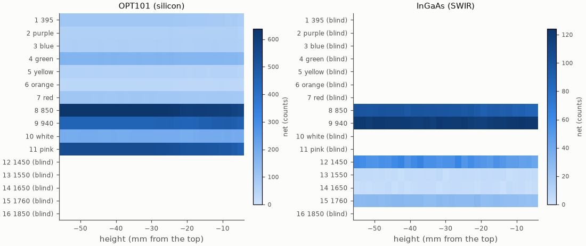
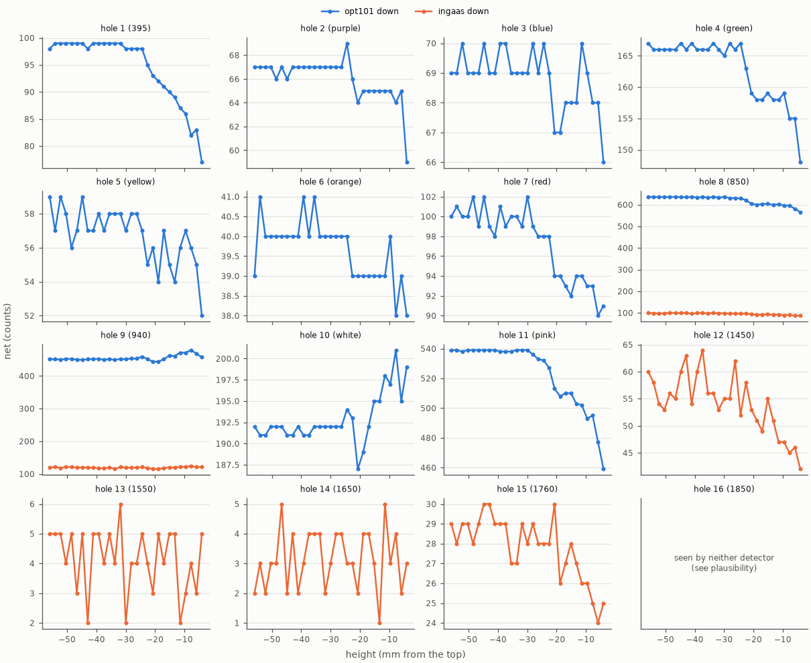
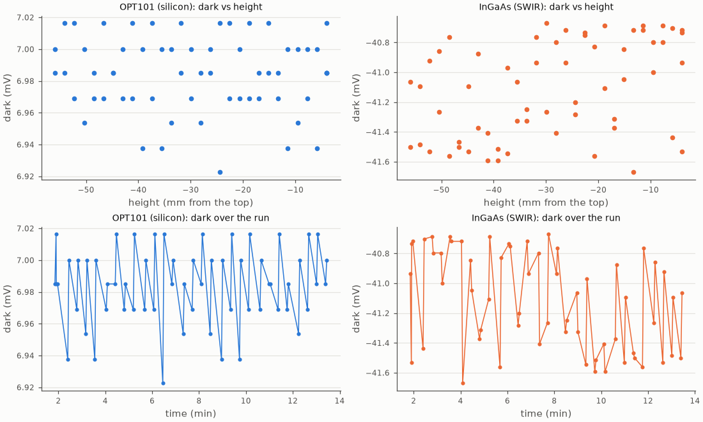
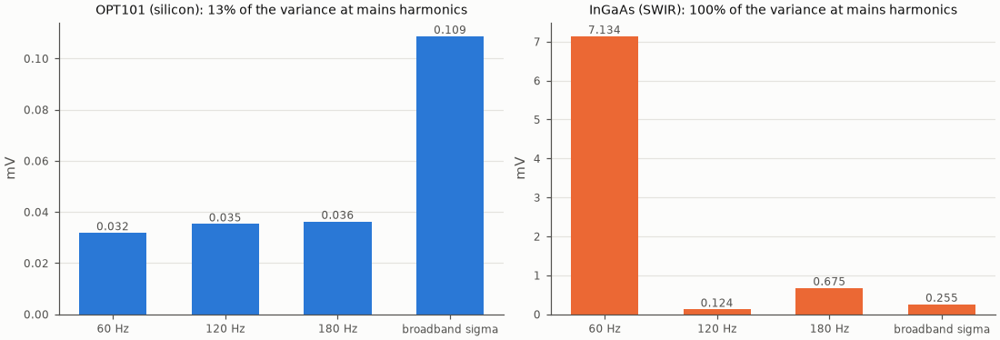

# LIO diagnostic sweep 20261125-153904_scan_fine

Mode **fine**, sample **LIO-F-00002**, status **INCOMPLETE**

## Verdict: NOT FUNCTIONAL

- failures not tied to a channel: T13.T09

## Subsystem health

| Subsystem | Parts | Health | Reason |
|---|---|---|---|
| Link / firmware | Nano R4, USB, firmware | ✓ OK | 1 checks pass |
| ADC / I²C | ADS1115, software I²C D11/D12 | ✓ OK | 1 checks pass |
| Shift registers | U1, U2 | ✓ OK | 1 checks pass |
| LED drivers / rails | DRV1 (RAIL A), DRV2 (RAIL B) | ✓ OK | 4 checks pass |
| LED / MOSFET channels | LED1-16, Q1-16 | ! WATCH | optics/opt101/h16/plausibility: opt101 cannot see 1850 nm; residual +862 counts over C +2.0 |
| OPT101 | OPT101 (A1) | ✓ OK | 7 checks pass |
| InGaAs TIA | D1, U5, Rf, Cf (A0) | ✕ ACT | elec/ingaas/coupling: rail A: +4.0 counts (+0.50 mV) from 7 blind holes, rail B: +47.0 counts (+5.88 mV) from 3 blind holes |
| Motors / lead screws | M1, M2, ULN2003, couplers, M6 rods | ! WATCH | mech/travel: tracked range 231099 / 412571 half-steps (M1/right / M2/left): the two sides differ (thresholds.motion.travel.range_steps not set: not compared) |
| Stage tracking | lio.stage, soft limits | ✕ ACT | system/stage: stage / soft limit: motor 1: -7599 would end at -236755, below the bottom limit (-231099); at most -1943 |
| Safety | interlocks, duty budget | ✓ OK | 1 checks pass |
| Power / earthing | supplies, GND, earth bond | ✕ ACT | elec/ingaas/ground_shift: +0.764 counts/mA |
| Optical path / ambient | window, shroud, lid, sample | ✓ OK | 4 checks pass |
| Run | the scan itself | ! WATCH | system/run: INCOMPLETE: unexpected error: RuntimeError: the two sides are not level (M1/right -28453, M2/left -12886); stage / soft limit: motor 1: -7599 would end at -236755, below the bottom limit (-231099); at most -1943 |

## Findings to act on

### ✕ FAIL `system/stage`: stage tracking (position trusted, soft limits respected)

stage / soft limit: motor 1: -7599 would end at -236755, below the bottom limit (-231099); at most -1943

- **Why:** The tracked position is no longer trusted (an unexpected reset) or a move hit a soft limit.
- **Parts:** lio.stage, M1, M2
- **Next check:** Raise the top to its upper end by hand or jog, then 'lio stage set-top'.

### ! WARN `system/run`: run complete

INCOMPLETE: unexpected error: RuntimeError: the two sides are not level (M1/right -28453, M2/left -12886); stage / soft limit: motor 1: -7599 would end at -236755, below the bottom limit (-231099); at most -1943

- **Why:** The run did not complete: metrics needing the missing steps are SKIP.
- **Parts:** run
- **Next check:** See the abort reason; 'lio scan resume <run>' carries on from the next step.

### ! WARN `optics/opt101/h16/plausibility`: hole 16 (1850) seen by opt101?

opt101 cannot see 1850 nm; residual +862 counts over C +2.0

- **Why:** A detector responds to a hole whose nominal wavelength it should not see. This does NOT identify a wrong LED: secondary/shorter-wave emission, broadband tails, electrical pickup or a swapped part are all possible; the spectrum is unassigned (h16 stays a proxy_unassigned feature, never primary 1850 nm).
- **Parts:** LED16, optical path
- **Next check:** Compare the LED marking with docs/OPTICAL_CHANNEL_MAP.md and look for a response missing elsewhere (a swap). Do not replace a part on this finding alone.

### ! WARN `optics/ingaas/h16/plausibility`: hole 16 (1850) seen by ingaas?

ingaas cannot see 1850 nm; residual +81 counts over C +47.0; height-dependent (optical)

- **Why:** A detector responds to a hole whose nominal wavelength it should not see. This does NOT identify a wrong LED: secondary/shorter-wave emission, broadband tails, electrical pickup or a swapped part are all possible; the spectrum is unassigned (h16 stays a proxy_unassigned feature, never primary 1850 nm).
- **Parts:** LED16, optical path
- **Next check:** Compare the LED marking with docs/OPTICAL_CHANNEL_MAP.md and look for a response missing elsewhere (a swap). Do not replace a part on this finding alone.

### ✕ FAIL `elec/ingaas/coupling`: ingaas: electrical coupling (height-invariant, LED on)

rail A: +4.0 counts (+0.50 mV) from 7 blind holes, rail B: +47.0 counts (+5.88 mV) from 3 blind holes

- **Why:** The detector output changes when an LED is on even though it cannot see that light: electrical coupling from the LED drive (shared ground return, or capacitive pick-up).
- **Parts:** GND star point, SUM/TIA_REF routing, LED drive wiring
- **Next check:** Check that the TIA reference and the LED return do not share a thin ground path.

### ✕ FAIL `elec/ingaas/ground_shift`: ingaas: ground shift (coupling vs rail current)

+0.764 counts/mA

- **Why:** The coupling scales with the rail current: LED current through a shared ground resistance shifts the detector's reference (ground shift).
- **Parts:** GND star point, TIA_REF, rail returns
- **Next check:** Measure the voltage between the TIA ground and the supply ground with RAIL B lit; run the LED returns straight to the supply.

### ! WARN `elec/ingaas/hum`: ingaas: mains hum (coils off)

60/120/180 Hz: 7.134 / 0.124 / 0.675 mV; 100% of the variance at mains harmonics; broadband sigma 0.255 mV; readings integrate whole mains periods, so it cancels in the measurements

- **Why:** Mains hum on the detector output: a missing earth bond or leakage from a charger.
- **Parts:** earth bond, chargers, GND
- **Next check:** Check the earth bond (circuit GND to mains earth); unplug the laptop charger and repeat.

### ! WARN `mech/travel`: travel (top to bottom)

tracked range 231099 / 412571 half-steps (M1/right / M2/left): the two sides differ (thresholds.motion.travel.range_steps not set: not compared)

- **Why:** The tracked travel differs from the configured one (or between the sides).
- **Parts:** stage limits
- **Next check:** Re-mark the top and bottom.

## Response vs height, per hole (down pass; blind holes blank)

## Response curves: down pass (solid) and up pass (dashed)

## Dark level vs height (light leak) and over time (drift)

## Dark noise: mains harmonics and broadband

## System

| Status | Metric | Value | Result | Criterion |
|---|---|---|---|---|
| ✓ PASS | `system/link` | 0 unexpected boots | firmware 2.5.2, no unexpected # BOOT |  |
| ✓ PASS | `system/adc` | 1166 readings | 1166 readings, no dropout |  |
| ✓ PASS | `system/addressing` | 0 pairs | 13 responding holes, all distinct |  |
| ✓ PASS | `system/rail/A` | 8 holes | 8/8 holes respond |  |
| ✓ PASS | `system/rail/B` | 4 holes | 4/8 holes respond |  |
| - SKIP | `system/interlocks` |  | P4 not reached |  |
| ✓ PASS | `system/duty` | 368 ms/min | max 368 ms of 1000 ms; 0 cool-down waits, 0 s in all |  |
| ✕ FAIL | `system/stage` |  | stage / soft limit: motor 1: -7599 would end at -236755, below the bottom limit (-231099); at most -1943 |  |
| ! WARN | `system/run` |  | INCOMPLETE: unexpected error: RuntimeError: the two sides are not level (M1/right -28453, M2/left -12886); stage / soft limit: motor 1: -7599 would end at -236755, below the bottom limit (-231099); at most -1943 |  |

## Optics

| Status | Metric | Value | Result | Criterion |
|---|---|---|---|---|
| - SKIP | `optics/opt101/h01/response` | 97.8 counts | sample 'LIO-F-00002' is not judged against absolute levels | O >= 15 (WARN below), >= 6 (FAIL below) |
| - SKIP | `optics/opt101/h02/response` | 66.6 counts | sample 'LIO-F-00002' is not judged against absolute levels | O >= 15 (WARN below), >= 6 (FAIL below) |
| - SKIP | `optics/opt101/h03/response` | 68.5 counts | sample 'LIO-F-00002' is not judged against absolute levels | O >= 15 (WARN below), >= 6 (FAIL below) |
| - SKIP | `optics/opt101/h04/response` | 165.7 counts | sample 'LIO-F-00002' is not judged against absolute levels | O >= 15 (WARN below), >= 6 (FAIL below) |
| - SKIP | `optics/opt101/h05/response` | 57 counts | sample 'LIO-F-00002' is not judged against absolute levels | O >= 15 (WARN below), >= 6 (FAIL below) |
| - SKIP | `optics/opt101/h06/response` | 39.4 counts | sample 'LIO-F-00002' is not judged against absolute levels | O >= 15 (WARN below), >= 6 (FAIL below) |
| - SKIP | `optics/opt101/h07/response` | 99.6 counts | sample 'LIO-F-00002' is not judged against absolute levels | O >= 15 (WARN below), >= 6 (FAIL below) |
| - SKIP | `optics/opt101/h08/response` | 635.2 counts | sample 'LIO-F-00002' is not judged against absolute levels | O >= 15 (WARN below), >= 6 (FAIL below) |
| - SKIP | `optics/opt101/h09/response` | 473.1 counts | sample 'LIO-F-00002' is not judged against absolute levels | O >= 15 (WARN below), >= 6 (FAIL below) |
| - SKIP | `optics/opt101/h10/response` | 197.1 counts | sample 'LIO-F-00002' is not judged against absolute levels | O >= 15 (WARN below), >= 6 (FAIL below) |
| - SKIP | `optics/opt101/h11/response` | 537.3 counts | sample 'LIO-F-00002' is not judged against absolute levels | O >= 15 (WARN below), >= 6 (FAIL below) |
| ✓ PASS | `optics/opt101/h12/plausibility` | 22.5 counts | opt101 cannot see 1450 nm; residual +22 counts over C +2.0 | < 30 counts (WARN), < 80 (FAIL) |
| ✓ PASS | `optics/opt101/h13/plausibility` | 0.3 counts | opt101 cannot see 1550 nm; residual +0 counts over C +2.0 | < 30 counts (WARN), < 80 (FAIL) |
| ✓ PASS | `optics/opt101/h14/plausibility` | 0.2 counts | opt101 cannot see 1650 nm; residual +0 counts over C +2.0 | < 30 counts (WARN), < 80 (FAIL) |
| ✓ PASS | `optics/opt101/h15/plausibility` | 0.7 counts | opt101 cannot see 1760 nm; residual +1 counts over C +2.0 | < 30 counts (WARN), < 80 (FAIL) |
| ! WARN | `optics/opt101/h16/plausibility` | 861.6 counts | opt101 cannot see 1850 nm; residual +862 counts over C +2.0 | < 30 counts (WARN); FAIL capped to WARN: no in-range detector for this hole |
| ✓ PASS | `optics/opt101/electrical_only` | 0 fraction | 0/11 expected holes show no optical response; coupling small | FAIL when >= 75% of expected holes have O < 6 while |C| >= 8 |
| - SKIP | `optics/opt101/throughput` | 99.6 counts | median O over 11 expected holes; spread (CV) 94% across holes | sample 'LIO-F-00002': judged against its baseline only |
| ✓ PASS | `optics/ingaas/h01/plausibility` | -1.1 counts | ingaas cannot see 395 nm; residual -1 counts over C +4.0 | < 30 counts (WARN), < 80 (FAIL) |
| ✓ PASS | `optics/ingaas/h02/plausibility` | -1.6 counts | ingaas cannot see 405 nm; residual -2 counts over C +4.0 | < 30 counts (WARN), < 80 (FAIL) |
| ✓ PASS | `optics/ingaas/h03/plausibility` | -2.3 counts | ingaas cannot see 465 nm; residual -2 counts over C +4.0 | < 30 counts (WARN), < 80 (FAIL) |
| ✓ PASS | `optics/ingaas/h04/plausibility` | 1.8 counts | ingaas cannot see 525 nm; residual +2 counts over C +4.0 | < 30 counts (WARN), < 80 (FAIL) |
| ✓ PASS | `optics/ingaas/h05/plausibility` | 4.7 counts | ingaas cannot see 590 nm; residual +5 counts over C +4.0 | < 30 counts (WARN), < 80 (FAIL) |
| ✓ PASS | `optics/ingaas/h06/plausibility` | 5.3 counts | ingaas cannot see 605 nm; residual +5 counts over C +4.0 | < 30 counts (WARN), < 80 (FAIL) |
| ✓ PASS | `optics/ingaas/h07/plausibility` | 9.5 counts | ingaas cannot see 630 nm; residual +9 counts over C +4.0 | < 30 counts (WARN), < 80 (FAIL) |
| - SKIP | `optics/ingaas/h08/response` | 95.8 counts | sample 'LIO-F-00002' is not judged against absolute levels | O >= 15 (WARN below), >= 6 (FAIL below) |
| - SKIP | `optics/ingaas/h09/response` | 76 counts | sample 'LIO-F-00002' is not judged against absolute levels | O >= 15 (WARN below), >= 6 (FAIL below) |
| ✓ PASS | `optics/ingaas/h10/plausibility` | -36.2 counts | ingaas cannot see 450 nm; residual -36 counts over C +47.0 | < 30 counts (WARN), < 80 (FAIL) |
| ✓ PASS | `optics/ingaas/h11/plausibility` | 1.7 counts | ingaas cannot see 450 nm; residual +2 counts over C +47.0 | < 30 counts (WARN), < 80 (FAIL) |
| - SKIP | `optics/ingaas/h12/response` | 14.4 counts | sample 'LIO-F-00002' is not judged against absolute levels | O >= 15 (WARN below), >= 6 (FAIL below) |
| ! WARN | `optics/ingaas/h16/plausibility` | 80.9 counts | ingaas cannot see 1850 nm; residual +81 counts over C +47.0; height-dependent (optical) | < 30 counts (WARN); FAIL capped to WARN: no in-range detector for this hole |
| ✓ PASS | `optics/ingaas/electrical_only` | 0 fraction | 0/3 expected holes show no optical response; coupling present | FAIL when >= 75% of expected holes have O < 6 while |C| >= 8 |
| - SKIP | `optics/ingaas/throughput` | 76 counts | median O over 3 expected holes; spread (CV) 56% across holes | sample 'LIO-F-00002': judged against its baseline only |
| - SKIP | `optics/optimum` |  | down pass incomplete (29 of 33 heights) |  |
| ✓ PASS | `optics/opt101/snr` | 33.1 dB | weakest hole 6: 33.1 dB (noise sigma 0.109 mV) | >= 20 dB |
| ✓ PASS | `optics/opt101/headroom` | 96.9 % | highest lit reading 920 of 29600 counts | >= 10% |
| ✓ PASS | `optics/ingaas/snr` | 17 dB | weakest hole 12: 17.0 dB (noise sigma 0.255 mV) | >= 20 dB |
| ✓ PASS | `optics/ingaas/headroom` | 100.7 % | highest lit reading -201 of 28000 counts | >= 10% |
| - SKIP | `optics/stray` |  | needs a black_cup run (with a white_ptfe reference) |  |
| - SKIP | `optics/effectiveness` |  | needs a reference (baseline) of the same sample |  |
| ✓ PASS | `optics/wrong_rail/h01` | 0 counts | +0 counts on opt101 with the hole selected and RAIL B enabled | < 30 counts (WARN), < 80 (FAIL) |
| ✓ PASS | `optics/wrong_rail/h02` | 0 counts | +0 counts on opt101 with the hole selected and RAIL B enabled | < 30 counts (WARN), < 80 (FAIL) |
| ✓ PASS | `optics/wrong_rail/h03` | 0 counts | +0 counts on opt101 with the hole selected and RAIL B enabled | < 30 counts (WARN), < 80 (FAIL) |
| ✓ PASS | `optics/wrong_rail/h04` | 0 counts | +0 counts on opt101 with the hole selected and RAIL B enabled | < 30 counts (WARN), < 80 (FAIL) |
| ✓ PASS | `optics/wrong_rail/h05` | 0 counts | +0 counts on opt101 with the hole selected and RAIL B enabled | < 30 counts (WARN), < 80 (FAIL) |
| ✓ PASS | `optics/wrong_rail/h06` | 0 counts | +0 counts on opt101 with the hole selected and RAIL B enabled | < 30 counts (WARN), < 80 (FAIL) |
| ✓ PASS | `optics/wrong_rail/h07` | 0 counts | +0 counts on opt101 with the hole selected and RAIL B enabled | < 30 counts (WARN), < 80 (FAIL) |
| ✓ PASS | `optics/wrong_rail/h08` | 0 counts | +0 counts on opt101 with the hole selected and RAIL B enabled | < 30 counts (WARN), < 80 (FAIL) |
| ✓ PASS | `optics/wrong_rail/h09` | 0 counts | +0 counts on opt101 with the hole selected and RAIL A enabled | < 30 counts (WARN), < 80 (FAIL) |
| ✓ PASS | `optics/wrong_rail/h10` | 0 counts | +0 counts on opt101 with the hole selected and RAIL A enabled | < 30 counts (WARN), < 80 (FAIL) |
| ✓ PASS | `optics/wrong_rail/h11` | 0 counts | +0 counts on opt101 with the hole selected and RAIL A enabled | < 30 counts (WARN), < 80 (FAIL) |
| ✓ PASS | `optics/wrong_rail/h12` | 0 counts | +0 counts on ingaas with the hole selected and RAIL A enabled | < 30 counts (WARN), < 80 (FAIL) |
| ✓ PASS | `optics/wrong_rail/h13` | 0 counts | +0 counts on ingaas with the hole selected and RAIL A enabled | < 30 counts (WARN), < 80 (FAIL) |
| ✓ PASS | `optics/wrong_rail/h14` | 1 counts | +1 counts on ingaas with the hole selected and RAIL A enabled | < 30 counts (WARN), < 80 (FAIL) |
| ✓ PASS | `optics/wrong_rail/h15` | 0 counts | +0 counts on ingaas with the hole selected and RAIL A enabled | < 30 counts (WARN), < 80 (FAIL) |

## Electrical

| Status | Metric | Value | Result | Criterion |
|---|---|---|---|---|
| ✓ PASS | `elec/opt101/coupling` | 2 counts | rail A: +1.3 counts (+0.17 mV) inferred, rail B: +2.0 counts (+0.25 mV) from 5 blind holes | corrected in software below 20 counts (FAIL at or above) |
| ✓ PASS | `elec/opt101/ground_shift` | 0.0056 mV/mA | +0.044 counts/mA | corrected in software below 0.08 mV/mA (FAIL at or above) |
| ✕ FAIL | `elec/ingaas/coupling` | 47 counts | rail A: +4.0 counts (+0.50 mV) from 7 blind holes, rail B: +47.0 counts (+5.88 mV) from 3 blind holes | corrected in software below 20 counts (FAIL at or above) |
| ✕ FAIL | `elec/ingaas/ground_shift` | 0.0955 mV/mA | +0.764 counts/mA | corrected in software below 0.08 mV/mA (FAIL at or above) |
| ✓ PASS | `elec/opt101/dark_offset` | 6.985 mV | +55.9 counts (+6.99 mV); equivalent input current not computed (Rf unsupported or unknown) | 0 to 800 counts (thresholds.dark) |
| ✓ PASS | `elec/ingaas/dark_offset` | -41.078 mV | -328.6 counts (-41.08 mV); equivalent input current not computed (InGaAs physical current blocked: input_range=unverified) | -400 to 2000 counts (thresholds.dark) |
| ✓ PASS | `elec/opt101/drift` | 0.032 mV/h | +0.03 ± 0.05 mV/h | |slope| < 3 mV/h (WARN), < 8 (FAIL) |
| ✓ PASS | `elec/ingaas/drift` | -2.172 mV/h | -2.17 ± 0.66 mV/h (+2.2 nA/h) | |slope| < 3 mV/h (WARN), < 8 (FAIL) |
| ✓ PASS | `elec/opt101/hum` | 0.0318 mV | 60/120/180 Hz: 0.032 / 0.035 / 0.036 mV; 13% of the variance at mains harmonics; broadband sigma 0.109 mV; readings integrate whole mains periods, so it cancels in the measurements | 60 Hz amplitude < 0.3 mV (WARN; not when the readings reject it), < 1 (FAIL); mains fraction < 0.5 |
| ! WARN | `elec/ingaas/hum` | 7.1342 mV | 60/120/180 Hz: 7.134 / 0.124 / 0.675 mV; 100% of the variance at mains harmonics; broadband sigma 0.255 mV; readings integrate whole mains periods, so it cancels in the measurements | 60 Hz amplitude < 1 mV (WARN; not when the readings reject it), < 3 (FAIL); mains fraction < 0.5 |
| ✓ PASS | `elec/opt101/coil_emi` | 9.38 x | sigma 1.172 mV moving vs 0.109 mV off (measured while moving, S0 D2); judged only when measuring while moving (continuous mode): every other reading is taken with the motors stopped | ratio < 3 (WARN), < 6 (FAIL) |
| ✓ PASS | `elec/ingaas/coil_emi` | 1.07 x | sigma 0.273 mV moving vs 0.255 mV off (measured while moving, S0 D2); judged only when measuring while moving (continuous mode): every other reading is taken with the motors stopped | ratio < 3 (WARN), < 6 (FAIL) |
| ✓ PASS | `elec/opt101/h01/select_only` | 0.4 counts | largest on hole 1: +0.4 counts | < 8 counts (WARN); FAIL capped to WARN (gate coupling, LED off) |
| ✓ PASS | `elec/ingaas/h05/select_only` | 2.9 counts | largest on hole 5: -2.9 counts | < 8 counts (WARN); FAIL capped to WARN (gate coupling, LED off) |
| ✓ PASS | `elec/opt101/ce_only` | 1 counts | CE1: -1.0, CE2: +0.0 | < 8 counts (WARN), < 20 (FAIL) |
| ✓ PASS | `elec/ingaas/ce_only` | 1 counts | CE1: +0.0, CE2: +1.0 | < 8 counts (WARN), < 20 (FAIL) |
| - SKIP | `elec/rails` |  | A2/A3 not wired for rail and ground monitoring |  |

## Mechanics

| Status | Metric | Value | Result | Criterion |
|---|---|---|---|---|
| - SKIP | `mech/home_sensors` |  | no home sensors fitted |  |
| ! WARN | `mech/travel` | 231099 half-steps | tracked range 231099 / 412571 half-steps (M1/right / M2/left): the two sides differ (thresholds.motion.travel.range_steps not set: not compared) |  |
| ✓ PASS | `mech/lockstep` | 0 moves | 30 moves; 0 ended with the two sides at different positions (without home sensors only the commanded steps are seen: a side losing steps shows as mech/step_loss) |  |
| ✓ PASS | `mech/settle` | 601 ms | median 601 ms, max 606 ms (mechanical wait 300 ms) | max - median < 500 ms (WARN), < 1500 (FAIL) |
| - SKIP | `mech/backlash` |  | needs an up pass |  |
| - SKIP | `mech/step_loss` |  | needs an up pass |  |
| - SKIP | `mech/repeatability` |  | no repeated reference visits in this mode (full, fine, repeatability have them) |  |

## Ambient

| Status | Metric | Value | Result | Criterion |
|---|---|---|---|---|
| ✓ PASS | `ambient/opt101/leak` | 0.2 counts | dark at the bottom +0.2 counts (+0.02 mV) vs the top; 0.19% of the median signal | rise < 8 counts (WARN), < 25 (FAIL) |
| ✓ PASS | `ambient/ingaas/leak` | -1.3 counts | dark at the bottom -1.3 counts (-0.16 mV) vs the top | rise < 8 counts (WARN), < 25 (FAIL) |
| ✓ PASS | `ambient/opt101/flicker` | 0.0353 mV | 120 Hz amplitude in the dark streams 0.035 mV; readings integrate whole mains periods, so it cancels | < 0.4 mV (WARN), < 1.2 (FAIL) |
| ✓ PASS | `ambient/ingaas/flicker` | 0.1243 mV | 120 Hz amplitude in the dark streams 0.124 mV; readings integrate whole mains periods, so it cancels | < 0.4 mV (WARN), < 1.2 (FAIL) |
| - SKIP | `ambient/lid` |  | optional operator step (lid ajar at two heights) |  |

## Trend

| Status | Metric | Value | Result | Criterion |
|---|---|---|---|---|
| - SKIP | `trend/control` |  | needs 5 baselines of LIO-F-00002 (have 0) |  |

## Not measured (capability)

- rail_monitor: A2/A3 not wired for rail and ground monitoring
- home_sensors: no home sensors fitted
