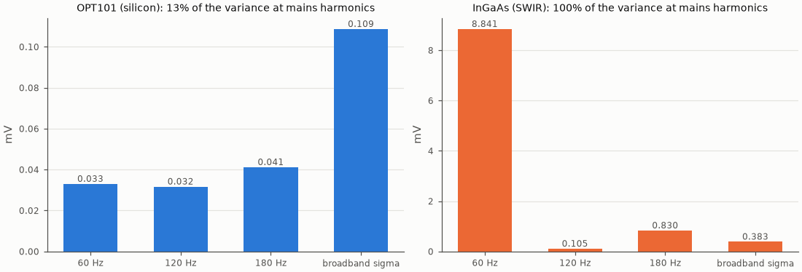

# LIO diagnostic sweep 20261126-004656_scan_full

Mode **full**, sample **LIO-F-00003**, status **INCOMPLETE**

## Verdict: FUNCTIONAL

- warnings: T13.T06, T13.T13

## Subsystem health

| Subsystem | Parts | Health | Reason |
|---|---|---|---|
| Link / firmware | Nano R4, USB, firmware | ✓ OK | 1 checks pass |
| ADC / I²C | ADS1115, software I²C D11/D12 | ✓ OK | 1 checks pass |
| Shift registers | U1, U2 | - n/a | not measured: no optical response to compare |
| LED drivers / rails | DRV1 (RAIL A), DRV2 (RAIL B) | - n/a | not measured:  |
| LED / MOSFET channels | LED1-16, Q1-16 | - n/a | not measured:  |
| OPT101 | OPT101 (A1) | - n/a | not measured: no blind channels measured; no dark frames; needs hum records, coils off and moving; no select-only readings; under 5 min of dark frames: too short for a drift estimate |
| InGaAs TIA | D1, U5, Rf, Cf (A0) | - n/a | not measured: no blind channels measured; no dark frames; needs hum records, coils off and moving; no select-only readings; under 5 min of dark frames: too short for a drift estimate |
| Motors / lead screws | M1, M2, ULN2003, couplers, M6 rods | ✓ OK | 2 checks pass |
| Stage tracking | lio.stage, soft limits | ✓ OK | 1 checks pass |
| Safety | interlocks, duty budget | ✓ OK | 1 checks pass |
| Power / earthing | supplies, GND, earth bond | ! WATCH | elec/ingaas/hum: 60/120/180 Hz: 8.841 / 0.105 / 0.830 mV; 100% of the variance at mains harmonics; broadband sigma 0.383 mV; readings integrate whole mains periods, so it cancels in the measurements |
| Optical path / ambient | window, shroud, lid, sample | ✓ OK | 2 checks pass |
| Run | the scan itself | ! WATCH | system/run: INCOMPLETE: device refused: 'DBG STATE CE_ONLY 1 8 2' -> ERR code=3 (refused): on-time exceeds watchdog |

## Findings to act on

### ! WARN `system/run`: run complete

INCOMPLETE: device refused: 'DBG STATE CE_ONLY 1 8 2' -> ERR code=3 (refused): on-time exceeds watchdog

- **Why:** The run did not complete: metrics needing the missing steps are SKIP.
- **Parts:** run
- **Next check:** See the abort reason; 'lio scan resume <run>' carries on from the next step.

### ! WARN `elec/ingaas/hum`: ingaas: mains hum (coils off)

60/120/180 Hz: 8.841 / 0.105 / 0.830 mV; 100% of the variance at mains harmonics; broadband sigma 0.383 mV; readings integrate whole mains periods, so it cancels in the measurements

- **Why:** Mains hum on the detector output: a missing earth bond or leakage from a charger.
- **Parts:** earth bond, chargers, GND
- **Next check:** Check the earth bond (circuit GND to mains earth); unplug the laptop charger and repeat.

## Dark noise: mains harmonics and broadband

## System

| Status | Metric | Value | Result | Criterion |
|---|---|---|---|---|
| ✓ PASS | `system/link` | 0 unexpected boots | firmware 2.5.2, no unexpected # BOOT |  |
| ✓ PASS | `system/adc` | 0 readings | 0 readings, no dropout |  |
| - SKIP | `system/addressing` |  | no optical response to compare |  |
| - SKIP | `system/interlocks` |  | P4 not reached |  |
| ✓ PASS | `system/duty` | 270 ms/min | max 270 ms of 1000 ms; 0 cool-down waits, 0 s in all |  |
| ✓ PASS | `system/stage` |  | position [-16384, -16384], limits respected |  |
| ! WARN | `system/run` |  | INCOMPLETE: device refused: 'DBG STATE CE_ONLY 1 8 2' -> ERR code=3 (refused): on-time exceeds watchdog |  |

## Optics

| Status | Metric | Value | Result | Criterion |
|---|---|---|---|---|
| - SKIP | `optics/curves` |  | no down pass in this mode (no height data) |  |

## Electrical

| Status | Metric | Value | Result | Criterion |
|---|---|---|---|---|
| - SKIP | `elec/opt101/coupling` |  | no blind channels measured |  |
| - SKIP | `elec/ingaas/coupling` |  | no blind channels measured |  |
| - SKIP | `elec/opt101/dark_offset` |  | no dark frames |  |
| - SKIP | `elec/ingaas/dark_offset` |  | no dark frames |  |
| - SKIP | `elec/opt101/drift` |  | under 5 min of dark frames: too short for a drift estimate |  |
| - SKIP | `elec/ingaas/drift` |  | under 5 min of dark frames: too short for a drift estimate |  |
| ✓ PASS | `elec/opt101/hum` | 0.033 mV | 60/120/180 Hz: 0.033 / 0.032 / 0.041 mV; 13% of the variance at mains harmonics; broadband sigma 0.109 mV; readings integrate whole mains periods, so it cancels in the measurements | 60 Hz amplitude < 0.3 mV (WARN; not when the readings reject it), < 1 (FAIL); mains fraction < 0.5 |
| ! WARN | `elec/ingaas/hum` | 8.8411 mV | 60/120/180 Hz: 8.841 / 0.105 / 0.830 mV; 100% of the variance at mains harmonics; broadband sigma 0.383 mV; readings integrate whole mains periods, so it cancels in the measurements | 60 Hz amplitude < 1 mV (WARN; not when the readings reject it), < 3 (FAIL); mains fraction < 0.5 |
| - SKIP | `elec/opt101/coil_emi` |  | needs hum records, coils off and moving |  |
| - SKIP | `elec/ingaas/coil_emi` |  | needs hum records, coils off and moving |  |
| - SKIP | `elec/opt101/select_only` |  | no select-only readings |  |
| - SKIP | `elec/ingaas/select_only` |  | no select-only readings |  |
| - SKIP | `elec/rails` |  | A2/A3 not wired for rail and ground monitoring |  |

## Mechanics

| Status | Metric | Value | Result | Criterion |
|---|---|---|---|---|
| - SKIP | `mech/home_sensors` |  | no home sensors fitted |  |
| ✓ PASS | `mech/travel` | 331073 half-steps | tracked range 331073 / 331073 half-steps (M1/right / M2/left) |  |
| ✓ PASS | `mech/lockstep` | 0 moves | 1 moves; 0 ended with the two sides at different positions (without home sensors only the commanded steps are seen: a side losing steps shows as mech/step_loss) |  |
| - SKIP | `mech/settle` |  | no settle records |  |
| - SKIP | `mech/backlash` |  | no down-pass reference curves (static or continuous mode, or no strong channel) |  |
| - SKIP | `mech/step_loss` |  | no down-pass reference curves (static or continuous mode, or no strong channel) |  |
| - SKIP | `mech/repeatability` |  | no down-pass reference curves (static or continuous mode, or no strong channel) |  |

## Ambient

| Status | Metric | Value | Result | Criterion |
|---|---|---|---|---|
| - SKIP | `ambient/opt101/leak` |  | needs dark frames at 4+ heights |  |
| - SKIP | `ambient/ingaas/leak` |  | needs dark frames at 4+ heights |  |
| ✓ PASS | `ambient/opt101/flicker` | 0.0316 mV | 120 Hz amplitude in the dark streams 0.032 mV; readings integrate whole mains periods, so it cancels | < 0.4 mV (WARN), < 1.2 (FAIL) |
| ✓ PASS | `ambient/ingaas/flicker` | 0.1046 mV | 120 Hz amplitude in the dark streams 0.105 mV; readings integrate whole mains periods, so it cancels | < 0.4 mV (WARN), < 1.2 (FAIL) |
| - SKIP | `ambient/lid` |  | optional operator step (lid ajar at two heights) |  |

## Trend

| Status | Metric | Value | Result | Criterion |
|---|---|---|---|---|
| - SKIP | `trend/control` |  | needs 5 baselines of LIO-F-00003 (have 0) |  |

## Not measured (capability)

- rail_monitor: A2/A3 not wired for rail and ground monitoring
- home_sensors: no home sensors fitted
