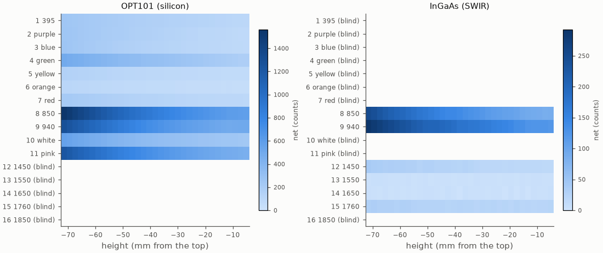
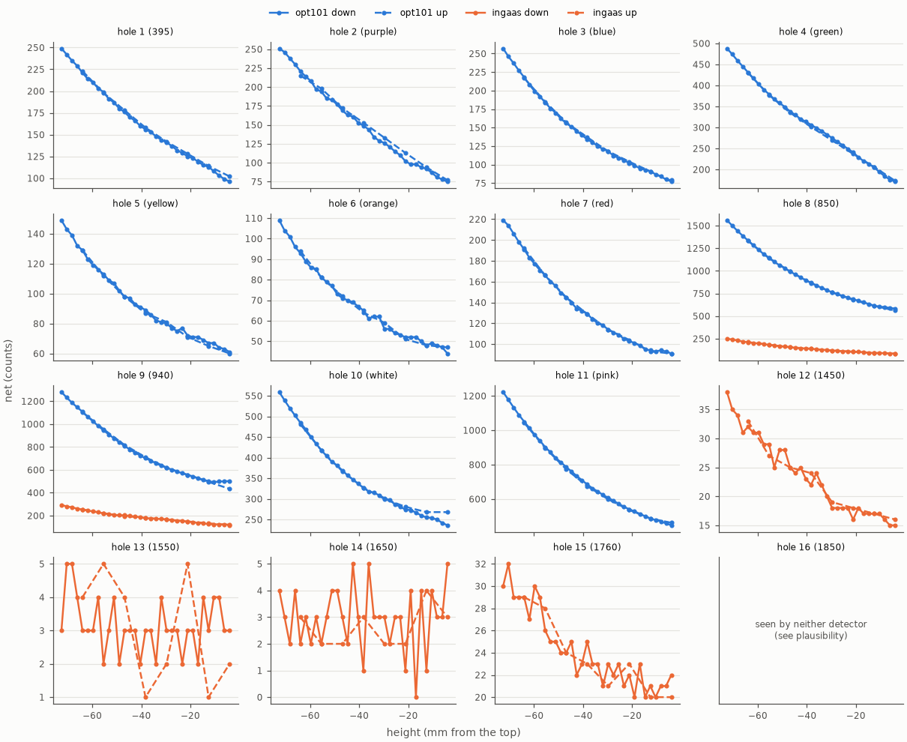
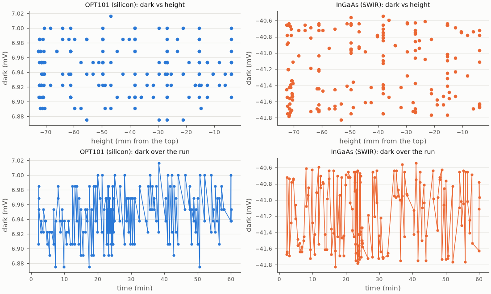
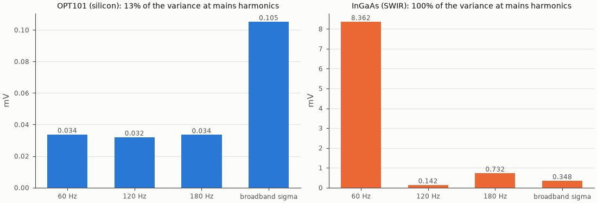

# LIO diagnostic sweep 20261126-040648_scan_fine

Mode **fine**, sample **LIO-F-00005**, status **COMPLETE**

## Verdict: FUNCTIONAL

- warnings: T13.T05, T13.T06, T13.T09, T13.T13

## Subsystem health

| Subsystem | Parts | Health | Reason |
|---|---|---|---|
| Link / firmware | Nano R4, USB, firmware | ✓ OK | 1 checks pass |
| ADC / I²C | ADS1115, software I²C D11/D12 | ✓ OK | 1 checks pass |
| Shift registers | U1, U2 | ✓ OK | 1 checks pass |
| LED drivers / rails | DRV1 (RAIL A), DRV2 (RAIL B) | ✓ OK | 4 checks pass |
| LED / MOSFET channels | LED1-16, Q1-16 | ! WATCH | optics/opt101/h16/plausibility: opt101 cannot see 1850 nm; residual +1842 counts over C +1.0; height-dependent (optical) |
| OPT101 | OPT101 (A1) | ✓ OK | 7 checks pass |
| InGaAs TIA | D1, U5, Rf, Cf (A0) | ✓ OK | 7 checks pass |
| Motors / lead screws | M1, M2, ULN2003, couplers, M6 rods | ! WATCH | mech/travel: tracked range 320582 / 297301 half-steps (M1/right / M2/left): the two sides differ (thresholds.motion.travel.range_steps not set: not compared) |
| Stage tracking | lio.stage, soft limits | ✓ OK | 1 checks pass |
| Safety | interlocks, duty budget | ✓ OK | 2 checks pass |
| Power / earthing | supplies, GND, earth bond | ! WATCH | elec/ingaas/hum: 60/120/180 Hz: 8.362 / 0.142 / 0.732 mV; 100% of the variance at mains harmonics; broadband sigma 0.348 mV; readings integrate whole mains periods, so it cancels in the measurements |
| Optical path / ambient | window, shroud, lid, sample | ! WATCH | optics/optimum: -297301 half-steps (-72.58 mm); weakest normalised response there 1.00; at an end of the travel: the true peak may lie beyond |
| Run | the scan itself | ✓ OK | 1 checks pass |

## Findings to act on

### ! WARN `optics/opt101/h16/plausibility`: hole 16 (1850) seen by opt101?

opt101 cannot see 1850 nm; residual +1842 counts over C +1.0; height-dependent (optical)

- **Why:** A detector responds to a hole whose nominal wavelength it should not see. This does NOT identify a wrong LED: secondary/shorter-wave emission, broadband tails, electrical pickup or a swapped part are all possible; the spectrum is unassigned (h16 stays a proxy_unassigned feature, never primary 1850 nm).
- **Parts:** LED16, optical path
- **Next check:** Compare the LED marking with docs/OPTICAL_CHANNEL_MAP.md and look for a response missing elsewhere (a swap). Do not replace a part on this finding alone.

### ! WARN `optics/ingaas/h11/plausibility`: hole 11 (pink) seen by ingaas?

ingaas cannot see 450 nm; residual +89 counts over C +18.0; height-dependent (optical)

- **Why:** A detector responds to a hole whose nominal wavelength it should not see. This does NOT identify a wrong LED: secondary/shorter-wave emission, broadband tails, electrical pickup or a swapped part are all possible; the spectrum is unassigned (h16 stays a proxy_unassigned feature, never primary 1850 nm).
- **Parts:** LED11, optical path
- **Next check:** Compare the LED marking with docs/OPTICAL_CHANNEL_MAP.md and look for a response missing elsewhere (a swap). Do not replace a part on this finding alone.

### ! WARN `optics/ingaas/h16/plausibility`: hole 16 (1850) seen by ingaas?

ingaas cannot see 1850 nm; residual +265 counts over C +18.0; height-dependent (optical)

- **Why:** A detector responds to a hole whose nominal wavelength it should not see. This does NOT identify a wrong LED: secondary/shorter-wave emission, broadband tails, electrical pickup or a swapped part are all possible; the spectrum is unassigned (h16 stays a proxy_unassigned feature, never primary 1850 nm).
- **Parts:** LED16, optical path
- **Next check:** Compare the LED marking with docs/OPTICAL_CHANNEL_MAP.md and look for a response missing elsewhere (a swap). Do not replace a part on this finding alone.

### ! WARN `optics/h16/intermittent`: hole 16 (1850) intermittent

down and up readings disagree on both detectors at once at 4 height(s): -121728, -86613, -51499, -16384

- **Why:** This hole's readings jump on both detectors at the same moment: an electrical event (a joint opening for an instant, or an intermittent short), not light.
- **Parts:** LED16, Q16, solder joints, breadboard contacts
- **Next check:** Wiggle-test the LED and MOSFET leads while watching 'lio ch 16 on' readings; reflow or re-seat the joints.

### ! WARN `optics/optimum`: optimum height (all holes)

-297301 half-steps (-72.58 mm); weakest normalised response there 1.00; at an end of the travel: the true peak may lie beyond

- **Why:** The best height is at an end of the travel: the true optimum may lie beyond it.
- **Parts:** geometry
- **Next check:** Check the sample position.

### ! WARN `elec/ingaas/hum`: ingaas: mains hum (coils off)

60/120/180 Hz: 8.362 / 0.142 / 0.732 mV; 100% of the variance at mains harmonics; broadband sigma 0.348 mV; readings integrate whole mains periods, so it cancels in the measurements

- **Why:** Mains hum on the detector output: a missing earth bond or leakage from a charger.
- **Parts:** earth bond, chargers, GND
- **Next check:** Check the earth bond (circuit GND to mains earth); unplug the laptop charger and repeat.

### ! WARN `mech/travel`: travel (top to bottom)

tracked range 320582 / 297301 half-steps (M1/right / M2/left): the two sides differ (thresholds.motion.travel.range_steps not set: not compared)

- **Why:** The tracked travel differs from the configured one (or between the sides).
- **Parts:** stage limits
- **Next check:** Re-mark the top and bottom.

### ! WARN `mech/repeatability`: repeatability at the reference heights

spread of repeated visits 4698 half-steps (RMS over 10 groups); above minus below -420 half-steps (backlash, direct); softened to WARN (V3 mechanics provisional)

- **Why:** Repeated visits to one height do not land in the same place.
- **Parts:** couplers, lead screws
- **Next check:** Repeat the reference heights; inspect the couplers.

## Response vs height, per hole (down pass; blind holes blank)

## Response curves: down pass (solid) and up pass (dashed)

## Dark level vs height (light leak) and over time (drift)

## Dark noise: mains harmonics and broadband

## System

| Status | Metric | Value | Result | Criterion |
|---|---|---|---|---|
| ✓ PASS | `system/link` | 0 unexpected boots | firmware 2.5.2, no unexpected # BOOT |  |
| ✓ PASS | `system/adc` | 3296 readings | 3296 readings, no dropout |  |
| ✓ PASS | `system/addressing` | 0 pairs | 14 responding holes, all distinct |  |
| ✓ PASS | `system/rail/A` | 8 holes | 8/8 holes respond |  |
| ✓ PASS | `system/rail/B` | 5 holes | 5/8 holes respond |  |
| ✓ PASS | `system/interlocks` | 0 failed | light_while_moving: PASS; single_channel: SKIP: host refused before transmission (CE on refused: no single selected hole to reserve duty against); firmware interlock not exercised |  |
| ✓ PASS | `system/duty` | 644 ms/min | max 644 ms of 1000 ms; 0 cool-down waits, 0 s in all |  |
| ✓ PASS | `system/stage` |  | position [-16384, -16384], limits respected |  |
| ✓ PASS | `system/run` |  | COMPLETE |  |

## Optics

| Status | Metric | Value | Result | Criterion |
|---|---|---|---|---|
| - SKIP | `optics/opt101/h01/response` | 248.3 counts | sample 'LIO-F-00005' is not judged against absolute levels | O >= 15 (WARN below), >= 6 (FAIL below) |
| - SKIP | `optics/opt101/h02/response` | 250.8 counts | sample 'LIO-F-00005' is not judged against absolute levels | O >= 15 (WARN below), >= 6 (FAIL below) |
| - SKIP | `optics/opt101/h03/response` | 256 counts | sample 'LIO-F-00005' is not judged against absolute levels | O >= 15 (WARN below), >= 6 (FAIL below) |
| - SKIP | `optics/opt101/h04/response` | 487.5 counts | sample 'LIO-F-00005' is not judged against absolute levels | O >= 15 (WARN below), >= 6 (FAIL below) |
| - SKIP | `optics/opt101/h05/response` | 148 counts | sample 'LIO-F-00005' is not judged against absolute levels | O >= 15 (WARN below), >= 6 (FAIL below) |
| - SKIP | `optics/opt101/h06/response` | 108 counts | sample 'LIO-F-00005' is not judged against absolute levels | O >= 15 (WARN below), >= 6 (FAIL below) |
| - SKIP | `optics/opt101/h07/response` | 218.8 counts | sample 'LIO-F-00005' is not judged against absolute levels | O >= 15 (WARN below), >= 6 (FAIL below) |
| - SKIP | `optics/opt101/h08/response` | 1559 counts | sample 'LIO-F-00005' is not judged against absolute levels | O >= 15 (WARN below), >= 6 (FAIL below) |
| - SKIP | `optics/opt101/h09/response` | 1278.5 counts | sample 'LIO-F-00005' is not judged against absolute levels | O >= 15 (WARN below), >= 6 (FAIL below) |
| - SKIP | `optics/opt101/h10/response` | 557.8 counts | sample 'LIO-F-00005' is not judged against absolute levels | O >= 15 (WARN below), >= 6 (FAIL below) |
| - SKIP | `optics/opt101/h11/response` | 1221 counts | sample 'LIO-F-00005' is not judged against absolute levels | O >= 15 (WARN below), >= 6 (FAIL below) |
| ✓ PASS | `optics/opt101/h12/plausibility` | 1.7 counts | opt101 cannot see 1450 nm; residual +2 counts over C +1.0 | < 30 counts (WARN), < 80 (FAIL) |
| ✓ PASS | `optics/opt101/h13/plausibility` | 1.4 counts | opt101 cannot see 1550 nm; residual +1 counts over C +1.0 | < 30 counts (WARN), < 80 (FAIL) |
| ✓ PASS | `optics/opt101/h14/plausibility` | 1 counts | opt101 cannot see 1650 nm; residual +1 counts over C +1.0 | < 30 counts (WARN), < 80 (FAIL) |
| ✓ PASS | `optics/opt101/h15/plausibility` | 1.4 counts | opt101 cannot see 1760 nm; residual +1 counts over C +1.0 | < 30 counts (WARN), < 80 (FAIL) |
| ! WARN | `optics/opt101/h16/plausibility` | 1841.8 counts | opt101 cannot see 1850 nm; residual +1842 counts over C +1.0; height-dependent (optical) | < 30 counts (WARN); FAIL capped to WARN: no in-range detector for this hole |
| ✓ PASS | `optics/opt101/electrical_only` | 0 fraction | 0/11 expected holes show no optical response; coupling small | FAIL when >= 75% of expected holes have O < 6 while |C| >= 8 |
| - SKIP | `optics/opt101/throughput` | 256 counts | median O over 11 expected holes; spread (CV) 87% across holes | sample 'LIO-F-00005': judged against its baseline only |
| ✓ PASS | `optics/ingaas/h01/plausibility` | -2.6 counts | ingaas cannot see 395 nm; residual -3 counts over C +8.0 | < 30 counts (WARN), < 80 (FAIL) |
| ✓ PASS | `optics/ingaas/h02/plausibility` | -2 counts | ingaas cannot see 405 nm; residual -2 counts over C +8.0 | < 30 counts (WARN), < 80 (FAIL) |
| ✓ PASS | `optics/ingaas/h03/plausibility` | -5.7 counts | ingaas cannot see 465 nm; residual -6 counts over C +8.0 | < 30 counts (WARN), < 80 (FAIL) |
| ✓ PASS | `optics/ingaas/h04/plausibility` | 6.2 counts | ingaas cannot see 525 nm; residual +6 counts over C +8.0 | < 30 counts (WARN), < 80 (FAIL) |
| ✓ PASS | `optics/ingaas/h05/plausibility` | 9.3 counts | ingaas cannot see 590 nm; residual +9 counts over C +8.0 | < 30 counts (WARN), < 80 (FAIL) |
| ✓ PASS | `optics/ingaas/h06/plausibility` | 8.1 counts | ingaas cannot see 605 nm; residual +8 counts over C +8.0 | < 30 counts (WARN), < 80 (FAIL) |
| ✓ PASS | `optics/ingaas/h07/plausibility` | 15.5 counts | ingaas cannot see 630 nm; residual +16 counts over C +8.0 | < 30 counts (WARN), < 80 (FAIL) |
| - SKIP | `optics/ingaas/h08/response` | 241.5 counts | sample 'LIO-F-00005' is not judged against absolute levels | O >= 15.2651 (WARN below), >= 7.63254 (FAIL below) |
| - SKIP | `optics/ingaas/h09/response` | 273.7 counts | sample 'LIO-F-00005' is not judged against absolute levels | O >= 15.2651 (WARN below), >= 7.63254 (FAIL below) |
| ✓ PASS | `optics/ingaas/h10/plausibility` | 9.7 counts | ingaas cannot see 450 nm; residual +10 counts over C +18.0 | < 30 counts (WARN), < 80 (FAIL) |
| ! WARN | `optics/ingaas/h11/plausibility` | 88.7 counts | ingaas cannot see 450 nm; residual +89 counts over C +18.0; height-dependent (optical) | < 30 counts (WARN), < 80 (FAIL) |
| - SKIP | `optics/ingaas/h12/response` | 19.7 counts | sample 'LIO-F-00005' is not judged against absolute levels | O >= 15.2651 (WARN below), >= 7.63254 (FAIL below) |
| ! WARN | `optics/ingaas/h16/plausibility` | 264.8 counts | ingaas cannot see 1850 nm; residual +265 counts over C +18.0; height-dependent (optical) | < 30 counts (WARN); FAIL capped to WARN: no in-range detector for this hole |
| ✓ PASS | `optics/ingaas/electrical_only` | 0 fraction | 0/3 expected holes show no optical response; coupling present | FAIL when >= 75% of expected holes have O < 7.63254 while |C| >= 8 |
| - SKIP | `optics/ingaas/throughput` | 241.5 counts | median O over 3 expected holes; spread (CV) 63% across holes | sample 'LIO-F-00005': judged against its baseline only |
| ✓ PASS | `optics/h01/intermittent` | 0 heights | down and up agree at 8 heights |  |
| ✓ PASS | `optics/h02/intermittent` | 0 heights | down and up agree at 8 heights |  |
| ✓ PASS | `optics/h03/intermittent` | 0 heights | down and up agree at 8 heights |  |
| ✓ PASS | `optics/h04/intermittent` | 0 heights | down and up agree at 8 heights |  |
| ✓ PASS | `optics/h05/intermittent` | 0 heights | down and up agree at 8 heights |  |
| ✓ PASS | `optics/h06/intermittent` | 0 heights | down and up agree at 8 heights |  |
| ✓ PASS | `optics/h07/intermittent` | 0 heights | down and up agree at 8 heights |  |
| ✓ PASS | `optics/h08/intermittent` | 0 heights | down and up agree at 8 heights |  |
| ✓ PASS | `optics/h09/intermittent` | 0 heights | down and up agree at 8 heights |  |
| ✓ PASS | `optics/h10/intermittent` | 0 heights | down and up agree at 8 heights |  |
| ✓ PASS | `optics/h11/intermittent` | 0 heights | down and up agree at 8 heights |  |
| ✓ PASS | `optics/h12/intermittent` | 0 heights | down and up agree at 8 heights |  |
| ✓ PASS | `optics/h13/intermittent` | 0 heights | down and up agree at 8 heights |  |
| ✓ PASS | `optics/h14/intermittent` | 0 heights | down and up agree at 8 heights |  |
| ✓ PASS | `optics/h15/intermittent` | 0 heights | down and up agree at 8 heights |  |
| ! WARN | `optics/h16/intermittent` | 4 heights | down and up readings disagree on both detectors at once at 4 height(s): -121728, -86613, -51499, -16384 | both detectors within max(5 x noise floor, 0.1 x reading) of each other |
| ! WARN | `optics/optimum` | -297301 half-steps | -297301 half-steps (-72.58 mm); weakest normalised response there 1.00; at an end of the travel: the true peak may lie beyond |  |
| ✓ PASS | `optics/opt101/snr` | 42.2 dB | weakest hole 6: 42.2 dB (noise sigma 0.105 mV) | >= 20 dB |
| ✓ PASS | `optics/opt101/headroom` | 93.6 % | highest lit reading 1899 of 29600 counts | >= 10% |
| ✓ PASS | `optics/ingaas/snr` | 17 dB | weakest hole 12: 17.0 dB (noise sigma 0.348 mV) | >= 20 dB |
| ✓ PASS | `optics/ingaas/headroom` | 100.1 % | highest lit reading -37 of 28000 counts | >= 10% |
| - SKIP | `optics/stray` |  | needs a black_cup run (with a white_ptfe reference) |  |
| - SKIP | `optics/effectiveness` |  | needs a reference (baseline) of the same sample |  |
| ✓ PASS | `optics/wrong_rail/h01` | -1 counts | -1 counts on opt101 with the hole selected and RAIL B enabled | < 30 counts (WARN), < 80 (FAIL) |
| ✓ PASS | `optics/wrong_rail/h02` | 1 counts | +1 counts on opt101 with the hole selected and RAIL B enabled | < 30 counts (WARN), < 80 (FAIL) |
| ✓ PASS | `optics/wrong_rail/h03` | -1 counts | -1 counts on opt101 with the hole selected and RAIL B enabled | < 30 counts (WARN), < 80 (FAIL) |
| ✓ PASS | `optics/wrong_rail/h04` | 0 counts | +0 counts on opt101 with the hole selected and RAIL B enabled | < 30 counts (WARN), < 80 (FAIL) |
| ✓ PASS | `optics/wrong_rail/h05` | 0 counts | +0 counts on opt101 with the hole selected and RAIL B enabled | < 30 counts (WARN), < 80 (FAIL) |
| ✓ PASS | `optics/wrong_rail/h06` | 0 counts | +0 counts on opt101 with the hole selected and RAIL B enabled | < 30 counts (WARN), < 80 (FAIL) |
| ✓ PASS | `optics/wrong_rail/h07` | 1 counts | +1 counts on opt101 with the hole selected and RAIL B enabled | < 30 counts (WARN), < 80 (FAIL) |
| ✓ PASS | `optics/wrong_rail/h08` | 0 counts | +0 counts on opt101 with the hole selected and RAIL B enabled | < 30 counts (WARN), < 80 (FAIL) |
| ✓ PASS | `optics/wrong_rail/h09` | 1 counts | +1 counts on opt101 with the hole selected and RAIL A enabled | < 30 counts (WARN), < 80 (FAIL) |
| ✓ PASS | `optics/wrong_rail/h10` | 0 counts | +0 counts on opt101 with the hole selected and RAIL A enabled | < 30 counts (WARN), < 80 (FAIL) |
| ✓ PASS | `optics/wrong_rail/h11` | -1 counts | -1 counts on opt101 with the hole selected and RAIL A enabled | < 30 counts (WARN), < 80 (FAIL) |
| ✓ PASS | `optics/wrong_rail/h12` | 1 counts | +1 counts on ingaas with the hole selected and RAIL A enabled | < 30 counts (WARN), < 80 (FAIL) |
| ✓ PASS | `optics/wrong_rail/h13` | 0 counts | +0 counts on ingaas with the hole selected and RAIL A enabled | < 30 counts (WARN), < 80 (FAIL) |
| ✓ PASS | `optics/wrong_rail/h14` | -1 counts | -1 counts on ingaas with the hole selected and RAIL A enabled | < 30 counts (WARN), < 80 (FAIL) |
| ✓ PASS | `optics/wrong_rail/h15` | 3 counts | +3 counts on ingaas with the hole selected and RAIL A enabled | < 30 counts (WARN), < 80 (FAIL) |

## Electrical

| Status | Metric | Value | Result | Criterion |
|---|---|---|---|---|
| ✓ PASS | `elec/opt101/coupling` | 1 counts | rail A: +0.7 counts (+0.08 mV) inferred, rail B: +1.0 counts (+0.12 mV) from 4 blind holes; blind holes returning light (excluded): [16] | corrected in software below 20 counts (FAIL at or above) |
| ✓ PASS | `elec/opt101/ground_shift` | 0.0028 mV/mA | +0.022 counts/mA | corrected in software below 0.08 mV/mA (FAIL at or above) |
| ✓ PASS | `elec/ingaas/coupling` | 18 counts | rail A: +8.0 counts (+1.00 mV) from 7 blind holes, rail B: +18.0 counts (+2.25 mV) from 1 blind holes; blind holes returning light (excluded): [11, 16] | corrected in software below 20 counts (FAIL at or above) |
| ✓ PASS | `elec/ingaas/ground_shift` | 0.0449 mV/mA | +0.359 counts/mA; scales with the rail current | corrected in software below 0.08 mV/mA (FAIL at or above) |
| ✓ PASS | `elec/opt101/dark_offset` | 6.938 mV | +55.5 counts (+6.94 mV); equivalent input current not computed (Rf unsupported or unknown) | 0 to 800 counts (thresholds.dark) |
| ✓ PASS | `elec/ingaas/dark_offset` | -41.195 mV | -329.6 counts (-41.20 mV); equivalent input current not computed (InGaAs physical current blocked: input_range=unverified) | -400 to 2000 counts (thresholds.dark) |
| ✓ PASS | `elec/opt101/drift` | 0.03 mV/h | +0.03 ± 0.01 mV/h; P4 - P1 +0.01 mV | |slope| < 3 mV/h (WARN), < 8 (FAIL) |
| ✓ PASS | `elec/ingaas/drift` | 0.133 mV/h | +0.13 ± 0.11 mV/h (-0.1 nA/h); P4 - P1 +0.78 mV | |slope| < 3 mV/h (WARN), < 8 (FAIL) |
| ✓ PASS | `elec/opt101/hum` | 0.0338 mV | 60/120/180 Hz: 0.034 / 0.032 / 0.034 mV; 13% of the variance at mains harmonics; broadband sigma 0.105 mV; readings integrate whole mains periods, so it cancels in the measurements | 60 Hz amplitude < 0.3 mV (WARN; not when the readings reject it), < 1 (FAIL); mains fraction < 0.5 |
| ! WARN | `elec/ingaas/hum` | 8.3624 mV | 60/120/180 Hz: 8.362 / 0.142 / 0.732 mV; 100% of the variance at mains harmonics; broadband sigma 0.348 mV; readings integrate whole mains periods, so it cancels in the measurements | 60 Hz amplitude < 1 mV (WARN; not when the readings reject it), < 3 (FAIL); mains fraction < 0.5 |
| ✓ PASS | `elec/opt101/coil_emi` | 9.4 x | sigma 1.174 mV moving vs 0.105 mV off (measured while moving, S0 D2); judged only when measuring while moving (continuous mode): every other reading is taken with the motors stopped | ratio < 3 (WARN), < 6 (FAIL) |
| ✓ PASS | `elec/ingaas/coil_emi` | 1.1 x | sigma 0.382 mV moving vs 0.348 mV off (measured while moving, S0 D2); judged only when measuring while moving (continuous mode): every other reading is taken with the motors stopped | ratio < 3 (WARN), < 6 (FAIL) |
| ✓ PASS | `elec/opt101/h03/select_only` | 0.4 counts | largest on hole 3: +0.4 counts | < 8 counts (WARN); FAIL capped to WARN (gate coupling, LED off) |
| ✓ PASS | `elec/ingaas/h08/select_only` | 1 counts | largest on hole 8: +1.0 counts | < 8 counts (WARN); FAIL capped to WARN (gate coupling, LED off) |
| ✓ PASS | `elec/opt101/ce_only` | 0 counts | CE1: +0.0, CE2: +0.0 | < 8 counts (WARN), < 20 (FAIL) |
| ✓ PASS | `elec/ingaas/ce_only` | 0 counts | CE1: +0.0, CE2: +0.0 | < 8 counts (WARN), < 20 (FAIL) |
| - SKIP | `elec/rails` |  | A2/A3 not wired for rail and ground monitoring |  |

## Mechanics

| Status | Metric | Value | Result | Criterion |
|---|---|---|---|---|
| - SKIP | `mech/home_sensors` |  | no home sensors fitted |  |
| ! WARN | `mech/travel` | 320582 half-steps | tracked range 320582 / 297301 half-steps (M1/right / M2/left): the two sides differ (thresholds.motion.travel.range_steps not set: not compared) |  |
| ✓ PASS | `mech/lockstep` | 0 moves | 120 moves; 0 ended with the two sides at different positions (without home sensors only the commanded steps are seen: a side losing steps shows as mech/step_loss) |  |
| ✓ PASS | `mech/settle` | 603 ms | median 603 ms, max 627 ms (mechanical wait 300 ms) | max - median < 500 ms (WARN), < 1500 (FAIL) |
| - SKIP | `mech/backlash` | -1075 half-steps | -1075 ± 735 half-steps (-0.263 mm) from 107 readings on 14 channels | < 600 (WARN), < 1500 (FAIL); not flagged within 3 sigma; not judged when the resolution is worse than 300 |
| - SKIP | `mech/step_loss` | -6716 half-steps per travel | the stage falls behind by -6716 ± 1699 half-steps over a full upward travel (one side losing steps: about twice that on that side, and a tilt) | < 400 (WARN), < 1000 (FAIL); not flagged within 3 sigma |
| ! WARN | `mech/repeatability` | 4698 half-steps | spread of repeated visits 4698 half-steps (RMS over 10 groups); above minus below -420 half-steps (backlash, direct); softened to WARN (V3 mechanics provisional) | < 300 (WARN), < 800 (would FAIL; capped at WARN for V3 mechanics) |

## Ambient

| Status | Metric | Value | Result | Criterion |
|---|---|---|---|---|
| ✓ PASS | `ambient/opt101/leak` | 0.2 counts | dark at the bottom +0.2 counts (+0.03 mV) vs the top; 0.10% of the median signal | rise < 8 counts (WARN), < 25 (FAIL) |
| ✓ PASS | `ambient/ingaas/leak` | 3.2 counts | dark at the bottom +3.2 counts (+0.41 mV) vs the top; 1.35% of the median signal | rise < 8 counts (WARN), < 25 (FAIL) |
| ✓ PASS | `ambient/opt101/flicker` | 0.032 mV | 120 Hz amplitude in the dark streams 0.032 mV; readings integrate whole mains periods, so it cancels | < 0.4 mV (WARN), < 1.2 (FAIL) |
| ✓ PASS | `ambient/ingaas/flicker` | 0.1416 mV | 120 Hz amplitude in the dark streams 0.142 mV; readings integrate whole mains periods, so it cancels | < 0.4 mV (WARN), < 1.2 (FAIL) |
| - SKIP | `ambient/lid` |  | optional operator step (lid ajar at two heights) |  |

## Trend

| Status | Metric | Value | Result | Criterion |
|---|---|---|---|---|
| - SKIP | `trend/control` |  | needs 5 baselines of LIO-F-00005 (have 0) |  |

## Not measured (capability)

- rail_monitor: A2/A3 not wired for rail and ground monitoring
- home_sensors: no home sensors fitted
