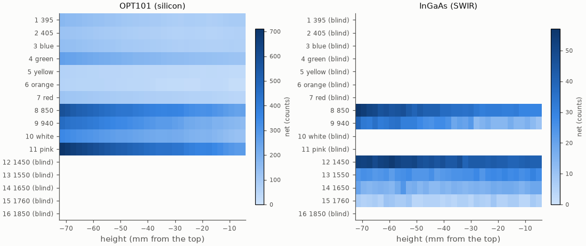
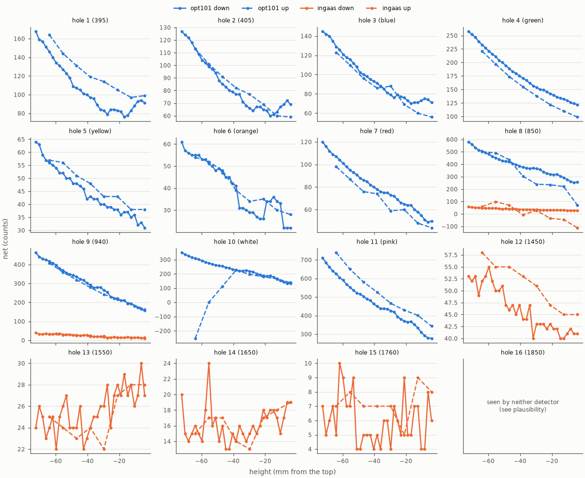
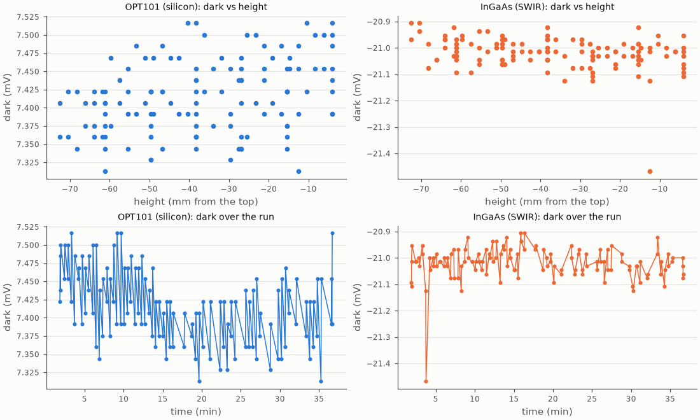
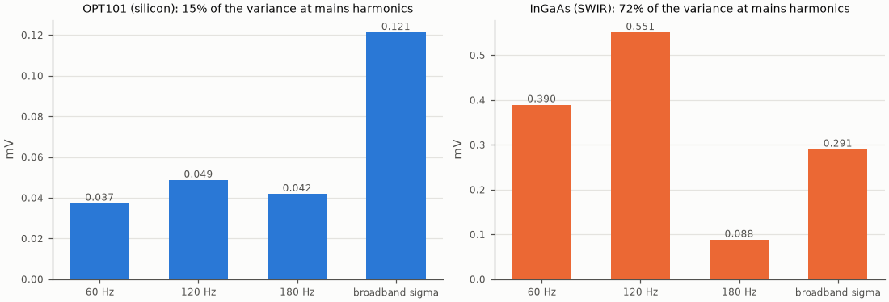

# LIO diagnostic sweep 20261120-173515_scan_full

Mode **full**, sample **empty**, status **COMPLETE**

## Verdict: DEGRADED

- failing channels: 14
- warnings: T13.T06, T13.T09

## Subsystem health

| Subsystem | Parts | Health | Reason |
|---|---|---|---|
| Link / firmware | Nano R4, USB, firmware | ✓ OK | 1 checks pass |
| ADC / I²C | ADS1115, software I²C D11/D12 | ✓ OK | 1 checks pass |
| Shift registers | U1, U2 | ✓ OK | 1 checks pass |
| LED drivers / rails | DRV1 (RAIL A), DRV2 (RAIL B) | ✓ OK | 4 checks pass |
| LED / MOSFET channels | LED1-16, Q1-16 | ✕ ACT | optics/ingaas/h14/response: O 5 counts at h -226956, C +16.0, modulation 1.57 |
| OPT101 | OPT101 (A1) | ✓ OK | 8 checks pass |
| InGaAs TIA | D1, U5, Rf, Cf (A0) | ! WATCH | optics/ingaas/throughput: median O over 5 expected holes; spread (CV) 67% across holes |
| Motors / lead screws | M1, M2, ULN2003, couplers, M6 rods | ! WATCH | mech/travel: tracked range 297147 / 309218 half-steps (left / right): the two sides differ (thresholds.motion.travel.range_steps not set: not compared) |
| Stage tracking | lio.stage, soft limits | ✓ OK | 1 checks pass |
| Safety | interlocks, duty budget | ✓ OK | 2 checks pass |
| Power / earthing | supplies, GND, earth bond | ✓ OK | 4 checks pass |
| Optical path / ambient | window, shroud, lid, sample | ✓ OK | 5 checks pass |
| Run | the scan itself | ✓ OK | 1 checks pass |

## Findings to act on

### ! WARN `optics/opt101/h16/plausibility`: hole 16 (1850) seen by opt101?

opt101 cannot see 1850 nm; residual +1064 counts over C +15.0; height-dependent (optical)

- **Why:** A detector responds, with a height-dependent (optical) signal, to a hole whose wavelength it cannot see: the LED in this hole is not the one in the channel map (swapped with another hole, or the wrong part).
- **Parts:** LED16
- **Next check:** Camera check of that hole (visible or not); compare the LED marking with docs/OPTICAL_CHANNEL_MAP.md; look for the hole it was swapped with (a response missing elsewhere).

### ! WARN `optics/ingaas/h13/response`: hole 13 (1550) on ingaas

O 13 counts at h -25158, C +16.0, modulation 0.49

- **Why:** This hole gives no (or little) height-dependent light on a detector that should see it: the LED is dead or reversed, its MOSFET is open, it is wired to the wrong rail, or it is an LED that this detector cannot see (swapped or wrong part).
- **Parts:** LED13, Q13, rail wiring
- **Next check:** Phone-camera check of the hole while it is lit (lio ch 13 on); meter the Q gate and drain; compare with the rail map.

### ✕ FAIL `optics/ingaas/h14/response`: hole 14 (1650) on ingaas

O 5 counts at h -226956, C +16.0, modulation 1.57

- **Why:** This hole gives no (or little) height-dependent light on a detector that should see it: the LED is dead or reversed, its MOSFET is open, it is wired to the wrong rail, or it is an LED that this detector cannot see (swapped or wrong part).
- **Parts:** LED14, Q14, rail wiring
- **Next check:** Phone-camera check of the hole while it is lit (lio ch 14 on); meter the Q gate and drain; compare with the rail map.

### ! WARN `optics/ingaas/throughput`: ingaas: optical throughput (window, alignment)

median O over 5 expected holes; spread (CV) 67% across holes

- **Why:** Every hole on this detector is weaker than expected while the shape vs height is normal: less light reaches the detector (a dirty or blocked window, misalignment, or a weaker sample).
- **Parts:** detector window, alignment, sample
- **Next check:** Inspect and clean the deck window over the detector; re-run with the white tile.

### ! WARN `optics/h08/intermittent`: hole 8 (850) intermittent

down and up readings disagree on both detectors at once at 3 height(s): -86575, -51479, -16384

- **Why:** This hole's readings jump on both detectors at the same moment: an electrical event (a joint opening for an instant, or an intermittent short), not light.
- **Parts:** LED8, Q8, solder joints, breadboard contacts
- **Next check:** Wiggle-test the LED and MOSFET leads while watching 'lio ch 8 on' readings; reflow or re-seat the joints.

### ! WARN `optics/ingaas/snr`: ingaas: signal-to-noise at the optimum

weakest hole 13: 14.8 dB (noise sigma 0.291 mV)

- **Why:** A hole's signal is close to the noise.
- **Parts:** LED, detector
- **Next check:** See the noise metrics; compare with the baseline.

### ! WARN `mech/travel`: travel (top to bottom)

tracked range 297147 / 309218 half-steps (left / right): the two sides differ (thresholds.motion.travel.range_steps not set: not compared)

- **Why:** The tracked travel differs from the configured one (or between the sides).
- **Parts:** stage limits
- **Next check:** Re-mark the top and bottom.

### ! WARN `mech/repeatability`: repeatability at the reference heights

spread of repeated visits 1442 half-steps (RMS over 1 groups); above minus below -972 half-steps (backlash, direct); softened to WARN (V3 mechanics provisional)

- **Why:** Repeated visits to one height do not land in the same place.
- **Parts:** couplers, lead screws
- **Next check:** Repeat the reference heights; inspect the couplers.

## Response vs height, per hole (down pass; blind holes blank)

## Response curves: down pass (solid) and up pass (dashed)

## Dark level vs height (light leak) and over time (drift)

## Dark noise: mains harmonics and broadband

## System

| Status | Metric | Value | Result | Criterion |
|---|---|---|---|---|
| ✓ PASS | `system/link` | 0 unexpected boots | firmware 2.5.2, no unexpected # BOOT |  |
| ✓ PASS | `system/adc` | 2360 readings | 2360 readings, no dropout |  |
| ✓ PASS | `system/addressing` | 0 pairs | 14 responding holes, all distinct |  |
| ✓ PASS | `system/rail/A` | 8 holes | 8/8 holes respond |  |
| ✓ PASS | `system/rail/B` | 5 holes | 5/8 holes respond |  |
| ✓ PASS | `system/interlocks` | 0 failed | light_while_moving: PASS; single_channel: PASS |  |
| ✓ PASS | `system/duty` | 336 ms/min | max 336 ms of 1000 ms; 0 cool-down waits, 0 s in all |  |
| ✓ PASS | `system/stage` |  | position [-16384, -16384], limits respected |  |
| ✓ PASS | `system/run` |  | COMPLETE |  |

## Optics

| Status | Metric | Value | Result | Criterion |
|---|---|---|---|---|
| ✓ PASS | `optics/opt101/h01/response` | 156.8 counts | O 157 counts at h -297147, C +10.0, modulation 0.57 | O >= 15 (WARN below), >= 6 (FAIL below) |
| ✓ PASS | `optics/opt101/h02/response` | 116.8 counts | O 117 counts at h -297147, C +10.0, modulation 0.57 | O >= 15 (WARN below), >= 6 (FAIL below) |
| ✓ PASS | `optics/opt101/h03/response` | 134.8 counts | O 135 counts at h -297147, C +10.0, modulation 0.55 | O >= 15 (WARN below), >= 6 (FAIL below) |
| ✓ PASS | `optics/opt101/h04/response` | 247.8 counts | O 248 counts at h -297147, C +10.0, modulation 0.55 | O >= 15 (WARN below), >= 6 (FAIL below) |
| ✓ PASS | `optics/opt101/h05/response` | 54.5 counts | O 54 counts at h -297147, C +10.0, modulation 0.61 | O >= 15 (WARN below), >= 6 (FAIL below) |
| ✓ PASS | `optics/opt101/h06/response` | 50.5 counts | O 50 counts at h -297147, C +10.0, modulation 0.80 | O >= 15 (WARN below), >= 6 (FAIL below) |
| ✓ PASS | `optics/opt101/h07/response` | 110 counts | O 110 counts at h -297147, C +10.0, modulation 0.64 | O >= 15 (WARN below), >= 6 (FAIL below) |
| ✓ PASS | `optics/opt101/h08/response` | 571.3 counts | O 571 counts at h -297147, C +10.0, modulation 0.58 | O >= 15 (WARN below), >= 6 (FAIL below) |
| ✓ PASS | `optics/opt101/h09/response` | 446.2 counts | O 446 counts at h -297147, C +15.0, modulation 0.68 | O >= 15 (WARN below), >= 6 (FAIL below) |
| ✓ PASS | `optics/opt101/h10/response` | 333.8 counts | O 334 counts at h -297147, C +15.0, modulation 0.65 | O >= 15 (WARN below), >= 6 (FAIL below) |
| ✓ PASS | `optics/opt101/h11/response` | 695 counts | O 695 counts at h -297147, C +15.0, modulation 0.63 | O >= 15 (WARN below), >= 6 (FAIL below) |
| ✓ PASS | `optics/opt101/h12/plausibility` | 2.7 counts | opt101 cannot see 1450 nm; residual +3 counts over C +15.0 | < 30 counts (WARN), < 80 (FAIL) |
| ✓ PASS | `optics/opt101/h13/plausibility` | -0.5 counts | opt101 cannot see 1550 nm; residual -0 counts over C +15.0 | < 30 counts (WARN), < 80 (FAIL) |
| ✓ PASS | `optics/opt101/h14/plausibility` | 0.4 counts | opt101 cannot see 1650 nm; residual +0 counts over C +15.0 | < 30 counts (WARN), < 80 (FAIL) |
| ✓ PASS | `optics/opt101/h15/plausibility` | 0.3 counts | opt101 cannot see 1760 nm; residual +0 counts over C +15.0 | < 30 counts (WARN), < 80 (FAIL) |
| ! WARN | `optics/opt101/h16/plausibility` | 1064.2 counts | opt101 cannot see 1850 nm; residual +1064 counts over C +15.0; height-dependent (optical) | < 30 counts (WARN); FAIL capped to WARN: no in-range detector for this hole |
| ✓ PASS | `optics/opt101/electrical_only` | 0 fraction | 0/11 expected holes show no optical response; coupling present | FAIL when >= 75% of expected holes have O < 6 while |C| >= 8 |
| ✓ PASS | `optics/opt101/throughput` | 156.8 counts | median O over 11 expected holes; spread (CV) 79% across holes | median O >= 60 (WARN below), >= 20 (FAIL below) for empty |
| ✓ PASS | `optics/ingaas/h01/plausibility` | 1.7 counts | ingaas cannot see 395 nm; residual +2 counts over C +2.0 | < 30 counts (WARN), < 80 (FAIL) |
| ✓ PASS | `optics/ingaas/h02/plausibility` | -0.5 counts | ingaas cannot see 405 nm; residual -1 counts over C +2.0 | < 30 counts (WARN), < 80 (FAIL) |
| ✓ PASS | `optics/ingaas/h03/plausibility` | -0.2 counts | ingaas cannot see 465 nm; residual -0 counts over C +2.0 | < 30 counts (WARN), < 80 (FAIL) |
| ✓ PASS | `optics/ingaas/h04/plausibility` | 2.5 counts | ingaas cannot see 525 nm; residual +2 counts over C +2.0 | < 30 counts (WARN), < 80 (FAIL) |
| ✓ PASS | `optics/ingaas/h05/plausibility` | 13 counts | ingaas cannot see 590 nm; residual +13 counts over C +2.0 | < 30 counts (WARN), < 80 (FAIL) |
| ✓ PASS | `optics/ingaas/h06/plausibility` | 13.1 counts | ingaas cannot see 605 nm; residual +13 counts over C +2.0 | < 30 counts (WARN), < 80 (FAIL) |
| ✓ PASS | `optics/ingaas/h07/plausibility` | 3.1 counts | ingaas cannot see 630 nm; residual +3 counts over C +2.0 | < 30 counts (WARN), < 80 (FAIL) |
| ✓ PASS | `optics/ingaas/h08/response` | 55 counts | O 55 counts at h -297147, C +2.0, modulation 0.51 | O >= 18.6002 (WARN below), >= 9.30012 (FAIL below) |
| ✓ PASS | `optics/ingaas/h09/response` | 23 counts | O 23 counts at h -297147, C +16.0, modulation 1.26 | O >= 18.6002 (WARN below), >= 9.30012 (FAIL below) |
| ✓ PASS | `optics/ingaas/h10/plausibility` | -11.2 counts | ingaas cannot see 450 nm; residual -11 counts over C +16.0 | < 30 counts (WARN), < 80 (FAIL) |
| ✓ PASS | `optics/ingaas/h11/plausibility` | 6.8 counts | ingaas cannot see 450 nm; residual +7 counts over C +16.0 | < 30 counts (WARN), < 80 (FAIL) |
| ✓ PASS | `optics/ingaas/h12/response` | 38 counts | O 38 counts at h -244504, C +16.0, modulation 0.37 | O >= 18.6002 (WARN below), >= 9.30012 (FAIL below) |
| ! WARN | `optics/ingaas/h13/response` | 12.8 counts | O 13 counts at h -25158, C +16.0, modulation 0.49 | O >= 18.6002 (WARN below), >= 9.30012 (FAIL below) |
| ✕ FAIL | `optics/ingaas/h14/response` | 4.7 counts | O 5 counts at h -226956, C +16.0, modulation 1.57 | O >= 18.6002 (WARN below), >= 9.30012 (FAIL below) |
| ✓ PASS | `optics/ingaas/h16/plausibility` | 28.7 counts | ingaas cannot see 1850 nm; residual +29 counts over C +16.0 | < 30 counts (WARN); FAIL capped to WARN: no in-range detector for this hole |
| ✓ PASS | `optics/ingaas/electrical_only` | 0.2 fraction | 1/5 expected holes show no optical response; coupling present | FAIL when >= 75% of expected holes have O < 9.30012 while |C| >= 8 |
| ! WARN | `optics/ingaas/throughput` | 23 counts | median O over 5 expected holes; spread (CV) 67% across holes | median O >= 60 (WARN below), >= 20 (FAIL below) for empty |
| ✓ PASS | `optics/h01/intermittent` | 0 heights | down and up agree at 8 heights |  |
| ✓ PASS | `optics/h02/intermittent` | 0 heights | down and up agree at 8 heights |  |
| ✓ PASS | `optics/h03/intermittent` | 0 heights | down and up agree at 8 heights |  |
| ✓ PASS | `optics/h04/intermittent` | 0 heights | down and up agree at 8 heights |  |
| ✓ PASS | `optics/h05/intermittent` | 0 heights | down and up agree at 8 heights |  |
| ✓ PASS | `optics/h06/intermittent` | 0 heights | down and up agree at 8 heights |  |
| ✓ PASS | `optics/h07/intermittent` | 0 heights | down and up agree at 8 heights |  |
| ! WARN | `optics/h08/intermittent` | 3 heights | down and up readings disagree on both detectors at once at 3 height(s): -86575, -51479, -16384 | both detectors within max(5 x noise floor, 0.1 x reading) of each other |
| ✓ PASS | `optics/h09/intermittent` | 0 heights | down and up agree at 8 heights |  |
| ✓ PASS | `optics/h10/intermittent` | 0 heights | down and up agree at 8 heights |  |
| ✓ PASS | `optics/h11/intermittent` | 0 heights | down and up agree at 8 heights |  |
| ✓ PASS | `optics/h12/intermittent` | 0 heights | down and up agree at 8 heights |  |
| ✓ PASS | `optics/h13/intermittent` | 0 heights | down and up agree at 8 heights |  |
| ✓ PASS | `optics/h14/intermittent` | 0 heights | down and up agree at 8 heights |  |
| ✓ PASS | `optics/h15/intermittent` | 0 heights | down and up agree at 8 heights |  |
| ✓ PASS | `optics/h16/intermittent` | 0 heights | down and up agree at 8 heights |  |
| ✓ PASS | `optics/optimum` | -226956 half-steps | -226956 half-steps (-55.41 mm); weakest normalised response there 0.71 |  |
| ✓ PASS | `optics/opt101/snr` | 34.3 dB | weakest hole 6: 34.3 dB (noise sigma 0.121 mV) | >= 20 dB |
| ✓ PASS | `optics/opt101/headroom` | 95.8 % | highest lit reading 1239 of 29600 counts | >= 10% |
| ! WARN | `optics/ingaas/snr` | 14.8 dB | weakest hole 13: 14.8 dB (noise sigma 0.291 mV) | >= 20 dB |
| ✓ PASS | `optics/ingaas/headroom` | 100.2 % | highest lit reading -68 of 28000 counts | >= 10% |
| - SKIP | `optics/stray` |  | needs a black_cup run (with a white_ptfe reference) |  |
| - SKIP | `optics/effectiveness` |  | needs a reference (baseline) of the same sample |  |
| ✓ PASS | `optics/wrong_rail/h01` | 1 counts | +1 counts on opt101 with the hole selected and RAIL B enabled | < 30 counts (WARN), < 80 (FAIL) |
| ✓ PASS | `optics/wrong_rail/h02` | -1 counts | -1 counts on opt101 with the hole selected and RAIL B enabled | < 30 counts (WARN), < 80 (FAIL) |
| ✓ PASS | `optics/wrong_rail/h03` | 0 counts | +0 counts on opt101 with the hole selected and RAIL B enabled | < 30 counts (WARN), < 80 (FAIL) |
| ✓ PASS | `optics/wrong_rail/h04` | 0 counts | +0 counts on opt101 with the hole selected and RAIL B enabled | < 30 counts (WARN), < 80 (FAIL) |
| ✓ PASS | `optics/wrong_rail/h05` | 0 counts | +0 counts on opt101 with the hole selected and RAIL B enabled | < 30 counts (WARN), < 80 (FAIL) |
| ✓ PASS | `optics/wrong_rail/h06` | -1 counts | -1 counts on opt101 with the hole selected and RAIL B enabled | < 30 counts (WARN), < 80 (FAIL) |
| ✓ PASS | `optics/wrong_rail/h07` | -1 counts | -1 counts on opt101 with the hole selected and RAIL B enabled | < 30 counts (WARN), < 80 (FAIL) |
| ✓ PASS | `optics/wrong_rail/h08` | -1 counts | -1 counts on opt101 with the hole selected and RAIL B enabled | < 30 counts (WARN), < 80 (FAIL) |
| ✓ PASS | `optics/wrong_rail/h09` | 0 counts | +0 counts on opt101 with the hole selected and RAIL A enabled | < 30 counts (WARN), < 80 (FAIL) |
| ✓ PASS | `optics/wrong_rail/h10` | 1 counts | +1 counts on opt101 with the hole selected and RAIL A enabled | < 30 counts (WARN), < 80 (FAIL) |
| ✓ PASS | `optics/wrong_rail/h11` | 0 counts | +0 counts on opt101 with the hole selected and RAIL A enabled | < 30 counts (WARN), < 80 (FAIL) |
| ✓ PASS | `optics/wrong_rail/h12` | 0 counts | +0 counts on ingaas with the hole selected and RAIL A enabled | < 30 counts (WARN), < 80 (FAIL) |
| ✓ PASS | `optics/wrong_rail/h13` | 0 counts | +0 counts on ingaas with the hole selected and RAIL A enabled | < 30 counts (WARN), < 80 (FAIL) |
| ✓ PASS | `optics/wrong_rail/h14` | -1 counts | -1 counts on ingaas with the hole selected and RAIL A enabled | < 30 counts (WARN), < 80 (FAIL) |
| ✓ PASS | `optics/wrong_rail/h15` | -1 counts | -1 counts on ingaas with the hole selected and RAIL A enabled | < 30 counts (WARN), < 80 (FAIL) |

## Electrical

| Status | Metric | Value | Result | Criterion |
|---|---|---|---|---|
| ✓ PASS | `elec/opt101/coupling` | 15 counts | rail A: +10.0 counts (+1.25 mV) inferred, rail B: +15.0 counts (+1.88 mV) from 5 blind holes | corrected in software below 20 counts (FAIL at or above) |
| ✓ PASS | `elec/opt101/ground_shift` | 0.0417 mV/mA | +0.333 counts/mA | corrected in software below 0.08 mV/mA (FAIL at or above) |
| ✓ PASS | `elec/ingaas/coupling` | 16 counts | rail A: +2.0 counts (+0.25 mV) from 7 blind holes, rail B: +16.0 counts (+2.00 mV) from 3 blind holes | corrected in software below 20 counts (FAIL at or above) |
| ✓ PASS | `elec/ingaas/ground_shift` | 0.0333 mV/mA | +0.267 counts/mA | corrected in software below 0.08 mV/mA (FAIL at or above) |
| ✓ PASS | `elec/opt101/dark_offset` | 7.423 mV | +59.4 counts (+7.42 mV) | 0 to 800 counts (thresholds.dark) |
| ✓ PASS | `elec/ingaas/dark_offset` | -21.015 mV | -168.1 counts (-21.02 mV); equivalent input current +21.0 nA (Rf 1 MΩ) | -400 to 2000 counts (thresholds.dark) |
| ✓ PASS | `elec/opt101/drift` | -0.109 mV/h | -0.11 ± 0.02 mV/h; P4 - P1 +0.00 mV | |slope| < 3 mV/h (WARN), < 8 (FAIL) |
| ✓ PASS | `elec/ingaas/drift` | -0.005 mV/h | -0.00 ± 0.03 mV/h (+0.0 nA/h); P4 - P1 +0.03 mV | |slope| < 3 mV/h (WARN), < 8 (FAIL) |
| ✓ PASS | `elec/opt101/hum` | 0.0374 mV | 60/120/180 Hz: 0.037 / 0.049 / 0.042 mV; 15% of the variance at mains harmonics; broadband sigma 0.121 mV; readings integrate whole mains periods, so it cancels in the measurements | 60 Hz amplitude < 0.3 mV (WARN; not when the readings reject it), < 1 (FAIL); mains fraction < 0.5 |
| ✓ PASS | `elec/ingaas/hum` | 0.3896 mV | 60/120/180 Hz: 0.390 / 0.551 / 0.088 mV; 72% of the variance at mains harmonics; broadband sigma 0.291 mV; readings integrate whole mains periods, so it cancels in the measurements | 60 Hz amplitude < 1 mV (WARN; not when the readings reject it), < 3 (FAIL); mains fraction < 0.5 |
| ✓ PASS | `elec/opt101/coil_emi` | 9.23 x | sigma 1.154 mV moving vs 0.121 mV off (measured while moving, S0 D2); judged only when measuring while moving (continuous mode): every other reading is taken with the motors stopped | ratio < 3 (WARN), < 6 (FAIL) |
| ✓ PASS | `elec/ingaas/coil_emi` | 1.21 x | sigma 0.352 mV moving vs 0.291 mV off (measured while moving, S0 D2); judged only when measuring while moving (continuous mode): every other reading is taken with the motors stopped | ratio < 3 (WARN), < 6 (FAIL) |
| ✓ PASS | `elec/opt101/h10/select_only` | 0.5 counts | largest on hole 10: +0.5 counts | < 8 counts (WARN); FAIL capped to WARN (gate coupling, LED off) |
| ✓ PASS | `elec/ingaas/h12/select_only` | 0.8 counts | largest on hole 12: -0.8 counts | < 8 counts (WARN); FAIL capped to WARN (gate coupling, LED off) |
| ✓ PASS | `elec/opt101/ce_only` | 1 counts | CE1: +0.0, CE2: -1.0 | < 8 counts (WARN), < 20 (FAIL) |
| ✓ PASS | `elec/ingaas/ce_only` | 1 counts | CE1: -1.0, CE2: +1.0 | < 8 counts (WARN), < 20 (FAIL) |
| - SKIP | `elec/rails` |  | A2/A3 not wired for rail and ground monitoring |  |

## Mechanics

| Status | Metric | Value | Result | Criterion |
|---|---|---|---|---|
| - SKIP | `mech/home_sensors` |  | no home sensors fitted |  |
| ! WARN | `mech/travel` | 297147 half-steps | tracked range 297147 / 309218 half-steps (left / right): the two sides differ (thresholds.motion.travel.range_steps not set: not compared) |  |
| ✓ PASS | `mech/lockstep` | 0 moves | 84 moves; 0 ended with the two sides at different positions (without home sensors only the commanded steps are seen: a side losing steps shows as mech/step_loss) |  |
| ✓ PASS | `mech/settle` | 602 ms | median 602 ms, max 608 ms (mechanical wait 300 ms) | max - median < 500 ms (WARN), < 1500 (FAIL) |
| - SKIP | `mech/backlash` | 1667 half-steps | +1667 ± 4606 half-steps (+0.407 mm) from 106 readings on 14 channels | < 600 (WARN), < 1500 (FAIL); not flagged within 3 sigma; not judged when the resolution is worse than 300 |
| - SKIP | `mech/step_loss` | -11450 half-steps per travel | the stage falls behind by -11450 ± 7595 half-steps over a full upward travel (one side losing steps: about twice that on that side, and a tilt) | < 400 (WARN), < 1000 (FAIL); not flagged within 3 sigma |
| ! WARN | `mech/repeatability` | 1442 half-steps | spread of repeated visits 1442 half-steps (RMS over 1 groups); above minus below -972 half-steps (backlash, direct); softened to WARN (V3 mechanics provisional) | < 300 (WARN), < 800 (would FAIL; capped at WARN for V3 mechanics) |

## Ambient

| Status | Metric | Value | Result | Criterion |
|---|---|---|---|---|
| ✓ PASS | `ambient/opt101/leak` | -0.1 counts | dark at the bottom -0.1 counts (-0.01 mV) vs the top | rise < 8 counts (WARN), < 25 (FAIL) |
| ✓ PASS | `ambient/ingaas/leak` | 0.8 counts | dark at the bottom +0.8 counts (+0.09 mV) vs the top; 3.26% of the median signal | rise < 8 counts (WARN), < 25 (FAIL) |
| ✓ PASS | `ambient/opt101/flicker` | 0.0488 mV | 120 Hz amplitude in the dark streams 0.049 mV; readings integrate whole mains periods, so it cancels | < 0.4 mV (WARN), < 1.2 (FAIL) |
| ✓ PASS | `ambient/ingaas/flicker` | 0.551 mV | 120 Hz amplitude in the dark streams 0.551 mV; readings integrate whole mains periods, so it cancels | < 0.4 mV (WARN), < 1.2 (FAIL) |
| - SKIP | `ambient/lid` |  | optional operator step (lid ajar at two heights) |  |

## Not measured (capability)

- rail_monitor: A2/A3 not wired for rail and ground monitoring
- home_sensors: no home sensors fitted
