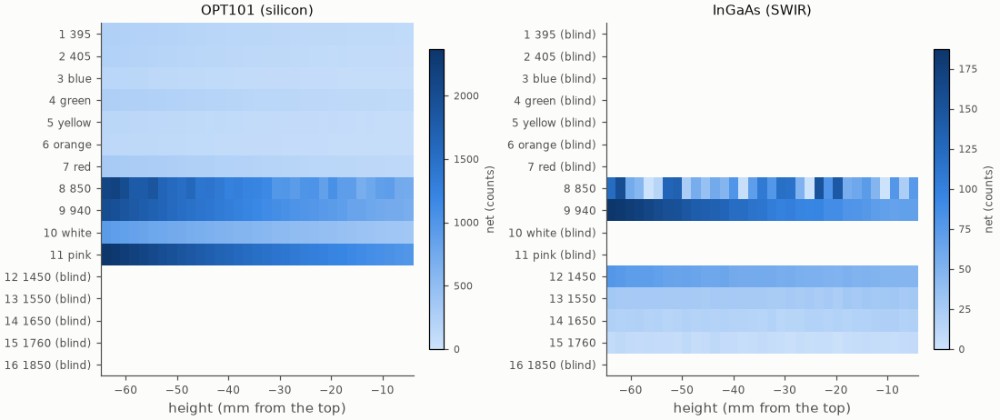
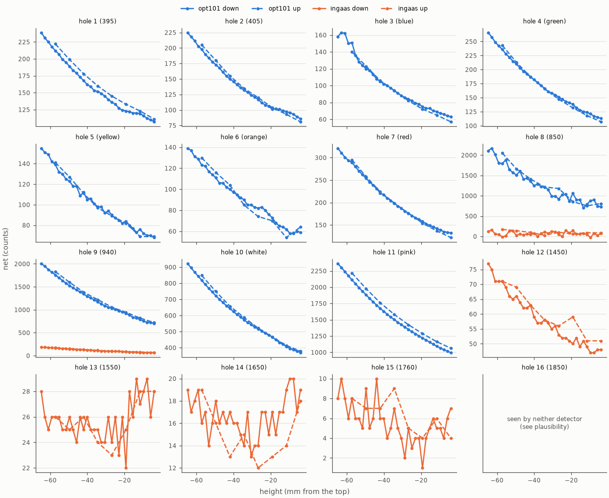
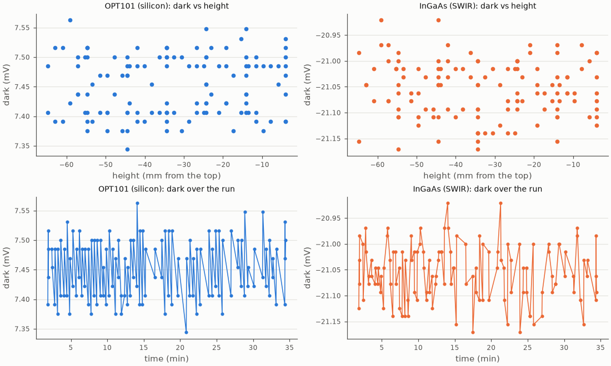
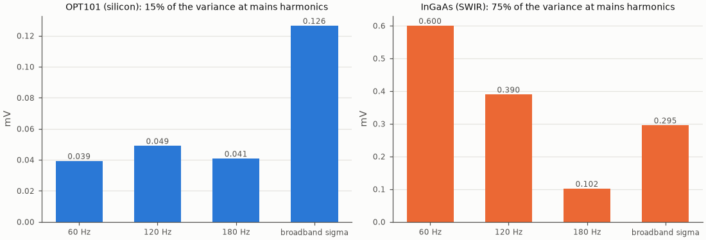

# LIO diagnostic sweep 20261120-184450_scan_full

Mode **full**, sample **LIO-F-00001**, status **COMPLETE**

## Verdict: FUNCTIONAL

- warnings: T13.T05, T13.T09, T13.T13, T13.T06

## Subsystem health

| Subsystem | Parts | Health | Reason |
|---|---|---|---|
| Link / firmware | Nano R4, USB, firmware | ✓ OK | 1 checks pass |
| ADC / I²C | ADS1115, software I²C D11/D12 | ✓ OK | 1 checks pass |
| Shift registers | U1, U2 | ✓ OK | 1 checks pass |
| LED drivers / rails | DRV1 (RAIL A), DRV2 (RAIL B) | ✓ OK | 4 checks pass |
| LED / MOSFET channels | LED1-16, Q1-16 | ! WATCH | optics/opt101/h16/plausibility: opt101 cannot see 1850 nm; residual +3571 counts over C +15.0; height-dependent (optical) |
| OPT101 | OPT101 (A1) | ✓ OK | 7 checks pass |
| InGaAs TIA | D1, U5, Rf, Cf (A0) | ✕ ACT | elec/ingaas/coupling: rail A: +5.0 counts (+0.62 mV) from 7 blind holes, rail B: +61.0 counts (+7.62 mV) from 3 blind holes |
| Motors / lead screws | M1, M2, ULN2003, couplers, M6 rods | ! WATCH | mech/travel: tracked range 265346 / 307493 half-steps (M1/right / M2/left): the two sides differ (thresholds.motion.travel.range_steps not set: not compared) |
| Stage tracking | lio.stage, soft limits | ✓ OK | 1 checks pass |
| Safety | interlocks, duty budget | ✓ OK | 2 checks pass |
| Power / earthing | supplies, GND, earth bond | ! WATCH | elec/ingaas/ground_shift: +0.990 counts/mA; does not scale with the rail current |
| Optical path / ambient | window, shroud, lid, sample | ! WATCH | optics/optimum: -265346 half-steps (-64.78 mm); weakest normalised response there 0.97; at an end of the travel: the true peak may lie beyond |
| Run | the scan itself | ✓ OK | 1 checks pass |

## Findings to act on

### ! WARN `optics/opt101/h16/plausibility`: hole 16 (1850) seen by opt101?

opt101 cannot see 1850 nm; residual +3571 counts over C +15.0; height-dependent (optical)

- **Why:** A detector responds, with a height-dependent (optical) signal, to a hole whose wavelength it cannot see: the LED in this hole is not the one in the channel map (swapped with another hole, or the wrong part).
- **Parts:** LED16
- **Next check:** Camera check of that hole (visible or not); compare the LED marking with docs/OPTICAL_CHANNEL_MAP.md; look for the hole it was swapped with (a response missing elsewhere).

### ! WARN `optics/ingaas/h16/plausibility`: hole 16 (1850) seen by ingaas?

ingaas cannot see 1850 nm; residual +129 counts over C +61.0; height-dependent (optical)

- **Why:** A detector responds, with a height-dependent (optical) signal, to a hole whose wavelength it cannot see: the LED in this hole is not the one in the channel map (swapped with another hole, or the wrong part).
- **Parts:** LED16
- **Next check:** Camera check of that hole (visible or not); compare the LED marking with docs/OPTICAL_CHANNEL_MAP.md; look for the hole it was swapped with (a response missing elsewhere).

### ! WARN `optics/h08/intermittent`: hole 8 (850) intermittent

down and up readings disagree on both detectors at once at 3 height(s): -234226, -109745, -78624

- **Why:** This hole's readings jump on both detectors at the same moment: an electrical event (a joint opening for an instant, or an intermittent short), not light.
- **Parts:** LED8, Q8, solder joints, breadboard contacts
- **Next check:** Wiggle-test the LED and MOSFET leads while watching 'lio ch 8 on' readings; reflow or re-seat the joints.

### ! WARN `optics/optimum`: optimum height (all holes)

-265346 half-steps (-64.78 mm); weakest normalised response there 0.97; at an end of the travel: the true peak may lie beyond

- **Why:** The best height is at an end of the travel: the true optimum may lie beyond it.
- **Parts:** geometry
- **Next check:** Check the sample position.

### ✕ FAIL `elec/ingaas/coupling`: ingaas: electrical coupling (height-invariant, LED on)

rail A: +5.0 counts (+0.62 mV) from 7 blind holes, rail B: +61.0 counts (+7.62 mV) from 3 blind holes

- **Why:** The detector output changes when an LED is on even though it cannot see that light: electrical coupling from the LED drive (shared ground return, or capacitive pick-up).
- **Parts:** GND star point, SUM/TIA_REF routing, LED drive wiring
- **Next check:** Check that the TIA reference and the LED return do not share a thin ground path.

### ! WARN `elec/ingaas/ground_shift`: ingaas: ground shift (coupling vs rail current)

+0.990 counts/mA; does not scale with the rail current

- **Why:** The coupling scales with the rail current: LED current through a shared ground resistance shifts the detector's reference (ground shift).
- **Parts:** GND star point, TIA_REF, rail returns
- **Next check:** Measure the voltage between the TIA ground and the supply ground with RAIL B lit; run the LED returns straight to the supply.

### ! WARN `mech/travel`: travel (top to bottom)

tracked range 265346 / 307493 half-steps (M1/right / M2/left): the two sides differ (thresholds.motion.travel.range_steps not set: not compared)

- **Why:** The tracked travel differs from the configured one (or between the sides).
- **Parts:** stage limits
- **Next check:** Re-mark the top and bottom.

### ! WARN `mech/repeatability`: repeatability at the reference heights

spread of repeated visits 3863 half-steps (RMS over 8 groups); above minus below +6352 half-steps (backlash, direct); softened to WARN (V3 mechanics provisional)

- **Why:** Repeated visits to one height do not land in the same place.
- **Parts:** couplers, lead screws
- **Next check:** Repeat the reference heights; inspect the couplers.

## Response vs height, per hole (down pass; blind holes blank)

## Response curves: down pass (solid) and up pass (dashed)

## Dark level vs height (light leak) and over time (drift)

## Dark noise: mains harmonics and broadband

## System

| Status | Metric | Value | Result | Criterion |
|---|---|---|---|---|
| ✓ PASS | `system/link` | 0 unexpected boots | firmware 2.5.2, no unexpected # BOOT |  |
| ✓ PASS | `system/adc` | 2360 readings | 2360 readings, no dropout |  |
| ✓ PASS | `system/addressing` | 0 pairs | 13 responding holes, all distinct |  |
| ✓ PASS | `system/rail/A` | 8 holes | 8/8 holes respond |  |
| ✓ PASS | `system/rail/B` | 4 holes | 4/8 holes respond |  |
| ✓ PASS | `system/interlocks` | 0 failed | light_while_moving: PASS; single_channel: PASS |  |
| ✓ PASS | `system/duty` | 420 ms/min | max 420 ms of 1000 ms; 0 cool-down waits, 0 s in all |  |
| ✓ PASS | `system/stage` |  | position [-16384, -16384], limits respected |  |
| ✓ PASS | `system/run` |  | COMPLETE |  |

## Optics

| Status | Metric | Value | Result | Criterion |
|---|---|---|---|---|
| - SKIP | `optics/opt101/h01/response` | 228.7 counts | sample 'LIO-F-00001' is not judged against absolute levels | O >= 15 (WARN below), >= 6 (FAIL below) |
| - SKIP | `optics/opt101/h02/response` | 214.8 counts | sample 'LIO-F-00001' is not judged against absolute levels | O >= 15 (WARN below), >= 6 (FAIL below) |
| - SKIP | `optics/opt101/h03/response` | 153.8 counts | sample 'LIO-F-00001' is not judged against absolute levels | O >= 15 (WARN below), >= 6 (FAIL below) |
| - SKIP | `optics/opt101/h04/response` | 256.2 counts | sample 'LIO-F-00001' is not judged against absolute levels | O >= 15 (WARN below), >= 6 (FAIL below) |
| - SKIP | `optics/opt101/h05/response` | 144.7 counts | sample 'LIO-F-00001' is not judged against absolute levels | O >= 15 (WARN below), >= 6 (FAIL below) |
| - SKIP | `optics/opt101/h06/response` | 129.7 counts | sample 'LIO-F-00001' is not judged against absolute levels | O >= 15 (WARN below), >= 6 (FAIL below) |
| - SKIP | `optics/opt101/h07/response` | 311 counts | sample 'LIO-F-00001' is not judged against absolute levels | O >= 15 (WARN below), >= 6 (FAIL below) |
| - SKIP | `optics/opt101/h08/response` | 2135.2 counts | sample 'LIO-F-00001' is not judged against absolute levels | O >= 15 (WARN below), >= 6 (FAIL below) |
| - SKIP | `optics/opt101/h09/response` | 1995.2 counts | sample 'LIO-F-00001' is not judged against absolute levels | O >= 15 (WARN below), >= 6 (FAIL below) |
| - SKIP | `optics/opt101/h10/response` | 908 counts | sample 'LIO-F-00001' is not judged against absolute levels | O >= 15 (WARN below), >= 6 (FAIL below) |
| - SKIP | `optics/opt101/h11/response` | 2349.3 counts | sample 'LIO-F-00001' is not judged against absolute levels | O >= 15 (WARN below), >= 6 (FAIL below) |
| ✓ PASS | `optics/opt101/h12/plausibility` | 2.7 counts | opt101 cannot see 1450 nm; residual +3 counts over C +15.0 | < 30 counts (WARN), < 80 (FAIL) |
| ✓ PASS | `optics/opt101/h13/plausibility` | -0.8 counts | opt101 cannot see 1550 nm; residual -1 counts over C +15.0 | < 30 counts (WARN), < 80 (FAIL) |
| ✓ PASS | `optics/opt101/h14/plausibility` | 0.8 counts | opt101 cannot see 1650 nm; residual +1 counts over C +15.0 | < 30 counts (WARN), < 80 (FAIL) |
| ✓ PASS | `optics/opt101/h15/plausibility` | 0.6 counts | opt101 cannot see 1760 nm; residual +1 counts over C +15.0 | < 30 counts (WARN), < 80 (FAIL) |
| ! WARN | `optics/opt101/h16/plausibility` | 3571.5 counts | opt101 cannot see 1850 nm; residual +3571 counts over C +15.0; height-dependent (optical) | < 30 counts (WARN); FAIL capped to WARN: no in-range detector for this hole |
| ✓ PASS | `optics/opt101/electrical_only` | 0 fraction | 0/11 expected holes show no optical response; coupling present | FAIL when >= 75% of expected holes have O < 6 while |C| >= 8 |
| - SKIP | `optics/opt101/throughput` | 256.2 counts | median O over 11 expected holes; spread (CV) 107% across holes | sample 'LIO-F-00001': judged against its baseline only |
| ✓ PASS | `optics/ingaas/h01/plausibility` | 1.7 counts | ingaas cannot see 395 nm; residual +2 counts over C +5.0 | < 30 counts (WARN), < 80 (FAIL) |
| ✓ PASS | `optics/ingaas/h02/plausibility` | -2.7 counts | ingaas cannot see 405 nm; residual -3 counts over C +5.0 | < 30 counts (WARN), < 80 (FAIL) |
| ✓ PASS | `optics/ingaas/h03/plausibility` | -2.8 counts | ingaas cannot see 465 nm; residual -3 counts over C +5.0 | < 30 counts (WARN), < 80 (FAIL) |
| ✓ PASS | `optics/ingaas/h04/plausibility` | -1.4 counts | ingaas cannot see 525 nm; residual -1 counts over C +5.0 | < 30 counts (WARN), < 80 (FAIL) |
| ✓ PASS | `optics/ingaas/h05/plausibility` | 16.7 counts | ingaas cannot see 590 nm; residual +17 counts over C +5.0 | < 30 counts (WARN), < 80 (FAIL) |
| ✓ PASS | `optics/ingaas/h06/plausibility` | 14.8 counts | ingaas cannot see 605 nm; residual +15 counts over C +5.0 | < 30 counts (WARN), < 80 (FAIL) |
| ✓ PASS | `optics/ingaas/h07/plausibility` | 13.2 counts | ingaas cannot see 630 nm; residual +13 counts over C +5.0 | < 30 counts (WARN), < 80 (FAIL) |
| - SKIP | `optics/ingaas/h08/response` | 139.3 counts | sample 'LIO-F-00001' is not judged against absolute levels | O >= 18.9042 (WARN below), >= 9.45212 (FAIL below) |
| - SKIP | `optics/ingaas/h09/response` | 125.8 counts | sample 'LIO-F-00001' is not judged against absolute levels | O >= 18.9042 (WARN below), >= 9.45212 (FAIL below) |
| ✓ PASS | `optics/ingaas/h10/plausibility` | -39.3 counts | ingaas cannot see 450 nm; residual -39 counts over C +61.0 | < 30 counts (WARN), < 80 (FAIL) |
| ✓ PASS | `optics/ingaas/h11/plausibility` | 28.5 counts | ingaas cannot see 450 nm; residual +28 counts over C +61.0 | < 30 counts (WARN), < 80 (FAIL) |
| - SKIP | `optics/ingaas/h12/response` | 16.3 counts | sample 'LIO-F-00001' is not judged against absolute levels | O >= 18.9042 (WARN below), >= 9.45212 (FAIL below) |
| - SKIP | `optics/ingaas/h13/response` | -32.9 counts | sample 'LIO-F-00001' is not judged against absolute levels | O >= 18.9042 (WARN below), >= 9.45212 (FAIL below) |
| - SKIP | `optics/ingaas/h14/response` | -40.8 counts | sample 'LIO-F-00001' is not judged against absolute levels | O >= 18.9042 (WARN below), >= 9.45212 (FAIL below) |
| ! WARN | `optics/ingaas/h16/plausibility` | 129 counts | ingaas cannot see 1850 nm; residual +129 counts over C +61.0; height-dependent (optical) | < 30 counts (WARN); FAIL capped to WARN: no in-range detector for this hole |
| ✓ PASS | `optics/ingaas/electrical_only` | 0.4 fraction | 2/5 expected holes show no optical response; coupling present | FAIL when >= 75% of expected holes have O < 9.45212 while |C| >= 8 |
| - SKIP | `optics/ingaas/throughput` | 16.3 counts | median O over 5 expected holes; spread (CV) 185% across holes | sample 'LIO-F-00001': judged against its baseline only |
| ✓ PASS | `optics/h01/intermittent` | 0 heights | down and up agree at 8 heights |  |
| ✓ PASS | `optics/h02/intermittent` | 0 heights | down and up agree at 8 heights |  |
| ✓ PASS | `optics/h03/intermittent` | 0 heights | down and up agree at 8 heights |  |
| ✓ PASS | `optics/h04/intermittent` | 0 heights | down and up agree at 8 heights |  |
| ✓ PASS | `optics/h05/intermittent` | 0 heights | down and up agree at 8 heights |  |
| ✓ PASS | `optics/h06/intermittent` | 0 heights | down and up agree at 8 heights |  |
| ✓ PASS | `optics/h07/intermittent` | 0 heights | down and up agree at 8 heights |  |
| ! WARN | `optics/h08/intermittent` | 3 heights | down and up readings disagree on both detectors at once at 3 height(s): -234226, -109745, -78624 | both detectors within max(5 x noise floor, 0.1 x reading) of each other |
| ✓ PASS | `optics/h09/intermittent` | 0 heights | down and up agree at 8 heights |  |
| ✓ PASS | `optics/h10/intermittent` | 0 heights | down and up agree at 8 heights |  |
| ✓ PASS | `optics/h11/intermittent` | 0 heights | down and up agree at 8 heights |  |
| ✓ PASS | `optics/h12/intermittent` | 0 heights | down and up agree at 8 heights |  |
| ✓ PASS | `optics/h13/intermittent` | 0 heights | down and up agree at 8 heights |  |
| ✓ PASS | `optics/h14/intermittent` | 0 heights | down and up agree at 8 heights |  |
| ✓ PASS | `optics/h15/intermittent` | 0 heights | down and up agree at 8 heights |  |
| ✓ PASS | `optics/h16/intermittent` | 0 heights | down and up agree at 8 heights |  |
| ! WARN | `optics/optimum` | -265346 half-steps | -265346 half-steps (-64.78 mm); weakest normalised response there 0.97; at an end of the travel: the true peak may lie beyond |  |
| ✓ PASS | `optics/opt101/snr` | 42.2 dB | weakest hole 6: 42.2 dB (noise sigma 0.126 mV) | >= 20 dB |
| ✓ PASS | `optics/opt101/headroom` | 87.7 % | highest lit reading 3648 of 29600 counts | >= 10% |
| ✓ PASS | `optics/ingaas/snr` | 16.8 dB | weakest hole 12: 16.8 dB (noise sigma 0.295 mV) | >= 20 dB |
| ✓ PASS | `optics/ingaas/headroom` | 99.9 % | highest lit reading 22 of 28000 counts | >= 10% |
| - SKIP | `optics/stray` |  | needs a black_cup run (with a white_ptfe reference) |  |
| - SKIP | `optics/effectiveness` |  | needs a reference (baseline) of the same sample |  |
| ✓ PASS | `optics/wrong_rail/h01` | 0 counts | +0 counts on opt101 with the hole selected and RAIL B enabled | < 30 counts (WARN), < 80 (FAIL) |
| ✓ PASS | `optics/wrong_rail/h02` | 1 counts | +1 counts on opt101 with the hole selected and RAIL B enabled | < 30 counts (WARN), < 80 (FAIL) |
| ✓ PASS | `optics/wrong_rail/h03` | 1 counts | +1 counts on opt101 with the hole selected and RAIL B enabled | < 30 counts (WARN), < 80 (FAIL) |
| ✓ PASS | `optics/wrong_rail/h04` | 0 counts | +0 counts on opt101 with the hole selected and RAIL B enabled | < 30 counts (WARN), < 80 (FAIL) |
| ✓ PASS | `optics/wrong_rail/h05` | 0 counts | +0 counts on opt101 with the hole selected and RAIL B enabled | < 30 counts (WARN), < 80 (FAIL) |
| ✓ PASS | `optics/wrong_rail/h06` | -1 counts | -1 counts on opt101 with the hole selected and RAIL B enabled | < 30 counts (WARN), < 80 (FAIL) |
| ✓ PASS | `optics/wrong_rail/h07` | -1 counts | -1 counts on opt101 with the hole selected and RAIL B enabled | < 30 counts (WARN), < 80 (FAIL) |
| ✓ PASS | `optics/wrong_rail/h08` | 1 counts | +1 counts on opt101 with the hole selected and RAIL B enabled | < 30 counts (WARN), < 80 (FAIL) |
| ✓ PASS | `optics/wrong_rail/h09` | 0 counts | +0 counts on ingaas with the hole selected and RAIL A enabled | < 30 counts (WARN), < 80 (FAIL) |
| ✓ PASS | `optics/wrong_rail/h10` | -1 counts | -1 counts on opt101 with the hole selected and RAIL A enabled | < 30 counts (WARN), < 80 (FAIL) |
| ✓ PASS | `optics/wrong_rail/h11` | 0 counts | +0 counts on opt101 with the hole selected and RAIL A enabled | < 30 counts (WARN), < 80 (FAIL) |
| ✓ PASS | `optics/wrong_rail/h12` | 2 counts | +2 counts on ingaas with the hole selected and RAIL A enabled | < 30 counts (WARN), < 80 (FAIL) |
| ✓ PASS | `optics/wrong_rail/h13` | 0 counts | +0 counts on ingaas with the hole selected and RAIL A enabled | < 30 counts (WARN), < 80 (FAIL) |
| ✓ PASS | `optics/wrong_rail/h14` | 0 counts | +0 counts on ingaas with the hole selected and RAIL A enabled | < 30 counts (WARN), < 80 (FAIL) |
| ✓ PASS | `optics/wrong_rail/h15` | 0 counts | +0 counts on ingaas with the hole selected and RAIL A enabled | < 30 counts (WARN), < 80 (FAIL) |

## Electrical

| Status | Metric | Value | Result | Criterion |
|---|---|---|---|---|
| ✓ PASS | `elec/opt101/coupling` | 15 counts | rail A: +10.0 counts (+1.25 mV) inferred, rail B: +15.0 counts (+1.88 mV) from 5 blind holes | corrected in software below 20 counts (FAIL at or above) |
| ✓ PASS | `elec/opt101/ground_shift` | 0.0417 mV/mA | +0.333 counts/mA | corrected in software below 0.08 mV/mA (FAIL at or above) |
| ✕ FAIL | `elec/ingaas/coupling` | 61 counts | rail A: +5.0 counts (+0.62 mV) from 7 blind holes, rail B: +61.0 counts (+7.62 mV) from 3 blind holes | corrected in software below 20 counts (FAIL at or above) |
| ! WARN | `elec/ingaas/ground_shift` | 0.1237 mV/mA | +0.990 counts/mA; does not scale with the rail current | corrected in software below 0.08 mV/mA (FAIL at or above) |
| ✓ PASS | `elec/opt101/dark_offset` | 7.454 mV | +59.6 counts (+7.45 mV) | 0 to 800 counts (thresholds.dark) |
| ✓ PASS | `elec/ingaas/dark_offset` | -21.054 mV | -168.4 counts (-21.05 mV); equivalent input current +21.1 nA (Rf 1 MΩ) | -400 to 2000 counts (thresholds.dark) |
| ✓ PASS | `elec/opt101/drift` | 0.024 mV/h | +0.02 ± 0.03 mV/h; P4 - P1 +0.03 mV | |slope| < 3 mV/h (WARN), < 8 (FAIL) |
| ✓ PASS | `elec/ingaas/drift` | -0.018 mV/h | -0.02 ± 0.03 mV/h (+0.0 nA/h); P4 - P1 +0.00 mV | |slope| < 3 mV/h (WARN), < 8 (FAIL) |
| ✓ PASS | `elec/opt101/hum` | 0.0393 mV | 60/120/180 Hz: 0.039 / 0.049 / 0.041 mV; 15% of the variance at mains harmonics; broadband sigma 0.126 mV; readings integrate whole mains periods, so it cancels in the measurements | 60 Hz amplitude < 0.3 mV (WARN; not when the readings reject it), < 1 (FAIL); mains fraction < 0.5 |
| ✓ PASS | `elec/ingaas/hum` | 0.6 mV | 60/120/180 Hz: 0.600 / 0.390 / 0.102 mV; 75% of the variance at mains harmonics; broadband sigma 0.295 mV; readings integrate whole mains periods, so it cancels in the measurements | 60 Hz amplitude < 1 mV (WARN; not when the readings reject it), < 3 (FAIL); mains fraction < 0.5 |
| ✓ PASS | `elec/opt101/coil_emi` | 9.44 x | sigma 1.194 mV moving vs 0.126 mV off (measured while moving, S0 D2); judged only when measuring while moving (continuous mode): every other reading is taken with the motors stopped | ratio < 3 (WARN), < 6 (FAIL) |
| ✓ PASS | `elec/ingaas/coil_emi` | 1.2 x | sigma 0.353 mV moving vs 0.295 mV off (measured while moving, S0 D2); judged only when measuring while moving (continuous mode): every other reading is taken with the motors stopped | ratio < 3 (WARN), < 6 (FAIL) |
| ✓ PASS | `elec/opt101/h07/select_only` | 0.5 counts | largest on hole 7: +0.5 counts | < 8 counts (WARN); FAIL capped to WARN (gate coupling, LED off) |
| ✓ PASS | `elec/ingaas/h16/select_only` | 0.6 counts | largest on hole 16: -0.6 counts | < 8 counts (WARN); FAIL capped to WARN (gate coupling, LED off) |
| ✓ PASS | `elec/opt101/ce_only` | 1 counts | CE1: +0.0, CE2: +1.0 | < 8 counts (WARN), < 20 (FAIL) |
| ✓ PASS | `elec/ingaas/ce_only` | 2 counts | CE1: -1.0, CE2: +2.0 | < 8 counts (WARN), < 20 (FAIL) |
| - SKIP | `elec/rails` |  | A2/A3 not wired for rail and ground monitoring |  |

## Mechanics

| Status | Metric | Value | Result | Criterion |
|---|---|---|---|---|
| - SKIP | `mech/home_sensors` |  | no home sensors fitted |  |
| ! WARN | `mech/travel` | 265346 half-steps | tracked range 265346 / 307493 half-steps (M1/right / M2/left): the two sides differ (thresholds.motion.travel.range_steps not set: not compared) |  |
| ✓ PASS | `mech/lockstep` | 0 moves | 84 moves; 0 ended with the two sides at different positions (without home sensors only the commanded steps are seen: a side losing steps shows as mech/step_loss) |  |
| ✓ PASS | `mech/settle` | 604 ms | median 604 ms, max 608 ms (mechanical wait 300 ms) | max - median < 500 ms (WARN), < 1500 (FAIL) |
| - SKIP | `mech/backlash` | 9997 half-steps | +9997 ± 693 half-steps (+2.441 mm) from 102 readings on 14 channels | < 600 (WARN), < 1500 (FAIL); not flagged within 3 sigma; not judged when the resolution is worse than 300 |
| - SKIP | `mech/step_loss` | -5991 half-steps per travel | the stage falls behind by -5991 ± 1812 half-steps over a full upward travel (one side losing steps: about twice that on that side, and a tilt) | < 400 (WARN), < 1000 (FAIL); not flagged within 3 sigma |
| ! WARN | `mech/repeatability` | 3863 half-steps | spread of repeated visits 3863 half-steps (RMS over 8 groups); above minus below +6352 half-steps (backlash, direct); softened to WARN (V3 mechanics provisional) | < 300 (WARN), < 800 (would FAIL; capped at WARN for V3 mechanics) |

## Ambient

| Status | Metric | Value | Result | Criterion |
|---|---|---|---|---|
| ✓ PASS | `ambient/opt101/leak` | 0.3 counts | dark at the bottom +0.3 counts (+0.04 mV) vs the top; 0.13% of the median signal | rise < 8 counts (WARN), < 25 (FAIL) |
| ✓ PASS | `ambient/ingaas/leak` | 0.9 counts | dark at the bottom +0.9 counts (+0.11 mV) vs the top; 0.70% of the median signal | rise < 8 counts (WARN), < 25 (FAIL) |
| ✓ PASS | `ambient/opt101/flicker` | 0.049 mV | 120 Hz amplitude in the dark streams 0.049 mV; readings integrate whole mains periods, so it cancels | < 0.4 mV (WARN), < 1.2 (FAIL) |
| ✓ PASS | `ambient/ingaas/flicker` | 0.3895 mV | 120 Hz amplitude in the dark streams 0.390 mV; readings integrate whole mains periods, so it cancels | < 0.4 mV (WARN), < 1.2 (FAIL) |
| - SKIP | `ambient/lid` |  | optional operator step (lid ajar at two heights) |  |

## Not measured (capability)

- rail_monitor: A2/A3 not wired for rail and ground monitoring
- home_sensors: no home sensors fitted
