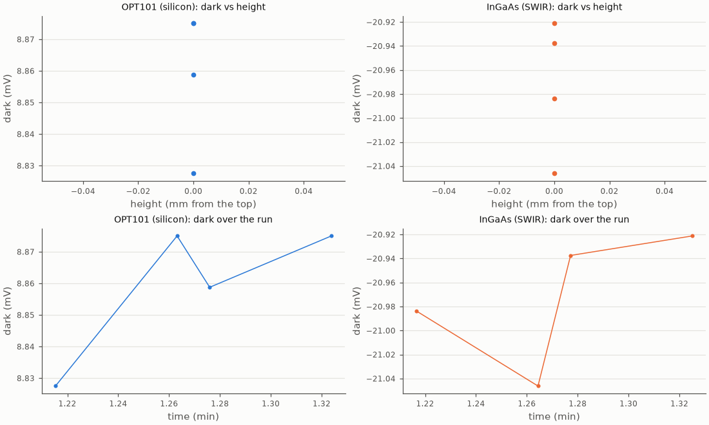
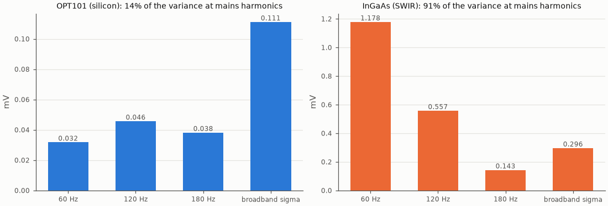

# LIO diagnostic sweep 20261121-121644_scan_electrical

Mode **electrical**, sample **LIO-F-00001**, status **COMPLETE**

## Verdict: FUNCTIONAL

- warnings: T13.T09

## Subsystem health

| Subsystem | Parts | Health | Reason |
|---|---|---|---|
| Link / firmware | Nano R4, USB, firmware | ✓ OK | 1 checks pass |
| ADC / I²C | ADS1115, software I²C D11/D12 | ✓ OK | 1 checks pass |
| Shift registers | U1, U2 | - n/a | not measured: no optical response to compare |
| LED drivers / rails | DRV1 (RAIL A), DRV2 (RAIL B) | ✓ OK | 2 checks pass |
| LED / MOSFET channels | LED1-16, Q1-16 | ✓ OK | 17 checks pass |
| OPT101 | OPT101 (A1) | ✓ OK | 1 checks pass |
| InGaAs TIA | D1, U5, Rf, Cf (A0) | ✓ OK | 1 checks pass |
| Motors / lead screws | M1, M2, ULN2003, couplers, M6 rods | ! WATCH | mech/travel: tracked range 260400 / 333677 half-steps (M1/right / M2/left): the two sides differ (thresholds.motion.travel.range_steps not set: not compared) |
| Stage tracking | lio.stage, soft limits | ✓ OK | 1 checks pass |
| Safety | interlocks, duty budget | ✓ OK | 2 checks pass |
| Power / earthing | supplies, GND, earth bond | ✓ OK | 2 checks pass |
| Optical path / ambient | window, shroud, lid, sample | ✓ OK | 2 checks pass |
| Run | the scan itself | ✓ OK | 1 checks pass |

## Findings to act on

### ! WARN `mech/travel`: travel (top to bottom)

tracked range 260400 / 333677 half-steps (M1/right / M2/left): the two sides differ (thresholds.motion.travel.range_steps not set: not compared)

- **Why:** The tracked travel differs from the configured one (or between the sides).
- **Parts:** stage limits
- **Next check:** Re-mark the top and bottom.

## Dark level vs height (light leak) and over time (drift)

## Dark noise: mains harmonics and broadband

## System

| Status | Metric | Value | Result | Criterion |
|---|---|---|---|---|
| ✓ PASS | `system/link` | 0 unexpected boots | firmware 2.5.2, no unexpected # BOOT |  |
| ✓ PASS | `system/adc` | 142 readings | 142 readings, no dropout |  |
| - SKIP | `system/addressing` |  | no optical response to compare |  |
| ✓ PASS | `system/interlocks` | 0 failed | light_while_moving: SKIP: static mode (no motion); single_channel: PASS |  |
| ✓ PASS | `system/duty` | 252 ms/min | max 252 ms of 1000 ms; 0 cool-down waits, 0 s in all |  |
| ✓ PASS | `system/stage` |  | position [0, 0], limits respected |  |
| ✓ PASS | `system/run` |  | COMPLETE |  |

## Optics

| Status | Metric | Value | Result | Criterion |
|---|---|---|---|---|
| - SKIP | `optics/curves` |  | no down pass in this mode (no height data) |  |
| ✓ PASS | `optics/wrong_rail/h01` | 0 counts | +0 counts on opt101 with the hole selected and RAIL B enabled | < 30 counts (WARN), < 80 (FAIL) |
| ✓ PASS | `optics/wrong_rail/h02` | 0 counts | +0 counts on opt101 with the hole selected and RAIL B enabled | < 30 counts (WARN), < 80 (FAIL) |
| ✓ PASS | `optics/wrong_rail/h03` | 0 counts | +0 counts on opt101 with the hole selected and RAIL B enabled | < 30 counts (WARN), < 80 (FAIL) |
| ✓ PASS | `optics/wrong_rail/h04` | 0 counts | +0 counts on opt101 with the hole selected and RAIL B enabled | < 30 counts (WARN), < 80 (FAIL) |
| ✓ PASS | `optics/wrong_rail/h05` | 0 counts | +0 counts on opt101 with the hole selected and RAIL B enabled | < 30 counts (WARN), < 80 (FAIL) |
| ✓ PASS | `optics/wrong_rail/h06` | -1 counts | -1 counts on opt101 with the hole selected and RAIL B enabled | < 30 counts (WARN), < 80 (FAIL) |
| ✓ PASS | `optics/wrong_rail/h07` | 1 counts | +1 counts on opt101 with the hole selected and RAIL B enabled | < 30 counts (WARN), < 80 (FAIL) |
| ✓ PASS | `optics/wrong_rail/h08` | 1 counts | +1 counts on opt101 with the hole selected and RAIL B enabled | < 30 counts (WARN), < 80 (FAIL) |
| ✓ PASS | `optics/wrong_rail/h09` | 0 counts | +0 counts on opt101 with the hole selected and RAIL A enabled | < 30 counts (WARN), < 80 (FAIL) |
| ✓ PASS | `optics/wrong_rail/h10` | -1 counts | -1 counts on opt101 with the hole selected and RAIL A enabled | < 30 counts (WARN), < 80 (FAIL) |
| ✓ PASS | `optics/wrong_rail/h11` | -1 counts | -1 counts on opt101 with the hole selected and RAIL A enabled | < 30 counts (WARN), < 80 (FAIL) |
| ✓ PASS | `optics/wrong_rail/h12` | 2 counts | +2 counts on ingaas with the hole selected and RAIL A enabled | < 30 counts (WARN), < 80 (FAIL) |
| ✓ PASS | `optics/wrong_rail/h13` | 0 counts | +0 counts on ingaas with the hole selected and RAIL A enabled | < 30 counts (WARN), < 80 (FAIL) |
| ✓ PASS | `optics/wrong_rail/h14` | 1 counts | +1 counts on ingaas with the hole selected and RAIL A enabled | < 30 counts (WARN), < 80 (FAIL) |
| ✓ PASS | `optics/wrong_rail/h15` | 0 counts | +0 counts on ingaas with the hole selected and RAIL A enabled | < 30 counts (WARN), < 80 (FAIL) |

## Electrical

| Status | Metric | Value | Result | Criterion |
|---|---|---|---|---|
| - SKIP | `elec/opt101/coupling` |  | no blind channels measured |  |
| - SKIP | `elec/ingaas/coupling` |  | no blind channels measured |  |
| ✓ PASS | `elec/opt101/dark_offset` | 8.867 mV | +70.9 counts (+8.87 mV) | 0 to 800 counts (thresholds.dark) |
| ✓ PASS | `elec/ingaas/dark_offset` | -20.961 mV | -167.7 counts (-20.96 mV); equivalent input current +21.0 nA (Rf 1 MΩ) | -400 to 2000 counts (thresholds.dark) |
| - SKIP | `elec/opt101/drift` |  | under 5 min of dark frames: too short for a drift estimate |  |
| - SKIP | `elec/ingaas/drift` |  | under 5 min of dark frames: too short for a drift estimate |  |
| ✓ PASS | `elec/opt101/hum` | 0.0317 mV | 60/120/180 Hz: 0.032 / 0.046 / 0.038 mV; 14% of the variance at mains harmonics; broadband sigma 0.111 mV; readings integrate whole mains periods, so it cancels in the measurements | 60 Hz amplitude < 0.3 mV (WARN; not when the readings reject it), < 1 (FAIL); mains fraction < 0.5 |
| ✓ PASS | `elec/ingaas/hum` | 1.1775 mV | 60/120/180 Hz: 1.178 / 0.557 / 0.143 mV; 91% of the variance at mains harmonics; broadband sigma 0.296 mV; readings integrate whole mains periods, so it cancels in the measurements | 60 Hz amplitude < 1 mV (WARN; not when the readings reject it), < 3 (FAIL); mains fraction < 0.5 |
| - SKIP | `elec/opt101/coil_emi` |  | needs hum records, coils off and moving |  |
| - SKIP | `elec/ingaas/coil_emi` |  | needs hum records, coils off and moving |  |
| ✓ PASS | `elec/opt101/h15/select_only` | 0.6 counts | largest on hole 15: -0.6 counts | < 8 counts (WARN); FAIL capped to WARN (gate coupling, LED off) |
| ✓ PASS | `elec/ingaas/h03/select_only` | 0.6 counts | largest on hole 3: -0.6 counts | < 8 counts (WARN); FAIL capped to WARN (gate coupling, LED off) |
| ✓ PASS | `elec/opt101/ce_only` | 1 counts | CE1: +1.0, CE2: +0.0 | < 8 counts (WARN), < 20 (FAIL) |
| ✓ PASS | `elec/ingaas/ce_only` | 1 counts | CE1: -1.0, CE2: +0.0 | < 8 counts (WARN), < 20 (FAIL) |
| - SKIP | `elec/rails` |  | A2/A3 not wired for rail and ground monitoring |  |

## Mechanics

| Status | Metric | Value | Result | Criterion |
|---|---|---|---|---|
| - SKIP | `mech/home_sensors` |  | no home sensors fitted |  |
| ! WARN | `mech/travel` | 260400 half-steps | tracked range 260400 / 333677 half-steps (M1/right / M2/left): the two sides differ (thresholds.motion.travel.range_steps not set: not compared) |  |
| ✓ PASS | `mech/lockstep` | 0 moves | 0 moves; 0 ended with the two sides at different positions (without home sensors only the commanded steps are seen: a side losing steps shows as mech/step_loss) |  |
| ✓ PASS | `mech/settle` | 602 ms | median 602 ms, max 602 ms (mechanical wait 300 ms) | max - median < 500 ms (WARN), < 1500 (FAIL) |
| - SKIP | `mech/backlash` |  | no down-pass reference curves (static or continuous mode, or no strong channel) |  |
| - SKIP | `mech/step_loss` |  | no down-pass reference curves (static or continuous mode, or no strong channel) |  |
| - SKIP | `mech/repeatability` |  | no down-pass reference curves (static or continuous mode, or no strong channel) |  |

## Ambient

| Status | Metric | Value | Result | Criterion |
|---|---|---|---|---|
| - SKIP | `ambient/opt101/leak` |  | needs dark frames at 4+ heights |  |
| - SKIP | `ambient/ingaas/leak` |  | needs dark frames at 4+ heights |  |
| ✓ PASS | `ambient/opt101/flicker` | 0.0456 mV | 120 Hz amplitude in the dark streams 0.046 mV; readings integrate whole mains periods, so it cancels | < 0.4 mV (WARN), < 1.2 (FAIL) |
| ✓ PASS | `ambient/ingaas/flicker` | 0.5573 mV | 120 Hz amplitude in the dark streams 0.557 mV; readings integrate whole mains periods, so it cancels | < 0.4 mV (WARN), < 1.2 (FAIL) |
| - SKIP | `ambient/lid` |  | optional operator step (lid ajar at two heights) |  |

## Trend

| Status | Metric | Value | Result | Criterion |
|---|---|---|---|---|
| - SKIP | `trend/control` |  | needs 5 baselines of LIO-F-00001 (have 0) |  |

## Not measured (capability)

- rail_monitor: A2/A3 not wired for rail and ground monitoring
- home_sensors: no home sensors fitted
